# 【伦敦帝国学院】深度图学习 ｜ Deep Graph Learning p10 P10_3.2_图神经网络的归纳能力——基于图的学习 -BV1WZUKBmEQA_p10-

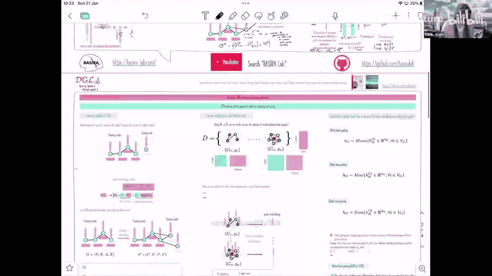

I'm going to leave you with this and then we will hit the second part so here。😊。

Here is the question and we're going to have a short break so the question is。What happens？

If we don't connect the note。😡，Can we still predict its output scores？We're right here。

And you can answer this mathematically if you understand how we aggregate。

 how we transform the components of the aggregation function that we talked about over and over again。

You should be able to answer this， okay， so we'll have the answer in the next section。

So now after thinking about this， I hope that you guys got the right line of reasoning so as I mentioned it is important to have logic and even if you don't get to the right answer having you know like a very thorough and clear line of reasoning including different components is important then we'll try to identify which element of your logic is maybe incorrect that may have led you to that incorrect answer okay so here let's start with first the you know so lets let's dig a bit deeper okay so we started with a note we said we have a node。

Our testing node has arrived and we want to predict its target scores Okay so here we have also the node has its original embedding or original features。

 the long feature vector with so many redundant and irrelevant features and we want to kind of map it onto a space a lower dimensional space that have of dimension DK and the original features belong to RD right and D should be so is so okay so so DK is much smaller than D okay so this is you know our embedding so the idea here that the question here can we get the embedding。

At the last layer of this test node without connecting it all right。

 can we get this can we get this embedding in this kind of you know lower dimensional space so。

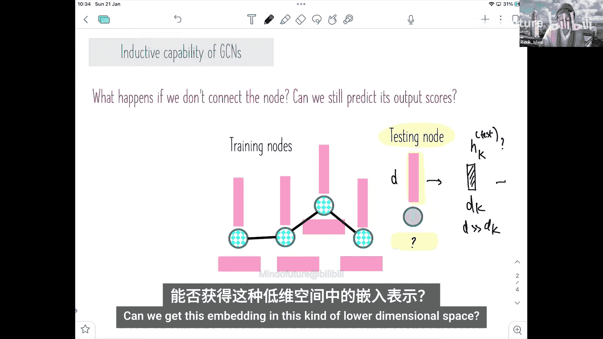

First let me remind you of the node embedding rules so or the node embedding update rules so here we have basically our update rule and there are different update rules i'm just taking this one here for for this example。

 so we have what we call two different。Components right we have the self encoding。

 which is the self connection。 right remember this node this node is always self connected。

 so even if we do a simple naive you know。An naive GCN and this is a bit more advanced because we have the bi season we do the separation right but even if we have an naive GCN the separation of these terms I mean like we put them like we kind of disentangle them but so here they were all entangled or integrated into this aha matrix adjacency matrix and this has two components the neighborhood component so this is you know basically who my neighbors are and this is myself right the self componentent and here we can always use the selfcomp so basically when you take the the original features the x test so we're going to feed them through this through the omega1 until you know like all the way down to omega K right all these mappings in a similar way as we did before to the connected note but what happens here。

The change that will occur is that the neighborhood encoding will not be there because this node is not connected。

 doesn't have any neighbors， so we have no neighbors。

 so this boils down basically to a simple you know MLP or a simple kind of mapping selfmapp so the node is is independent of others and this independent reminds us of you know at the beginning of lecture to DGL2 right so we talked about how samples were completely kind of independent individualistic right so they are very independent so here here we fold back onto that learning paradigm so this node is independent so that's fine but you can you know focus on only inner our self or selfcon but we can still kind of you know res you okay so here we're going to use a selfencoding。

And we can pass this through all these kind of， you know。

Learned transformations g and transformations the layers of the gn and add a bias here if you want to add a bias and then activate using non nonlinearity and we're going to get our embedding right here so we can get this so the answer is yes。

 we can now yes we can is。I all right， but what are the pros what are what are the disadvantages to doing this So one potential disadvantage is like we fall back as I mentioned onto the you know like the individualistic approach so individualistic so we look at the individual and we are not we're not looking at the you know at the coindependence between this node and the relationship between this node to all other nodes in the graph and the training set so this node considered independently okay and also the other thing is that we're losing this term this term is very important because this term right here is what makes what defines the power of GNN so GNNs are based on this idea if you remove this right you're going you're going to get a simple you know multilayer perceptron which is a simple deep learning model right so everybody's trained independently and this is a default kind of you know。

This is a variant of GenNN， so you can always transform GenNNs onto you can transform a GNN can become a simple。

 you know， deep neural network if you remove when removing when you remove when removing。

The aggregation function across neighbors okay so this is very an important property here so now the answer is yes we can。

 but it has several disadvantages we're losing the power and the compelling capacity of the ATNN model。

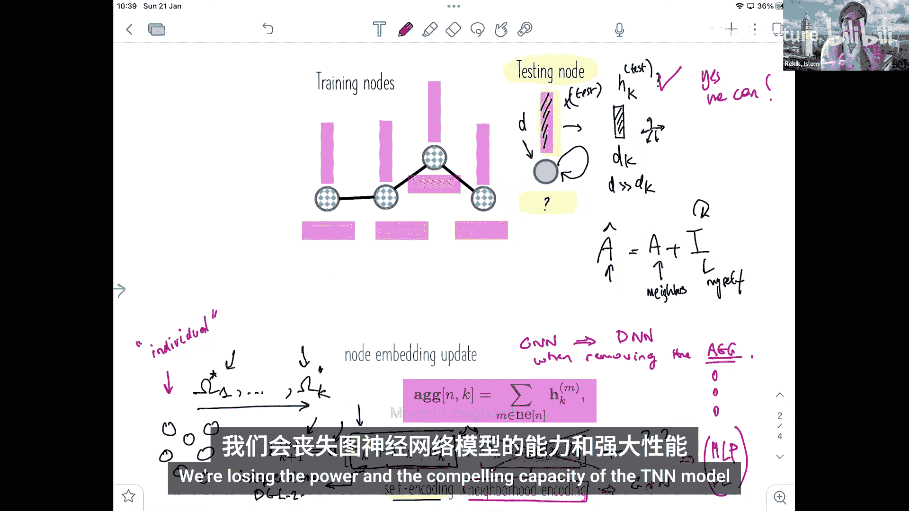

So now。

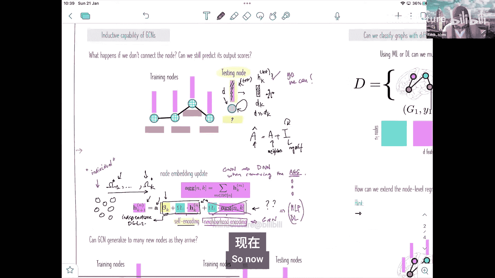

This is called the inductive capability of GCN so GCNs can easily generalize can easily generalize to unseen samples and this is one thing that is very compelling about GNs and GCNs so the next question is。

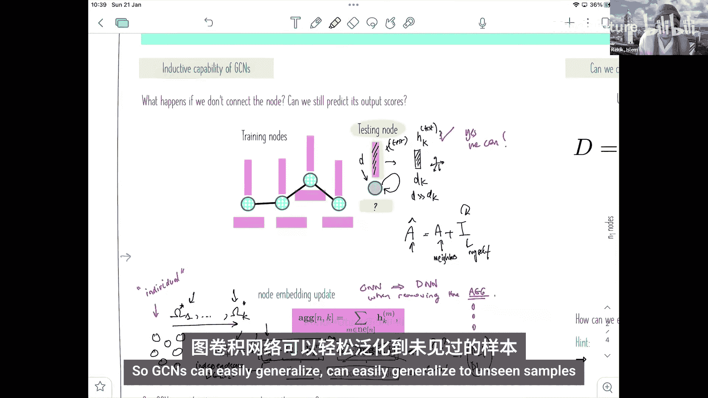

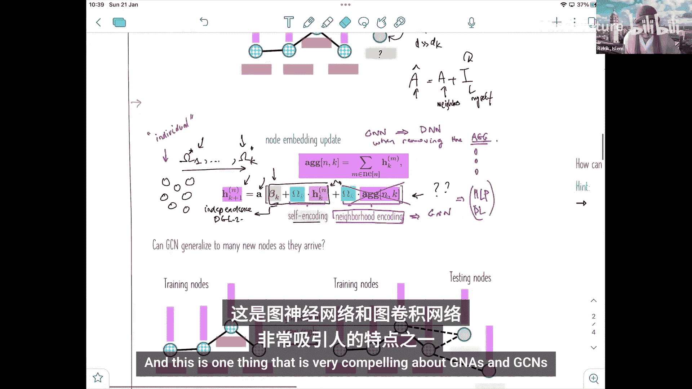

Can we generalize to many new notes as they arrive many new node， so we don't have only one。

 we have many and you guys can think about it and。

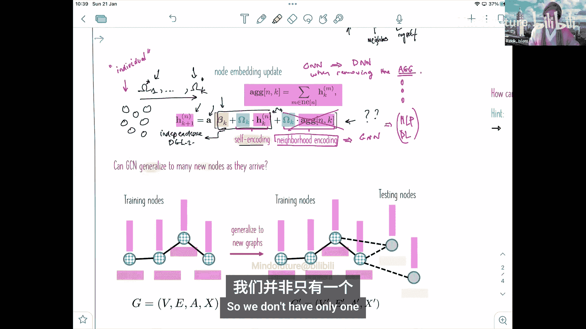

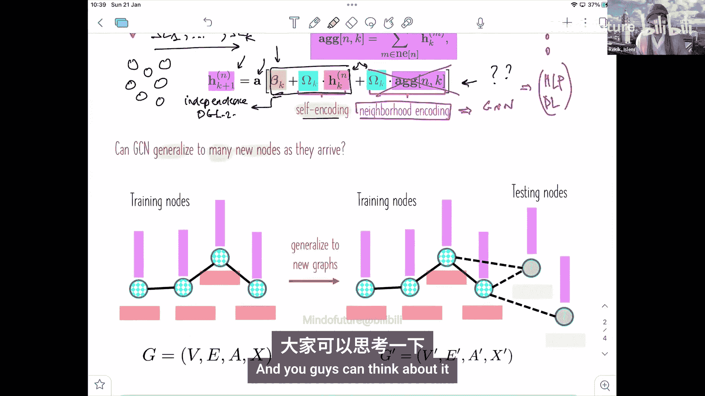

If you take a few seconds to think about it the answer should be yes okay it's the same thing so if we have a graph with V notess E edges an adjacency matrix a and x right is the feature matrix and then we're going we can easily generalize two new graphs where we add new testing notes here we have two new testing notes okay and we want to predict their target score or so basically if we connect them right to this graph and we're going to have we need to update the set of notes because we added two edges we have three new edges here to add right and then the a matrix a prime because we increase the size of the matrix and we added these new to em it you original embeddings so our original feature matrix x prime here for graph G prime。

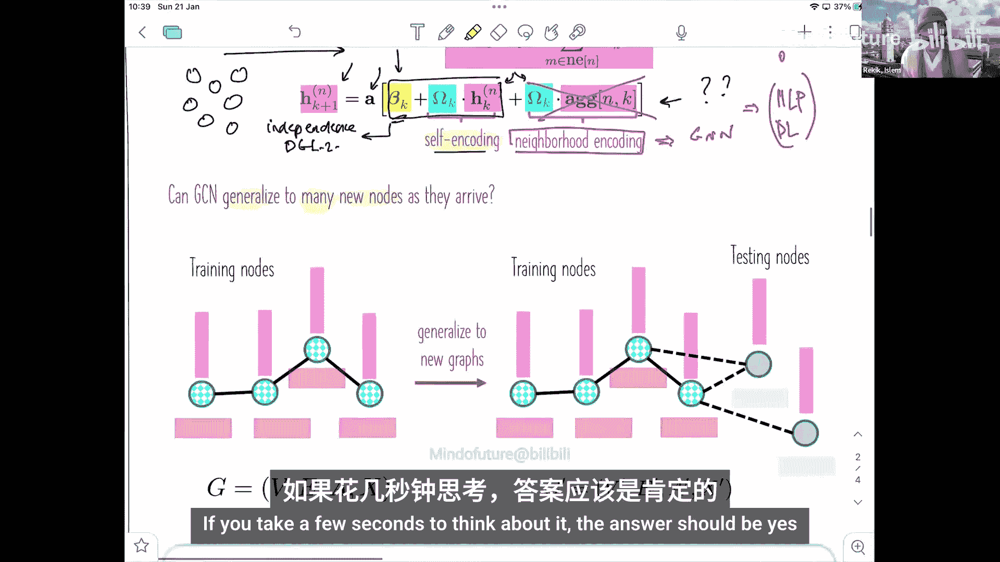

So。This is a very compelling property of a graph neural network and let's try to look at all these beautiful properties that make gens very powerful。

 very generalizable and also outperform you know kind of。

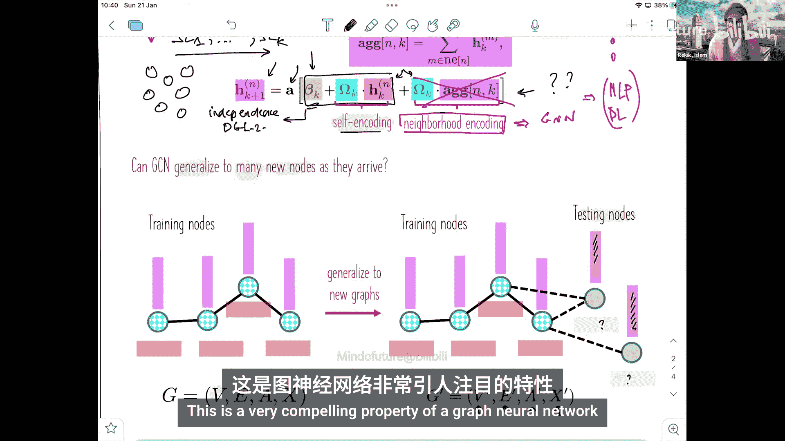

A lot of conventional deep learning paradigms okay so going from individualistic approaches to collectivist approaches and then generalizing to things that are very dynamic like mapping you know generalizing to unseen graphs vary with varying dimensions with varying properties and this something really powerful okay so first。

😊，The first thing is that one of the most compelling aspects of GNN models lies in their in depthive capability where we can easily generalize to new graphs with varying sizes and even like sometimes I would say。

 properties， okay？So we will see a few more examples also in the coming sessions。

And the second one is why we have this power that's a key question so now we do have a power。

 this power stems from the feature aggregation and the parameter sharing at the node level。

 so the feature aggregation means that here we are doing the aggregation function right so if we have a node so let's say for example。

If we're going to look at immediate node so this node right here has you know these two nodes as neighbors right so we do the aggregation the aggregation allows us to kind of you know take into account the the topology and the interrelationships between different training samples so here we're looking at the codedependence between different training samples and also the parameter sharing which is so important so the parameter sharing if you guys remember when we do the mega right when we apply the omega here our mapping function let's called it omega right so or we can write it a bit differently so if we look at the update wheres the update rule for yeah so here so this is important so the update rule for a single node right is we're taking an omega K that depends on layer K here。

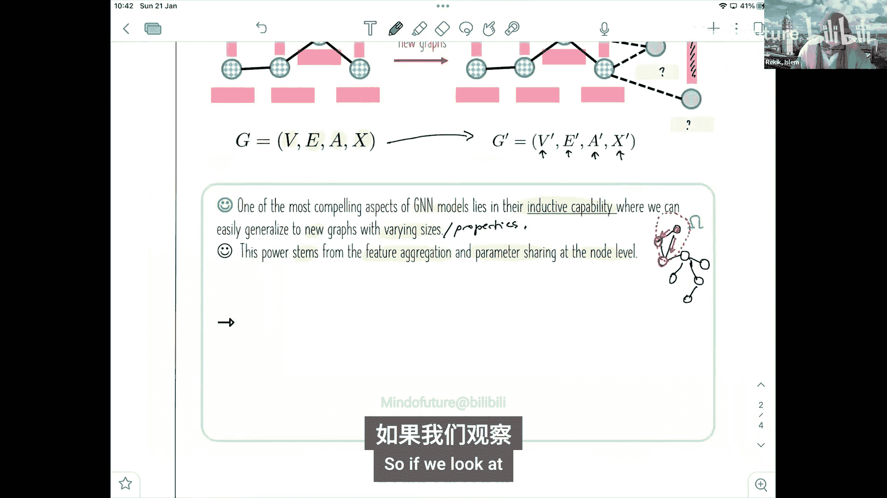

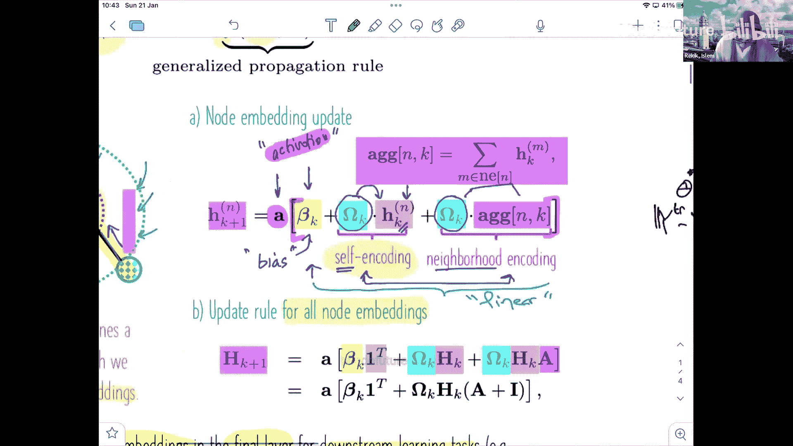

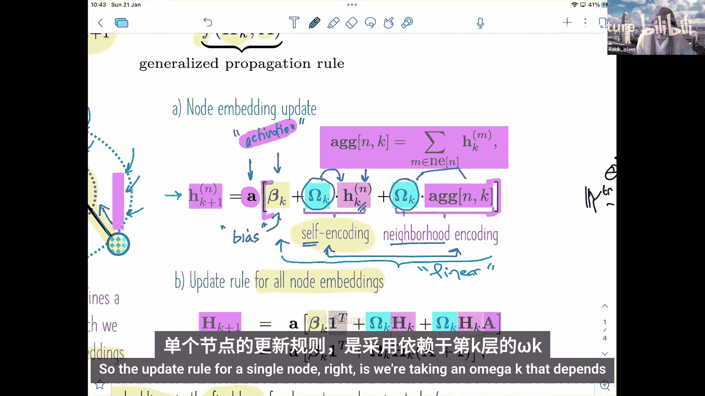

So which means if we look at this， so this this is what we covered earlier okay。

 now if we look at this update rule， so the the nodeW embedding update rule。

 we have the omega K does it depend the question is does ga K depend。

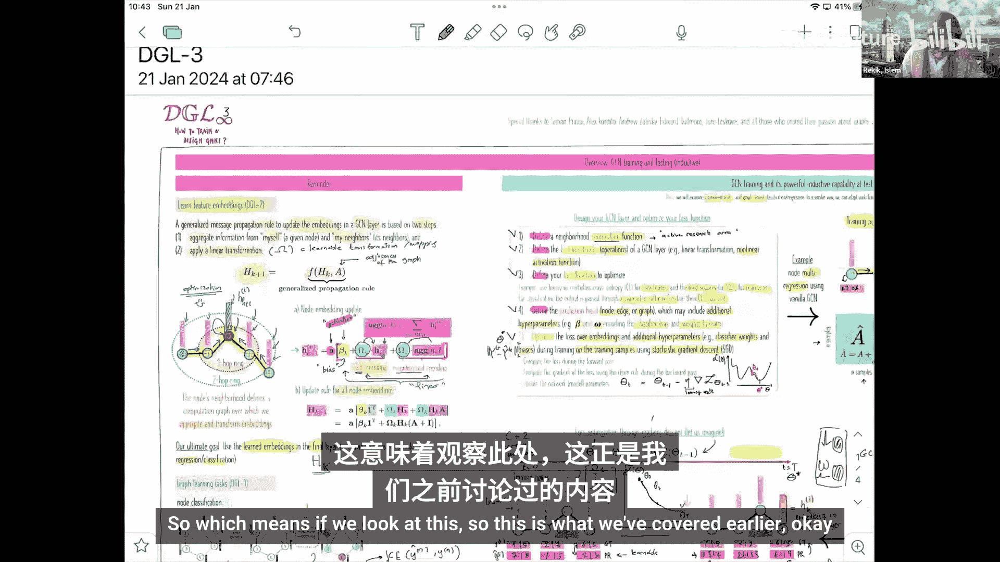

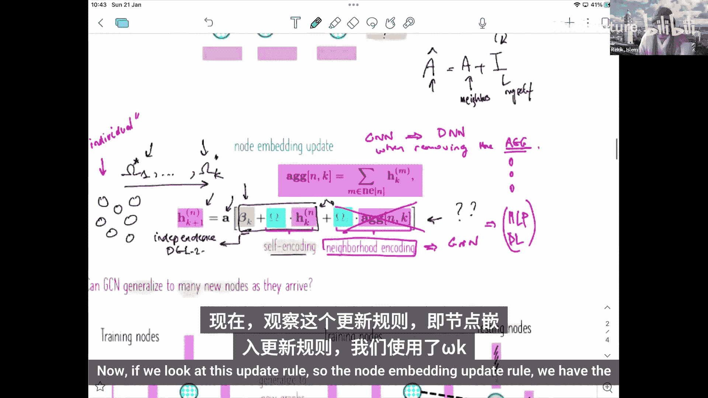

On the node itself， do we have a superscript here？And。No， we don't。

 which means that this omega K is applied to each node in the graph。 It's shared。

 It's a shared parameter。 It's a shared mapping that we are learning at any node in the graph。

 So the omega K here is applied to every single node and it does it's you know in the graph you know looking at this topology So here if we look at this node right and we check its neighbors has only one neighbors so this is the node and this is its neighbor right so this omega K will transform the embeddings if we put the embeddings here using you know kind of these vectors right vertical lines right so it will transform all of these in a similar way Okay so we're gonna get different values but we're applying the same omega to all of these guys now。

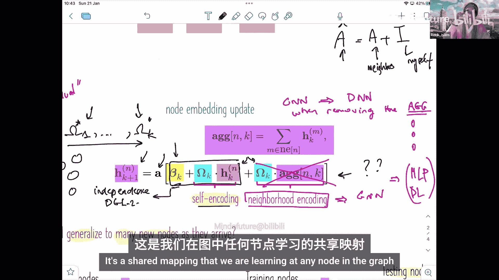

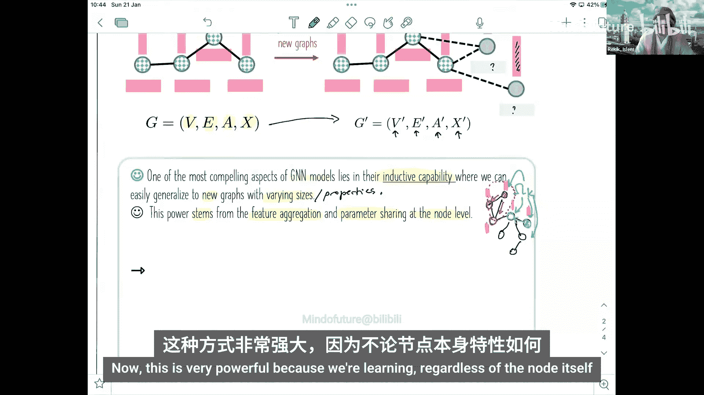

This is very powerful because we're learning regardless of the node itself。

 regardless of where the node is in the graph is an important node is it a you know like a node that with heavy connections central node we're learning the same transformation this transformation is kind of position agnostic it doesn't care about the position it looks at the node and basically applies the same parameters and this has a lot of nice properties so let's look at this。

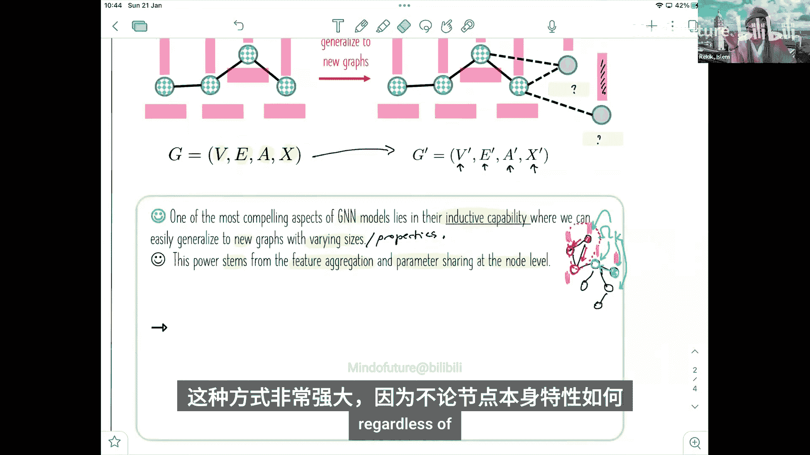

So here。One step at a time， so what happens if we don't share the parameters across all nodes so。

I want you to take a moment and think about this too。So here， what does it mean？

If I have a note right here and another note， guys， I'm going to build a graph。

And we're going to apply mega K， so let's say we do not do the sharing。

 so what we're going to have is for this graph and maybe we have another note here okay。

 for this graph。We're going to apply k for each node so let's call this node1，23，4。

 so we're going to have omega for12，34 so we're going to transform all these features right differently all of these features the features or the embedding the original features of these nodes differently and all of these that are stored here now we're going to have loads of of omegas right so the problem is you're going have an omega for each layer K for each layer K you're going to have omega K and then you're going to repeat at n times right so you're going to have it from node one to end nodes。

And this is only for one single layer， so you're going to end up with a huge number of parameters to optimize for each node。

And the problem is， if you have a new graph with a completely different apology。

 if I have a new graph。So let's say I have a new graph like this， right？

How can I generalize here so which omega i'm going to apply I don't know right because should I apply the omega of node one node two node3 oh maybe I can reason that well maybe node three because it has this kind of you know V shape but two has a V shape one also so I mean it's very difficult right so you can decide you can generalize easily if you don't share parameters so。

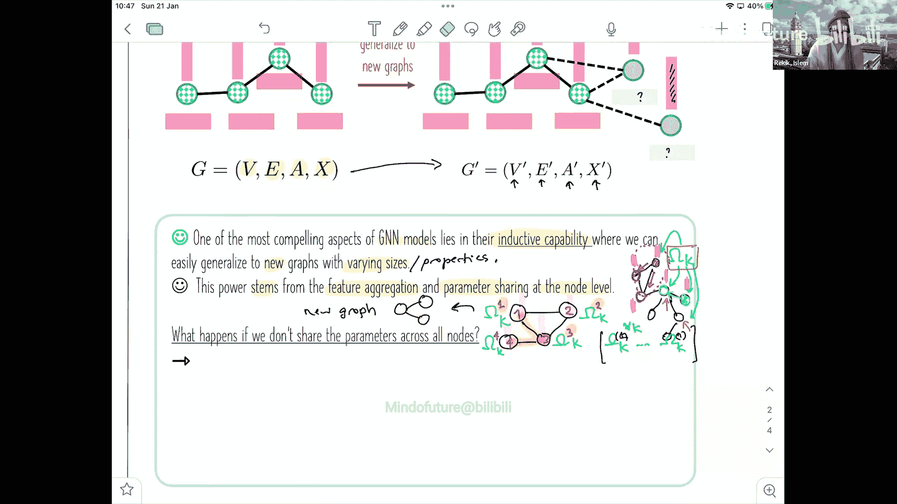

Basically here this is summarized here so we could learn a model with separate parameters as I explained。

 associated with each node however there is a big however the network must relearn the meaning of the connections in the graph at each position so when we want to kind of test we need to relearn these mappings you can test it right away and the training would require many graphs with the same topologies so you need to have graphs with similar topologies if you have graphs with complete different topologies or number of nodes or you know like edges then you can apply this but if you have graphs with the same number of nodes and edges like you know you're having something like this similar very similar topology right。

So with you know edge weights kind of， you know， changing a little bit， so maybe you can so yeah。

 so maybe you can you can train。But if you don't have something like that。

 then it's kind of difficult to train such models。 so parameter Sha this omega K and this equation that does not depend on the node n。

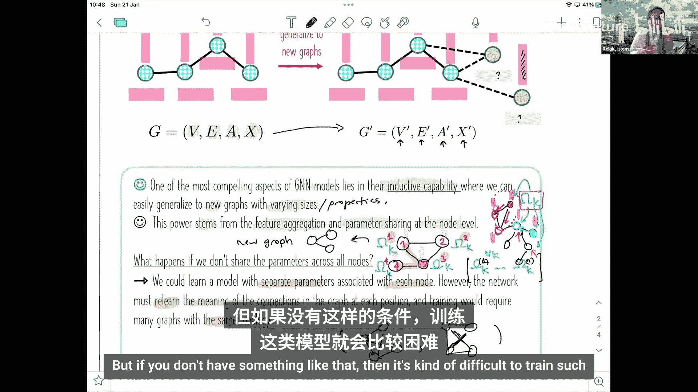

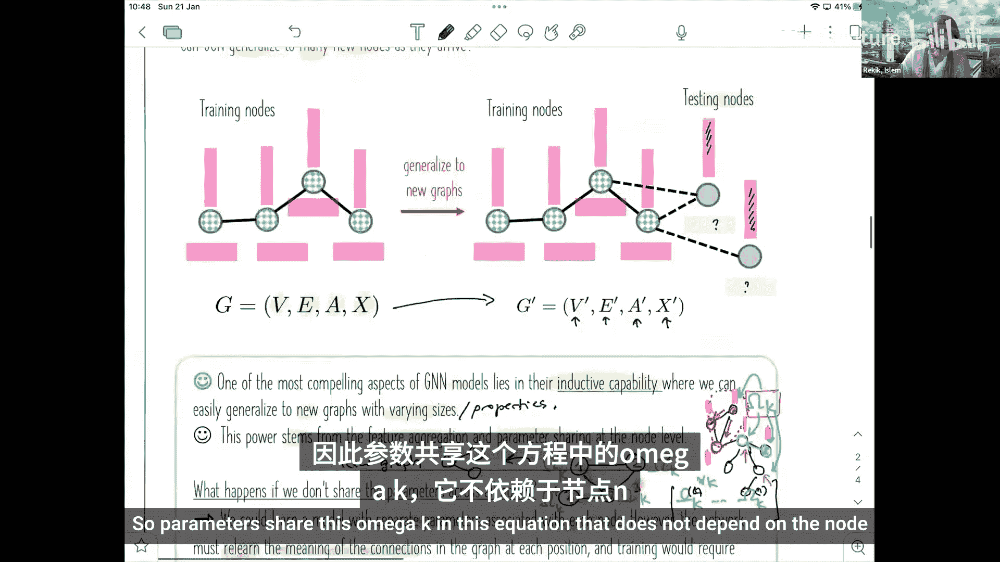

Has so many powerful properties and we can see it now clearly okay very good so now we're going to move to the next board and we're still in the exploring the GNN training and testing the inductive paradigm okay and the powerful inductive capability of GNNZ testing so let's look at this example。

😊。

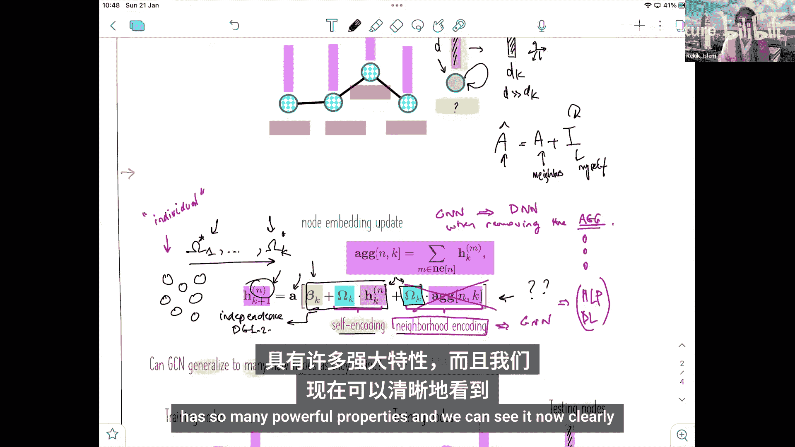

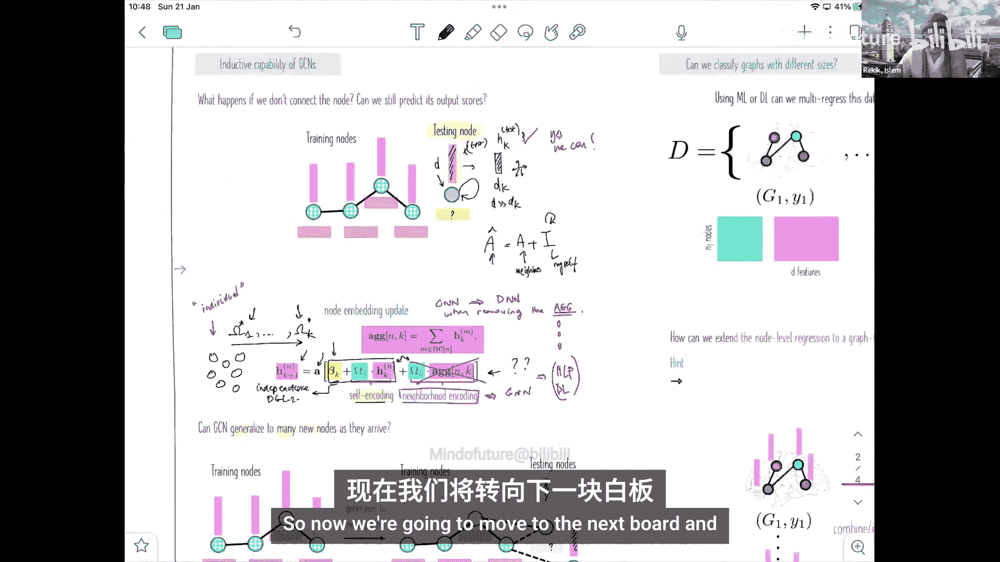

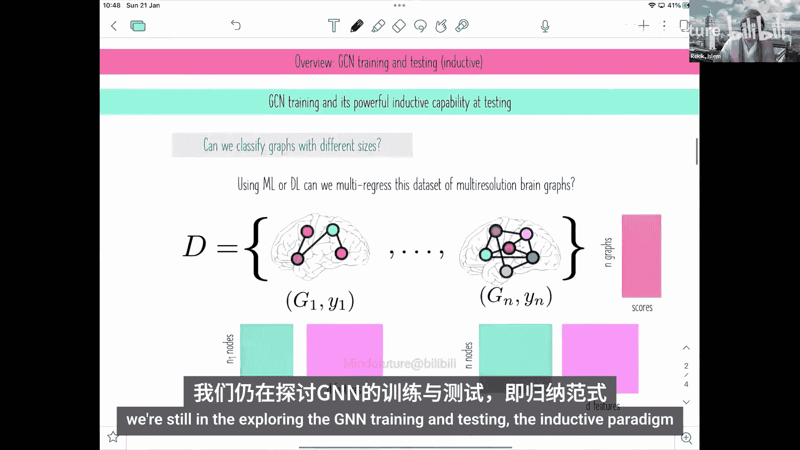

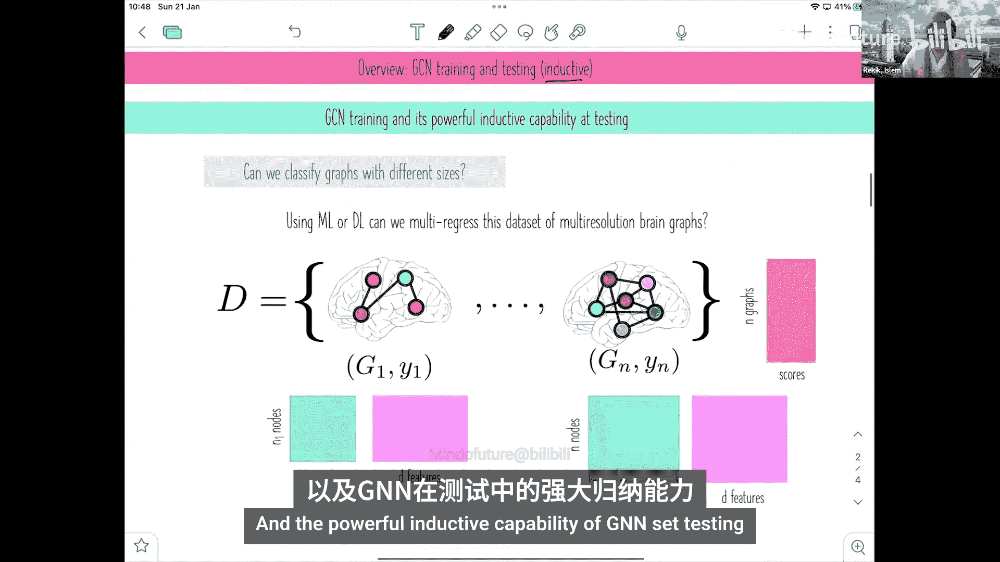

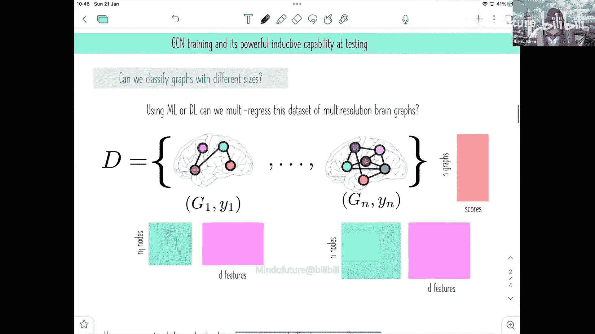

This is another example。And another question。

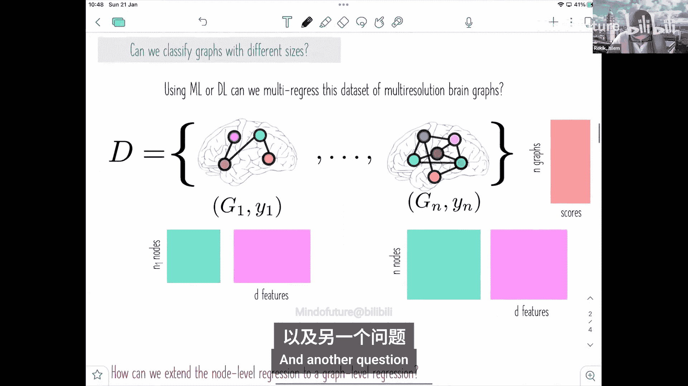

So。So imagine we have brain networks these are different brain networks we have a data set D D is composed of different graphs of course a graph has all the adjacency matrix we may have also you know the features okay so the features that me so we have graphs so graph1 to graph n all right and then we have a bunch of score vectors so these are vectors so here for each graph so for each graph we have a set of scores。

And this defines， for example， Y I for graph I， all right。So， now。Here。

 if you look at this what we have we have graphs with different sizes。

 so if we have the first adjacency matrix， this is the adjacency matrix of graph1。

 this is the adjacency matrix that's center it of graph N and then we have x。Of， you know。

 this is the feature matrix of。This graph， and then we have X1。

The feature matrix storing and the feature the feature embeddings of all these nodes okay so let's imagine we have also kind of each node has its own features okay so like this we' going to add all these features。

All right， now the question is。These are multi resolution graphs right so you can see the number of nodes are different so if we wanted to use machine learning so let's say this is a data set。

Okay， and I want to use。You know， maybe only the features， okay， so I want to use these features。

And the graphs right the graphs themselves which are the weights because we have weights here。

 so if you want to do classification， so let's think about this a little bit together。

If we want to do classification here we have different number of nodes so let's call this you know so okay。

 so here n1 and this is you know n I'm going to call F last or n big n maybe okay so。

These are the different number of nodes we have in graphs and then you can see that these vary a lot right so we have different number of nodes that's the idea so you start here from n1 by n1 matrix but then you end up with a n by n and you may have different number of notess in these in this set of graphs so the question is if you want can we use ML or tl to multiregressive data so our goal is to predict this y so this is the y that we have right here and all of these are training samples all right。

So this is all the training data that we define and then in this training data set。

 using this training data set， we want to kind of predict the scores for a new coming brain graph with a different。

Tapology， completely different topology。So if you were to use ML or DL。Can we。

Do the classification or the regression of these adjacency matrices。

 So if you want to vectorize the matrix and take the weights here plus the features， Okay。

 so when you vectorize the matrix remember so we're going to have n1 times n1 minus。

One divided by two， so this is the these are the number of elements the in the of diagonal and the upper triangular part of diagonal elements excluding the diagonal。

And here we're going to have n n1 divided by  two。 So if we were to train a deep learning model。

 our training sample。

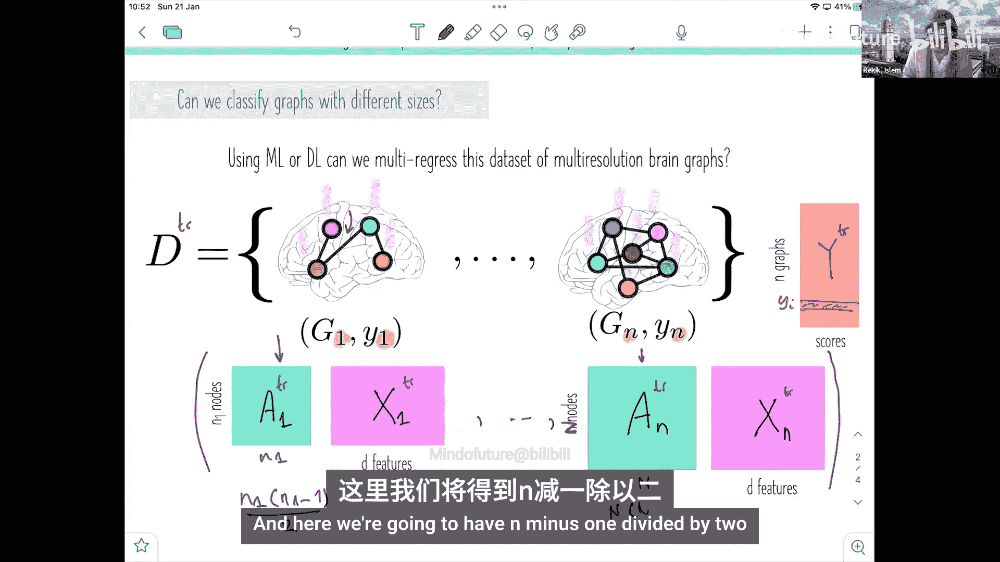

Will have a varying number of you know total kind of weights or input features if you will count the adjacency matrix which is important in brain connectivity。

 this is important because it shows us the interactions strength and correlation between different parts of the brain different regions in the brain okay or regions of interest in the brain ROY so well obviously even if you want to train an SVM classifier this will not work let alone a deep learning so same thing so you have a mismatch in what we call a mismatch。

In dimensionality， right？You have a mismatch in dimensionality。

And even here the same so here you have n even for the features you have big n here。

 you have small n here， so n1 so these are of different dimensions。

 so if you have a data set like this and you want to use ML or DL this won't work。

Unless you harmonize the features somehow， you need to harmonize the dimensionality of your features to be able to train the model on the same number of features right and they need to have the same meaning right so they need to be in correspondence to do some feature selection and mapping if they're not then you cannot do that so。

This problem can only be solved with Gens and this is the power also the inductive power of a graph neural networks so here how can we so here is the question how can we extend the node level regression that we have seen previously as you have seen the details of the node level regression so we did multire to a graph level regression so what do we have here guys we have a whole graph right so it's a whole graph so we're not taking only we're not classifying a node we're classifying or we're regressiongressing a whole brain graph so the why here could be anything so for example giving this brain let me do this here so giving this brain we want to predict these values so what are these values so these values actually this should be the last one so。

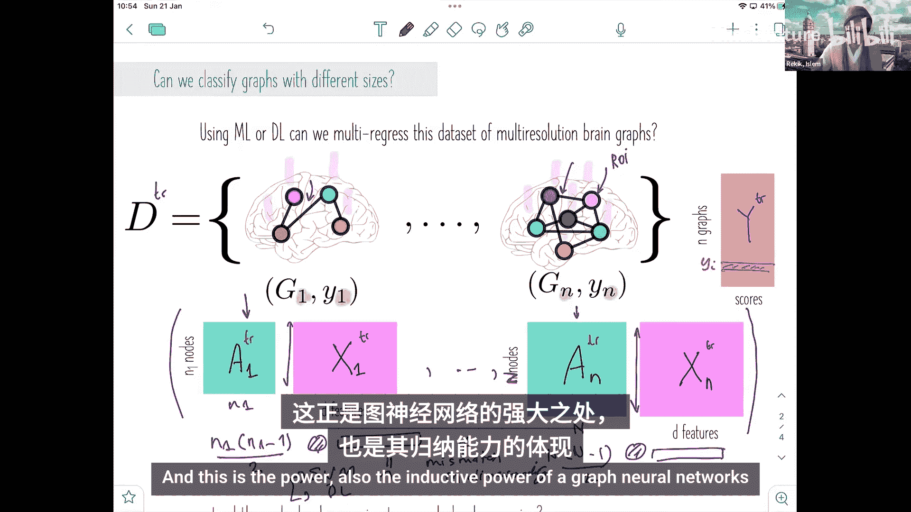

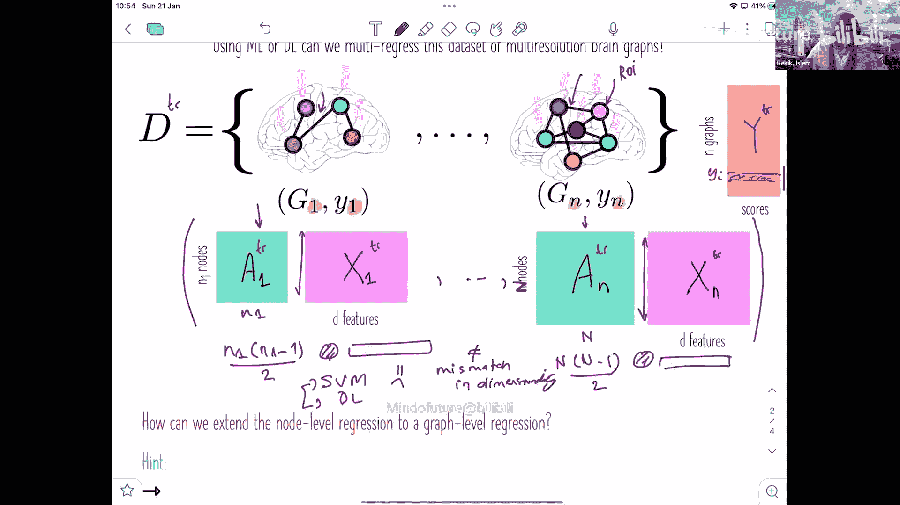

Here。

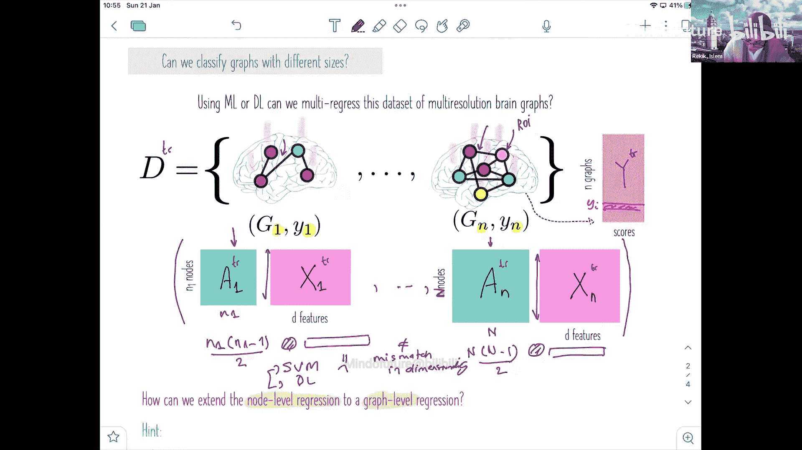

To keep things consistent so these values could be for example the age of the person so let's say 70 the IQ of the person I don't know if it could be any kind of number so 11。

2 so different kind of scores that we want to predict based on this brain graph topology so N also the brain which is the adjacency matrix or the and the brain graph features which we have measured at each node right so。

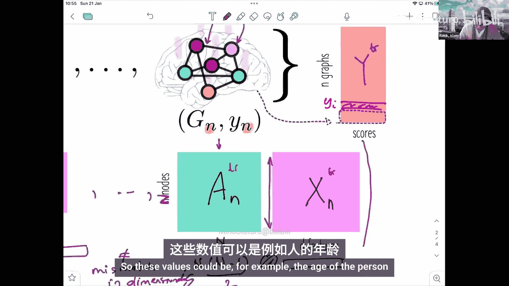

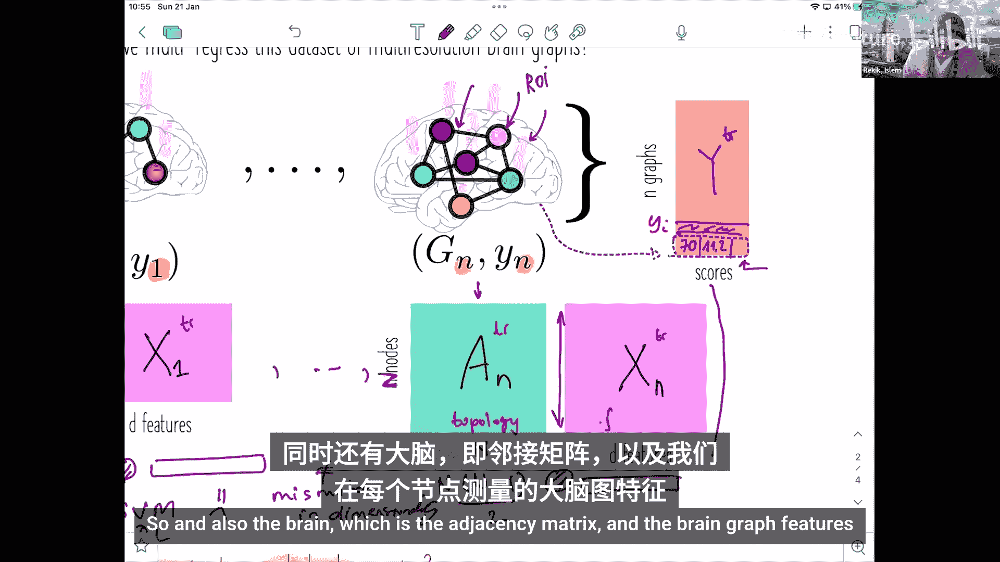

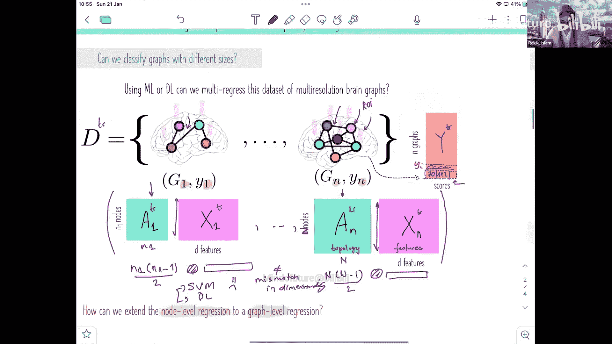

Let's take a minute， I want you to stick a minute。And。Also pause the video and think of that。

Based off the node features， the node embeddings that we learned， the HK final layer， how can we？

Adapt that or kind of take it to the next level where we'rere we're。Doing graph。Reggression。

 whole graph， entire graph regression or classification。So I can give you a hint here if you want。

But it's something very interesting to think about and you should be able to get the solution or at least。

Get， you know。A good idea that will allow you。To use the node embeddings。

The concept of node embedding to do graph whole graph embeddings， whole graph embedding， okay？Cool。

 so the hint， let me give you the hint。Leveraging the power of integration。

So let's take a minute to think about that。So here。

 basically we can easily leverage the power of integration。

The basic idea is to first learn an embedding for each node。

 so if we learn the embeddings of these nodes using the conventional node based the node embedding rule。

 then all we need to do is to integrate those and if we integrate them so we use an integration or a combination function integration or a combination。

Function or operation we can get a single embedding so let's put a color pink here so we can get a single embedding and this h will represent。

 for example so I can layer K our graph G1 Okay so this would be a combination of all these four nodes。

 for example， we do the same for this graph so let's look at the solution together。

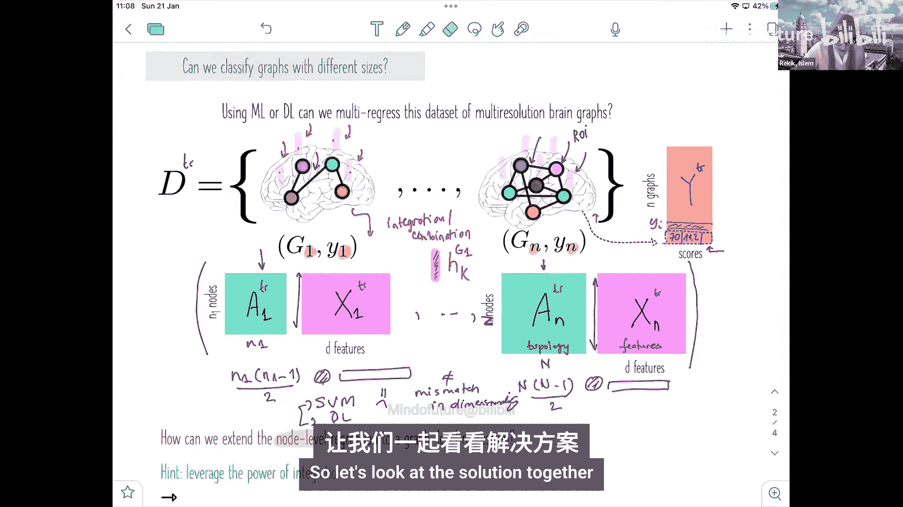

So integrate， basically， we can integrate。So let's look at this one second at a time， okay。

 so one more step at a time。So we can integrate the node embeddings across the whole graph and use the integrated embedding or the final one or the output embedding to solve the same optimization problem for node based learning or node based regression so we fall back onto the this kind of optimization paradigm that we had before。

 but now we're going to do it for the whole graph。

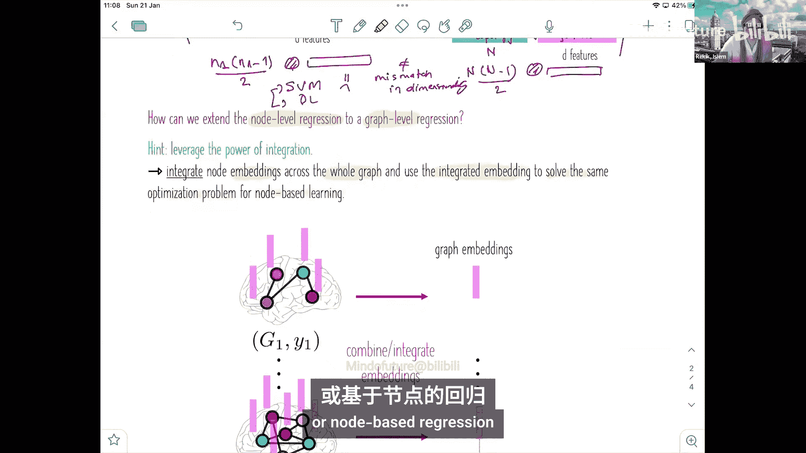

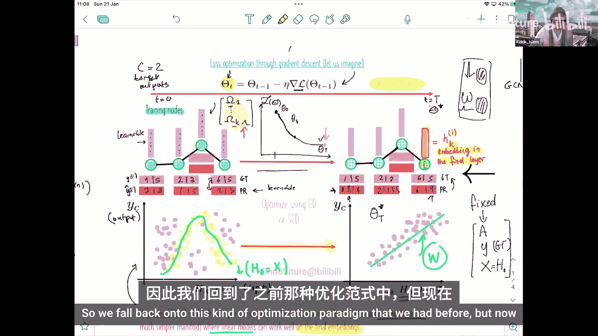

And this will require us to introduce a simple integration。Operation okay。

 so how to integrate that's the question that we need to ask right now So what's the best way of integrating all these kind of node embeddings So so yeah。

 so through the integration process we do we transform let's take color So we transform each graph the whole graph onto a single kind of the graph node embedding onto a single embedding all right so through this process we will get our set of。

So these are all the graph based node embedding， so we're going to have N graph embeddings for N graphs。

 okay。

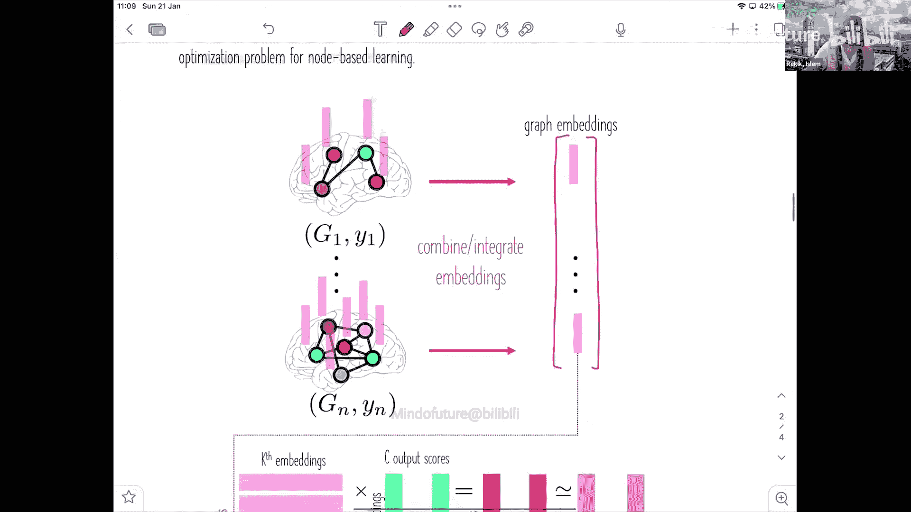

And then simply。All we need to do is basically put these embedding， stack them in the same way。

 So here instead of having a node embedding we're going have a graph embedding and we're going to have a a graph you know like we're going to predict the score the scores the target scores for n graphs okay so that's the only thing that we change and the mathematical formalization and optimization loss of all of these of this graph based learning or graph based regression or classification we're doing graph classification we're going to use across entropy loss and we're going to have a sigmoid also layer as we have here so it's very easy we can easily generalize this to also graph classification using this prediction hand okay very good now great so now we have basically。

😊。

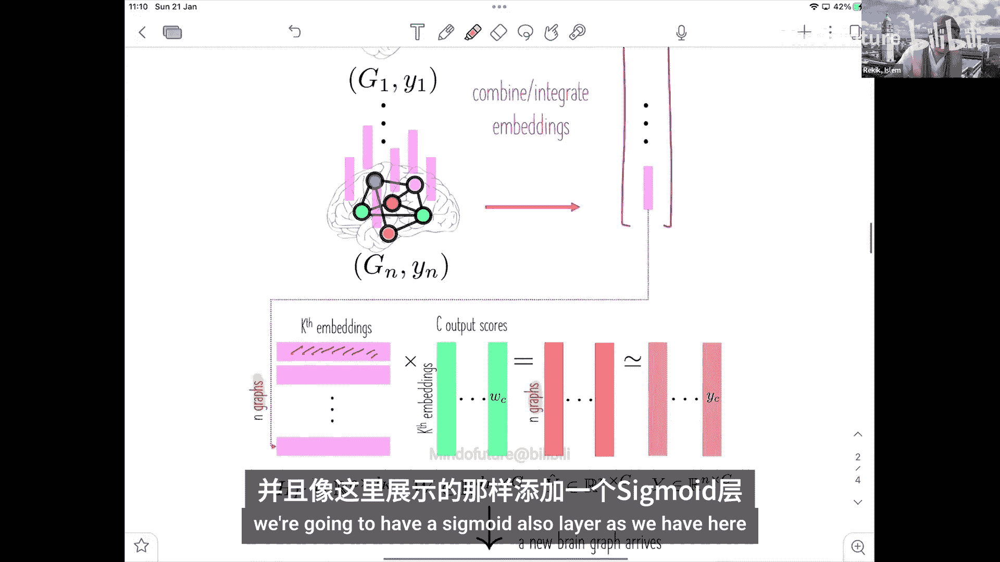

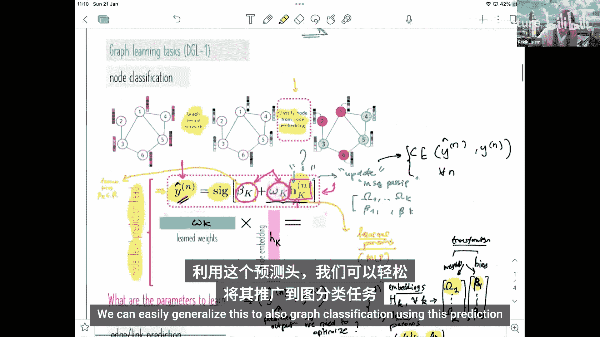

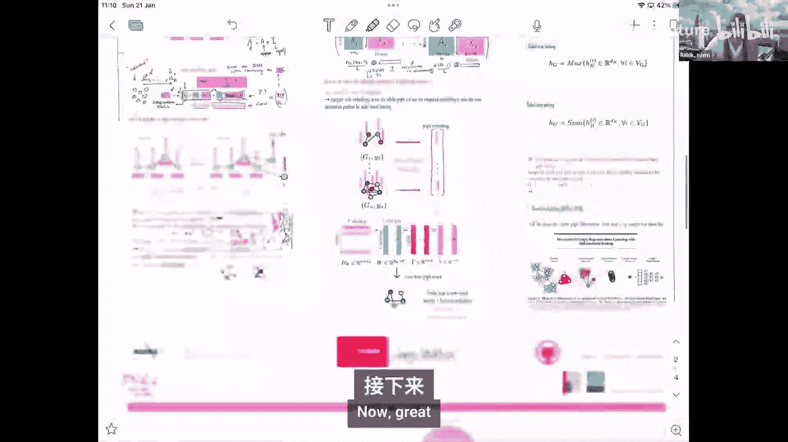

Formalize this is very easy so we need to kind of integrate or combine and then we solve the same problem。

 but we have graphs here represented instead of nodes whole graphs so。诶。

The mathematical formalization is the same so N graphs decays them the size of the dimensionality of the final embedding space or the final embedding representation space we have C scores it' it's a multi score multi regression problem and now a new graph a new brain graph arrives so we have a new brain graph and you guys can see that the new brain graph has a different topology so to do the testing now we need to test or predict these scores so to test。

We need to test our model。Our learned model。Learned。

Model theta star with all the parameters that we defined earlier。And it's very similar steps。

 so we have similar steps to node based learning The final node embedding， however。

 we need to kind of add an integration prior to the supervised learning mapping so we need to integrate so there' is an integration step that we need to perform right here okay and when we do the integration we basically we do the same pass the same forward pass through all the omegas and then after we do the same forward pass we're going to so we explain this so we do the forward pass right here so we had it earlier here we go so a forward pass through the Gn layers but now instead of having a node we're going have a graph to。

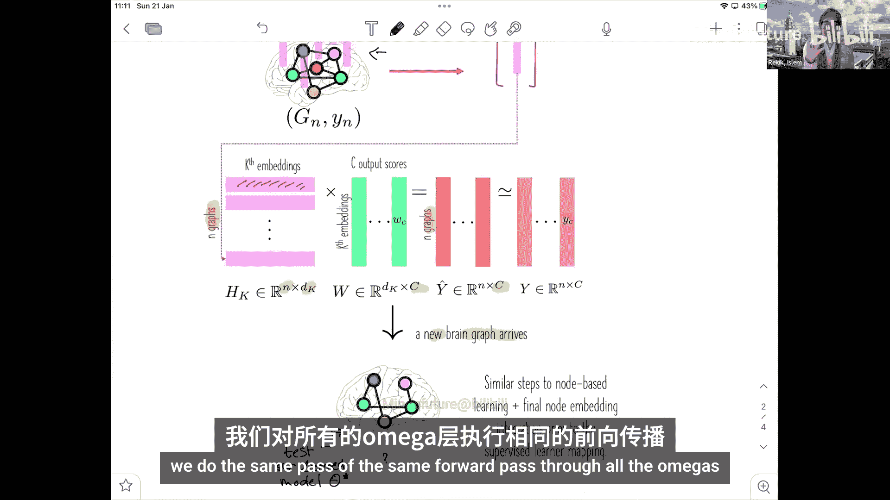

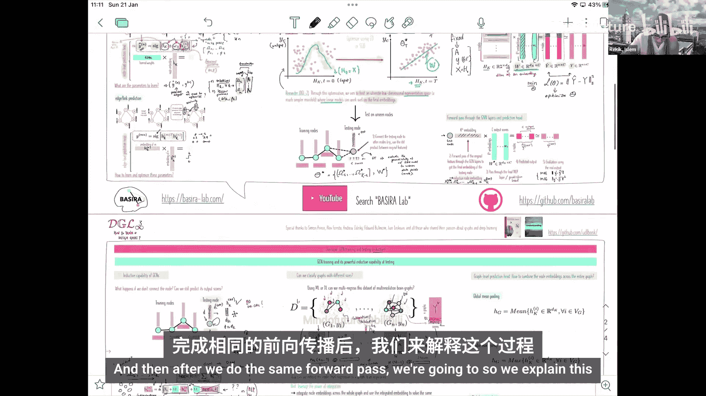

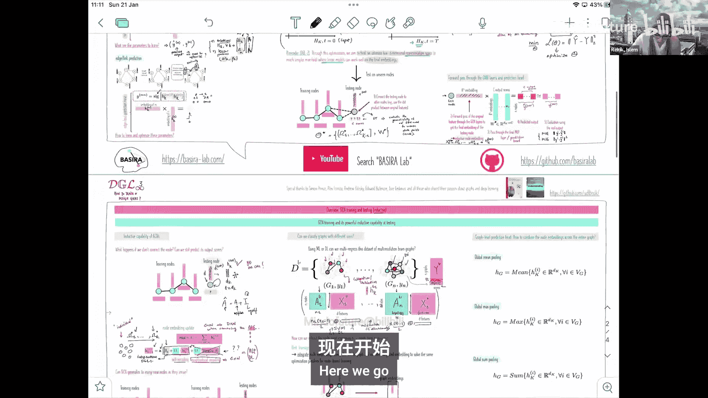

Regress okay and we pass this graph embedding now it's not a notbedding graph embedding through all the omega layers you know to get first the the embeddings of all these nodes we integrate we get a single embedding right and then from that single embedding we do the forward pass through the final you know prediction head and we get our predicted scores okay so that's how we do the prediction for the testing for a new graph right here in this graph here we。

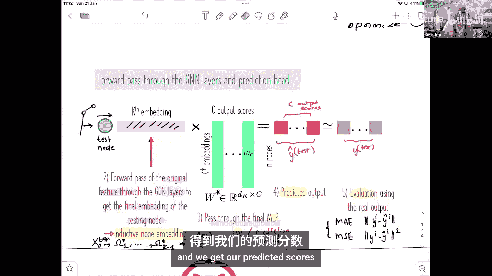

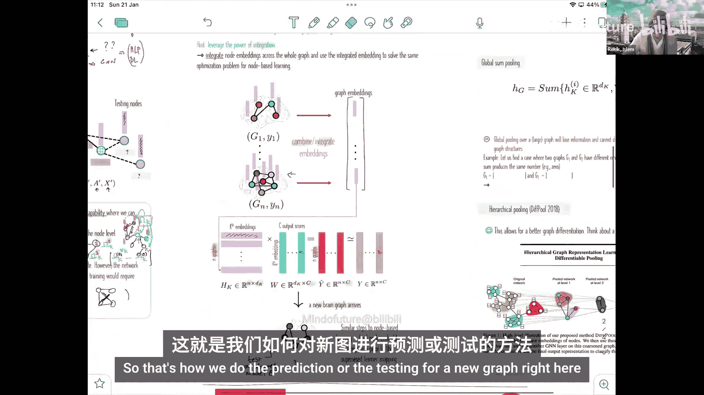

We talked about grain graphs， but we could have， for example molecules。

 you can have you know drug molecules so you can have different types of molecules with different completely different topologies and we want to kind of identify if a new molecule with a particular topology and you know feature weights if it is kind of poisonous or is it safe for humans this drug is it safe or is it kind of harmful so to do that it's the same basically it's the same formalization problem formalization that we're going to use so we define the problem or we state the problem in a similar way and we have a bunch of varying graphs that that have different topologies and our goal is to train on these you know graphs or these kind of drug molecules or proteins or whatever you name it and then we test on a completely new entity with completely different topology and thanks to the integration the。

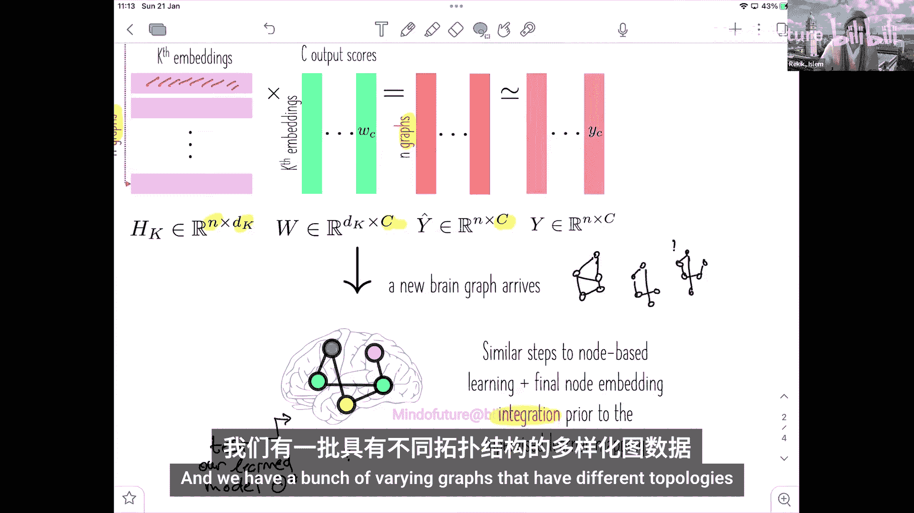

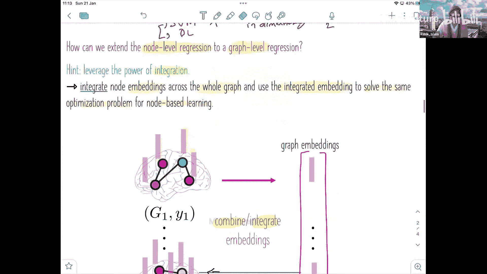

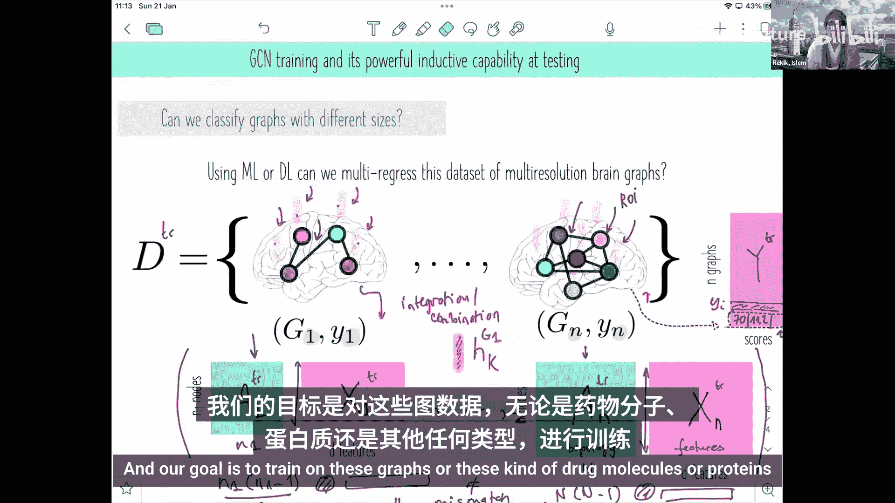

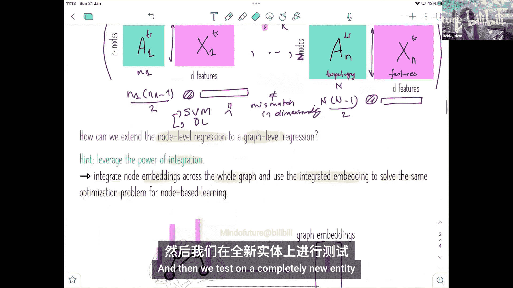

Ebedding integration we are able to do graph regression and classification。 So here， for example。

 we will be predicting values so we have I don't know so the age would be maybe 40。2。

 and then we have， you know IQ I don't know10 and then we will have the ground truth so we need to have this is the prediction and we have the ground truth and the ground truth will be something。

like the ground truth values and this will allow us to calculate the difference between these so I don't know let's say you know 35 and then we have 11 and you can see that we have made a mistake here so there is a gap between the ground truth and the prediction。

Grand truth and yeah so。

So good， so that's that。 So we have seen a lot already， and we're going to cover an important。

An important component here so we've seen the inductive power of Genan GCN models to you know like independent nodes to multiple nodes to even you know whole graphs with completely different apologies。

 a problem that could not be solved with typical with ordinary ML and DL models deep learning models so graph neural networks are extremely powerful have amazing inductive you know capability and now we're going to talk about the integration so remember guys here we need to do integration so how are we going to integrate okay。

So。