# 【伦敦帝国学院】深度图学习 ｜ Deep Graph Learning p12 P12_3.4_图卷积网络的层操作 -BV1WZUKBmEQA_p12-

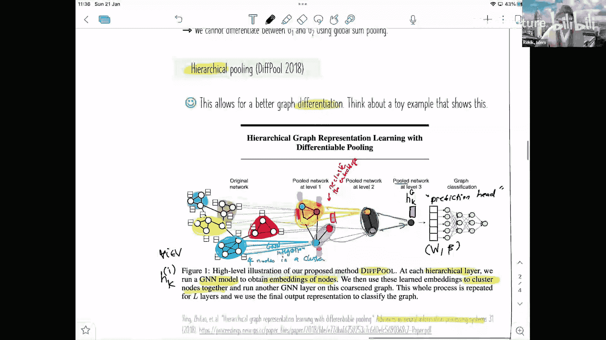

So。Now， the last part。Okay。

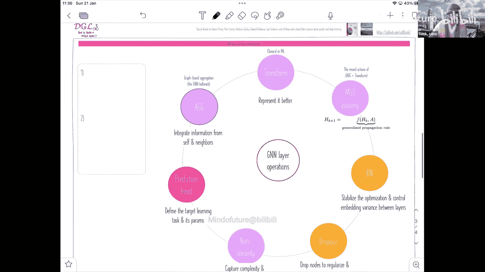

。So so far we have seen in this lecture the GCN training paradigm how to train and optimize GNN models in general。

 we also explored their powerful inductive capability and we have seen different examples。

 a node based node level multiregression model and also a graph level multiregression model so two supervised tasks and we've seen also different approaches for transforming node embeddings into a graph embeddings using different pooling methodologies which have a few disadvantages and how these were addressed using hierarchical pooling and there are several a new state of the art methods that address this so but this is just a simple example that you should be able to understand and go over in detail so now。

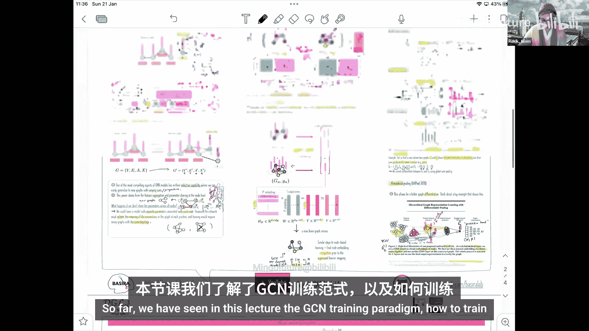

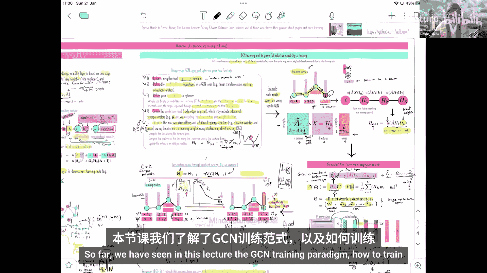

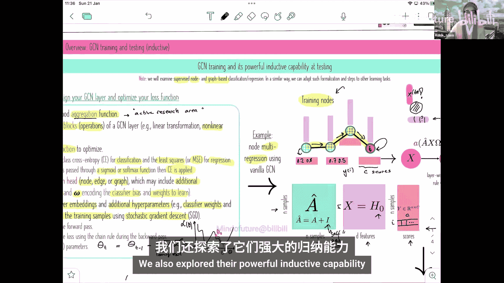

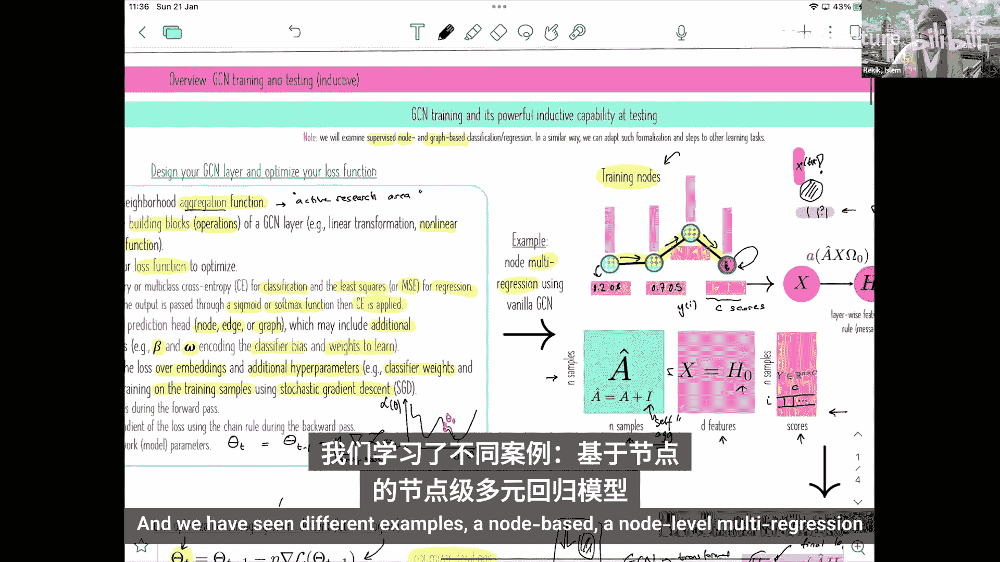

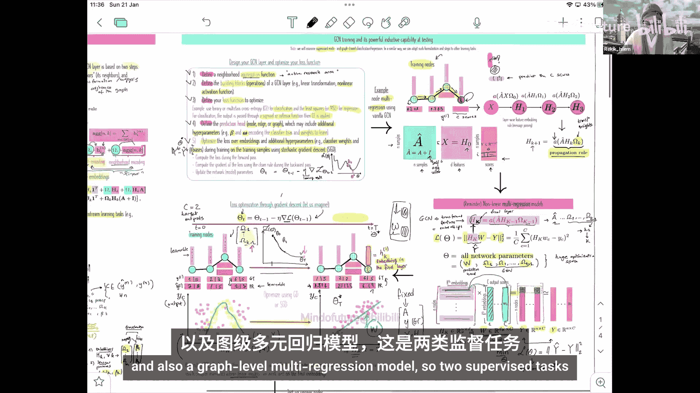

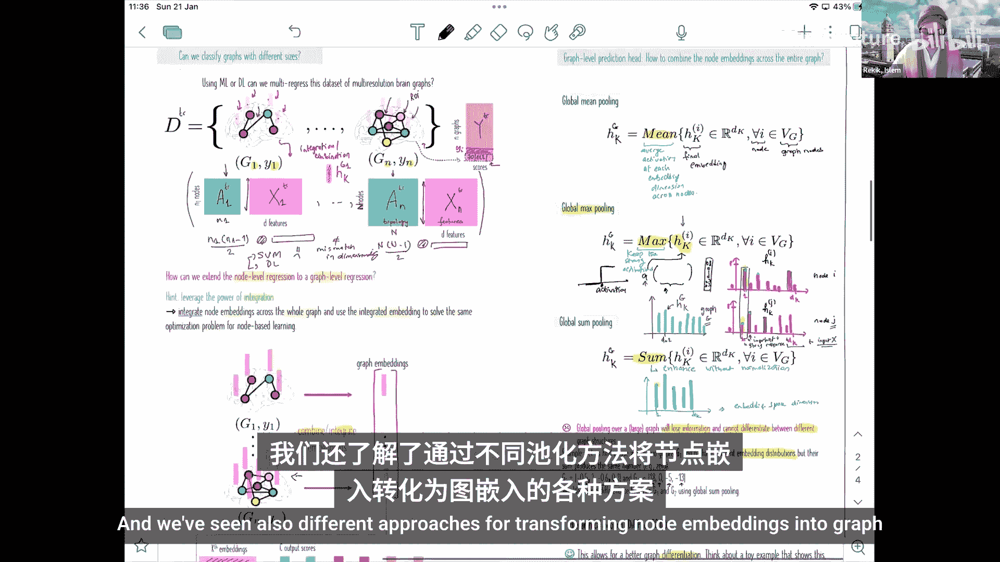

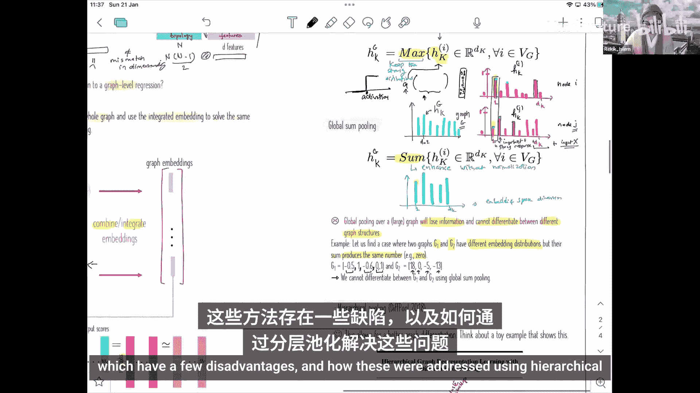

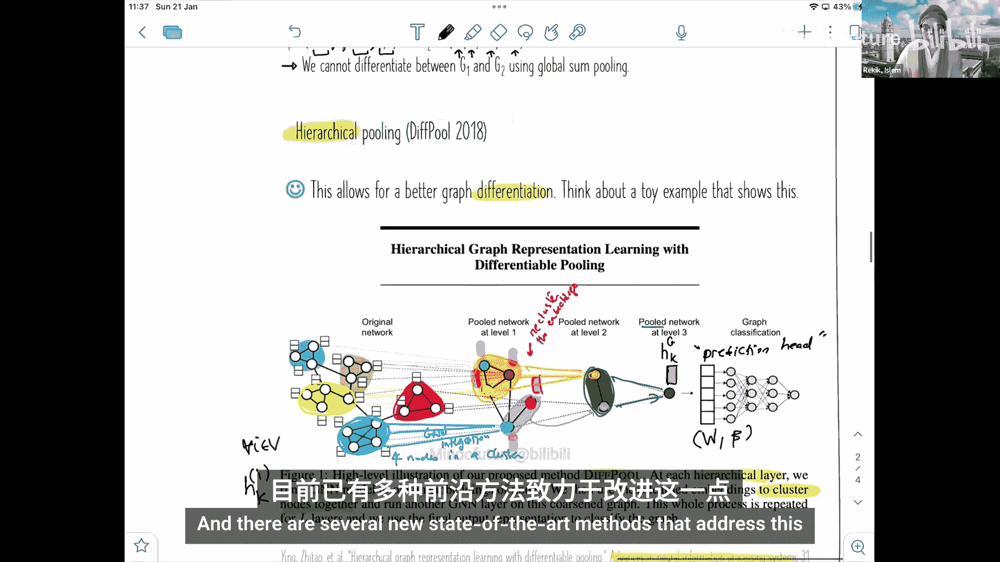

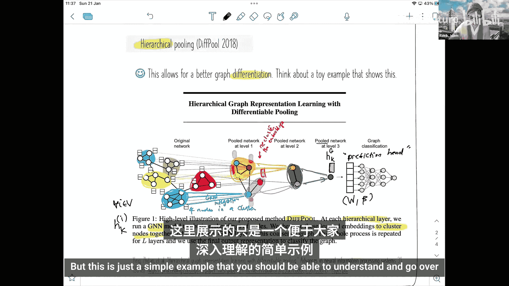

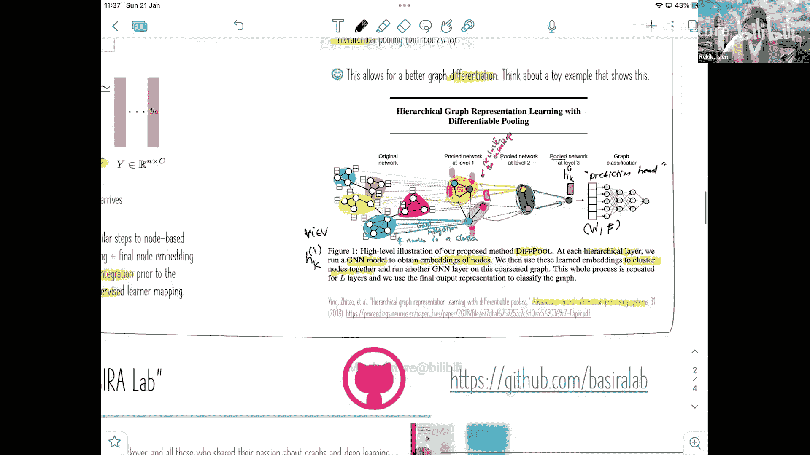

In this section will' look at the different operations or the different different genN operations or building blocks that we used to create or design genN models so first there are many that we have seen already so for first let's start with。

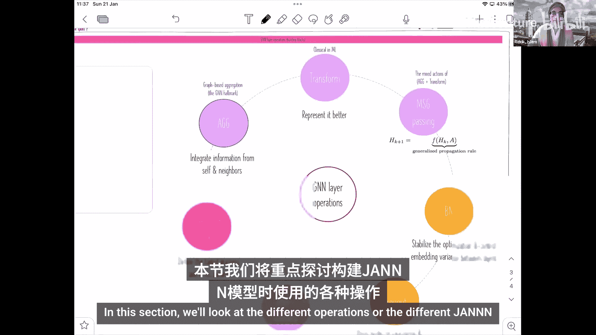

The first operation， so here which is aggregation， this aggregation actually is very important because this is what makes an a gen and model。

This is what makes up a genN model So this is the hallmark of the genN model Also I would say the message passing along neighbors。

 So this is also something very important because it takes into account the adjacency matrix so here I would put you know a heart because this means oops so let me use a different so this is a hallmark of GNNs so these operations are very specific to GNN and also this one also is very specific to GNN okay so we have seen the aggregation the message passing and these operations you do need the adjacency matrix and here you need the adjacency matrix and actually if you take these out okay you will fall back onto the regular operations that we use in a neural network so now let's put them back here because we are doing GNNs so first aggregation aggregation is an important operation because it allows us to integrate。

From both self the self node and also its neighbors all right so it's a graph based aggregation。

 this is a hallmark of a general model we have seen transformation which is transforming features and this is you know a very。

A classical concept in ML where you want to learn a better representation by extracting new features and deep learning by building new representations and new subspaces right so transformation mapping mapping one feature space onto the other or an input feature onto the other a new target feature that represents better that reduces you know redundancy removes removes noise outliers all these things are very important so how to represent better。

Lice。And how to transform basically okay so it's how to transform better so transformation is a very important concept that perates both machine learning and deep learning and now we use it of course in geometric deep learning we're learning on non-uclidean spaces such as graphs okay GnNs now we also have in Gnns the mixed actions of aggregation and transformation so and this defines what we call the generalized propagation rules so to update the embedding so this message passing is used to update the embeddings it could be the graph embedding。

 the node embedding， the edge embedding any element of the graph or the graph itself okay so we want to do this update of the embedding the representation of the graph or elements of the graph okay so now we have other things that we will see in detail。

Also if you haven't uncover this visa B in and dropout that are very commonly used in deep learning so if you've taken a deep learning course you should cover these in detail。

 but here the key idea is batch normalization when you're training here Gna using batches and we'll see this later and later in future sessions is that this allows us to stabilize the optimization to stabilize the convergence of the laws and also it can by controlling actually why this is good to stabilize the optimizationization because it enables us to control the embedding variance between layers so the distribution of the embedding from K minus1 to K right it doesn't change a lot so if it changes a lot is not a good thing so somehow we want to control this distribution we want it to be kind of similar a bit different of course we want to learn different representation we want them to be the distribution of these embeddings in each layer to be。

Different， but not very divergent okay so。Very diversion it means you know we're gonna to have a large variance in the neural network in the omegas we're gonna to have different mapping。

 so its it's not good to have completely different weights weight jumps from omega K to K plus one for example between consecutive layers so these mappings somehow their weights should be kind of also you know quite different to extract diverse information but not very diversion to kind of make the network hard to train and the loss dirges or to have some kind of funky learning behavior so the dropout basically is here we drop notes to regularize and increase the expressiveness of a GNN model and dropouts are very used in you know during so basically during training you remove node and then you bring them back during testing so here it kind of you know decreases somehow you don't need to optimize the weight for。

So dropping out notes is acts as a regularizer for the network loss and for the GNS。

 it also increases the expressiveness of the TNS， which means we can easily distinguish between different apologies and graph structures。

So we have seen also the all the purple ones we have seen and also the pink we've seen today so BN and dropouts these are things that you can add up to your GNN layer so you can add a batch normalization you can add dropout usually it comes after the batch normalization and before applying the non nonlinearity so the nu linearity is actually the activation function and here it allows us to capture the complexity and identify important patterns so this is the the important patterns and also important you know dimensions you know feature I would say embedding dimensions。

Embbedding dimensions okay so embedding dimensions as I explained earlier。

 when you activate you give a strong response you maintain you want to give a strong response to the important features and nonlinearity allows us to kind of identify the most important features but also it allows us to give these weights and kind of you know capture very complex relationship between the features and the and also the samples themselves because were now using graphs right so nonlinearity what is the the component here that makes a whole network nonlinear or makes it you know able to capture。

Complex patterns and high level patterns okay if you use simple linear transformations we will see that in the first you know like in a few examples we will see that if you remove a linearity you may not be able to kind of do good classification or regression okay so that's not linearity now the last one is the prediction head so we need to define the target learning task whether we're doing a。

Whether we're doing， for example， a node classification or edge you know link prediction or a simple。

Regression of the whole graph so here we need to define the dis and their parameters and this comes of course after the nu nonlinearity so after we do the whole embedding so this transformation right here will get us you know to the final embedding that we're going have at some point and what I want to say that well sometimes this comes in this order other times that like the order can change so there important remarks here I want to add which is the first one is that。

Okay so let's see this so the first one is that the operation order the order in which we do these operations it can change depending on the rationale and the target task okay so and then also a few operations can be merged or completely removed so you can remove a dropout for example we can use only what we have used in in a naive GCN is basically these three right and then we added later on we added the prediction hat for the task so this is for our target task yeah so these operations here they are not necessarily executed in the order I mentioned here so they can the order can change we can merge few operations can bind them together we can remove a few operations in in in a layer in a GCN or JanN layer okay one layer and then。

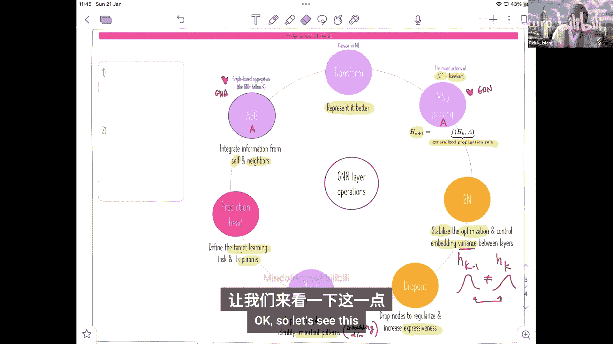

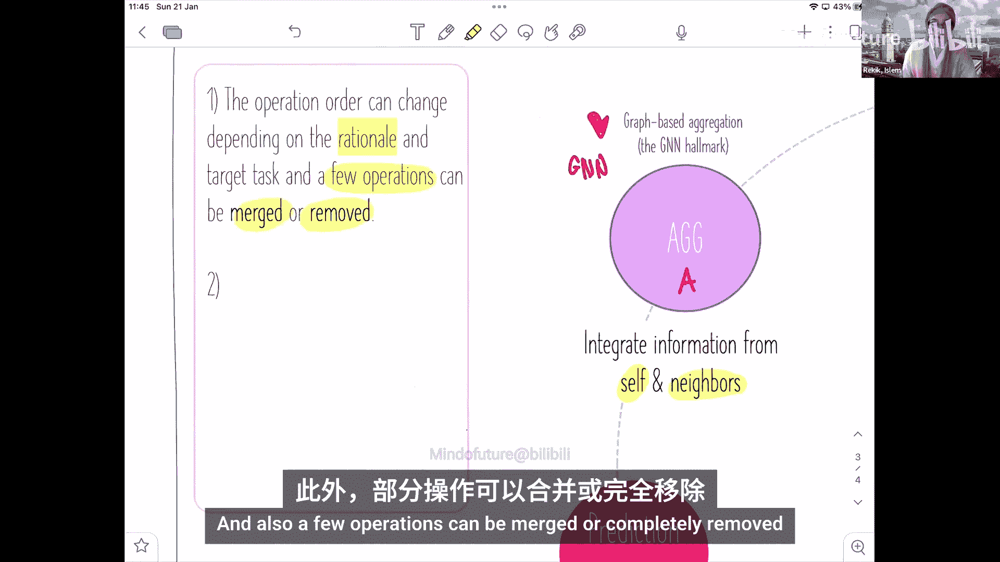

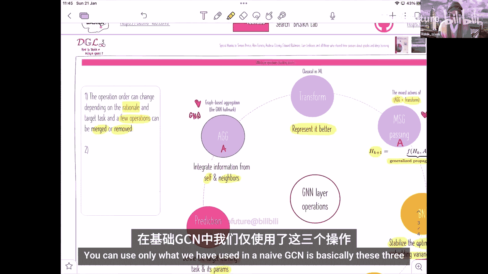

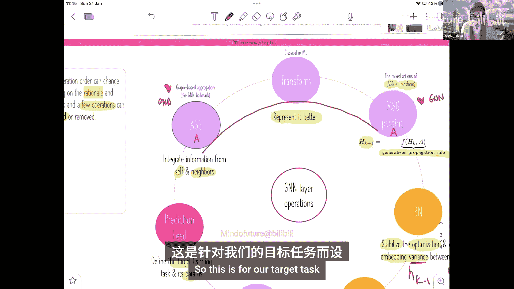

Yeah so there are different things we can do and so we define one layer and then you can stack up multiple layers to do to repeat the same operations series of operations over and over again after you define them so now these are very important questions so look we have multiple operations here guys we have aggregation transformation we have the you know propagation rule have batch normalization dropout we have the type of activation function we want to use and we have the of course we need to fix and define the type of prediction tasks that we want to solve and all of these okay so we need to ask for each of one of these we need to ask。

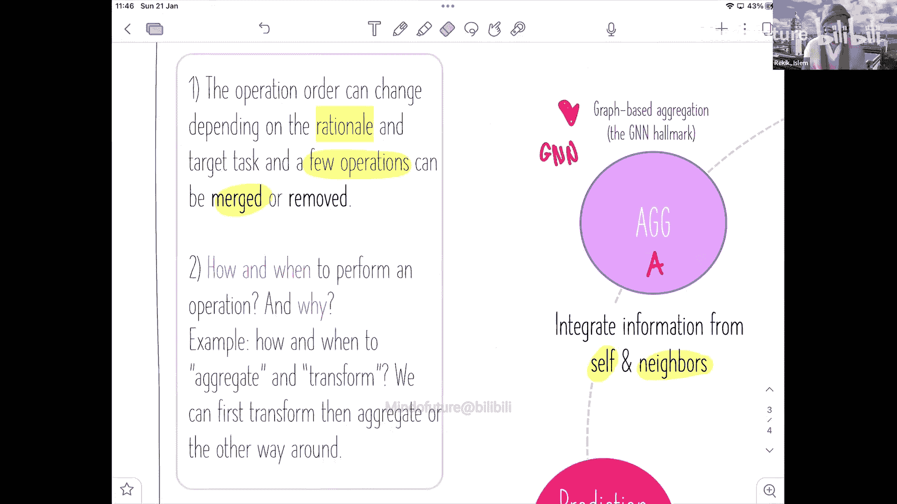

The second question which is very important， this is a very important question okay so how and when to perform an operation and of course why why would we need batch normalization。

 why would we need a dropout Why would we need to add the prediction head there。

 why would we need to kind of do pulling or whatever okay。

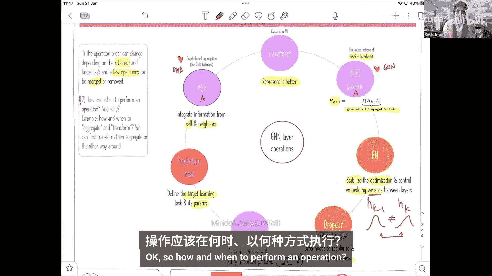

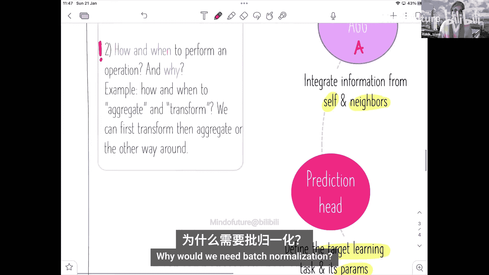

So for example， there are several GN papers that use you know that aggregate and transform in a completely different order。

 so how and when to aggregate and transform these are very important questions and they will completely shift your narrative and your results okay so for example。

 so far we we have aggregated first and then transform but what you can also do you can transform first okay？

And then aggregate the features so you can say I want to apply on linear I want to kind of sorry linear transform the data and then aggregate it rather than aggregating and transforming what I have aggregated or combined and these are these are of course you know each of these choices needs to be justified and explained and you know there should be a logic behind these this design。

 the design that you will choose for your network based on empirical evidence or preliminary data that you have or based simply on nicely I would say robustly on some mathematical foundation okay。

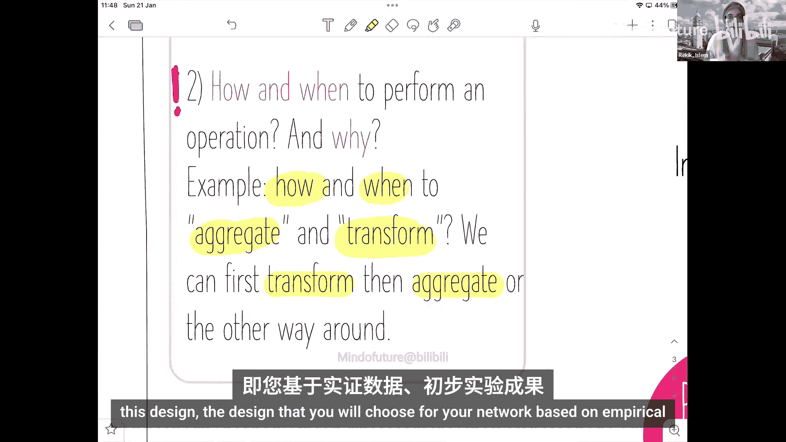

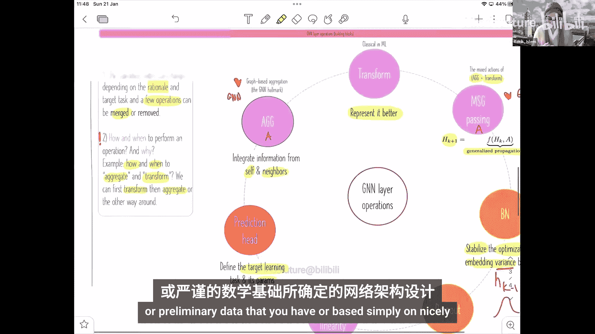

Good， so next we will look at a few of these operations like BN Dout， also the concept of batching。

 how we batch， you know， how we do batching in graphph neural networks。

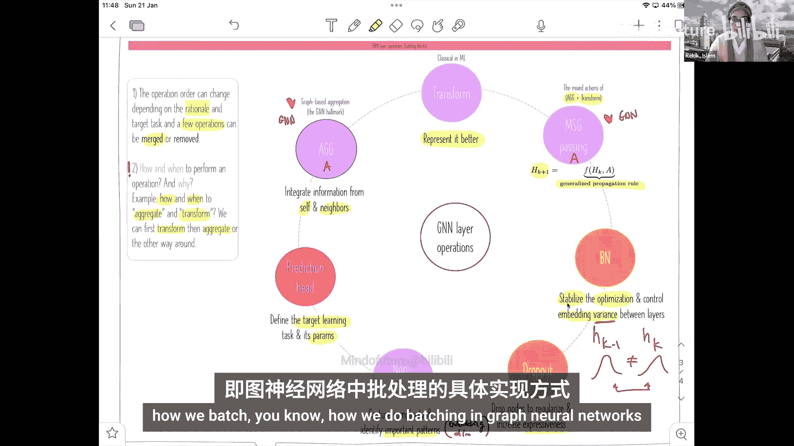