# 深度图学习：P12：3.4_图卷积网络的层操作 🧱

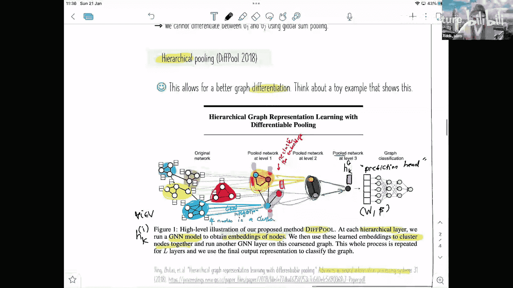

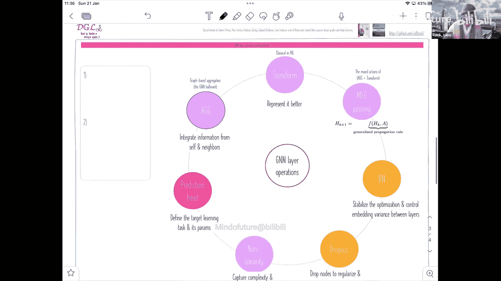

在本节课中，我们将学习图神经网络（GNN）的核心构建模块——层操作。我们将详细探讨构成GNN模型的各种操作，包括聚合、变换、消息传递等，并理解它们如何组合在一起以处理图结构数据。

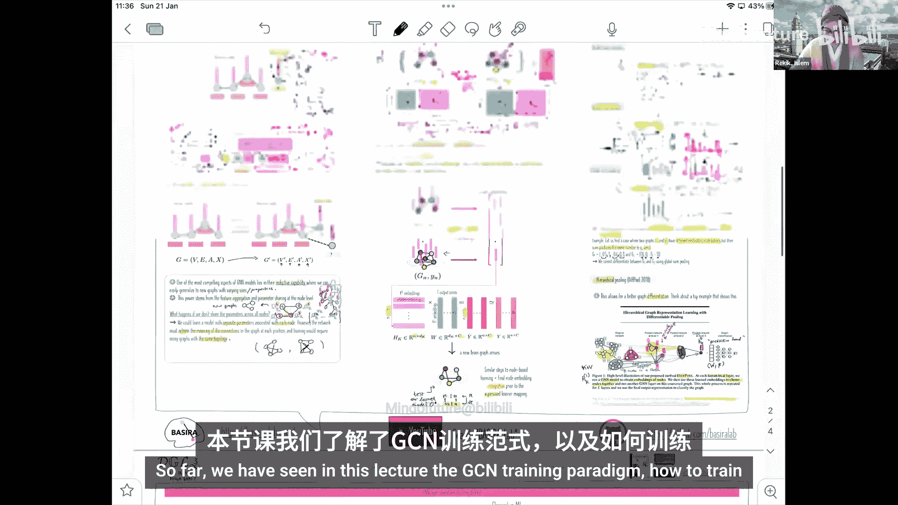

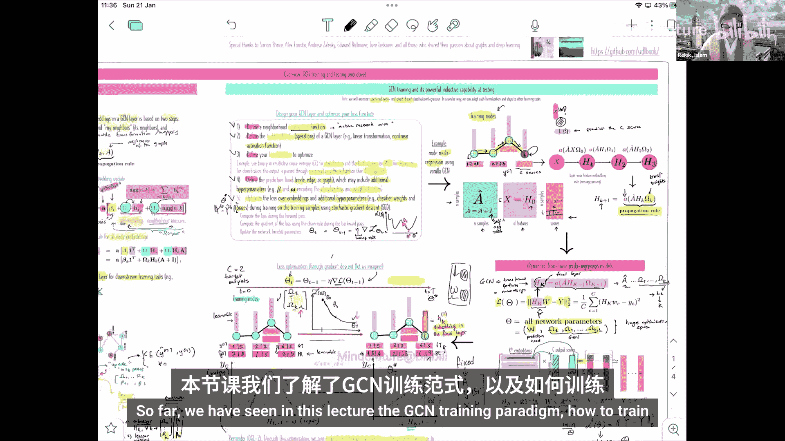

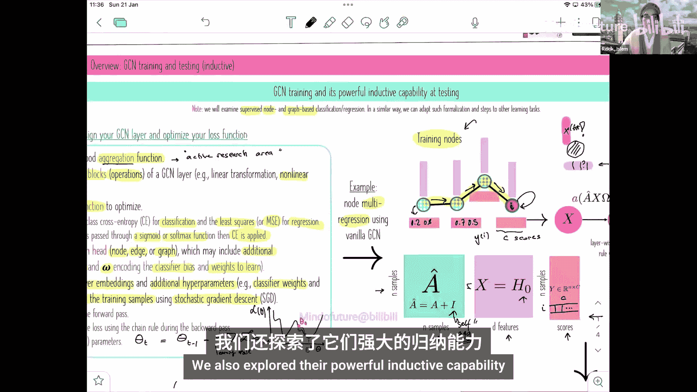

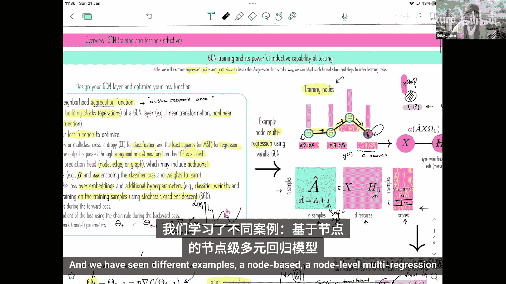

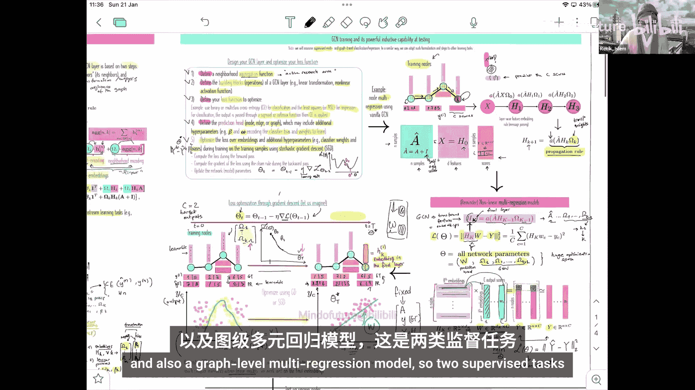

## 概述

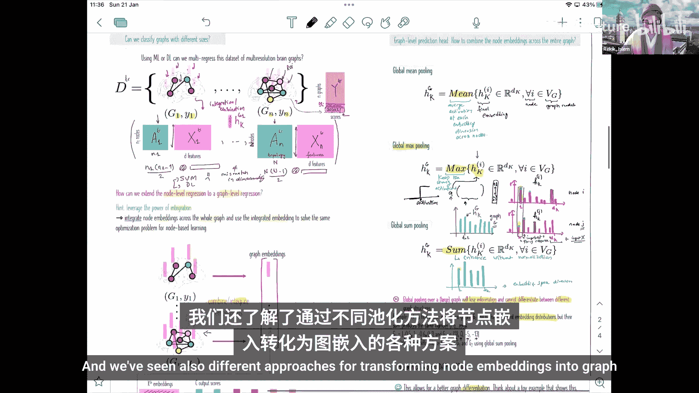

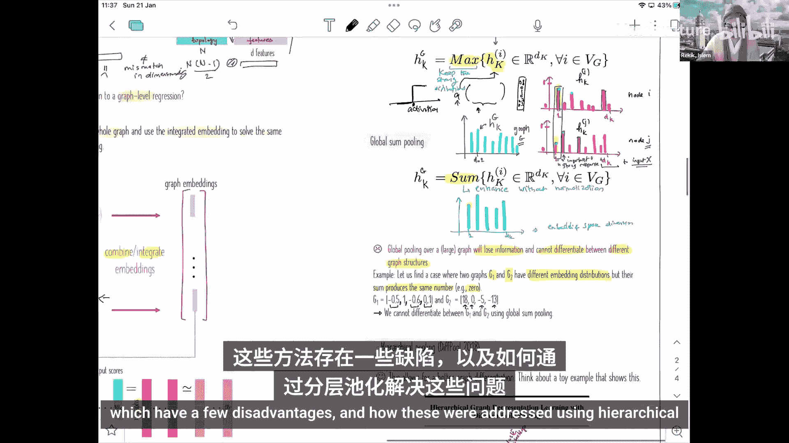

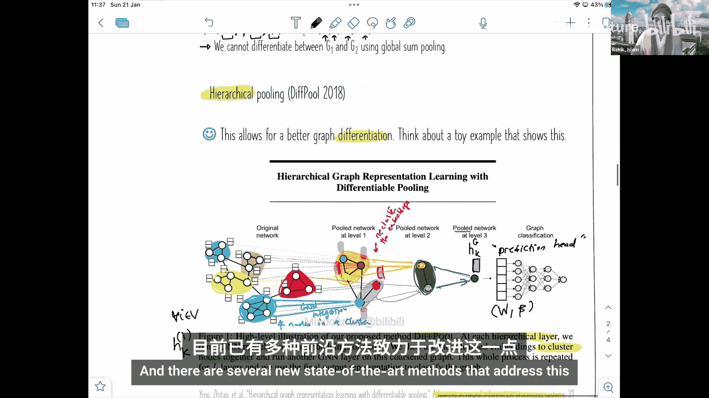

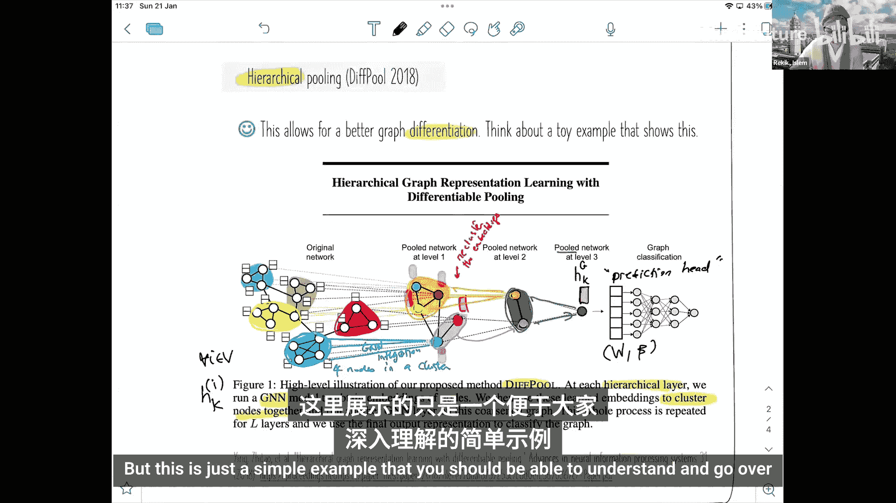

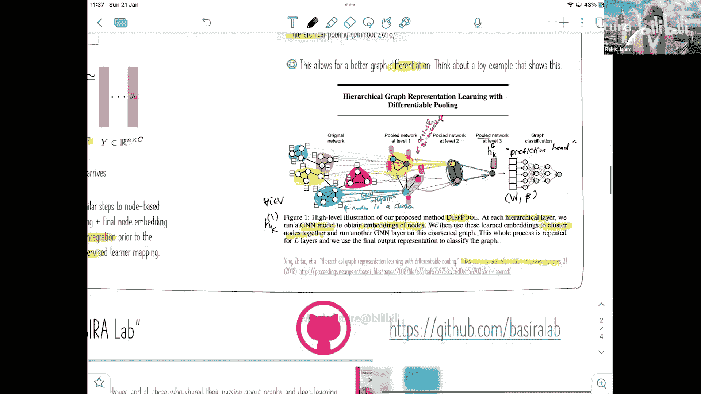

到目前为止，我们已经在本课程中了解了GCN的训练范式，即如何训练和优化GNN模型。我们也探索了它们强大的归纳能力，并看到了不同的示例，包括基于节点的多回归模型和图级别的多回归模型。我们还学习了使用不同池化方法将节点嵌入转换为图嵌入的方法，以及如何通过分层池化来解决这些方法的缺点。现在，我们将深入探讨用于创建或设计GNN模型的不同操作或构建模块。

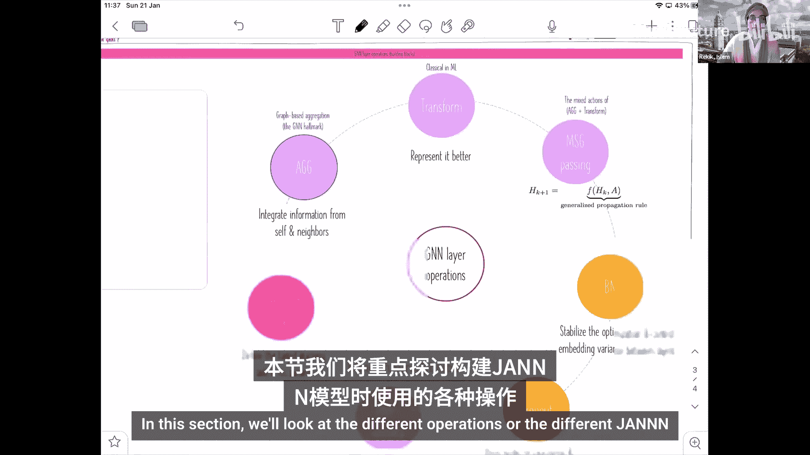

## GNN的核心操作

以下是构成GNN模型的一系列关键操作。这些操作共同定义了模型如何处理和学习图数据。

### 聚合操作

聚合是GNN的标志性操作。它允许我们整合目标节点自身及其邻居节点的信息。这一操作依赖于图的邻接矩阵，是图神经网络区别于传统神经网络的关键。

**公式表示**：对于节点 `i` 在第 `l` 层的聚合操作，可以表示为：
```
h_i^(l) = AGGREGATE({h_j^(l-1) | j ∈ N(i) ∪ {i}})
```
其中，`N(i)` 是节点 `i` 的邻居集合，`h_j^(l-1)` 是邻居节点 `j` 在上一层的嵌入。

### 变换操作

变换是机器学习和深度学习的经典概念，旨在通过学习新的特征和构建新的表示空间来获得更好的数据表示。在图神经网络中，变换用于将输入特征映射到新的目标特征空间，以减少冗余、去除噪声和异常值。

**代码描述**：一个简单的线性变换可以表示为：
```
z_i = W * h_i + b
```
其中，`W` 是权重矩阵，`b` 是偏置向量，`h_i` 是节点 `i` 的当前特征，`z_i` 是变换后的特征。

### 消息传递与传播规则

消息传递是聚合与变换操作的混合，用于更新图中元素的嵌入表示（如节点、边或整个图的嵌入）。它定义了广义的传播规则，是GNN更新表示的核心机制。

**核心思想**：每个节点从其邻居接收“消息”（即邻居的特征），然后结合自身信息进行更新。

### 批归一化

批归一化是深度学习中常用的技术，用于稳定优化过程和控制层间嵌入的分布。在GNN中，当使用批次进行训练时，批归一化有助于控制嵌入在连续层之间的方差，防止分布发生剧烈变化，从而使网络更易于训练和收敛。

### Dropout

Dropout是一种正则化技术，在训练过程中随机“丢弃”（即暂时移除）一部分节点，然后在测试时恢复。这可以防止模型过拟合，并增加GNN模型的表达能力，使其能够更好地区分不同的图拓扑和结构。

### 非线性激活函数

非线性激活函数（如ReLU、Sigmoid）允许网络捕获复杂的模式和高层次的特征关系。它通过给予重要特征更强的响应，并抑制不重要的特征，使网络能够学习数据中的非线性关系。如果没有非线性激活，网络将退化为线性模型，难以完成复杂的分类或回归任务。

### 预测头

预测头定义了最终的学习任务，例如节点分类、链接预测或图级别的回归。它位于非线性激活之后，作用于最终的嵌入表示上，并包含任务特定的参数。

## 操作顺序与设计选择

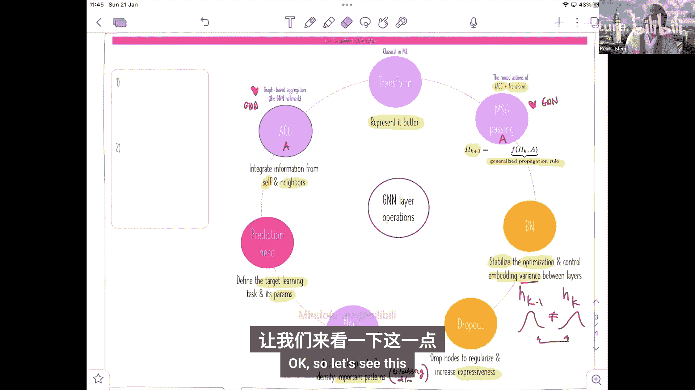

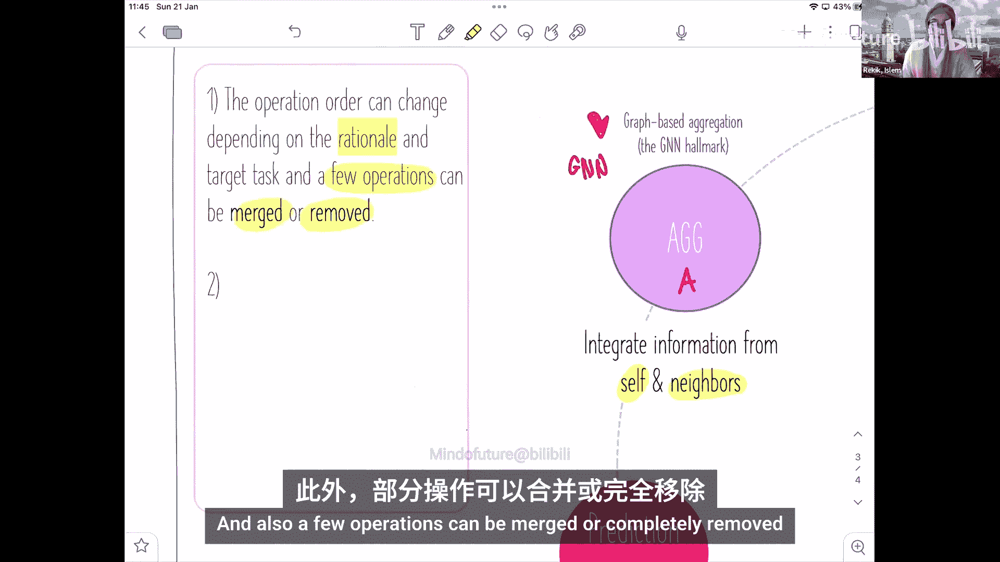

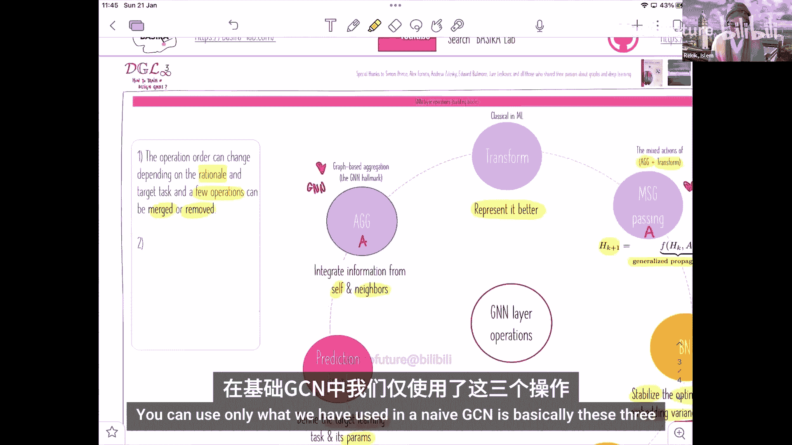

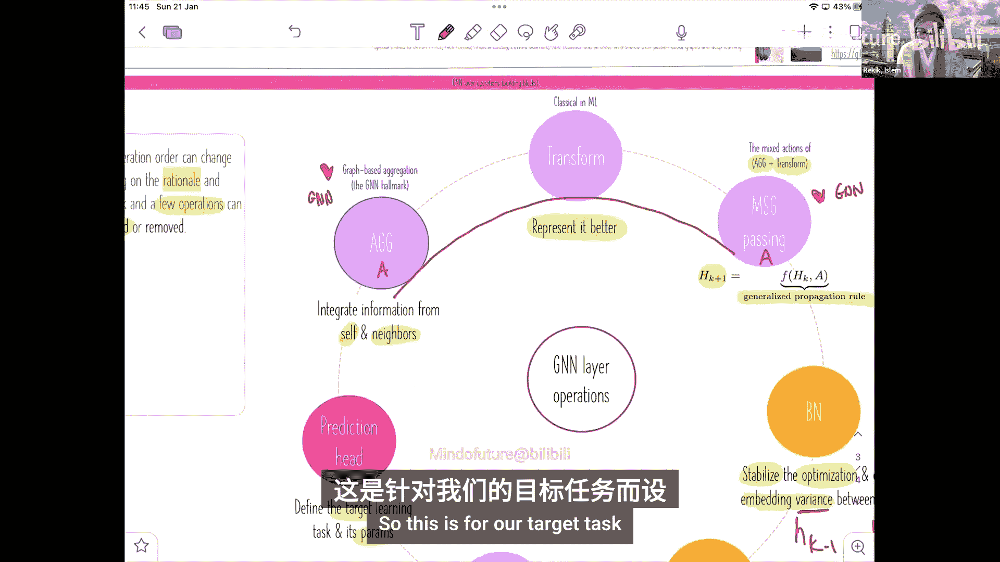

上一节我们介绍了GNN的各种核心操作，本节中我们来看看如何组合这些操作。操作执行的顺序可以根据设计原理和目标任务而改变。此外，某些操作可以合并或完全移除。

例如，一个简单的GCN层可能只包含聚合、变换和非线性激活。而更复杂的模型可能会加入批归一化和Dropout。操作的顺序也可能颠倒，例如可以先进行特征变换，然后再进行聚合，而不是先聚合再变换。

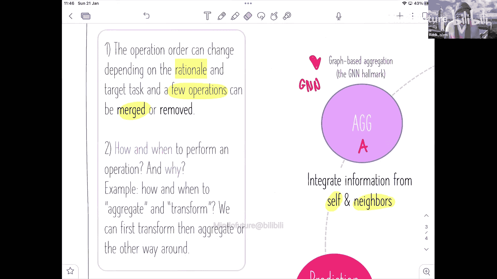

以下是设计GNN层时需要思考的关键问题：

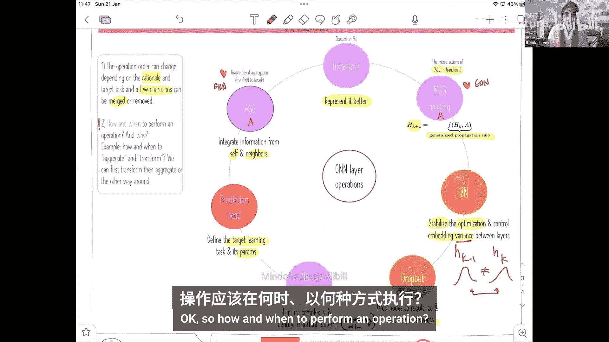

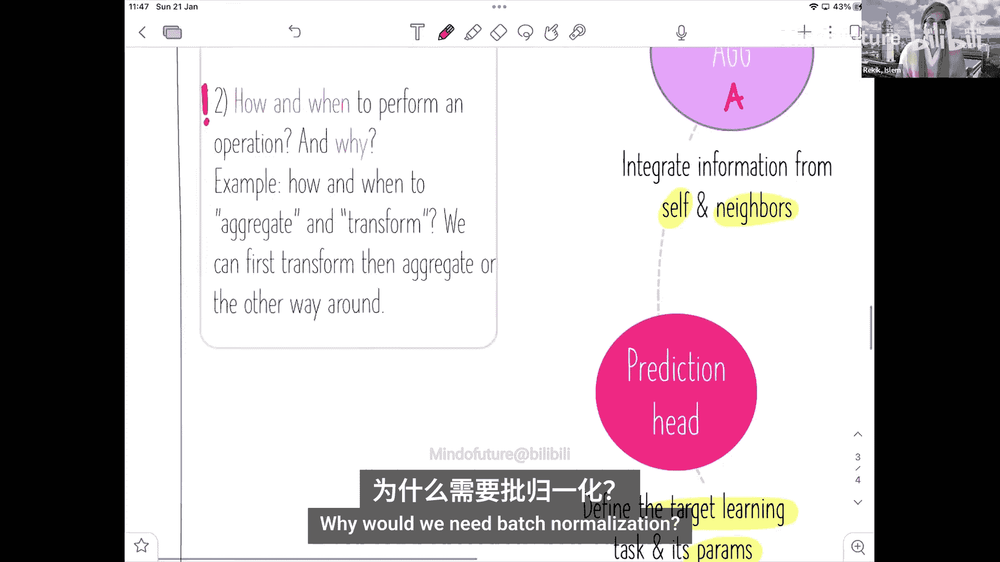

*   我们需要为每个操作选择合适的类型和参数。
*   我们如何以及何时执行某个操作？例如，为什么需要批归一化？为什么需要Dropout？
*   操作的顺序如何影响模型性能和结果？例如，先聚合后变换与先变换后聚合会产生不同的效果。

这些设计选择需要基于经验证据、初步数据或坚实的数学基础来证明和解释。

## 总结

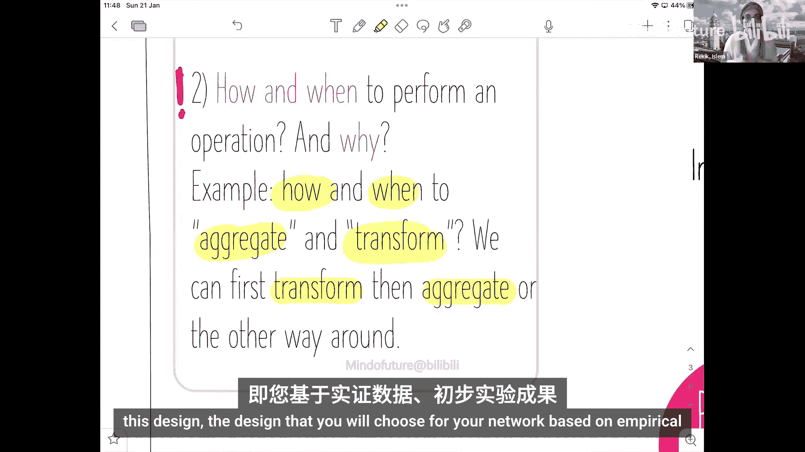

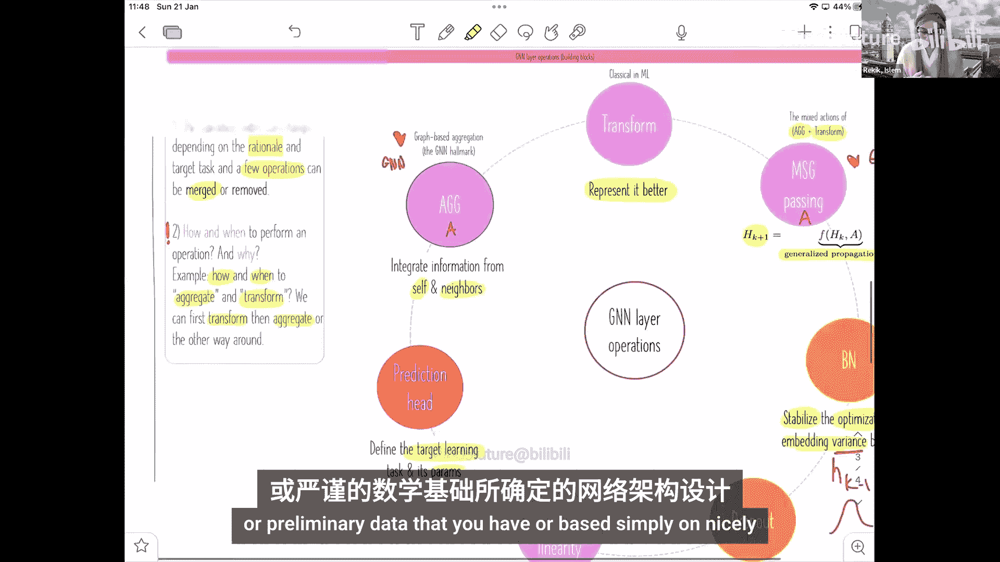

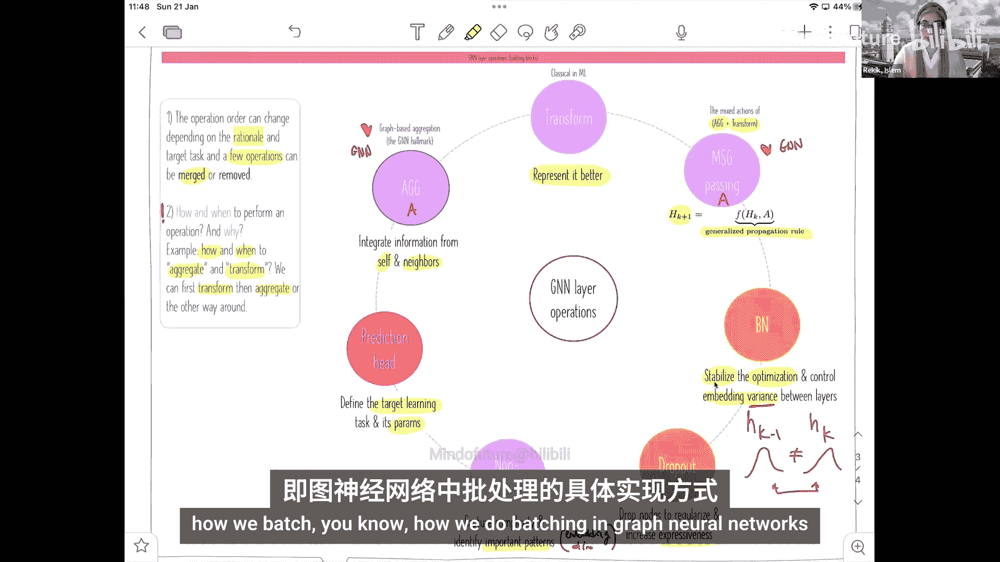

本节课中我们一起学习了图神经网络（GNN）的层操作。我们详细探讨了聚合、变换、消息传递、批归一化、Dropout、非线性激活和预测头这些核心构建模块。我们了解到，这些操作的组合与顺序是GNN模型设计的关键，不同的选择会显著影响模型的叙事和最终结果。理解这些操作及其作用，是构建有效图神经网络模型的基础。