# 【伦敦帝国学院】深度图学习 ｜ Deep Graph Learning p14 P14_4.1_点、批次和小批次梯度下降 -BV1WZUKBmEQA_p14-

So in in today's lecture we will learn about batching。

 sampling and different training or learning paradigms so first let's get started with。

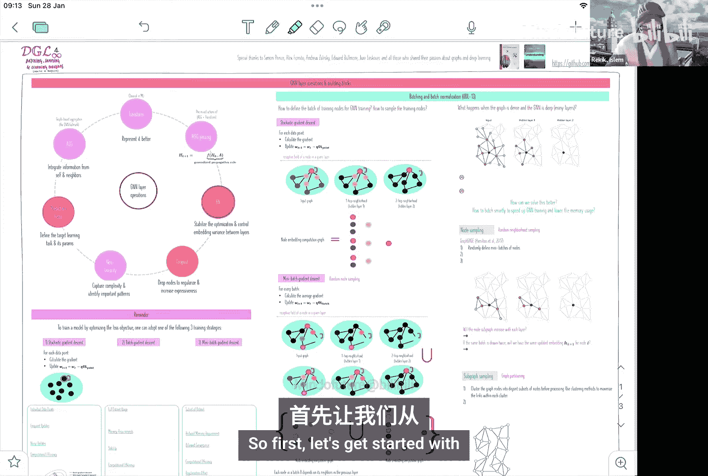

A reminder here， so the batchbased training that we have in deep learninging so to train a model we aim of course。

 to optimize an objective loss function and through the optimalization we are able to get our optimal parameters W so the optimal parameters of our neural network whether it's a deep learning network or a Gna network so to do the training to perform the training we can adopt one of the following three training strategies okay so the first one is the stochastic gradient descent so stochastic gradient descent what we do basically we take each point so this is a training point and for each data point we calculate the gradient of the loss at this point all right at this point and then we update the weights so what happens is that we're going to update the weight。

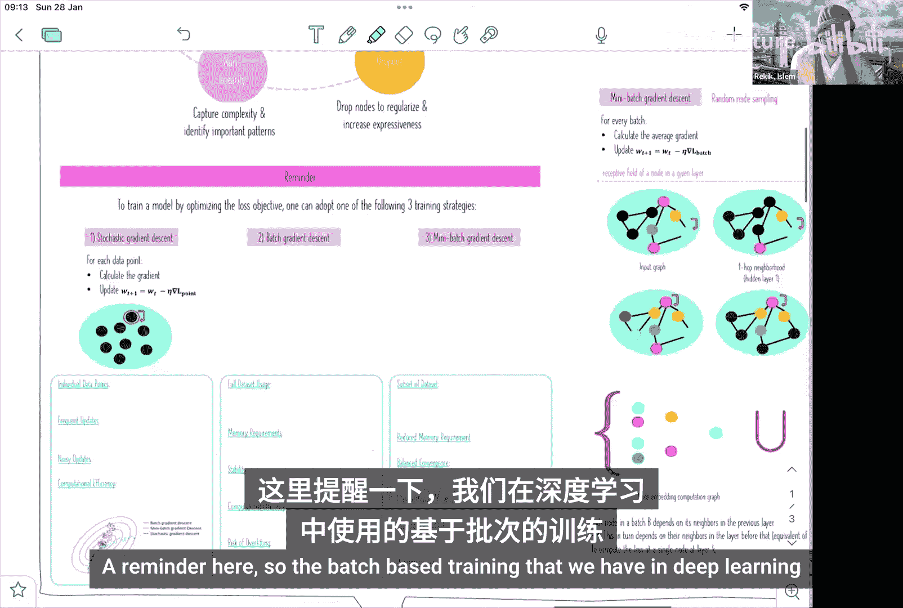

For each point individually so we will loop over or iterate over all points one by one and every time each time we will update our weights one by one okay so this is the first training paradigm where we do individual or independent sample training and you randomly actually you can randomly select the training samples so there are different ways of doing this you can loop over all training samples if you have a small data set but if you have many samples you can randomly draw your individual points and you calculate or update the parameters based on the randomly sampled points okay so now the stochastic gradient descent has different properties so first and it's a single point training so in single point training。

We called also stochastic training each update is based on the gradient calculated from a single randomly chosen data point all right so here what we have。

 we have frequent updates so the parameters W are updated frequently after every single point so W the parameters of the network will be less stable because we will have every time you put in a sample you're going to change the direction of your your W vector your final parameter vector and this will destabilize your training or the learning behavior of your model and how can we see that that actually reflects in the loss so here you can see in the stochastic gradient descent the loss function right here okay so the loss function at zigzags a lot there is a lot of there is a change of directionality like a constant change so。

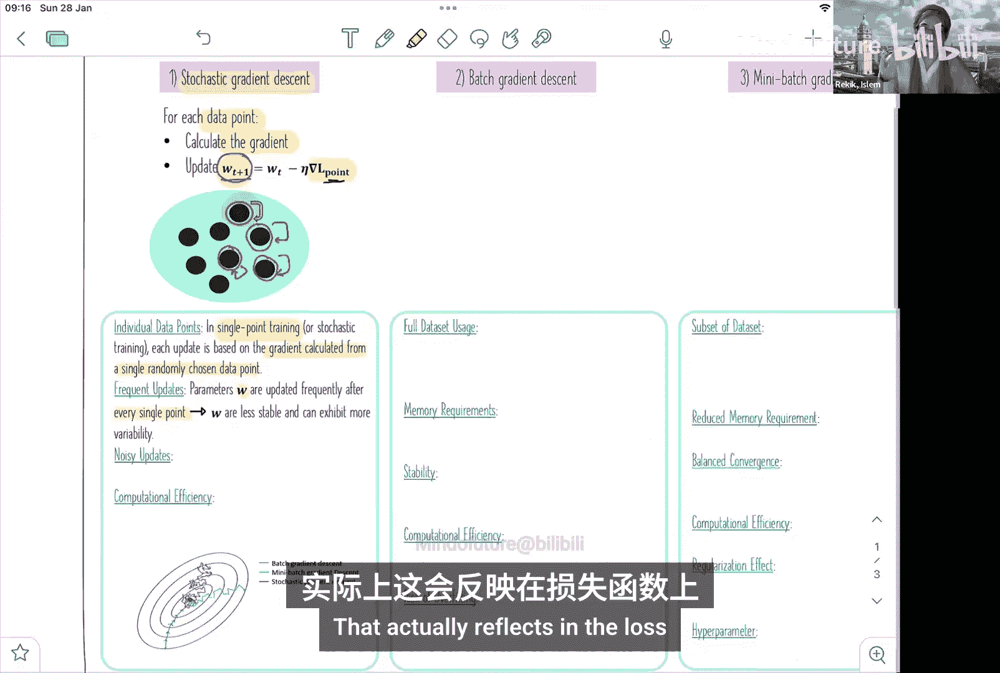

It converges to the optimum， but it takes a longer time because of this zigzagging behavior and the fact that we are training on each sample individually okay so we will have noisy updates so the updates can be noisy so this will lead to what we call an erratic convergence behavior so as you can see here in this figure the purple line right and the computational efficiency is also bad is not that good because you're updating the parameters for each point individually so this update will is computationally expensive so it's going to be inefficient and the overhead the compute overhead will be high for these stochastic gradient descent implemented in this way okay now a different option or a second or better alternative well better we will。

😊。

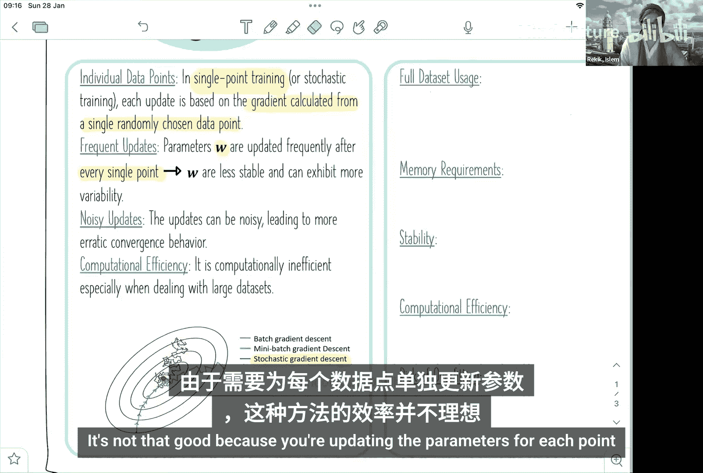

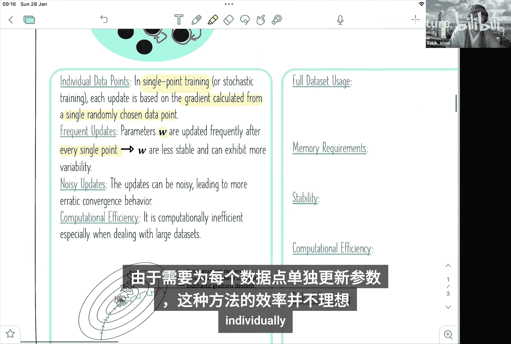

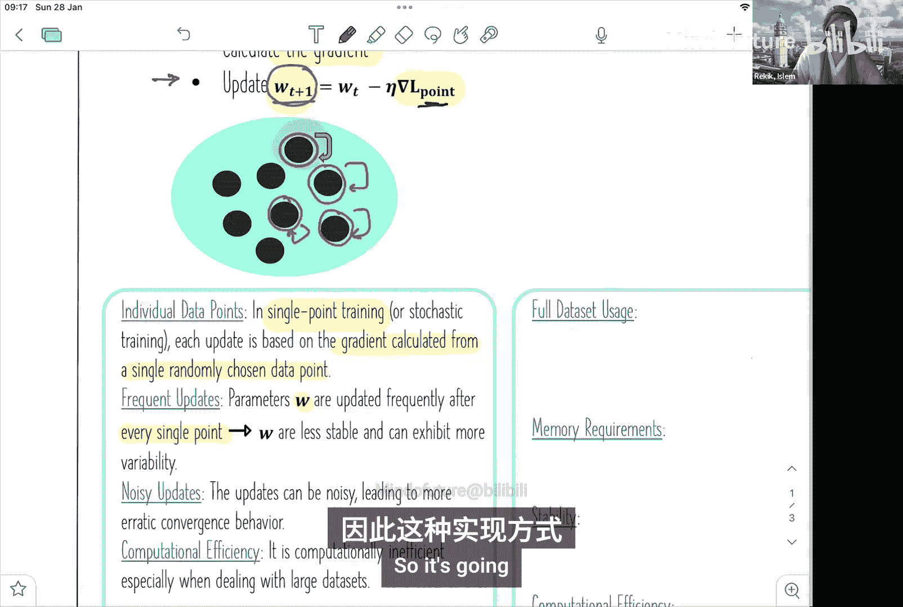

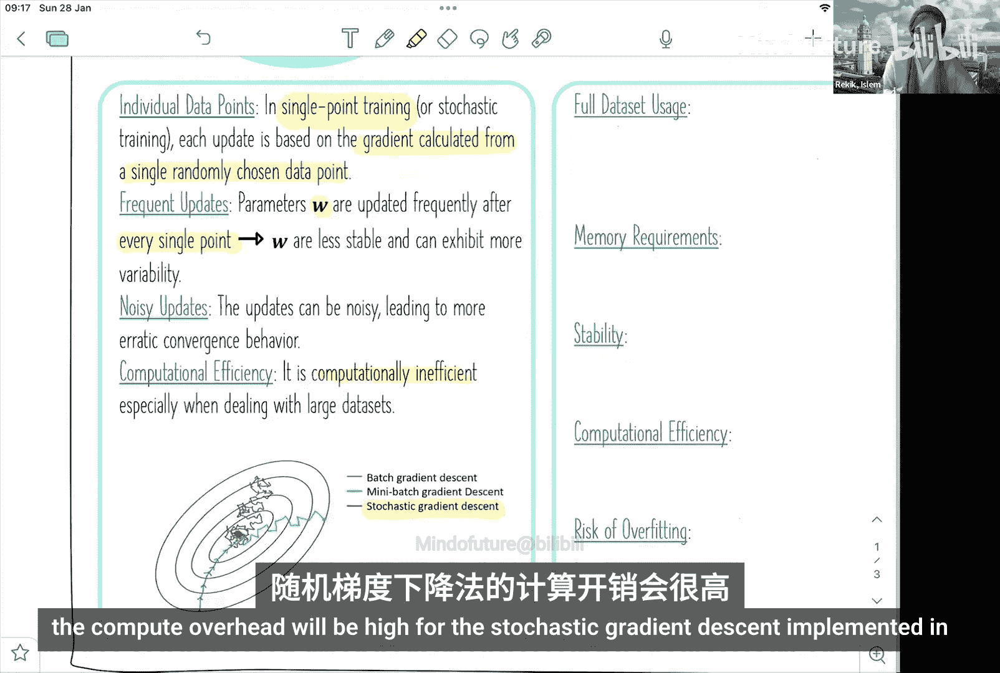

Discuss that， whether it's better it's a better option or not is the batch gradient descent so what is the batch gradient descent？

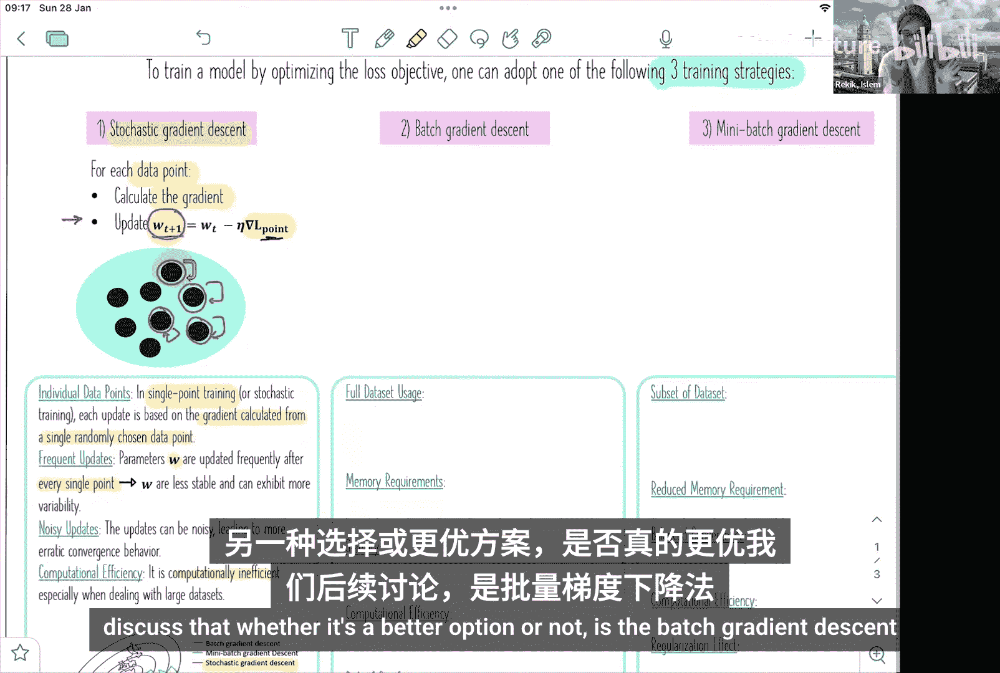

So in the batch gradient descent we use the whole data set to calculate the average gradient okay so the gradient is calculated for the whole data and we update the W only once so basically we take the whole training data we calculate the average gradient and we update the weights of our neural network across all layers right only once okay so this is you know one single batch one single iteration defines an epoch and then we're going to move forward and reiterate over and over again okay so that we'll take the whole data set as a bulk and calculate the average gradient for the whole set as you guys can see here okay so。

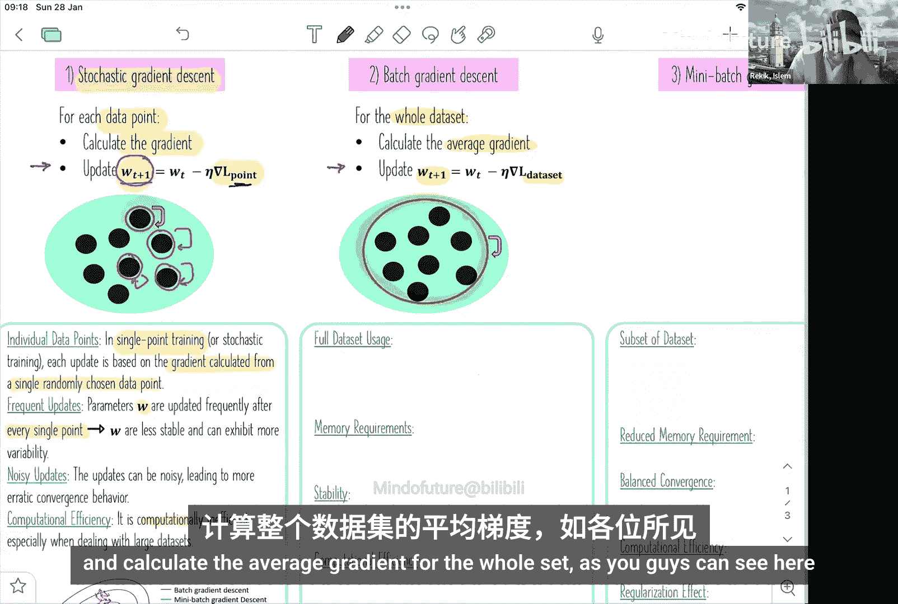

Now what are the advantages or disadvantages of this method the batch gradient descent so there is a full usage of the data set so in batch training the entire data set is used for each training iteration okay so the model parameters are updated only once per epoC so here an epoch is a complete pass through the entire training set data set and here we have a complete pass so one batch is one epoC in this case okay so now for the memory requirements。

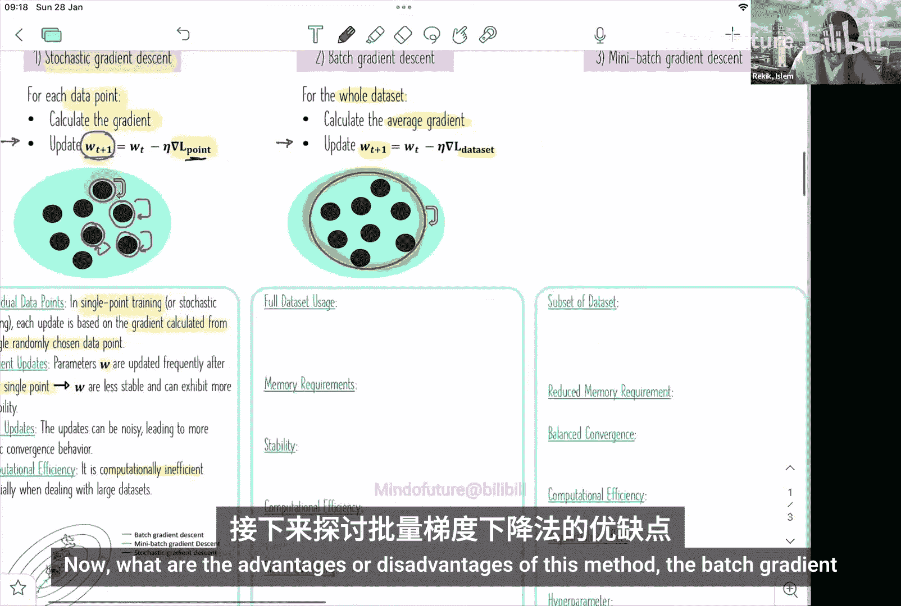

The entire data set needs to be loaded into the memory all right so this means that we will have you know we need to you know store everything so it's highly memory intensive it increases the memory usage and it could be impractical for large data so you can get out of memory error struggling to load the whole data if you have millions of samples and you know thousands and thousands of features so this is impractical。

Now in terms of stability it provides stable error gradient and convergence。

 so we have a better convergence and stability compared to compared to the stochastic gradient descent and this is because we are using the entire data set so the update will be more consistent because every time we are updating the parameters using the whole data set so this parameter doesn't depend on a point with different kind of a feature vector with different kind of directionality right so a feature a vector has a direction right so in a D dimensionional space and an RD so because we're doing this for the mean direction we' taking the mean direction of all training points right so this is for example。

 let's say well the mean direction here maybe would be around here so we're taking the mean direction then this will allow us to better you know like update the。

is in a more stable and controlled and consistent way， I would say， okay。So computational efficiency。

 so it's still computationally inefficient because we need to process the entire data before making a single update so this is computationally expensive and also there is a risk of overfitting because you're using the whole data at once and you're calculating the average so the model is exposed to the whole data in the same order so there is no randomness for regularization which means you know we don't randomly sample particular training points like in stochastic gradient descent we don't use a subset we only use the whole data so it's kind of bias towards the data and it may overfi the data okay so now if you look at this diagram here or this plot of the loss function contours we can see that when we use the mini batch so sorry the batch-based gradient。

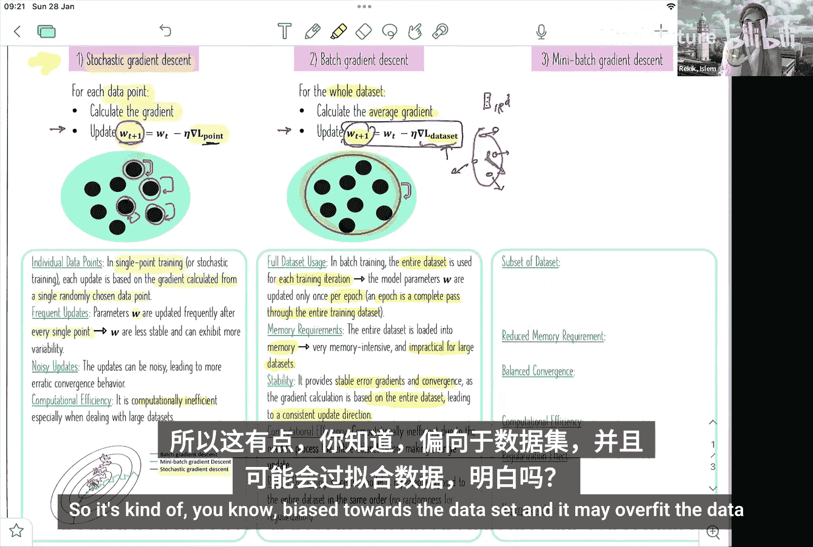

Which is in blue， so the batch gradient here are all right， so change the color of this one。

So batch gradient you can see you have a more stable and faster convergence in this case so because you're you're using the whole entire data set as I said to update so your updates will not change a lot because the average direction will not kind of randomly change so the average direction may change a little bit you know like of the gradient but it will not kind of oscillate and be shattered across different directions okay so there is more stability there even if there is a tiny epsilon change here of your average gradient it won't be kind of you know dramatic okay so now let's look at the last one so the final one is。

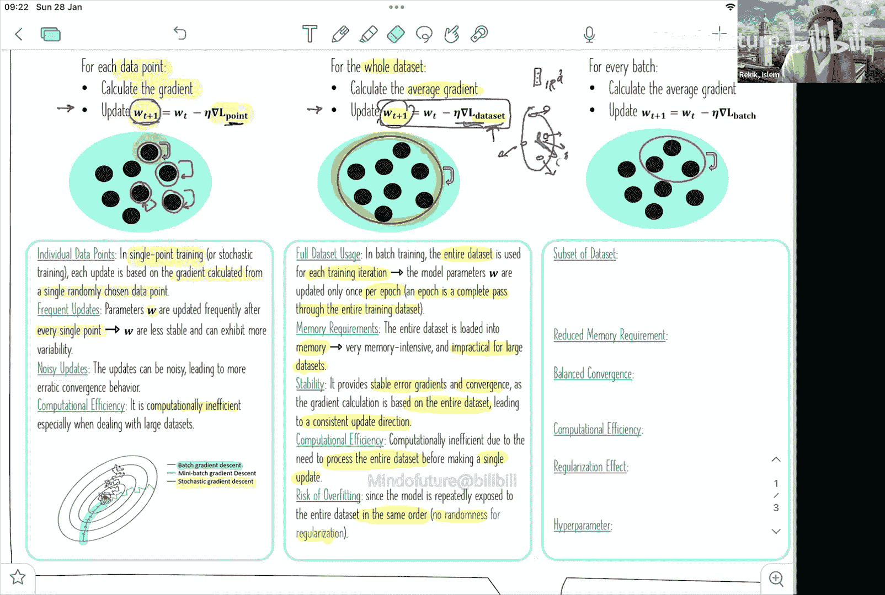

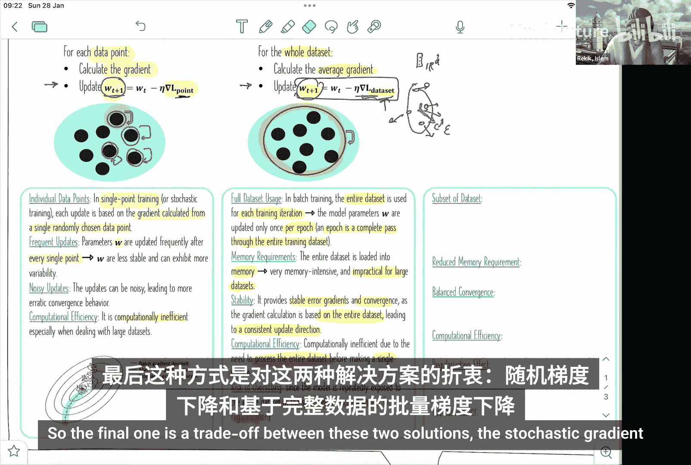

A tradeoff between these two solutions， this stochastic gradient descent and the batch。

 the whole database gradient descent so in this solution we have what we call a mini batch gradient descent and in this mini batch gradient descent here。

 so let's look at this together so i'm going to move this。Right here， that's a bit slow， let's see。

So in the mini batch gradient descent， so basically。

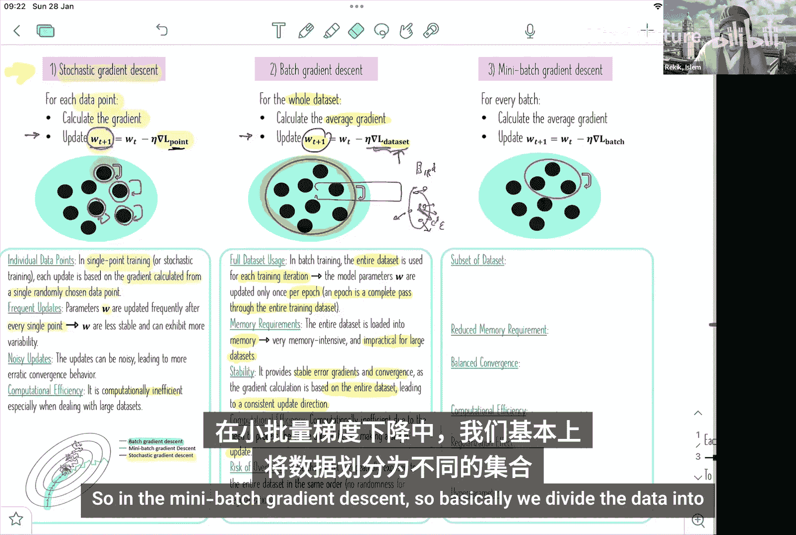

We divide the data into different sets and for every batch batch sorry for every batch for each set we calculate the average gradient so we will calculate the average gradient for that particular batch and then update using the gradient of the training samples inside the batch so any training sample here we will calculate their gradients and then we'll take the average gradient right here okay and this will be the gradient of the loss of the whole batch all right so it's an average across the of the gradient of all these points within each batch now this is a tradeoff because now we're dividing the data into subsets and we're still we still have some variability because every time you have a different set the distribution of the data will vary so maybe here the distribution of the features will look like this but for these you know。

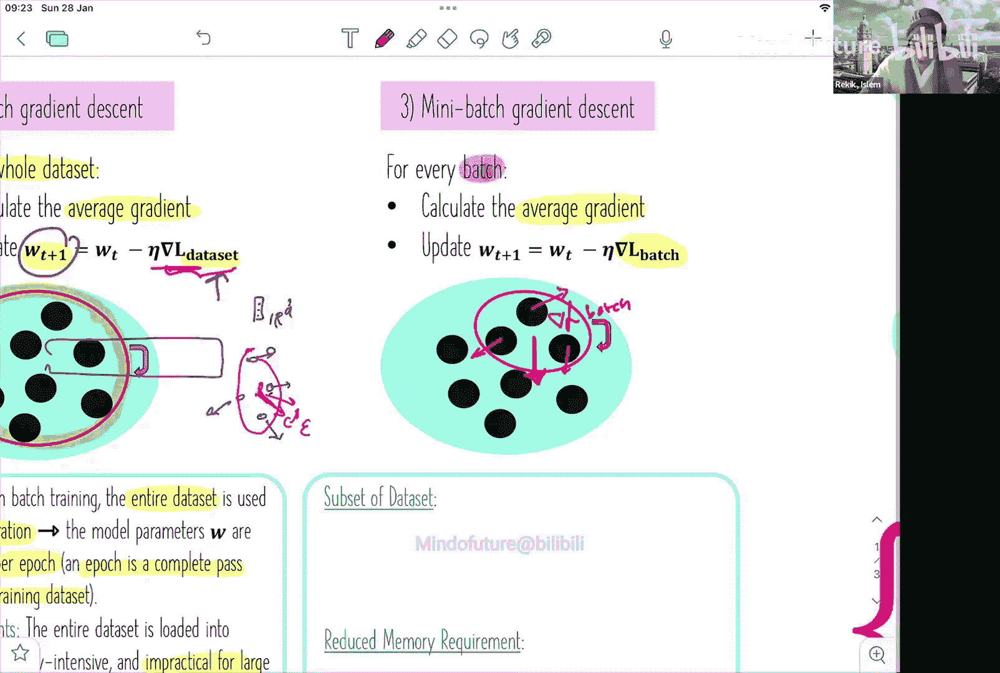

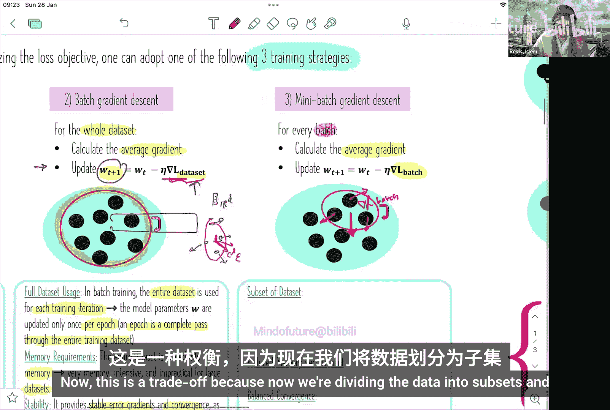

3 samples you may have slightly a different distribution okay so it creates kind of variability you drawing from the final let's say if this is the ground truth distribution of the whole data or maybe something that looks like this all right so you you're trying to kind of you know model different drawings or samplings from the ground truth distribution by doing this kind of clustering so this allows us to simulate different scenarios of data distributions and the model will learn from a diverse data so this diversifies you know diversifies。

The data inputs， which means when you have inputs it means you know distribution right and all it's kind of it properties all right so let's look at this together so now the mini batch。

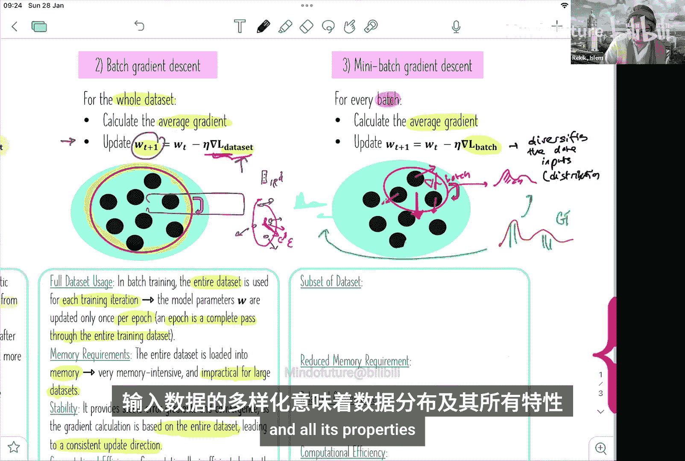

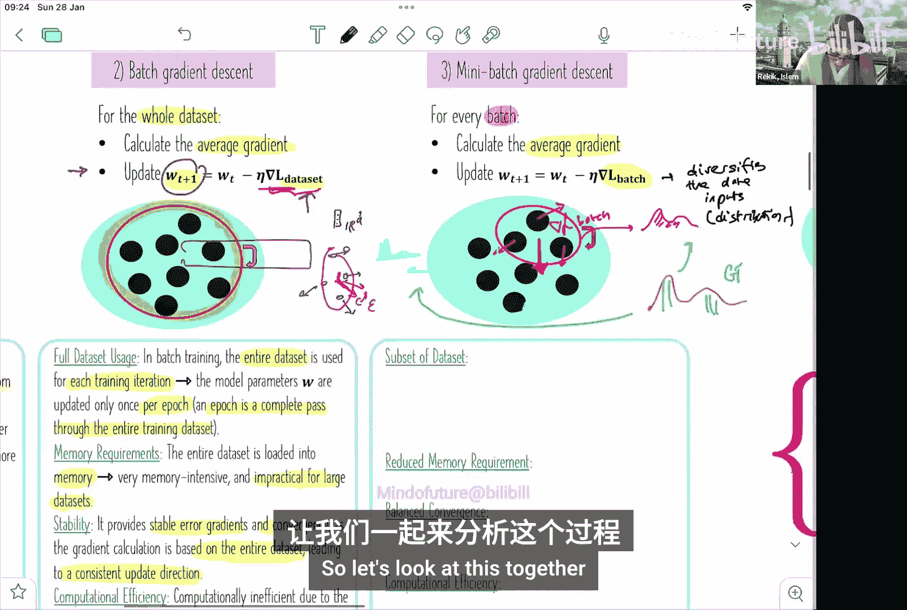

So first we take a subset of data sets so the mini batch training involves dividing the dataset into smaller subsets we call them mini batches and the parameters W are updated for each mini batch independently okay and then once we complete the iteration of across all mini batches then that is considered as one epoC of training all right so we have more frequent updates than batch training but less frequent updates than the stochastic single point training and in terms of memory it requires it is less memory intensive than the batch gradient descent the second option and it is feasible for larger data sets and in terms of convergence we have balance convergence because it strikes a balance between the stable convergence of batch training that we have here so we have a。

Stable convergence right in this diagram and then the faster fluctuation versus the you know thectua fluctuating slow convergence of the stochastic trading so you can see in this example when we have the mini batch。

So the mini batch gradient it has some exact but is more stable compared to the schastic gradient descent it is faster convers faster than schastic gradient descent but it's a bit slower than the batchbased draining okay so it kind of strikes a balance between both extremes and yeah so that's mini batch gradient descent now in terms of computational efficiency it is more computationally efficient compared at least to you know to both options one and two because here we can parallelize we can consider we can calculate the gradient do the updates of the W in parallelel for all batches simultaneously so these could be easily computed using GPUs and it has a regularization effect so this is a very nice property to have so as I mentioned earlier。

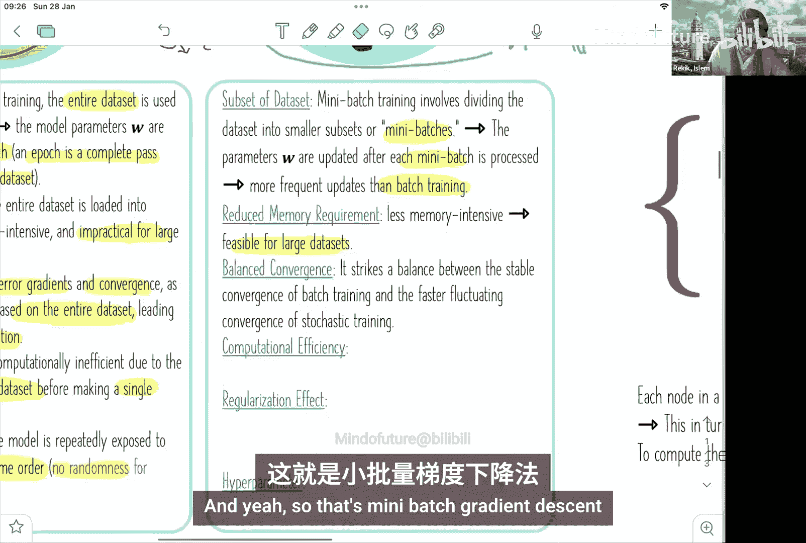

The variability in the mini batch samples， the variability in the distribution can introduce some noise into the training process and it acts as a form of a regularization so there is some randomness there。

 there is a shift of distributions of the training data so every time you update the W it's going to look at a particular distribution here it will be affected by a particular distribution and that variation will create a better generalizability power of the model parameters to optimize okay now there is a hyperparameter here which is the size of the mini batch so the size of the mini batch it can affect the performance and the efficiency of the training so if you have you know when you set the size to the whole data we go back to option two and if you set the size of the batch to one it means you go back to option one right the single pointbased training so you want to strike a balance between。

These and fixing the size how many samples， what is the size of your cluster here is important so you can。

 for example， take you know five points you can take three points so how to actually fix that it's still an ongoing area of research。

All right， so this was， you know， batch based training or optimization or grading descent using three different approaches。

