# 深度图学习：P14：点、批次和小批次梯度下降

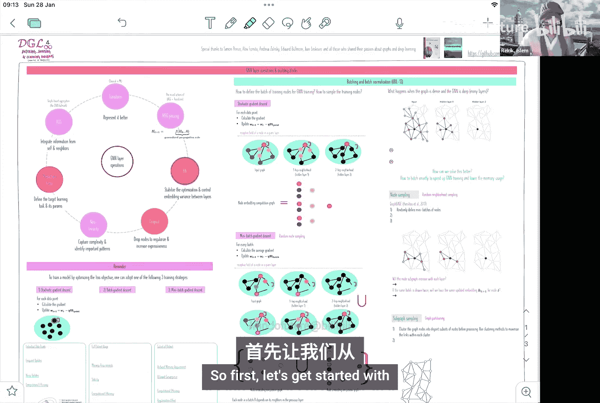

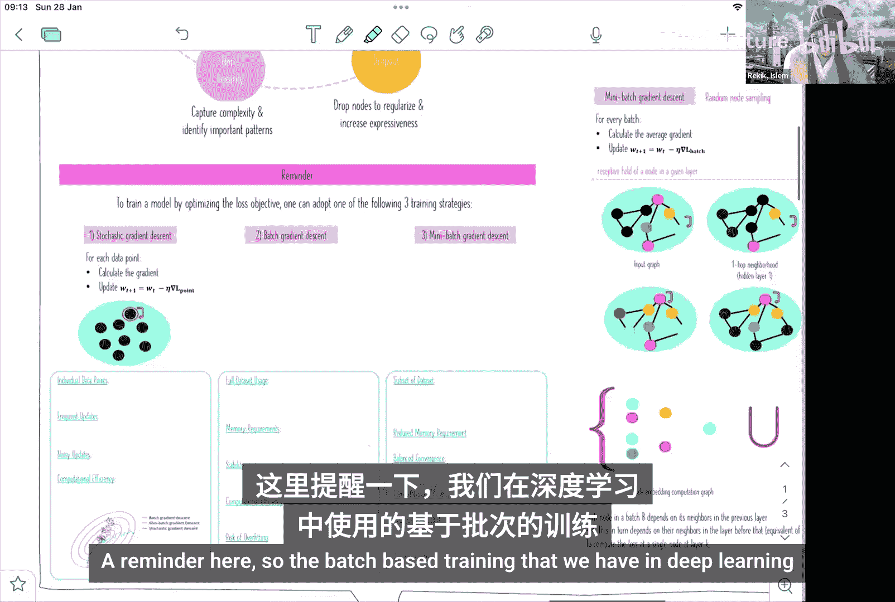

在本节课中，我们将学习批处理、采样以及不同的训练或学习范式。我们将从深度学习中的批处理训练开始，探讨三种主要的梯度下降策略：随机梯度下降、批量梯度下降和小批量梯度下降，并分析它们各自的优缺点。

## 梯度下降策略概述

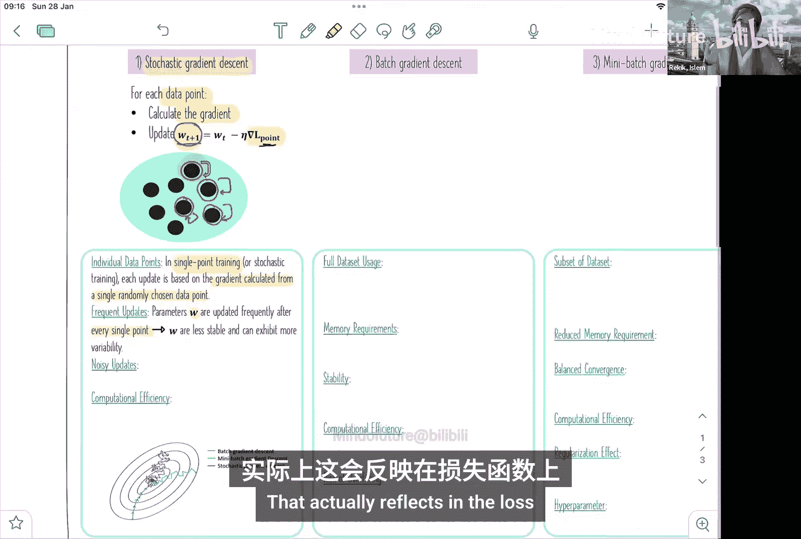

为了训练模型，我们的目标是优化一个目标损失函数。通过优化，我们可以得到最优的模型参数 **W**。无论是深度学习网络还是图神经网络，为了执行训练，我们可以采用以下三种策略之一。

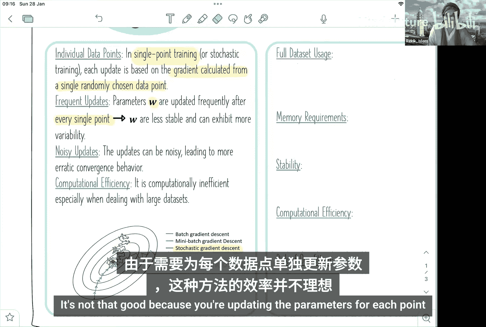

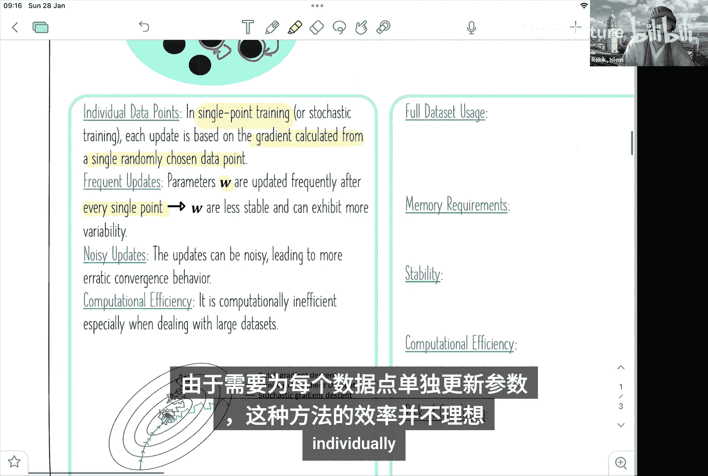

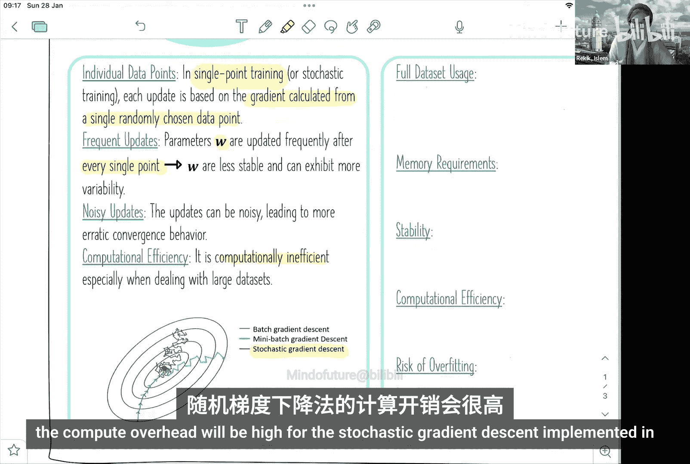

## 随机梯度下降

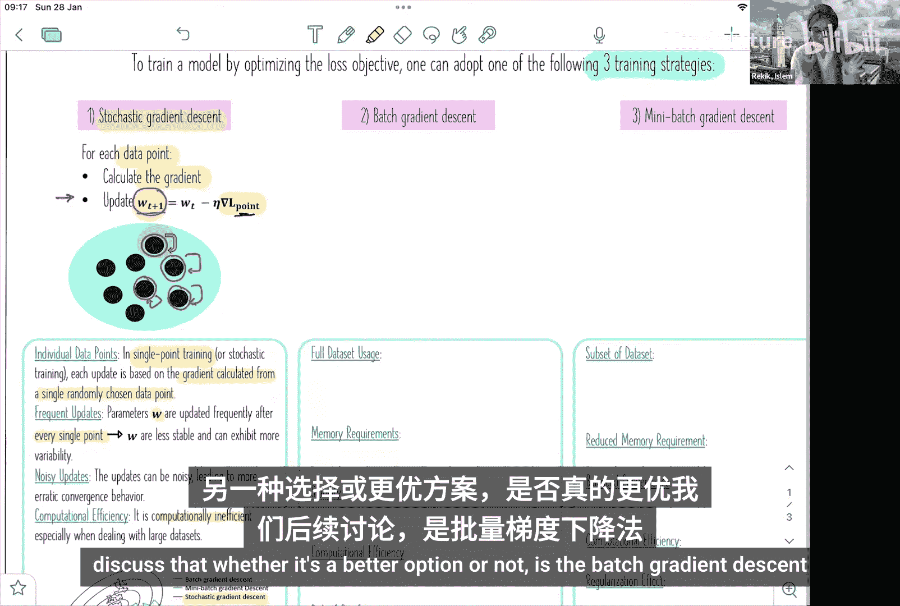

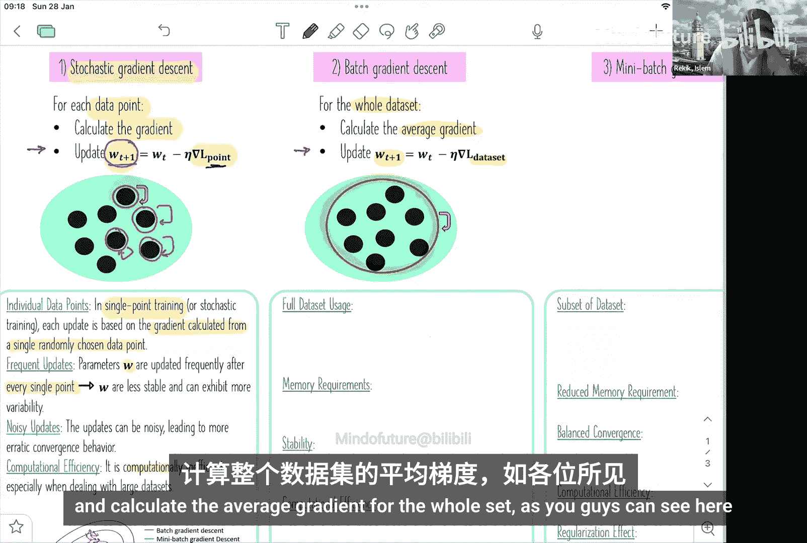

上一节我们介绍了训练的基本目标。本节中，我们来看看第一种策略：随机梯度下降。

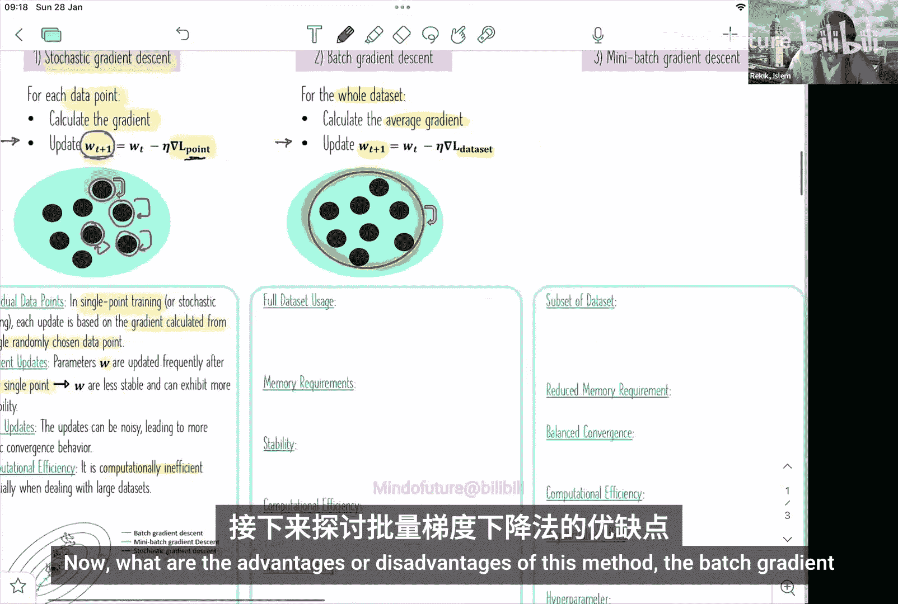

在随机梯度下降中，我们处理每个训练点。对于每个数据点，我们计算该点处的损失梯度，然后更新权重。这意味着我们将逐个遍历所有点，每次处理一个点时都会更新一次权重。

以下是随机梯度下降的核心特点：
*   **单点训练**：每次更新基于从单个随机选择的数据点计算出的梯度。
*   **更新频繁**：参数 **W** 在每个点之后都会频繁更新。
*   **参数不稳定**：由于每次输入一个样本都会改变参数向量 **W** 的方向，导致训练过程不稳定。
*   **收敛行为**：损失函数会呈现明显的“之”字形波动，虽然最终能收敛到最优解，但耗时较长。
*   **计算效率**：由于需要为每个点单独更新参数，计算开销大，效率较低。

## 批量梯度下降

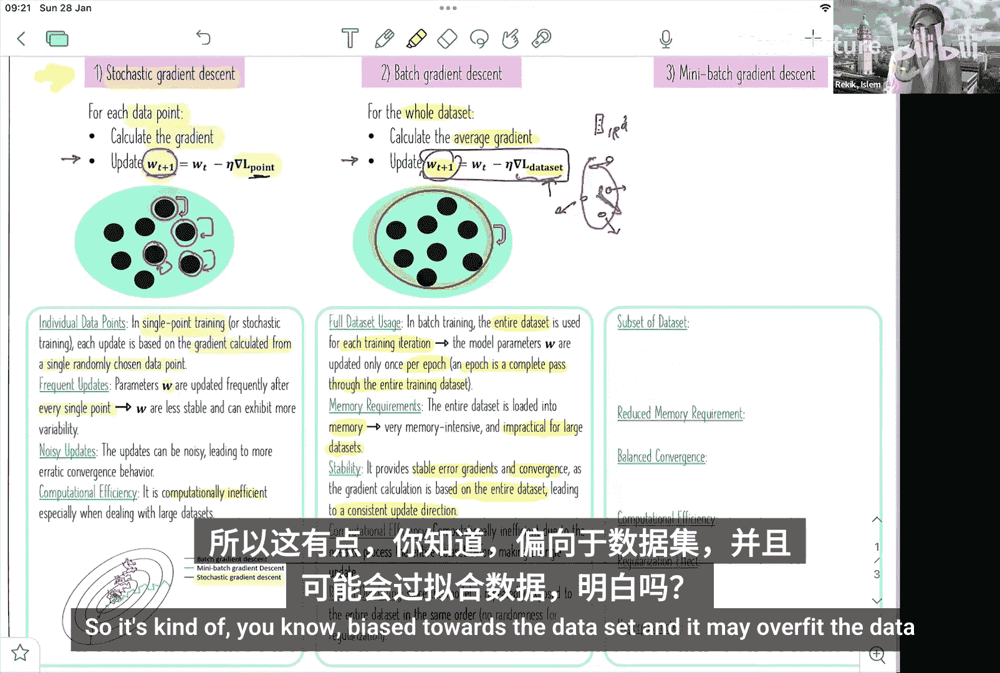

上一节我们介绍了随机梯度下降的特点。本节中，我们来看看第二种策略：批量梯度下降。

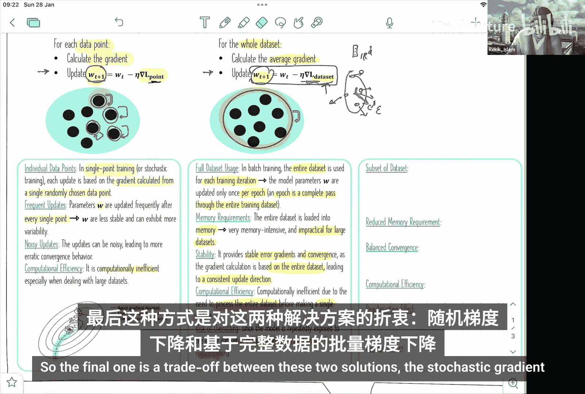

在批量梯度下降中，我们使用整个数据集来计算平均梯度。梯度是针对所有数据计算的，并且我们只更新一次权重 **W**。基本上，我们取整个训练数据，计算平均梯度，并一次性更新神经网络所有层的权重。

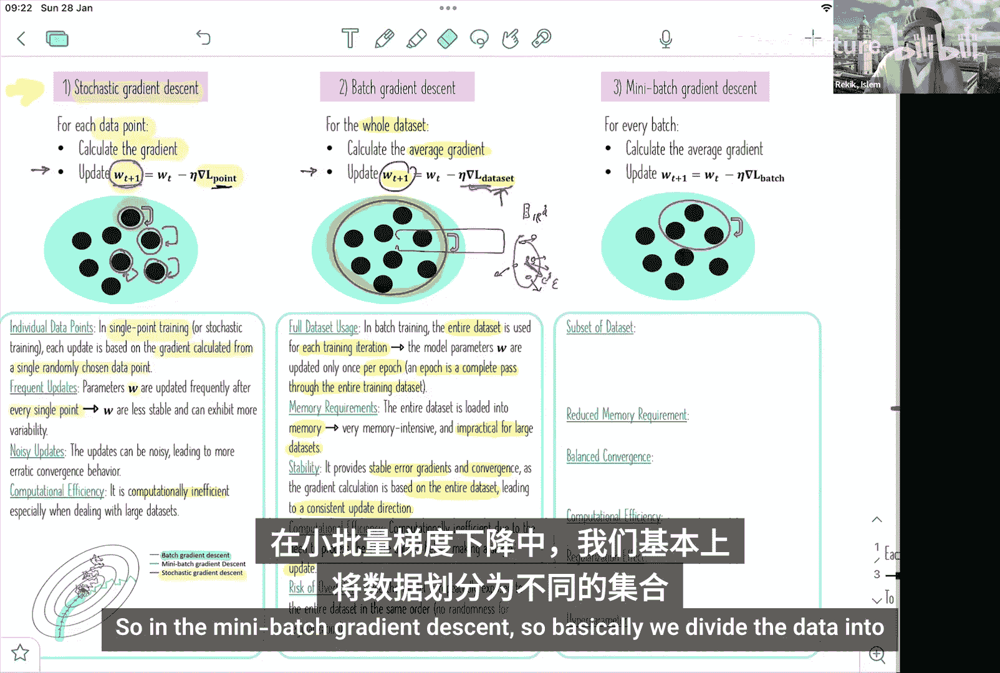

以下是批量梯度下降的核心特点：
*   **使用全部数据**：每次训练迭代都使用整个数据集。
*   **更新频率低**：模型参数每个周期只更新一次。在这里，一个周期意味着完整遍历一次整个训练集。
*   **内存需求高**：整个数据集需要加载到内存中，这对于大型数据集可能不切实际。
*   **稳定性好**：由于使用整个数据集，能提供更稳定的误差梯度和收敛过程。
*   **计算效率**：在单次更新前需要处理整个数据集，计算成本高。
*   **过拟合风险**：模型一次性接触所有数据，缺乏随机性带来的正则化效果，可能偏向于数据并导致过拟合。

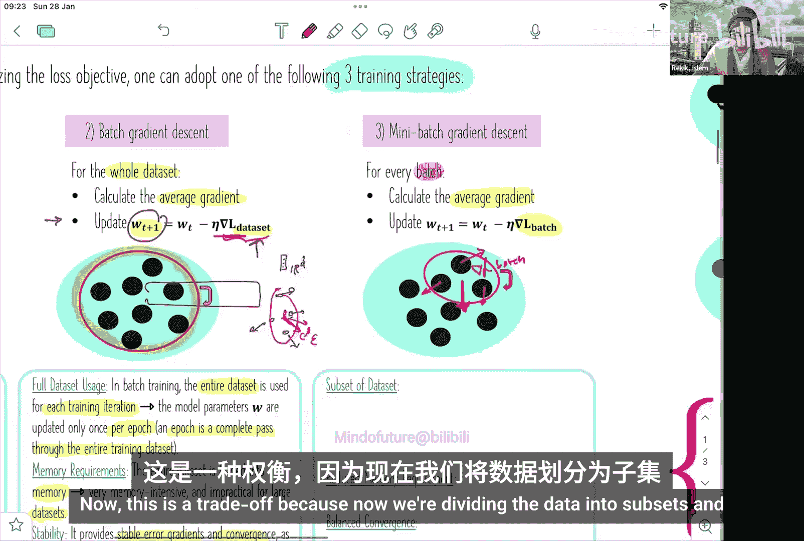

## 小批量梯度下降

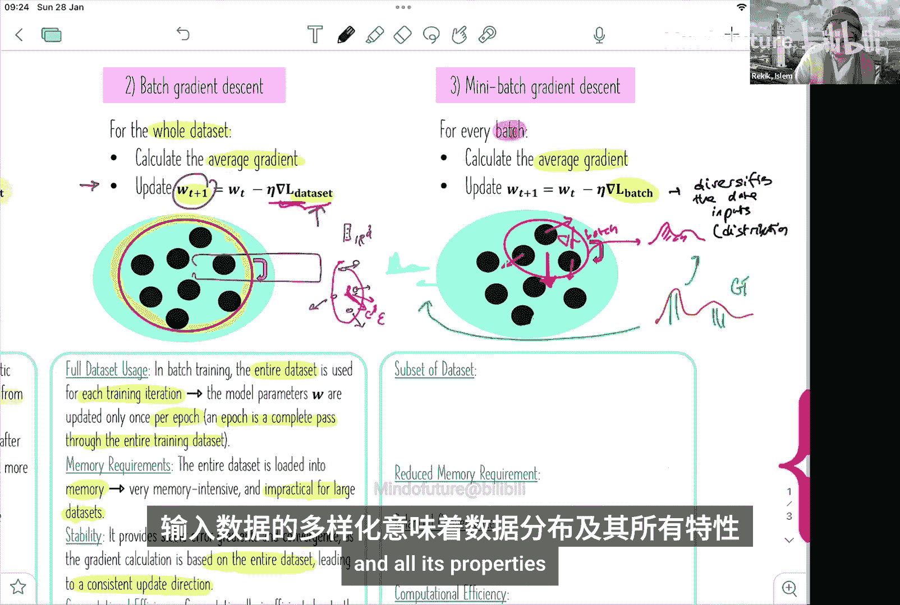

上一节我们介绍了批量梯度下降的优缺点。本节中，我们来看看第三种策略，它是前两种策略的折中方案：小批量梯度下降。

在小批量梯度下降中，我们将数据划分为多个较小的子集。对于每个子集，我们计算其内部所有样本的平均梯度，并使用该梯度来更新权重。这相当于对每个批次内的点梯度取平均。

以下是其核心特点：
*   **数据子集**：训练涉及将数据集划分为更小的子集，称为小批量。
*   **更新频率**：参数 **W** 为每个小批量独立更新。遍历所有小批量构成一个训练周期。其更新频率高于批量训练，但低于随机单点训练。
*   **内存需求**：比批量梯度下降的内存密集度低，适用于更大的数据集。
*   **收敛平衡**：它在批量训练的稳定收敛和随机训练的快速波动/慢收敛之间取得了平衡。
*   **计算效率**：相比前两种方案更高效，因为可以并行计算多个批次的梯度更新，易于利用GPU。
*   **正则化效果**：小批量样本的变异性会在训练过程中引入一些噪声，这起到了一种正则化的作用，有助于提高模型的泛化能力。
*   **超参数**：小批量的大小是一个重要的超参数，会影响训练的性能和效率。大小设为整个数据集则退化为批量梯度下降，设为1则退化为随机梯度下降。

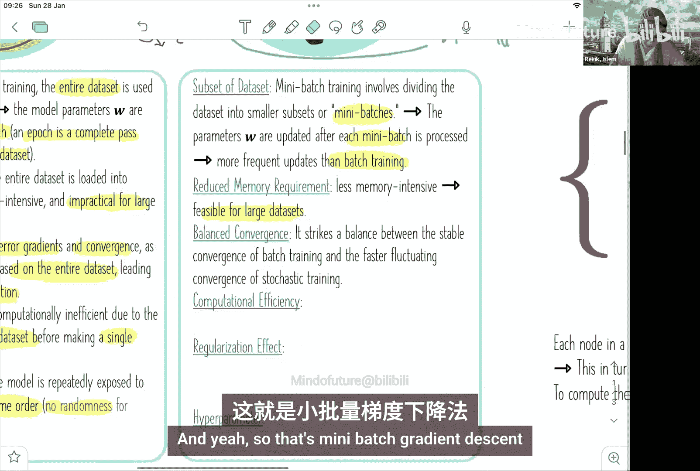

## 总结

本节课中，我们一起学习了三种基于批处理的梯度下降优化方法。我们了解了随机梯度下降的频繁但嘈杂的更新，批量梯度下降的稳定但内存消耗大的特点，以及作为两者平衡的小批量梯度下降。小批量梯度下降因其在收敛稳定性、计算效率和正则化效果之间的良好权衡，在实践中被广泛采用。选择合适的小批量大小是优化训练过程的关键之一。