# 【伦敦帝国学院】深度图学习 ｜ Deep Graph Learning p15 P15_4.2_批处理与图神经网络采样方法 -BV1WZUKBmEQA_p15-

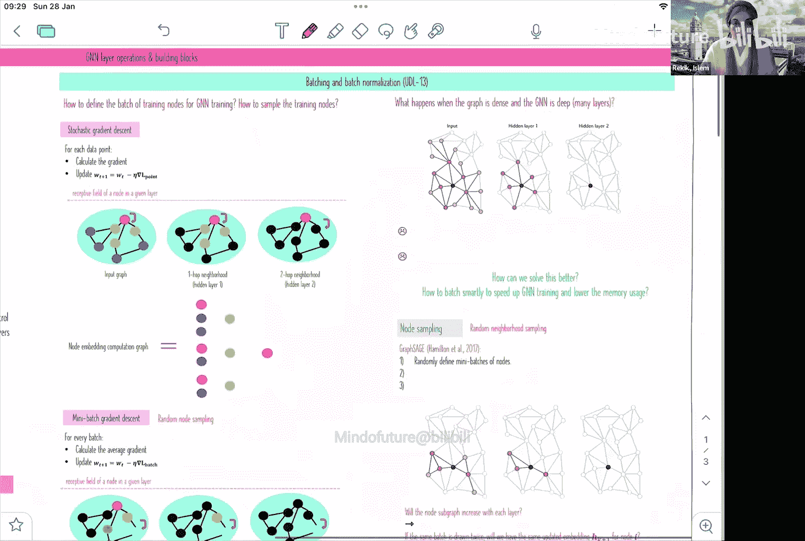

All right， so after this brief introduction now let's look。

 how are we going to generalize or apply this batch based training or mini batch based training approaches to GNNs graphph neural networks。

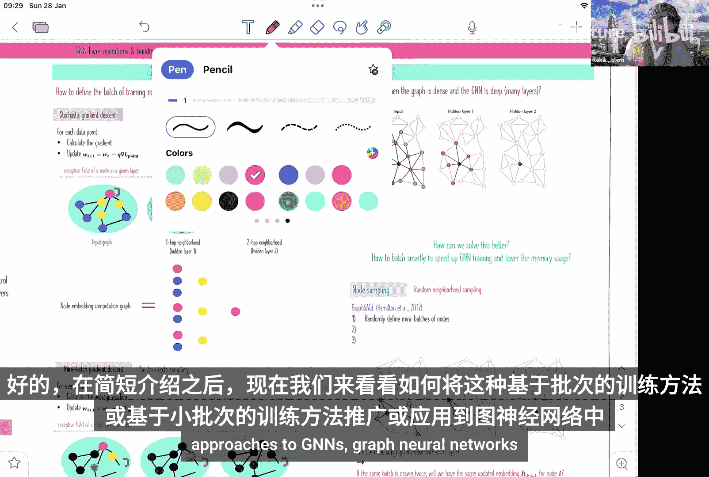

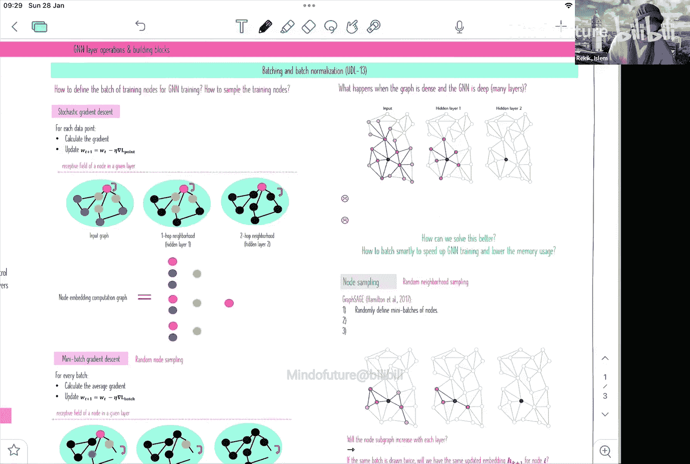

So the first question here is how to define。The batch of training nodes for GNN training so how to sample the training nodes and we can look at a simple example so let's start with these stochastic gradient descent so let's see how this works on a single graph so we will apply these rules so basically for each data point we will calculate the gradient of the loss and then we will update the parameters of the whole network all parameters of the GNN layer okay using including the transformation on linearity if we have。

 for example any additional layers like MLlP layers we will update all these so W here is the aggregated parameters of the whole GNN network from the first layer to the final layer okay so now。

If we do this， so here I want you to look at this figure and let's see what we have here。

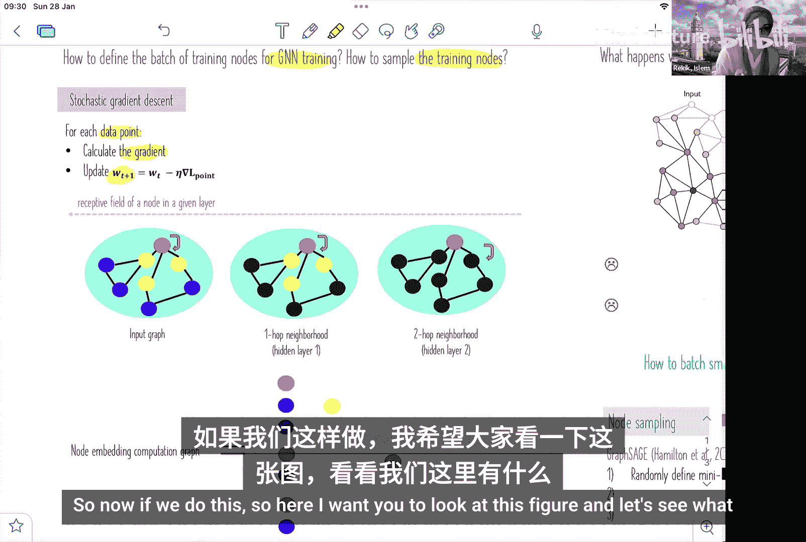

So let's say we want to update。The actually this is so we want to update this node so we want to calculate the gradient at this particular node training sample or training node in our GNN and to update to calculate the gradient or to update you know the embedding of this node right we need to calculate the gradient of the loss and to do so we need to use the neighbors right so basically for every single node in a particular layer to have the updated parameters for this node to update the embedding of this node we need to look at its neighbors so we need to trace it back so we look at its neighbors first you know oneh neighborhood and then if we we trace it backward or to the origin the origin of the network so here because we have a twoh neighborhood it's a two layer network we trace it back so we have。

The first you know， neighbors here， let's call them one， two and three， Okay， and then we will have。

The neighbors of the neighbors so we trace it back again and we will have these neighbors here45。

6 and7 all right so you can see that all of these nodes they actually contribute to the update of the embedding vector H you know at a particular layer here K plus2 so K is equal equals to2 so if we want to update to calculate the node embedding at this layer so let's call this node I for example okay or0 we start0 of node zero then we need we need to basically trace it back right so let's put H and this is node0 so I equals zero so yeah so so the problem here is that。

We need to you know like trace it backwards throughout the layers until we get to the first layer and here this is actually the receptive field of the node in a given layer so this whole area right here defines the receptive field of the node and the receptive field is defined when we you know like kind of a backdrop or like you know we trace back all the connections of one neurons to all other neurons in a network until we get the a set of neurons that affect the set of neurons that affect the decision made at this particular layer so these are all set of neurons or set of nodes in this case that affect the decision or the update rule that happens here H you know k equals2 of node I as0 all right so now let's。

Transform this into a node embedding computation graph。

 so computation graphing means for to get the update for the node0。 what do we actually need。

 So let's look here。So first， we need to trace back its， you know， like neighbors in the。

In so this is in layer one all right， and then here we have you know， one，2。

3 and then the neighbors of the neighbors， so to aggregate information of all these embeddings all right of these notes。

 this em right here was actually updated using。Its neighbors so what are the neighbors of node one it's actually four five and zero right so here we have four and five。

And then for node two we have0 and6 and for node three we have0 and7 so now we can build our computation graph right like this all right and then you can see that to get the final update embedding here updated embedding over here we actually need to access the embeddings so all these nodes in the previous iteration so you guys can see here all of these are required for our computation okay so even the node itself right here so this is this is what we call it computational graph for the node embedding update rule and we have expandedend it throughout the whole you know like a neural network so tracing it back to the very beginning of the network and this is what is required actually to get this update right here the H of layer node2 and node。

So let's put this way and node equals zero， all right。

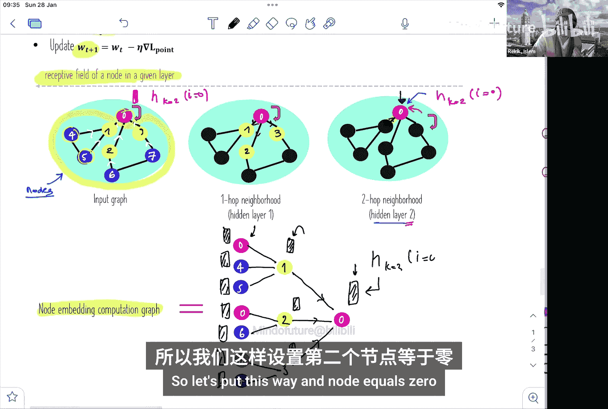

Now。If we're going do this for every single point you will see that there will be a lot of redundancies because if now I'm going to calculate the computational graph of node one okay and node two separately and then for each of these node three to randomly sample maybe six four etc you will see that these computational graphs they have you know there is an overlap with their neighbors so there is an overlap in these computations so we calculate the same thing multiple times so when we do s acidastic gradient descent for each node individually on a graph it is actually very intensive because it requires the calculation of similar shared pathways and neighbors right four different nodes so and you can see this also within the same you know within a single computation graph so if we want to update this。

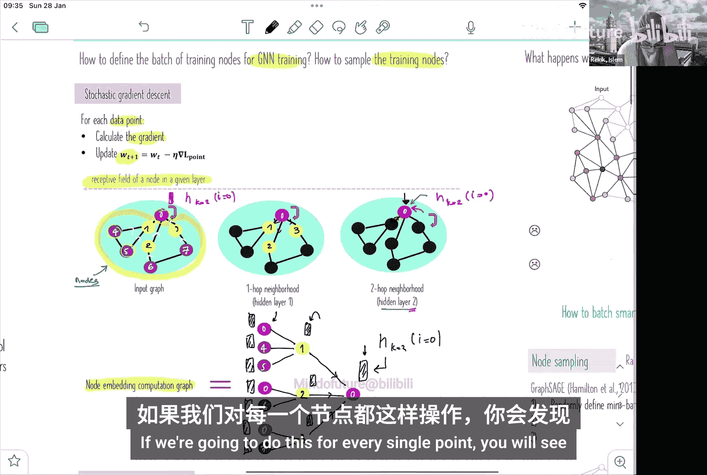

Each note individually， the calculation of the gradient will have a lot of redundancy， so we'll have。

 you know， redundancy。Especially between neighboring。Neighboing training。Notes which are here points。

 okay， data points。All right， so this is not something really nice to have and as we have seen before。

 stoacastic gradientding descent， whether you use it on GNS or deep learning it is actually time consuming so let's try to see a better solution。

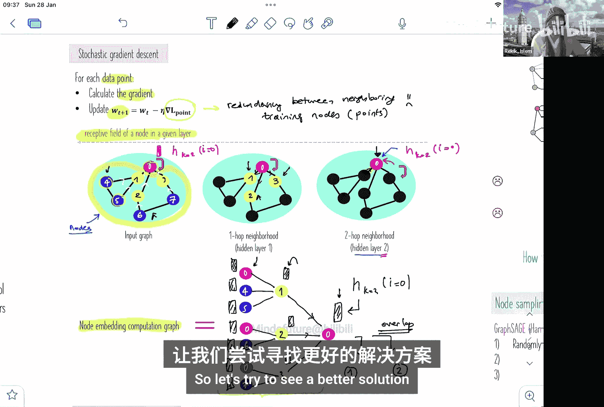

So here we will look at the mini batch， so let me just move this a little bit up so。

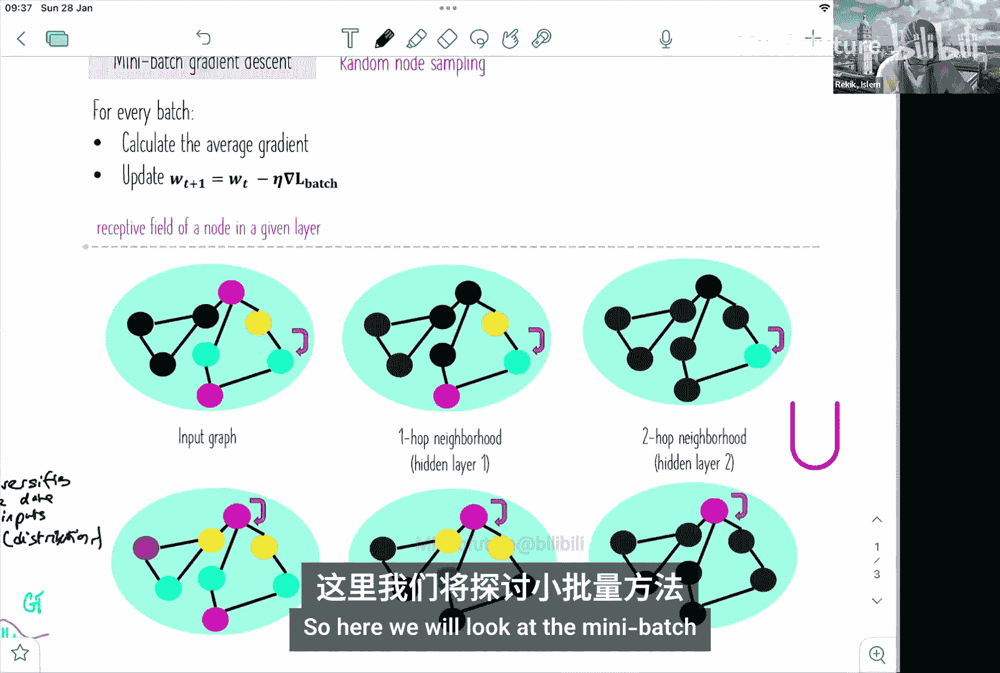

So I'm going to put here。😔，All right。

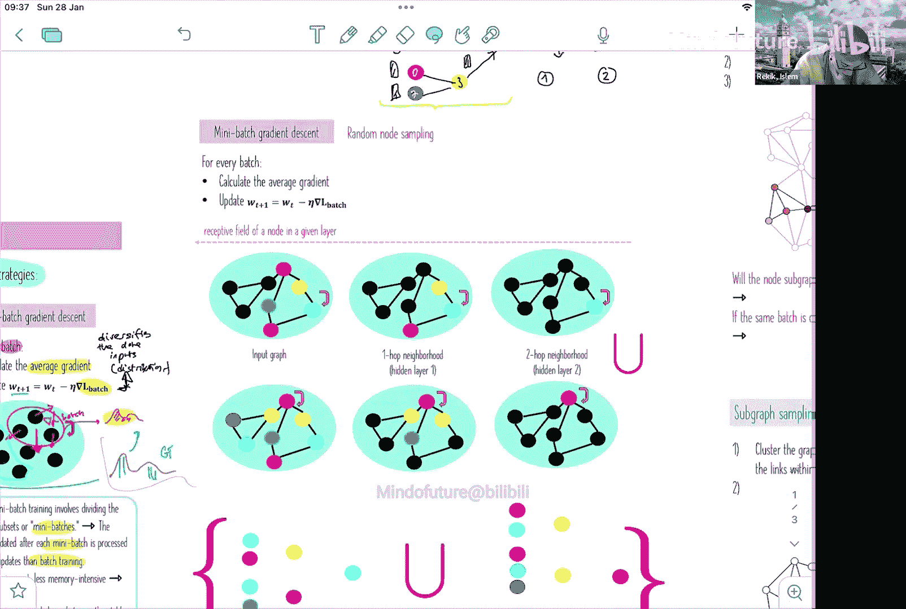

Okay， so now for this mini batch gradient descent， let's look at this example。

 So here we will use what we call。

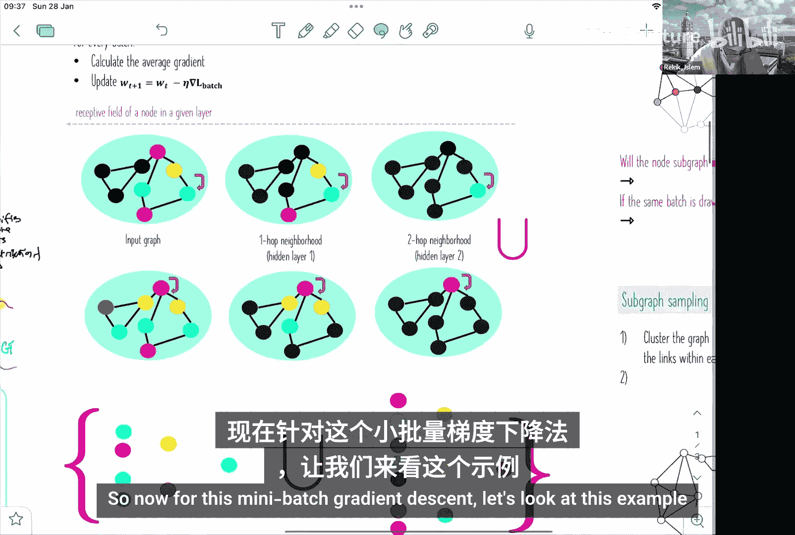

A random node sampling all right， so a random node sampling。

 it means like we will take we will define a batch。Using randomly sampled nodes。

 so randomly sampled notes， let's say this is the first node here。

 let's call it node for example I right so this is node actually this is the main note node I here。

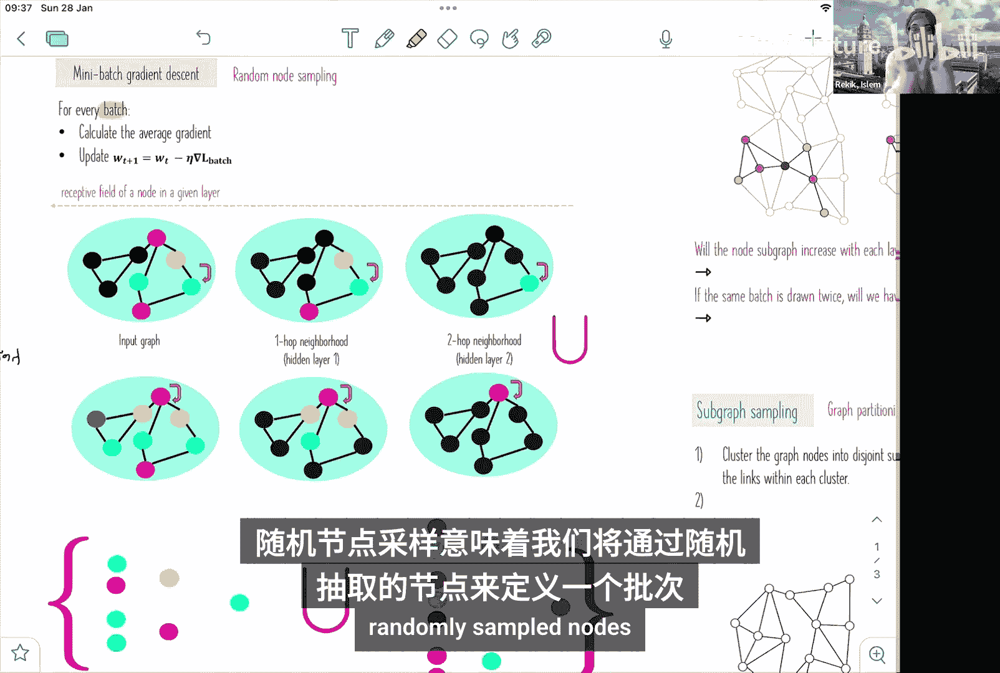

So I'm going to put I and then we have node J。 All right， so here I'm giving an example of the batch。

A batch composed of two nodes So here a batch you know B the size of B is two which is nodes I a node nj okay so it's the same idea basically you take the graph you randomly select some training notes so here we sample this node and we sample this we can sample more of course okay so for example。

 four nodes and that defines your mini batch alright and you're going to calculate the gradient across you know of these four nodes for example。

 if you have nodes in a batch now let's look what happens here so what do we have here in this case。

So let's write or kind of you know define the node embedding computation graph for each of these two nodes。

 so first let's start with node with node I so for node I has two neighbors it has that call it neighbor one and two so one and two so i'm going to put it here all right。

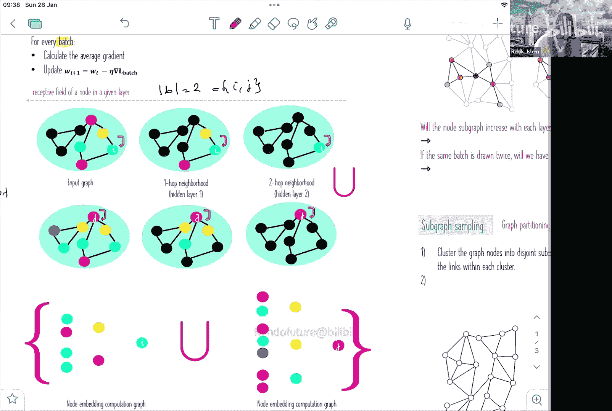

And then one has two neighbors sorry it has only yeah two neighbors， it has the pink。

 so it's called three。Alright， and then this is I right and three happens to be an node j。

 so I'm gonna call it J here for consistency。 Allright。

 so this is node J in itself right so and what are the neighbors of two it's node I and let's call this you know number three So we have one2 and three。

 so that's three okay for example， so this is a computational graph of the first node and the depth is2 okay so if you want to update to depth2 get the final embedding to get the final embedding of node I we need to you basically get the embeddings of all these nodes at the same time to do the aggregation and then the transformation Now for node j is actually more interesting so we have more expensive neighborhood and you can see because of the degree of the node So the node J has three connections is connected to three nodes and。

Here we have one。And then we have so we put three here so three right and then we have I so let's put this is j itself right and we have for example four let's put this four so it is connected to four three and one and then we need to trace back so what is connected to these two so let's put the numbers here for。

Three is this I and then it's put five and six， so we have five and six， right？

And then we have J2 so what do you guys notice now what happens is that to get the embedding here to do the update calculate the gradientd we need to you know like take the union of all these notess and all their embeddings and。

We need to calculate independently we're calculating independently this node embedding computation graph and the second one right so this is a waste of resources why is that because there is an overlap so let's find the overlap for example we can see that node3 is used to update the node embedding of J but also is used also to update the node embedding for node I another overlap or redundancy we need to calculate the embedding for for node4 well it's not reus so let's remove that actually node one so we need to calculate the embedding for node one。

Here， which is also required for node。I so node one embedding is required for both I and J。

 but what we're doing we're calculating them separately in each you know for each node individually so each node has its own computation graph that needs to be calculated okay or inferd so now this is you know a bit problematic so let's look at this so each node in batch be depends on its neighbors on the previous layers okay so the neighbors on the previous layer this one and this in turn depends on their neighbors in the layer before that so the layer before that which is this one okay so now what happens is that。

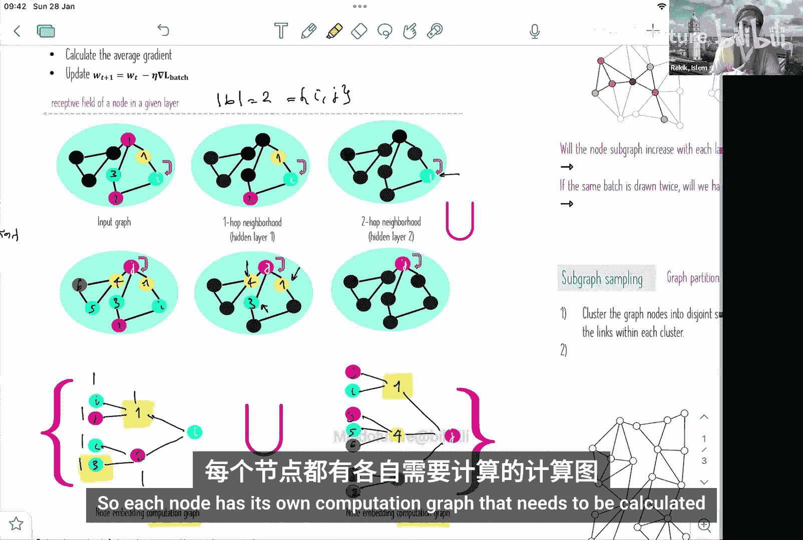

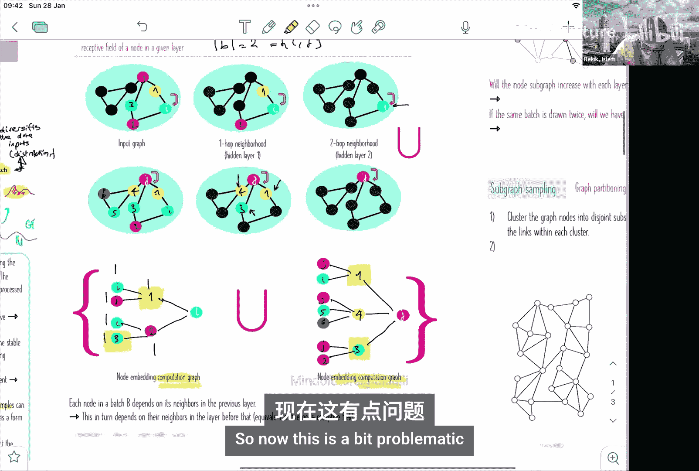

This is very time consuming because every time we want to calculate the loss at a single node in a single layer。

 we need to actually so we need to let's look at this。

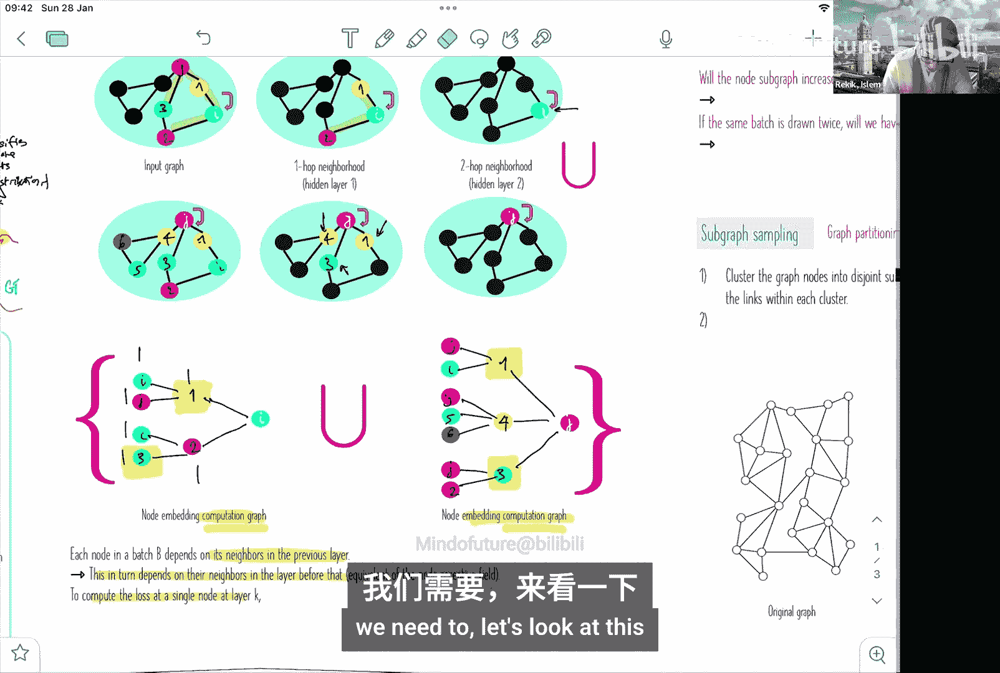

We need to calculate the nodes embeddings of the nodes neighbors。

 so we need to calculate the nodes neighbors nodes embedding at layer k minus1 and the recursive ones in the downstream layers as we go。

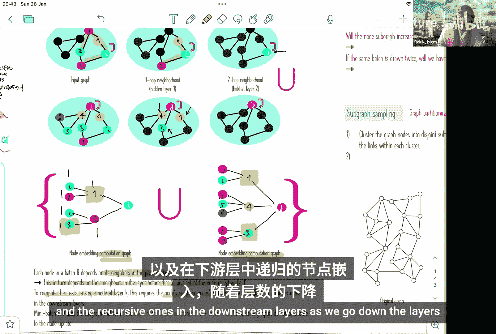

Down the layers okay so basically this is very time consuming and if you use mini batch stochastic gradient descent you will we will use actually the subgraph that forms the union of the kh neighbors and B so here to do the the batch will be defined by the union of this subgraph so this is the first subgraph。

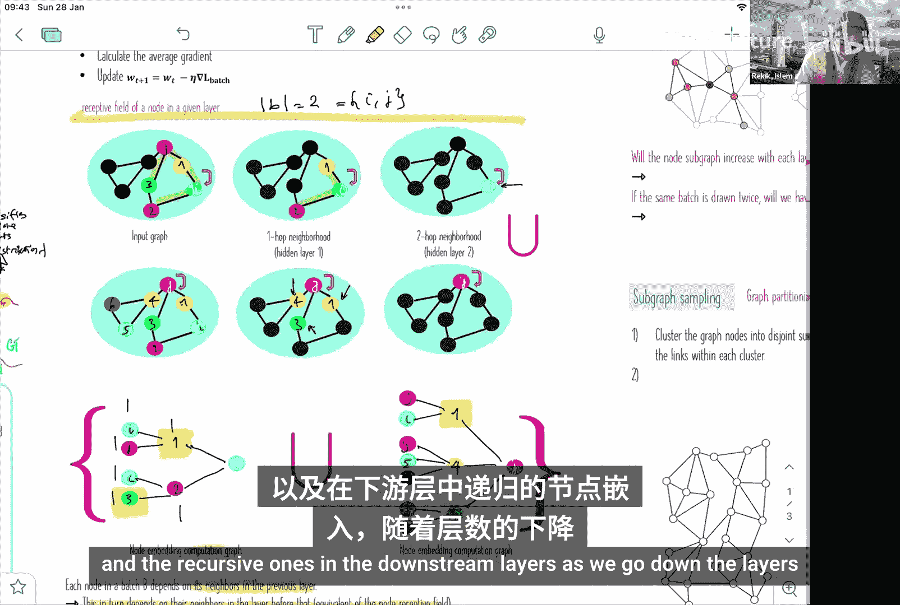

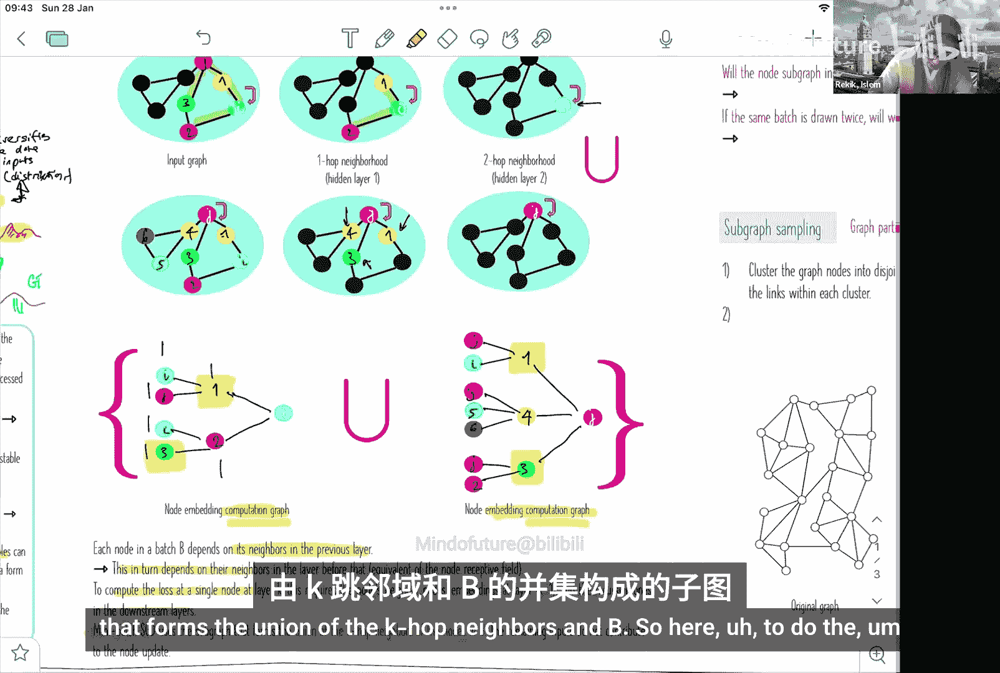

Okay， which is this one？And the subgraph required for the second node and the subgraph required for the second node let's call the blue one so this one okay so there is an overlap here you guys can see so if the union of both and the union will give us the hold here because we have a small graph but I want you guys to imagine a very large graph so you know you will take the union of the local neighborhood or the neighbors of the neighbors of all sampled randomly sampled node and that will form your mini batch okay and so this will form your mini batch if the union of the Khop neighbors of all nodes in B and Khop it means you start from。

 for example if K equals3 you go to210 if K equals5 you get54321 etca trace it all the way back for every single node that you sampled in your mini batch okay。

So now the remaining notes will not contribute to the node update。

 which is kind of good so that's fine now like we're we're not going to update then the。

The nodes using the other you know like any further away or far away nodes。

 however here you guys can see that actually because our graph is kind of small so we ended up the union involves the all node Okay in this case just in this case all right so i'm gonna remove this so allright cool now we have seen how we do single stochastic gradienting descent it's a bit blurry sorry about that so let's wait mile is heavy now stochastic gradienting descent also the mini batch so how do we do mini batching and let's look at this question now。

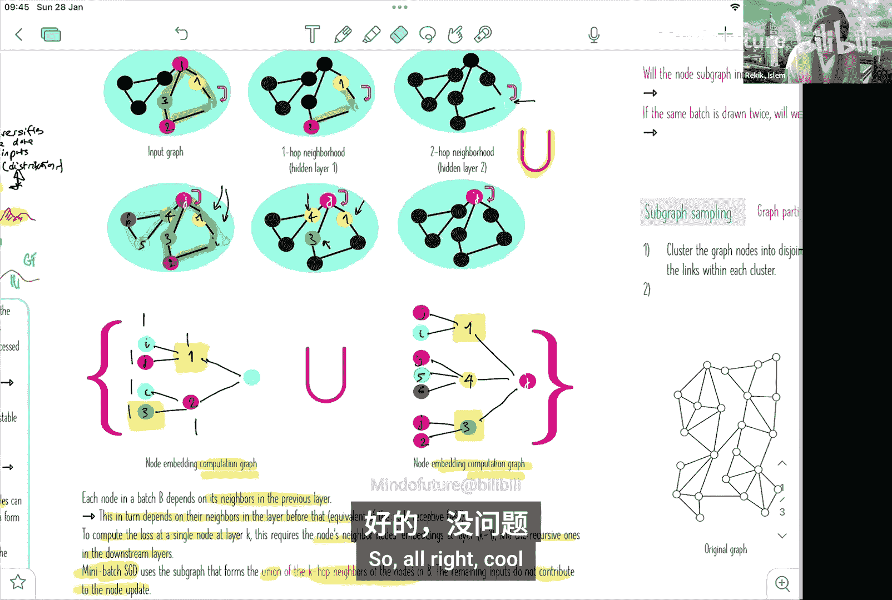

So what happens when the graph is dense and the Jianan is deep？All right。

 so if we have a very dense graph and we randomly sample nodes in a mini batch， right。

 so I want you to take a minute and think about it。So in terms of computational power。

 in terms of memory budget， in terms of you know， training， etc cea。

 so as you have if you have a dense grab where everybody is connected to everybody。

Then every time you sample， right， there is a likelihood。

 there is a you know a high likelihood that one sampled node would be。

En neighbor or close to another sampled note。And you know， in this case also。

 it means that you need to include if it's densely connected， what happens as you guys can see here。

 so let's look at this example， so we want to calculate update the embedding of this node。All right。

 so we have the embedding of this node， so to do that we need to trace it back so we need to identify its you know first rank neighbors。

And then after we do that here。It's actually these guys， right？All right。

I'm going to remove this one。Then we do the second， the neighbors of the neighbors。

 so the neighbors of the neighbors will give us all these guys， okay？So these， these， oh these。

And then second， right， so a neighbor of a neighbor。And then right here。All right。

 and then so basically we're going to get all these these nodes right here， Okay， so these nodes are。

Are very dense so we're covering almost the whole graph right so to update this embedding I this is my receptive field I need to go I need to calculate the embeddings of all these guys that are required for the aggregation the the aggregation you know that we need to do for。

Calculating the embedding at this kind of the final layer layer to here。

 for example okay or this particular layer so here this is basically what we call a graph expansion problem which means every node maybe in the receptive field of every output so you will end up you know of all node being in the receptive field of a particular node so if I select this node i'll have a similar receptive field of very large kind of receptive field like this right if I sample another node if I want to update another node right here so we're going to have also the same problem or this one so basically this is this is really you know intensive in terms of both memory usage and compute budget so it's not feasible to have this kind of you know update because here if we do node based sampling to create。

Rendandom note sampling to create the batch， the mini batch。

We're sampling in a dense graph and the dense graph everybody is connected so in dense graphs and deep graphs with multiple layers with many layers。

 you will not be able to calculate this or to do the updates you may get an out of memory error or it may take very long you know a very long time to train your network so now。

Aside from in addition to the graph expansion problem， so just expanding on that， so this is really。

 as I said cost to training sometimes impossible because you have an exponential time complexity for a fully connected graph right to the GCN depth。

 the number of layers in the graph neural network so。

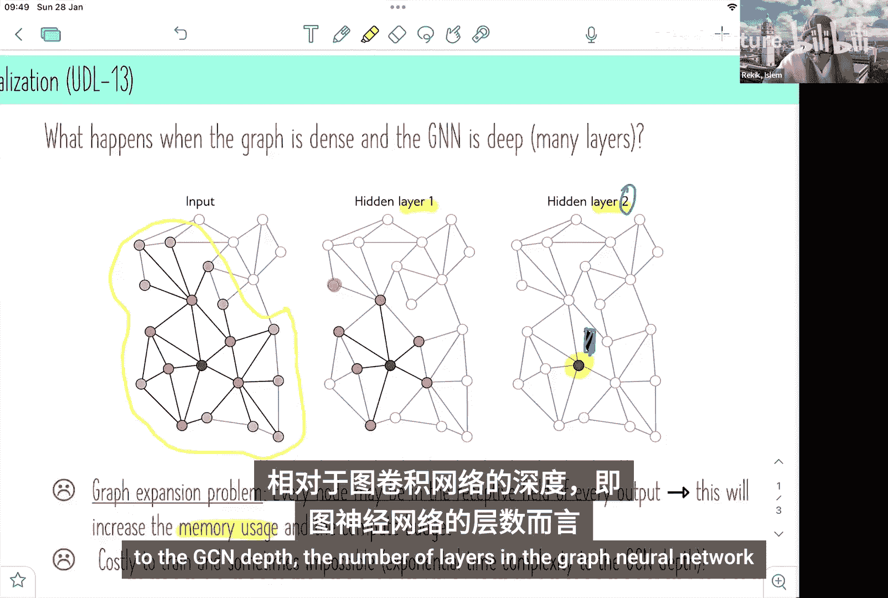

How can we solve this better， how to batch smartly。

 how to select the nodes that will go into particular batch。Okay， smartly。

 just speed up the GenN training and lower the memory usage。

So this is a kind of a question I would like you guys to reflect on before I reveal the solution to you。

 so here what we have we have remember if we have two notes and the notes they share neighborhood they share neighbors or their own neighbors right we will have a lot of overlap between them and and we want to actually minimize that a little bit or somehow leverage that okay so to avoid a lot of redundancies and。

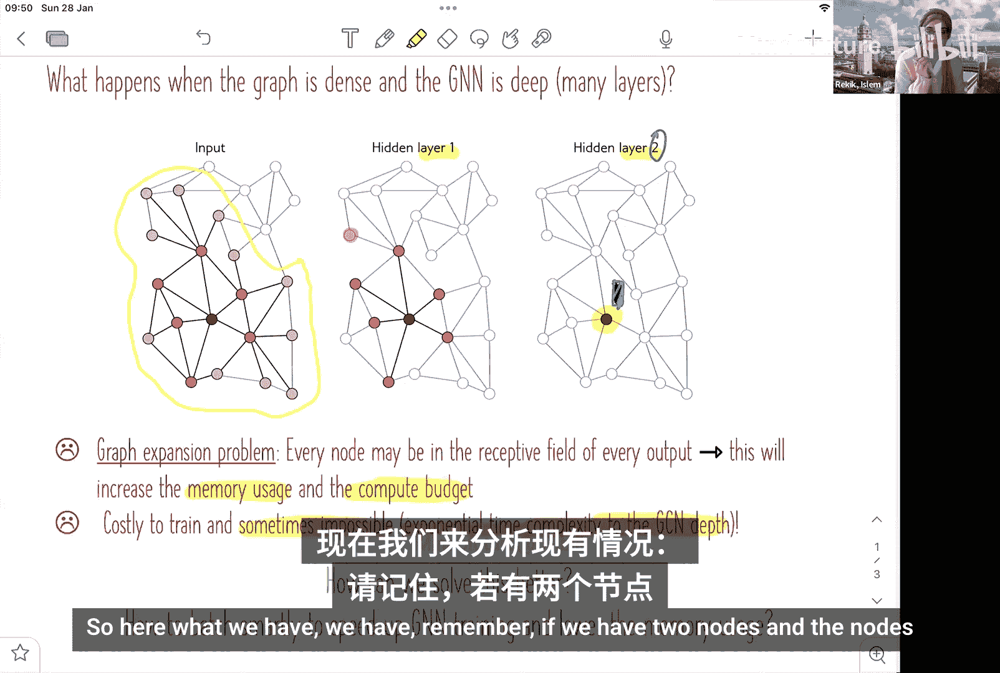

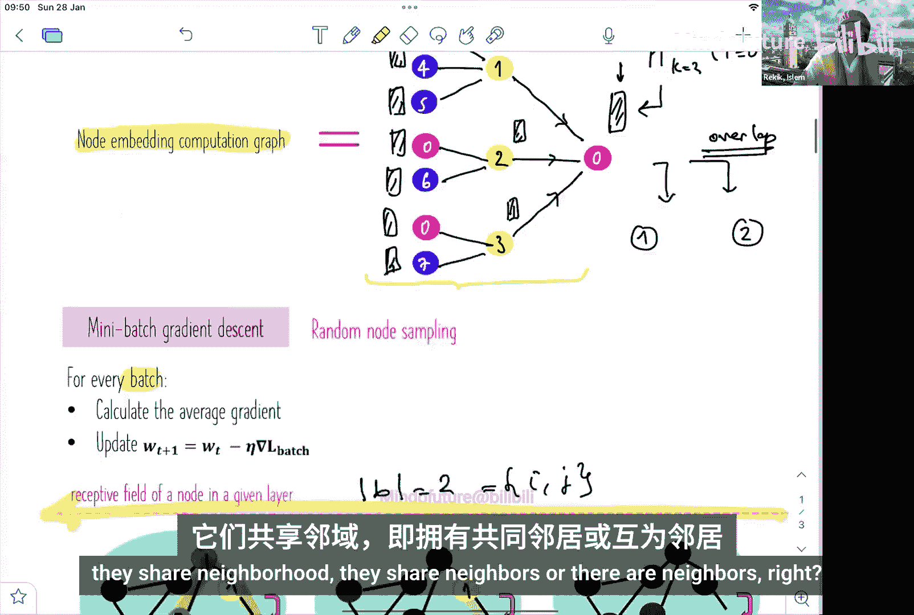

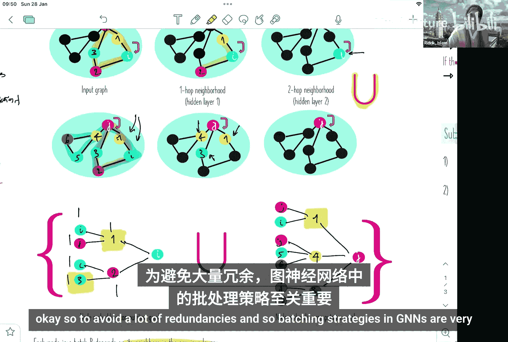

So batching strategies in GNNs are very important， so this is very different from deep neural networks because you don't have the graph structure structure。

 so here we do have a graph structure which means a training point is connected to another training point so remember we have a collectivist kind of you know learning paradigm so everybody body is codependent so how can we。

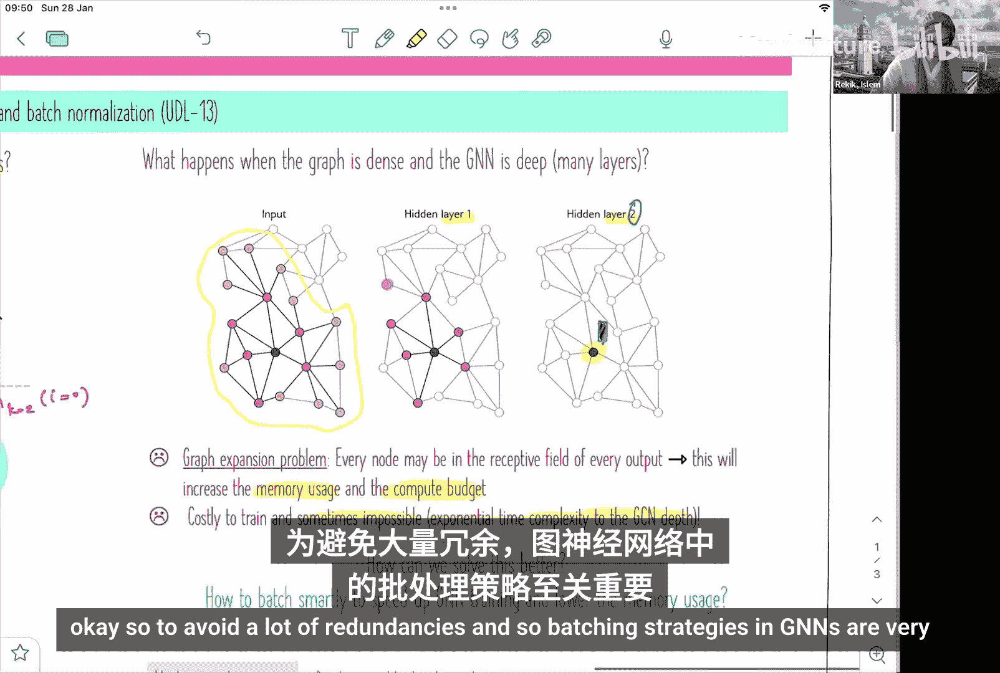

Kind of leverage this codependency and let it play for us and not against us， so。

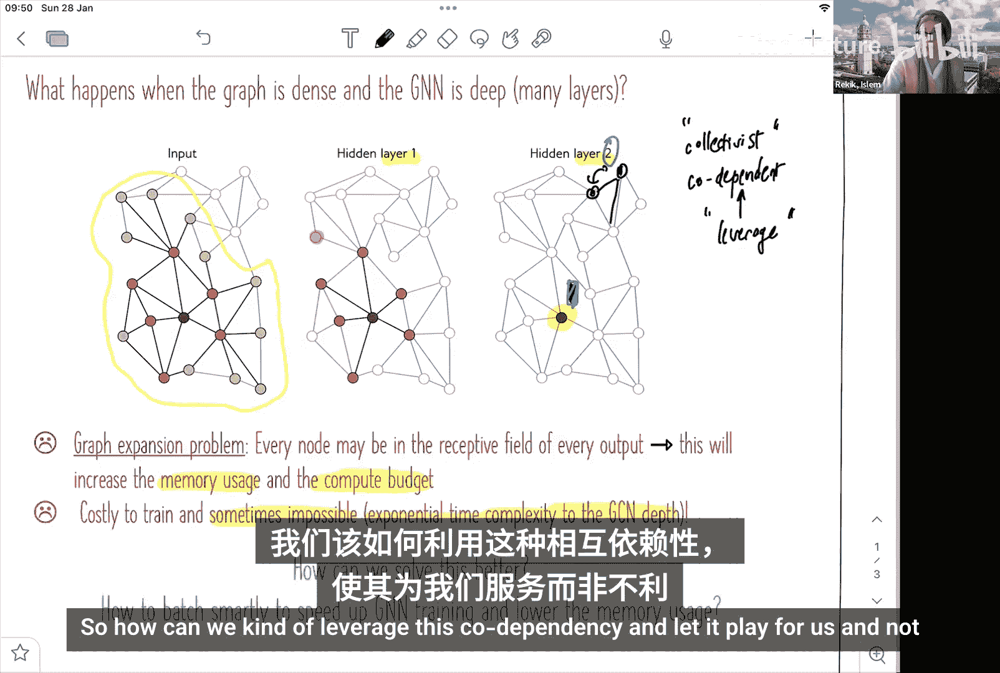

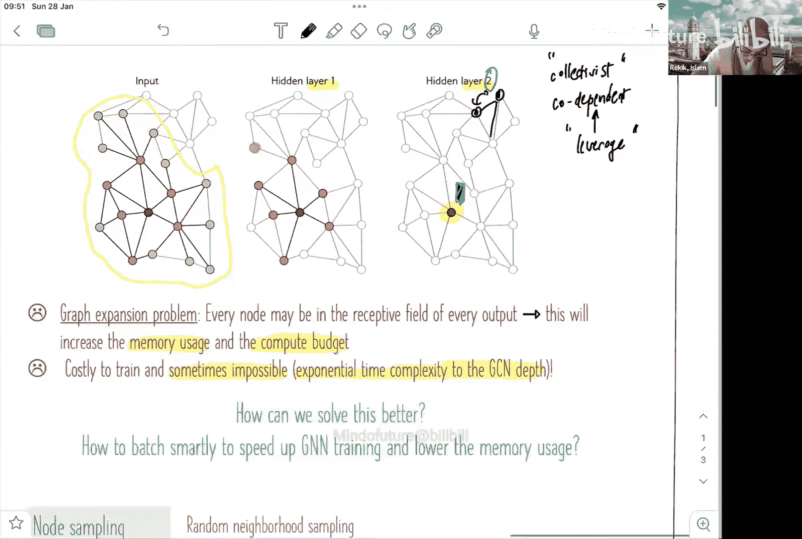

So one potential solution is to you know do a node sampling and control the way we sample node okay so for example。

 a node sampling so we have done a random node sampling before so this is a random neighborhood sampling which means we're not sampling only the notes but also we're randomly sampling or selecting a subset of neighbors right and this has been proposed in graphs age in 2017 so the paper basically suggests that we first randomly define a mini batch of notes so this is what we have done before so nothing has changed here but next the key idea here is to randomly sample a fixed number of their neighbors in the previous layer all right and remember where we're tracing backwards so here we do the same and we randomly sample a fixed number of their neighbors in the layer before that。

We do this recursively so let's look at this example so first we start with this node this node has many neighbors has all these neighbors okay so now instead of taking all these neighbors we're going to sample three so the sampling rate here is like select let's call it three nodes okay selecting three only three neighboring nodes let's call it。

Or for now and this will give us these randomly selected notes now in the next layer what we're going to do so so we have these。

Selected notes right， so one， two and three Now we're going to randomly sample another three。

Okay so another three which means a neighbor of a neighbor so we need a neighbor of this guy so we will select this shared neighbor in this one so two right so here we have two node selected and this one so if you look at the neighbors of the neighbors before that it was really expensive so it was a lot of notes right so here。

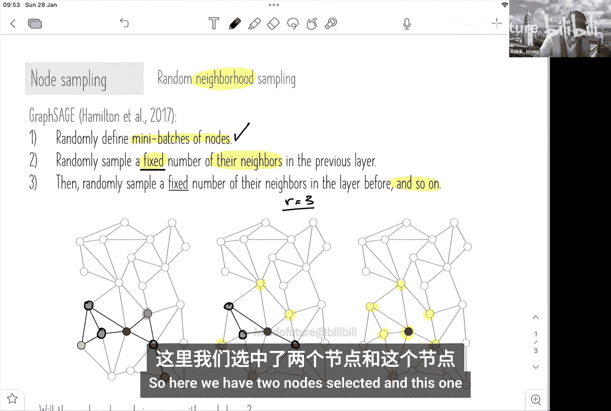

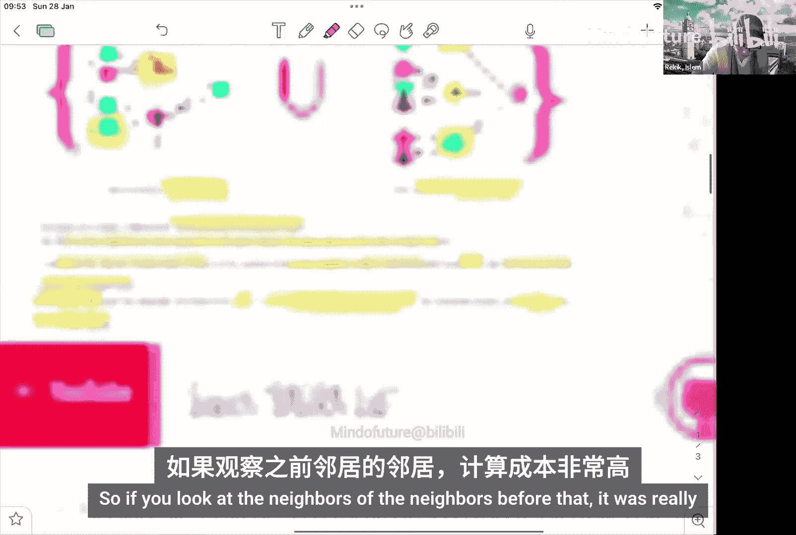

We had a lot of notes it's very dense， but now that you compare it instead of having this whole receptive field right now we are we limited it to this small subgraph that is you know tightly connected so what happens in this case is that we minimize the number of embeddings that we need to calculate right so we don't need to select all neighbors every time we're going to randomly sample this is very important word these are drawn randomly okay and we fix the numbers so every time we draw three randomly for each note。

All right。So this is a node in the batch so let's say this is node one so my batch has node one and then maybe this node okay node two and let's call this node3 so it has maybe three nodes and we need to do the same and sample using these same rules and that will define our mini batch be all right that we will use for training and this is called random neighborhood sampling we're sampling randomly what the neighbors al right now let me ask you two questions here so about this strategy the graph s strategy so the first one and feel free guys to have a look at the paper it's a very interesting read so the first question is will the node subgraph。

Increase with each layer， so the notes sub graph here， you can see at layer。

This is you know the first you know the first ring and then we have the two ring or two hop neighborhood。

 so will we still have this expansion。Yes or no。You can see it here the answer is yes we will have this expansion because you know we are still sampling neighbors right so we're expanding we're further expanding our neighborhood we are doing this expansion right however。

We are controlling it it's it's in a we're expanding in a more controlled way so we're not in like kind of propagating the signal across all neighbors。

 we're selecting a subset of neighbors randomly， which means we are controlling our neighborhood and the controlling the size of the subgraph or the computation graph that will be used to update the node embedding all right now the second question is。

If the same batch is drawn twice， will we have the same updated embedding。 So remember in。

When we do mini batch based training so you have all these mini batches right and then you can draw the same batch again so as you randomly draw sample node you can also randomly draw the mini batches so there is a randomness also there so there's it's a randomness within randomness so we try to randomize multiple times to improve generalizability randomness is a very powerful concept in machine learning deep learning and also geometric deep learning with graph neural networks so here what happens if we let's say this batch。

We select the same notes again， so we're going to run this we randomly select draw these this batch so this batch we have has always nodes one23。

 but now we're going to select the neighbors al right so the question here will we get the same subgraph okay so will we get the same subgraph that will lead us to the same updated embedding will we get the same updated embedding at the layer K plus one using the embeddings from layer K all right previous layer so。

Here it's an important question to think about because the key lies。

In this word randomly so let's say we selected node one this node and the first when we sampled we sample the three nodes right。

 but we could have randomly for you run again and our function is random right it's not anchored we're going to sample other nodes so we can draw these three guys right。

So now the neighborhood has changed in this first ring。

 so which means when I draw three other nodes so I can select this neighbor right of these guys and then I can select。

This one， and I can select this one。 So now the subgraph has completely changed。

 So its we have a completely different， you know subgraph that will contribute to the update of the embedding H and this is because of the random drawing。

 So the answer is no since you know the contributing neighbors are selected randomly。

 So even when the same batch is drawn twice， we will have different embeddings for the node in the batch and this randomness as I mentioned。

 it acts as a regularizer of the network learning behavior。 Allright。

 now we have seen two different approaches here for sampling and batching。

 So so first we can take a single node is not really cool we can define mini batches。

 which helps you know alleviate the computation load。

 but we still have a lot of redundancy and when the graph gets deeper。

 it kind of explodes we have a graph expansion problem and we thought about solving this。

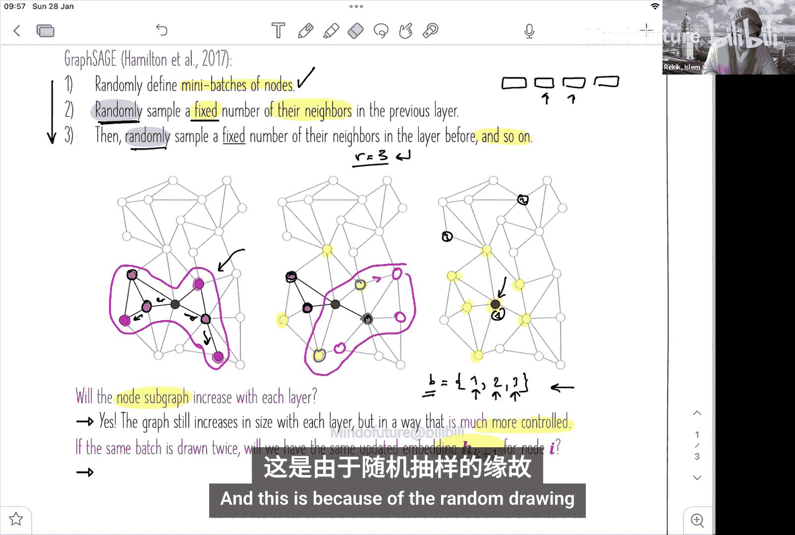

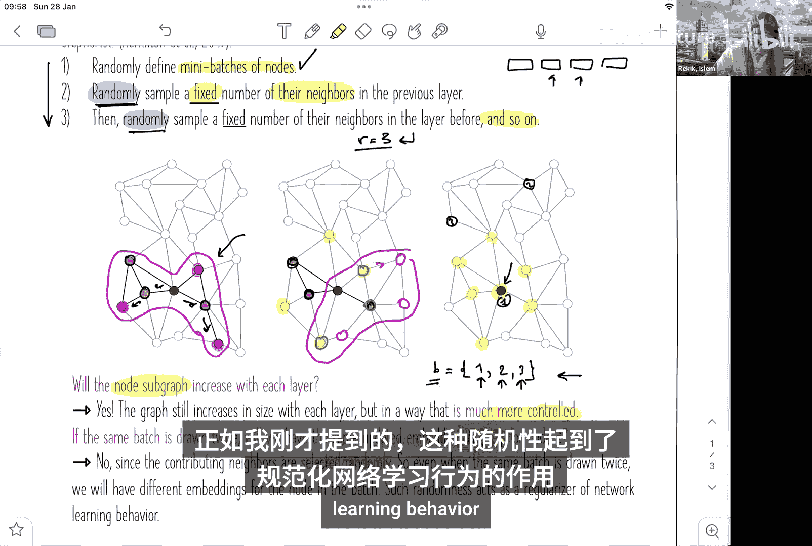

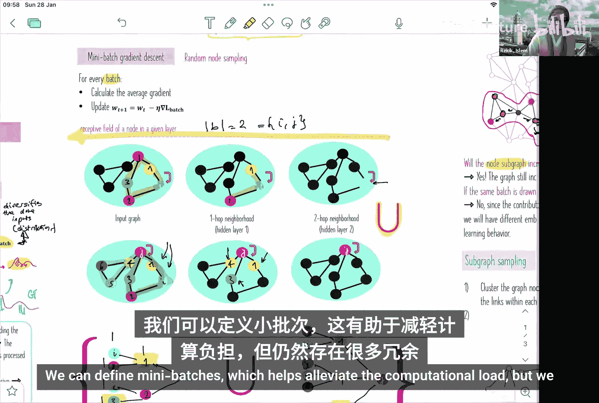

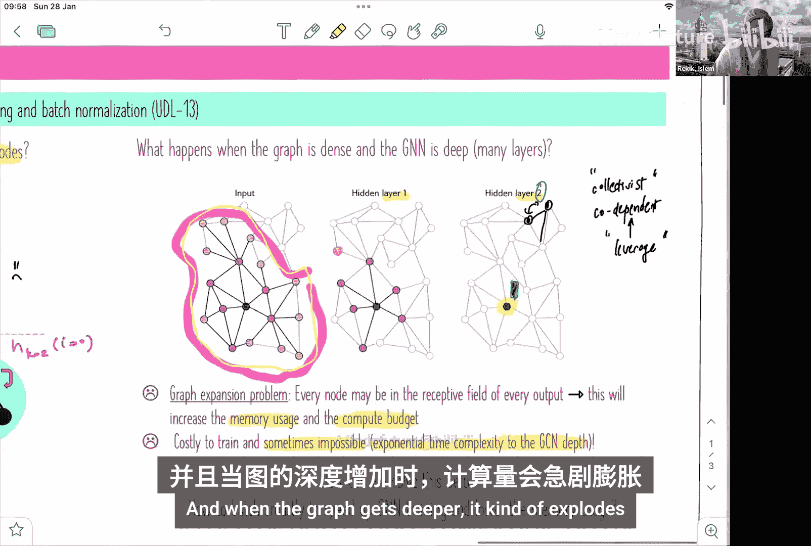

Using random neighborhood sampling so node sampling with neighborhood sampling and this is what graph St has introduced and last we have maybe a better approach so instead of sampling nodes。

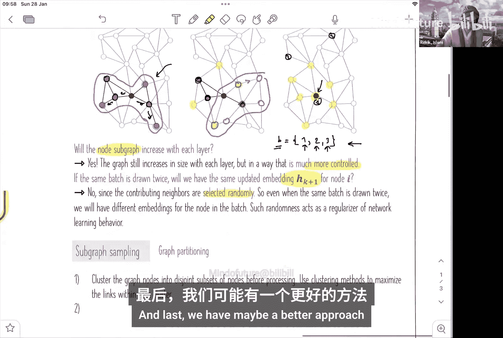

Or neighbor and and their neighbors， we can sample whole subgraphs or clusters of nodes all right and this is the idea this idea has been proposed in different also research papers so this is called graph sampling okay so we divide the graph or we partition the graph into subsets of nodes and these subsets of nodes will be close together will be very similar so now we're using a sort of a clustering algorithm so we're not selecting you know the nodes randomly we don't care where they are but now we will select the nodes in such a way that they will be close to each other so those that are closed will be put in a batch together because here they are highly interconnected so we will kind of breakdown or divide the graph into mini graphs or subgraphs So let's look at this together。

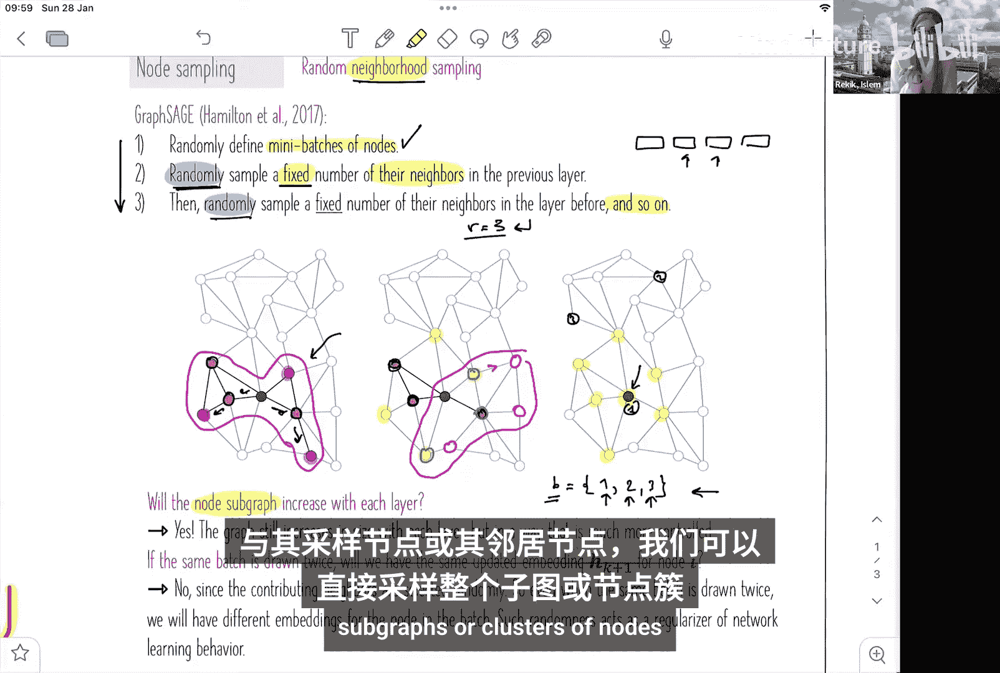

So first。We cluster the graph nodes into disjoint subsets of nodes before processing so we can use a clustering method to maximize the links within each cluster between nodes。

 Al right， And second， what we do is we treat each cluster as a batch or we can also treat a random combination of batches as a cluster so we can combine two clusters and say these two clusters were define the nodes in my batch Allright。

And we do this so if we combine two clusters we can reinstate any links between them from the original graph so let's look at this example so in this example right here we have an original graph and if we do clustering so we will divide the graph in two for example four clusters so each cluster will define a batch so here this cluster will define batch one so B here is equal to B1 so this is batch one with all these notes we'll have also batch2 okay etc so B2 etc all right and and we have four batches four clusters so we will basically train our model we will iterate over all these batches so in the training you iterate over batches so here we have small number you can randomly sample batches if you have so many batches so if you have for example thousands of batches you can randomly。

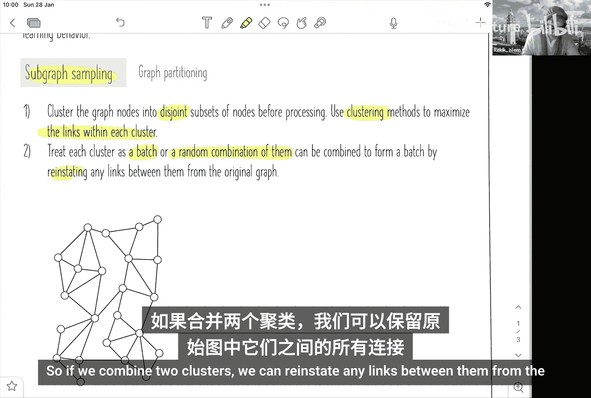

raw and take not iterate over all of them you can randomly select， for example。

100 batches and say i'm going to optimize over only these randomly sampled batches。

 but when you have a limited number of batches as in this case we have only four so we will iterate over all of them so we will calculate the gradient with respect to batch one batch two so here of our loss if you guys remember you know the lecture the previous lecture right so of this you know calculated at this batch。

And then this one right and then this this is actually an average across all over all these nodes in this batch right and what we do is like we're going to update iterate over all of these batches and then after the iteration is complete and we have updated the parameters that that defines an epoC all right so when we complete the iterations and the updates the forward and backward passes then this defines an epoC and then yeah so now this is an example where we combine two clusters so we decided here that。

These two will define a single batch Okay so this is batch one。

 so we have three batches so in this case we reinstate the connection between these two so that's what we put there so we kind of you know after we partitioned the graph。

We kind of reconnect them or patch these two clusters back and this you know graph will define our you know training our training batch and we will try to learn the embedding。

 update the embedding for each node in this batch all right cool now。

This is graph subgraph sampling and or graph partitioning and here let's look at a few more examples so one example is the sub graph sampling is the cluster GCN so cluster GCN was published in 2019 it's a subgraph sampling method and also feel free to have a read at the paper so here in this paper it's the idea is very simple so we want to design an efficient algorithm for training deep large graph convolutional networks GCNs all right so first we sample a block of notes that associate with a dense subgraph identified by clustering algorithm which means we cluster the notes into you know different subgraphs okay and then we restrict the neighborhood search within the subgraph so because this is like partitioning exactly the idea that I explained earlier so we kind of you know。

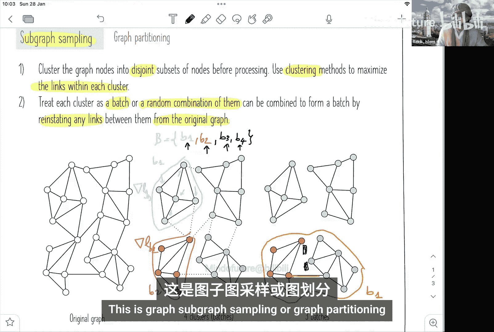

Separate out these subgraphs and we calculate the updates using the neighborhood within each subgraph。

 so this maximizes also the within batch edges， which means we want to have you know a subgraph highly connected guy not sparsely connected。

And a cluster defines a batchge of training notes and next。What we do so this。Simple。

 it is a simple and effective strategy because one of the benefits of this methods that it improves the memory and computational efficiency now we don't need to look at store the history of embeddings of all neighbors of neighbors of neighbors throughout the whole graph now we're breaking the graph into smaller graphs and processing each unit individually or each subgraph individually which means we can easily parallellyze here and this you know this is good for memory also for computational time and if you read the paper you'll find very interesting results and comparisons against GCN in terms of performance memory usage and also you know time training time per Epo so now let's look at this example right here so in this example from the paper。

😊。

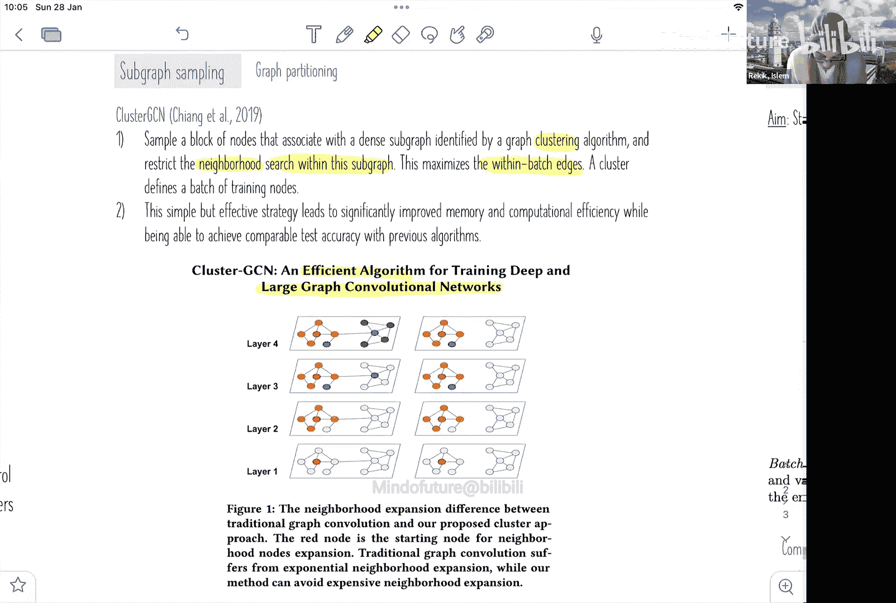

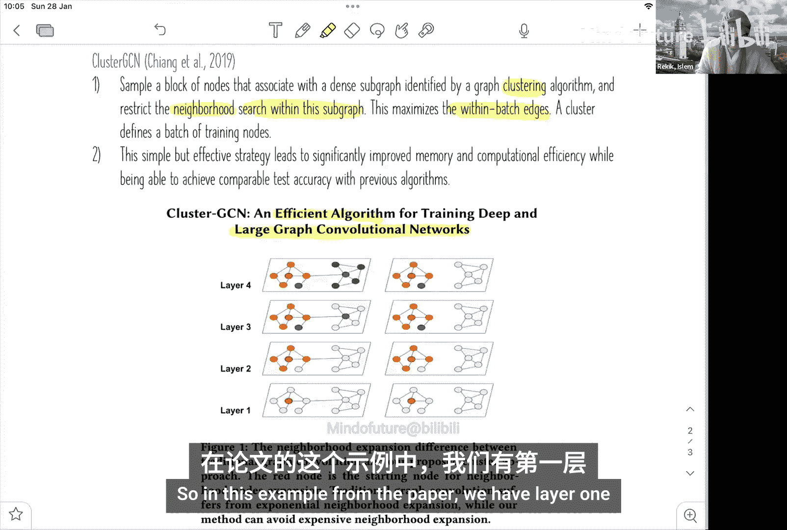

We have layer one so this is our original graph okay so in layer one we have the red node so we want to calculate the embedding of the red node to update it so to do that we need to go through up to layer four so we need to include literally the whole graph right here we have a small graph right this is we expanded the neighborhood now when we do the the this is what we call the neighborhood expansion right so when we do the partitioning or the clustering you know we avoid this expensive neighborhood expansion because we split the graph into two clusters so we can see here we can easily cluster these together so now that I want to update the embedding of the red node I only need you know to involve smaller a smaller number of neighboring nodes and they embeddings right all their embeddings so here we process this independent。

Of all other graphs and each node， so for example， if I sample a node from this graph from this this part of the graph。

 then I will need to kind of only consider this subgraph so or this cluster which defines。Oops。

 so it' which defines our batch， our mini batch。Let's write it properly， so this is a mini。

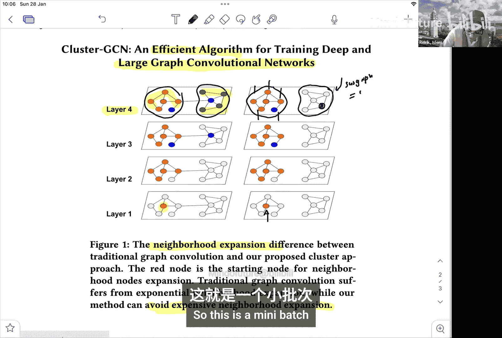

Btch， all right， cool。 So this is a cluster GCN now。

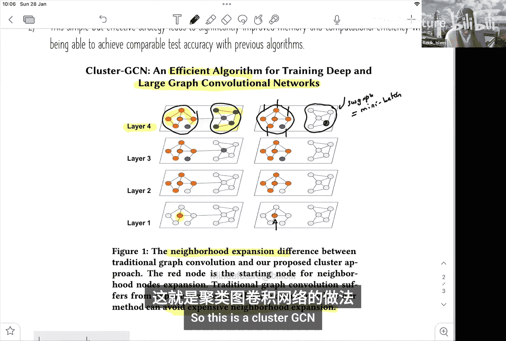

We have seen two types of sampling we have seen node sampling neighborhood sampling。

 which is a part of node sampling and subgraph whole subgraph sampling or graph partitioning and now there is a different way of doing the sampling so we can sample nodes。

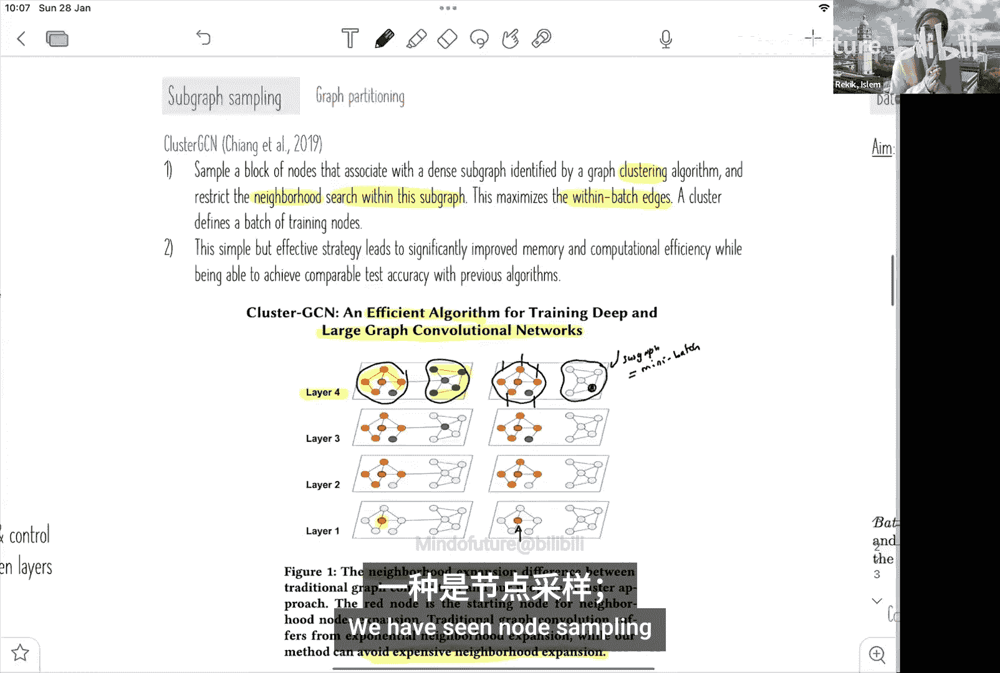

Subgraphs。And we can sample from the layers directly。

Okay from the layers or the neighborhoods that we have so let's look at that in an independent way。

 so here this method is called layer sampling， so in layer sampling what we do。

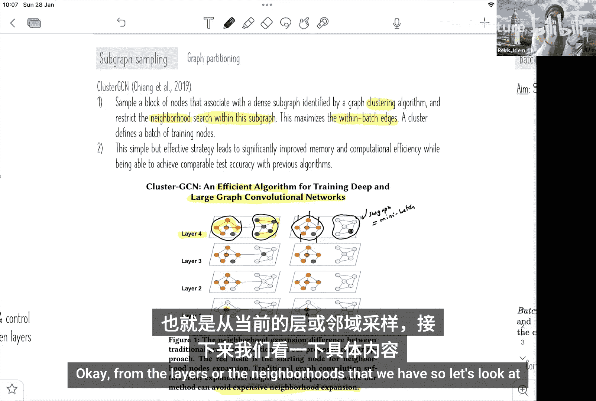

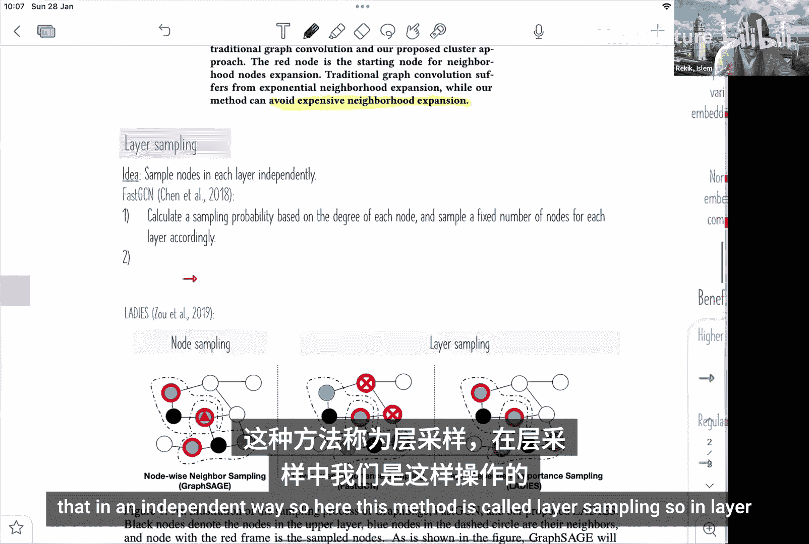

So we have basically we sample nodes in each layer independently and this is a very key word。

 this is an important word because here we don't care if the notes are neighbors anymore we take the first node and you know and we randomly sample notes from the layers so for example if I take you know like a particular notes I'm going to show you here so this is a good example actually in this figures from the ladies paper so we sample independently and there are different methods that do layerwise sampling with different pros and cons it's an ongoing area of research So a paper was published in 2018 called fast GCN so fast GCN basically calculate we first calculate a sampling probability based on the degree of each node so depending on the degree of each node we'll define the probability of。

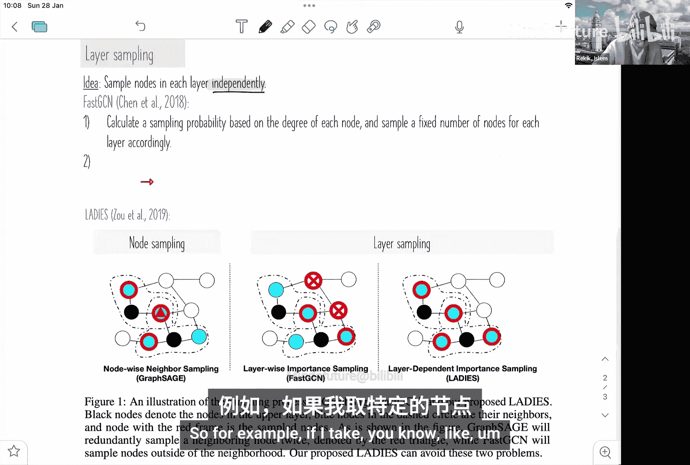

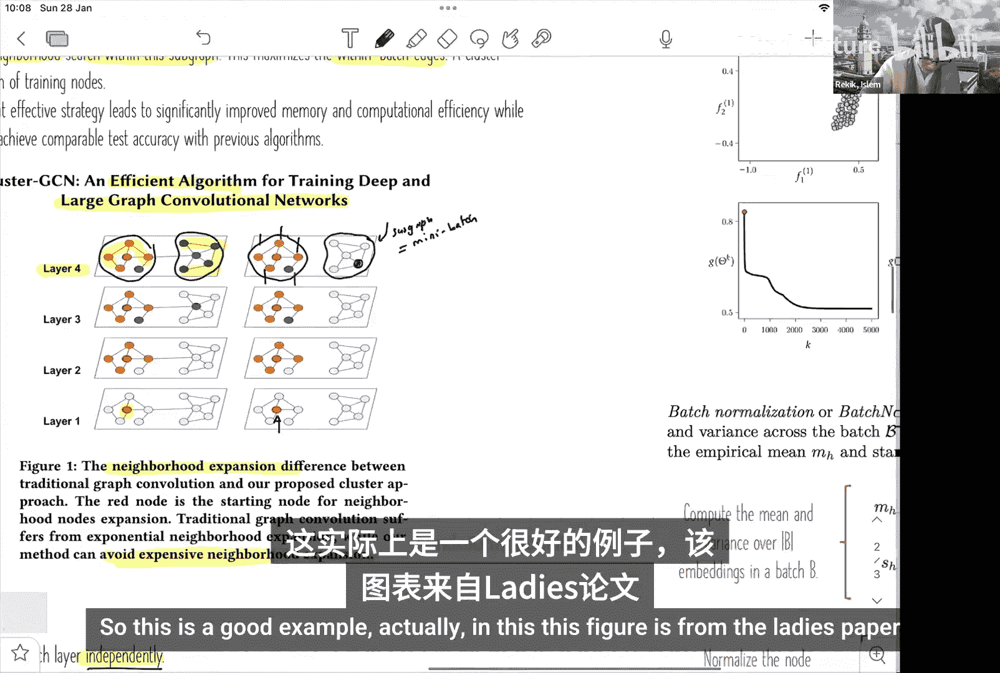

Selecting that node， okay， and then we sample a fixed number of nodes。

In each layer accordingly so now we select nodes based on their degrees and then we sample a fixed number of nodes in each layer。

 but this sampling is very independent of you know the node itself sampled in the previous layer so this these two steps now are independent so which means that。

Here we only use the sampled nodes to build a much smaller sampled adjacency matrix， okay？

And then the computational cost is reduced， so we're reducing the computational cost because we're kind of shrinking the graph but this random sampling。

 however， there is a drawback to this the sampled notes from two consecutive layers。

Are not necessarily connected， so we're disconnecting the topology of the graph or the structure of the graph through the layerwise sampling。

 so for example， let's look at this figure right here and we're gonna see another detailed example so here we have node sampling so in node sampling for example graphs age in graphage so we have three methods we have two notes one node sampling method which is graph age and two layer sampling method。

 the fast Gcn and the ladies and this is from the paper published the ladies published in 20 19 Now here the black notes。

 they the note the notes in the upper layer so these are the notes in the final layer that we want to kind of update right so we need to update recursively and the blue notes so let me change the color the blue notes in the dash circle they are their neighbors so you know these are the neighbors of this。

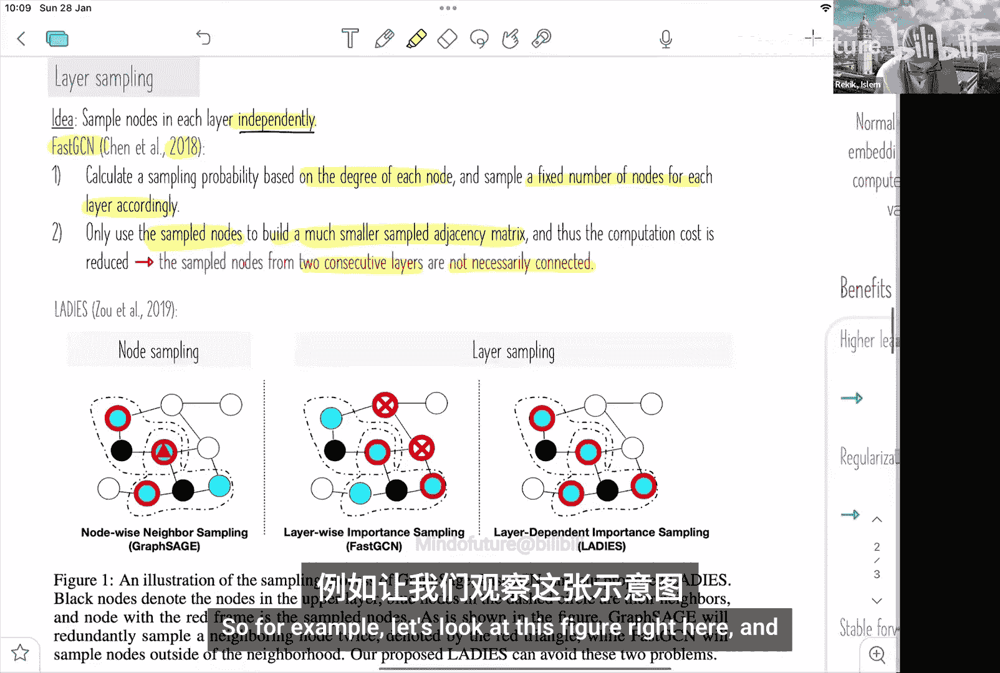

Black note and these are its neighbors too Okay so we sample two notes。

 we have their neighbors and the note in the red frame。呃。And the red frame is the sampled node。

 so these are actually the nodes that we selected， the sampled notes。

So what we know is that when we do the sampling all right， so we selected so for example。

 we selected。You know two nodes here so this guy has two let me change the color so i'm going to use a different maybe green here so guys can see so this guy right here it has two neighbors and these were sampled and this one has three neighbors but we sampled only these two so what do you guys know this we have a redundancy here so we have you know the one with a triangle it's a redundantly sampled and this neighborhood so basically this neighborhood is sampled twice and we need to calculate it twice all right so this has been solved in fast GCN so fast GCN will sample notes outside of the neighborhood so fast GcN is。

It doesn't you know necessarily has overlaps， but the problem with fast GCN which is a layer sampling method as described here is that it may end up sampling node outside the neighborhood because we're randomly sampling in each layer so here in this case you guys can see that we sampled two nodes that do not belong to the immediate neighborhood of these two you know black node right so you can randomly select node that do not belong to the neighborhood that you're interested in okay so if you have for example two layers here okay actually here we have only one okay so one layer so now the ladies。

Is a layer dependent important sampling and the key idea of this method is that we will make sure that when we sample that we can avoid these two problems we can avoid the the neighborhood redundancy sampling and we can avoid sampling from outside the neighborhood all right so outside the neighborhood so let's look at how the ladies work so the key concept so you can also read the paper have a look at the paper。

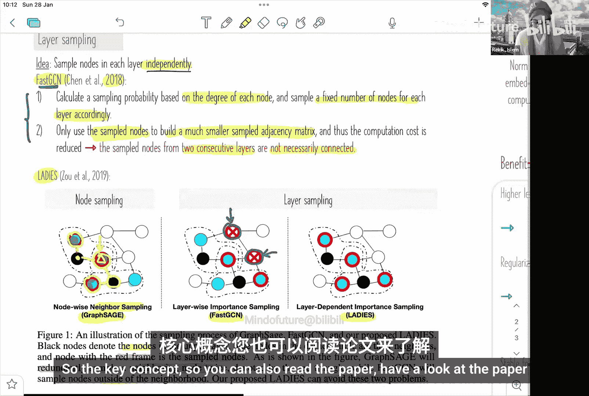

So this is the paper right here， but I'm going to give you just the gist of it just the key idea here。

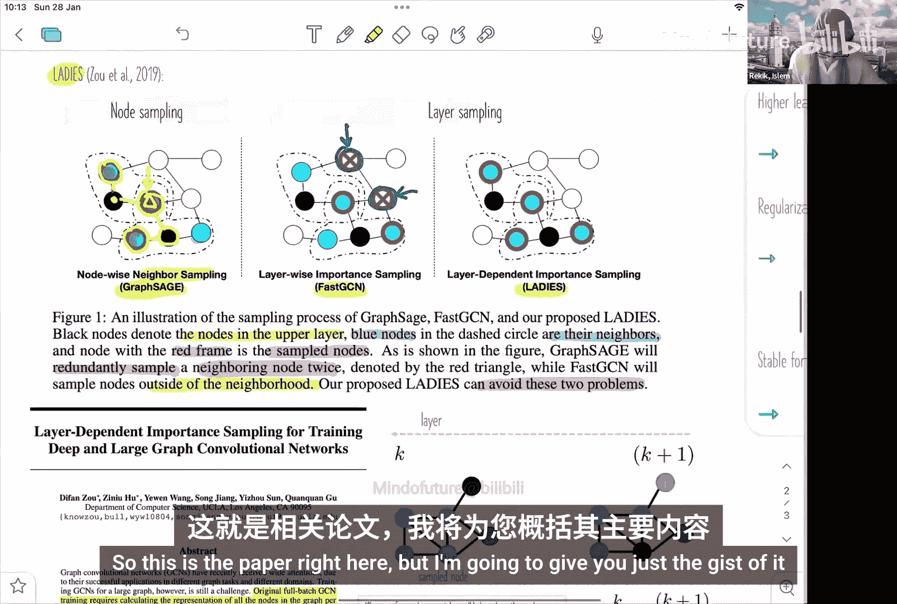

So let's get started so the paper is very interesting because here let's read together so original full batch GCN training requires calculating the representation of all nodes in the graph per GCN layer per layer so which brings in a high computation and memory cost so this is not good to have right so to alleviate this issue several samplingbased methods have been proposed to train GCNs on a subset of nodes so among them is the nodewise neighbor sampling neighborhood sampling which is the graphage that we have seen okay so this is graph s and this samples recursively using a fixed number of neighbors in each layer however the computation cost suffers from an exponential growing neighbor size still you know we control it。

 but it it may explode a particular time point okay so on the other hand we have。

Layer wise imported sampling method and this discards the neighbor dependent constraints so we don't care so the problem with the existing layer wise method at the time。

 you know before the prior to the publication of the ladies which was in 2020 I think 2019 if i'm correct so。

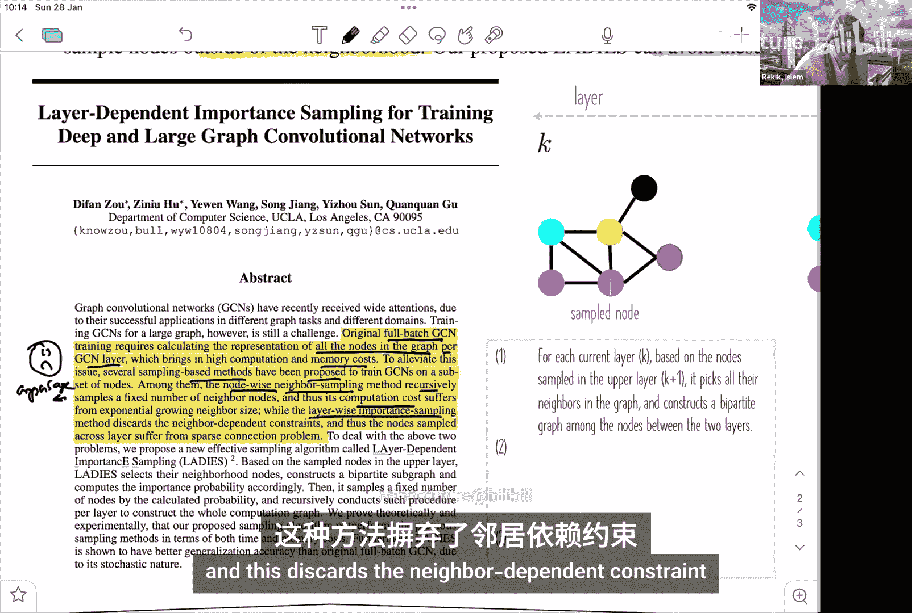

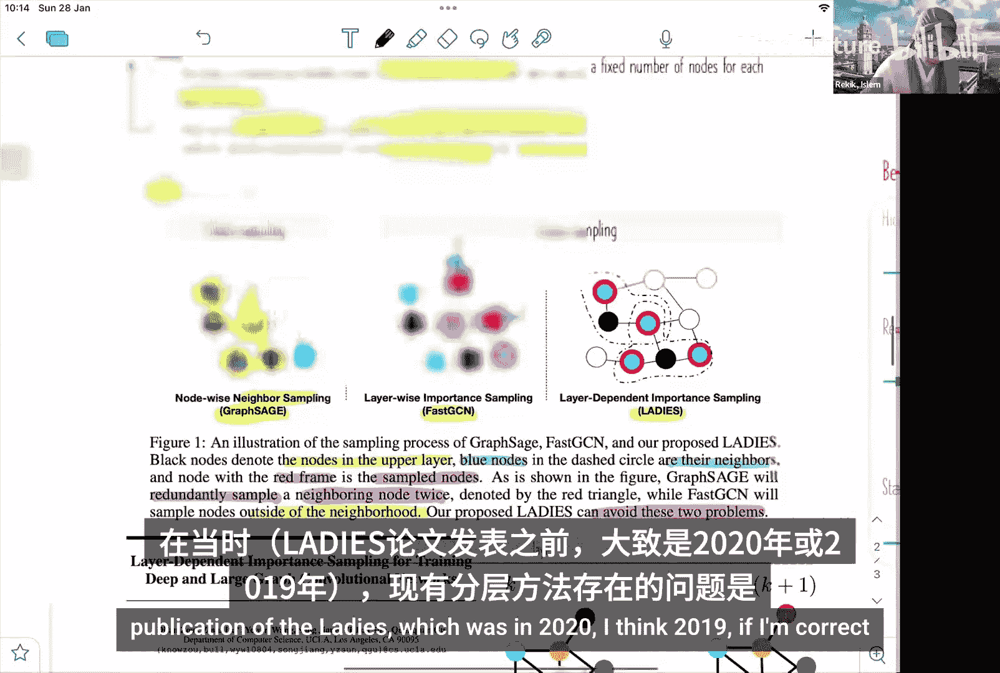

So here these layer Y sampling method they do not take into account the neighbors and they may sample from like fast GCN from outside the neighborhood so that's not good so the node sampled across layer suffer from sparse connection problems so which means they are disconnected so they solve this through this algorithm right here and let's have a look at it together all right so。

And this example。We have first we have our let's say this is the graph at layer K plus one。

 this is the the layer the final layer or any kind of layer inside the graph okay so at a given layer we have our node I。

And we have a note J here。So we have two nodes in our batch。Okay。

 so let's read this together so what is the first step in the ladies algorithm so going from backwards from layer K plus one to layer K。

First for each current layer， based on the node sample sampled in the upper layer K plus1。

 it picks all their neighbors in the graph and constructs a bipartid graph among the notes between the two layers。

 so let's see this。The neighbor of I is only。This node， okay， so it's this node gets called one。

All right， and then the neighbors of J are actually let's put them together the neighbors of J are one so we have all these notes。

 one two， three and four Okay， so all these notes are。Neighbors of the node J。

So now what happens is that in this case， what we want to do， we are looking at these notes okay。

 so we pick all the neighbors and you can see that。In this case。If we remove this， okay。

 so now I'm going to sample it， so simplify it。So we're going to move this here。

Propy paste sorry paste image， so we're going to put the image here。And this was the， let's say。

 the original one， so we're going to put them together。And what happens that。We see that。

If we put these guys together here we'll have something like that so we created a bipartite graph between the nodes and their neighbors and between between these these two layers and in this case we can easily kind of you know find redundancies and when we want to sample now we calculate the probability according to the degree of the nodes and the current layer with the with the purpose to reduce sampling variance so if we want to sample from here we're going to take the notes for example。

 with the high with high degree okay so what are the nodes of the high degree so we have degree three here two so three。

And then we have two and the purple has two and the one has four。

 so we can sample simply these two all right， so these will be sampled。

And we're going to use these two。For， you know。Our computation right so then next is samples a fixed number of nodes based on this probability so let's say we want to fix the number so r will be two so every time we're going to take only the top two nodes with the highest degree for example in this case so so this is you know an example and there are lots of variants in layer。

