# 【伦敦帝国学院】深度图学习 ｜ Deep Graph Learning p16 P16_4.3_图神经网络采样方法回顾 -BV1WZUKBmEQA_p16-

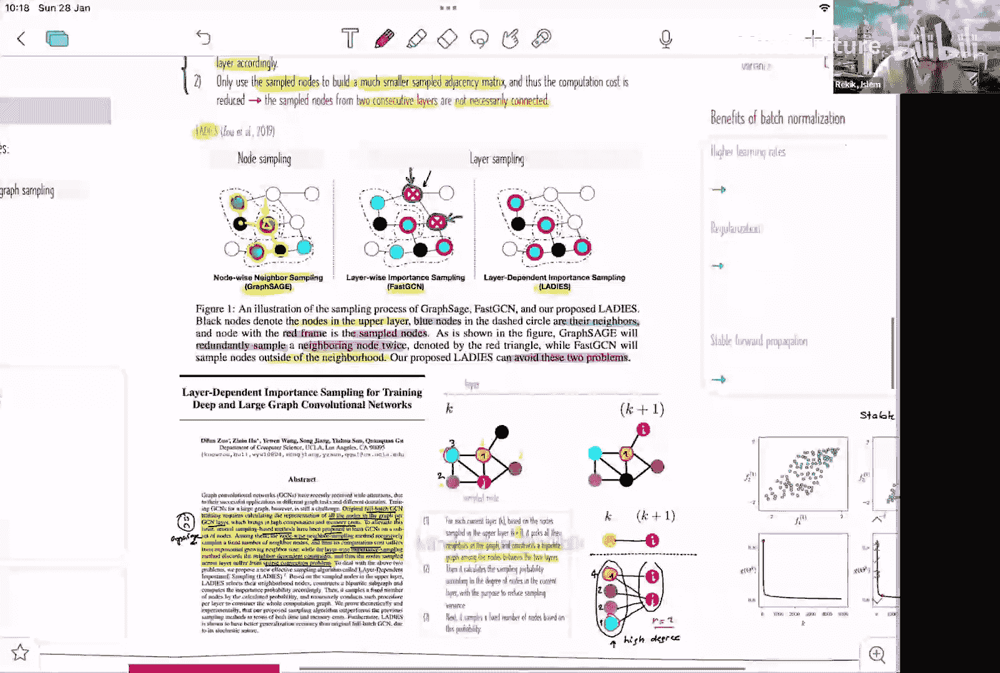

So recap time so we have seen that there are different sampling methods to create training mini batches in GNNs and so to lower the the GNN compute budget one can adopt one of the following sampling strategies and each has pros and cons so let's look at these strategies together so first。

The node sampling。 so the node sampling at randomly， we randomly select。

A subset of target nodes al right and randomly means they may not be connected we just randomly select from the graph and then define the batch in that way and then work back through the network。

 adding a subset of node and the receptive field at each stage so this is for example graph s there is also variance reduction GN pin s so there are lots of published works and methodologies aiming to improve the strategy of node sampling in graph neural networks so the problem the good news is that basically node sampling it reduces the computational cost by training on a subset of nodes rather than training on the entire graph compared to batch stochastic descent and it makes it you know a bit I' would say quite suitable for a large graphs at least compared to when training on all right taking the whole batch the whole data set。

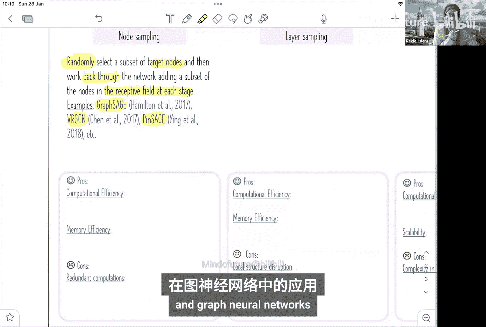

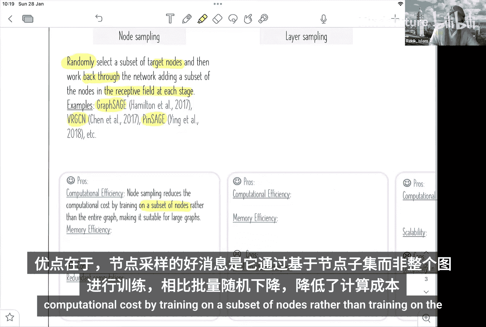

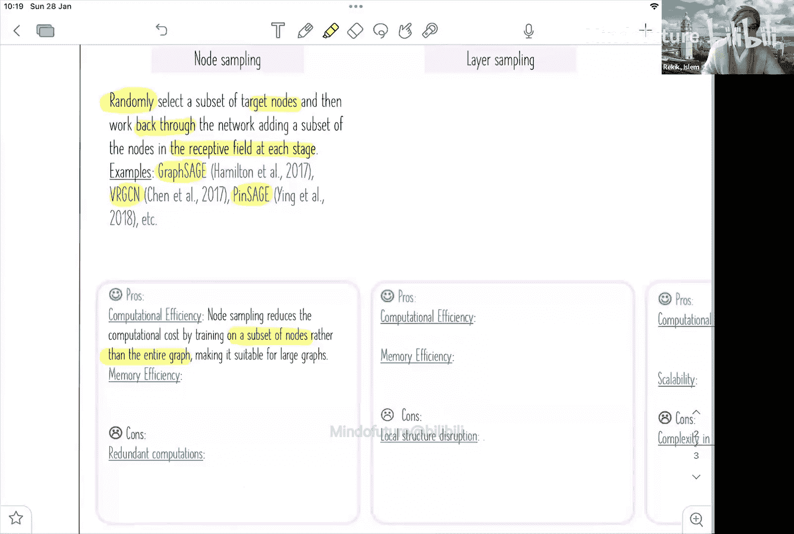

Now in terms of memory efficiency， it allows for a more efficient memory usage。

 particularly as I said， when dealing with with kind of you know these huge graphs and the disadvantage of these methods is the redundant computation so we have seen because you know since we're sampling randomly we may end up with a lot of you know overlaps between shared neighborhoods neighbors that we need to recalculate their embeddings over and over again。

 so and also because of the recursive nature so the recursive nature of Nor wise sampling brings a redundancy in。

For calculating the embeddings， so if two node share the same neighbor。

 the embedding of this neighbor has to be calculated twice。

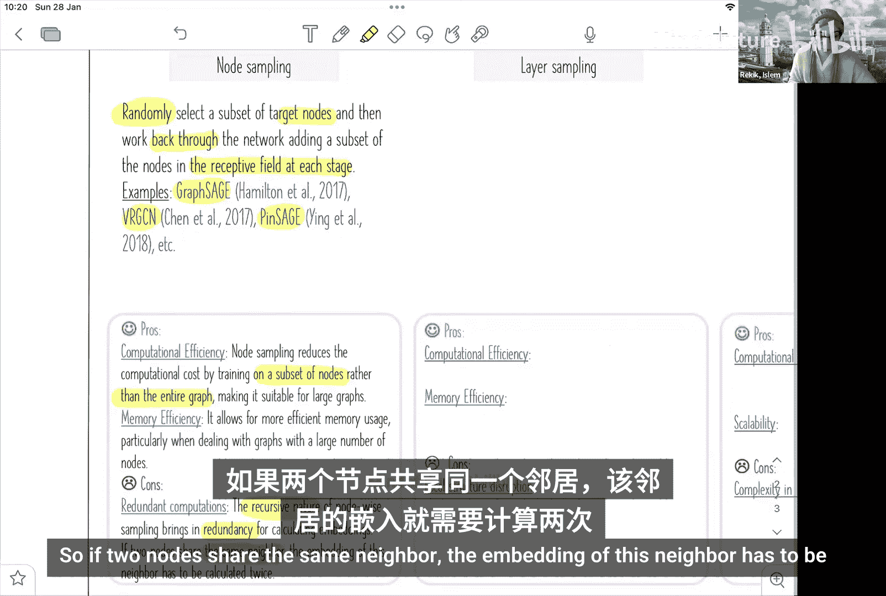

Right， and we have seen this right here。

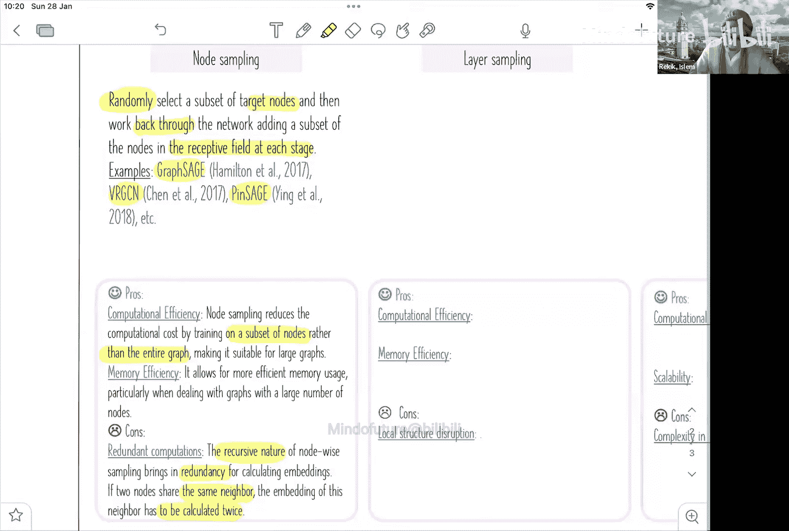

The orange and the green。All right， and now let's go back so the second method is we have seen in so far so。

Is the layer sampling so in the layer sampling， the layer sampling basically it takes in。

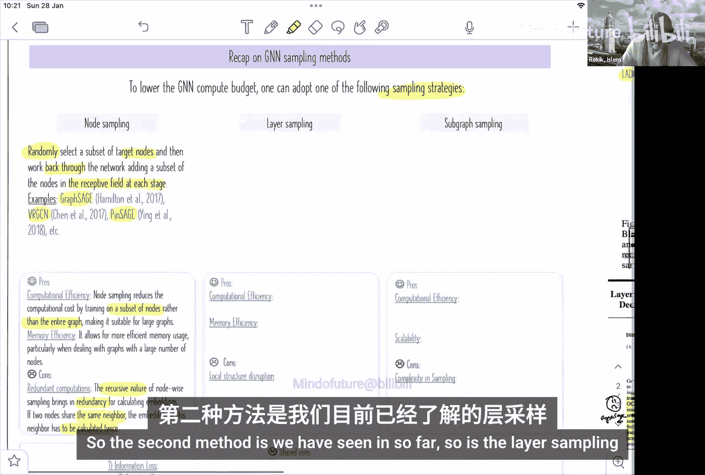

It samples the receptive field and each layer independently so the keyword here is independently all right so this addresses the node increase in node sampling as we pass back through the graph however so we can control that it address this problem it may remove the overlap a little with the redundancy but the problem is that there are are lots of problems so we're going to see that in a bit。

 but there are many examples like for example fast GCN adaptive sampling the ladies the layer dependent importance sampling the L2 here GCN so there are lots of works and it's an ongoing area of research how to improve the layer sampling methods so computational efficiency in terms of computational efficiency the layer Y sampling it avoids the redundant computationals and node sampling so that's better than the first one in terms of memory it allows for more efficient memory use。

It's the same thing I mean it's a bit better than the node sampling and the key disadvantage here is that it disrupts the local structure of the graph so it may disrupt the links connecting neighboring nodes between two consecutive layers to due to the random independent sampling in each layer okay so this may create isolated nodes and parsifies the graph and may not be very beneficial to the final loss optimization and parameter of learning okay。

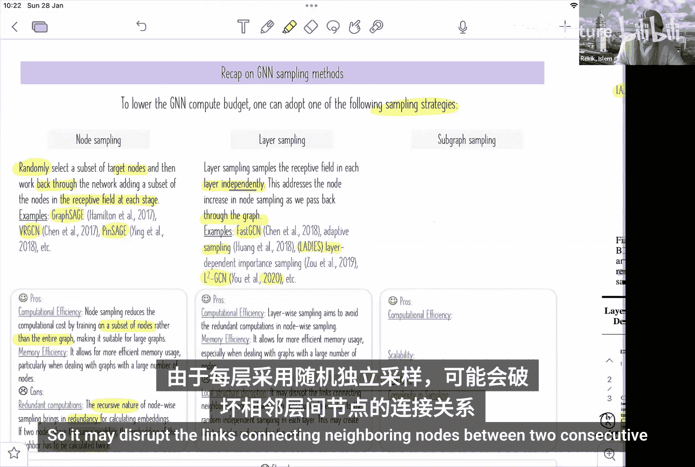

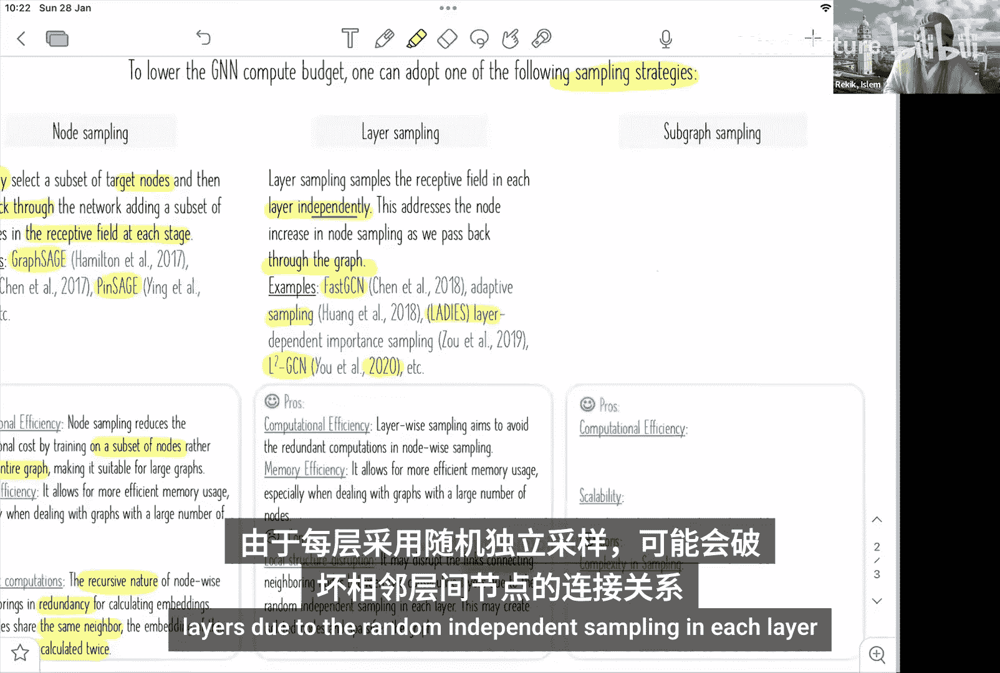

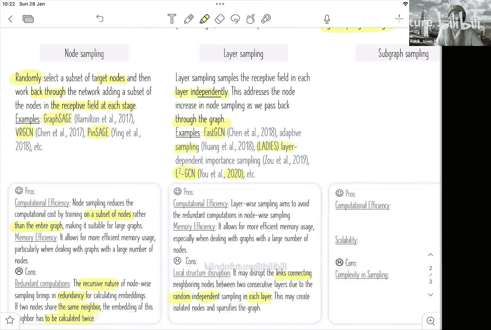

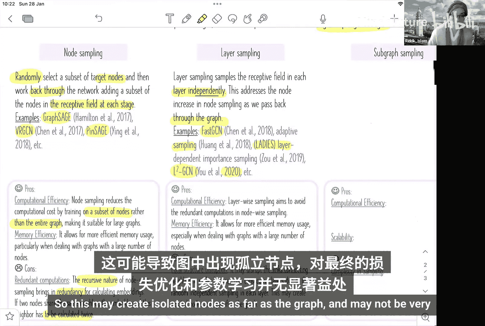

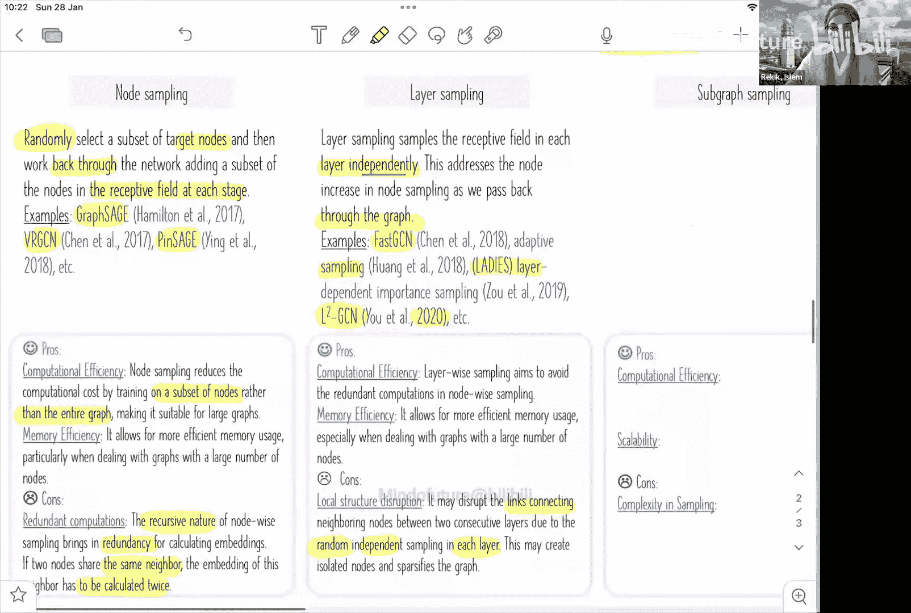

So the last one is subgraph sampling， so for subgraph sampling。

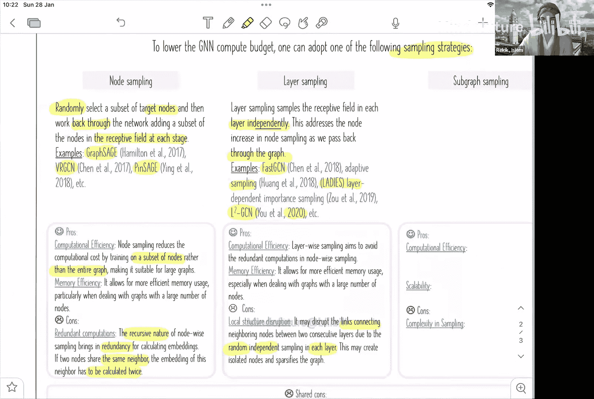

We have so we randomly draw。

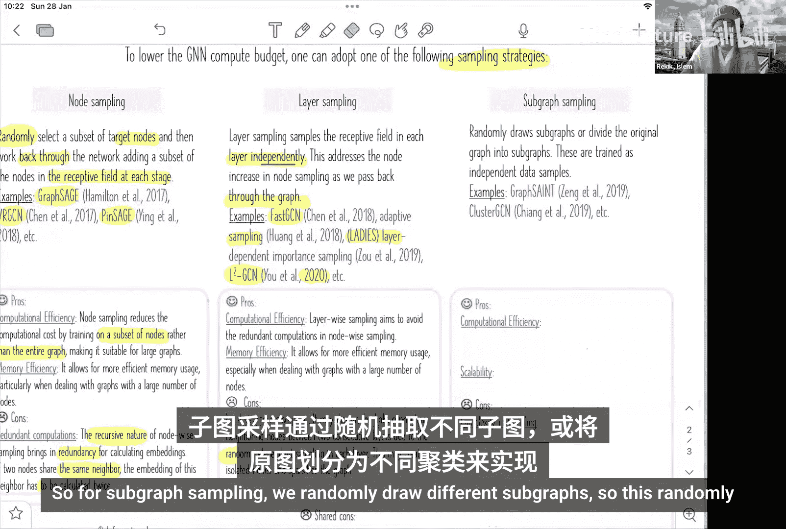

Different subgraph so this randomly draws subgraphs or divide the original graph into different clusters and these are trained as independent data samples so each batch will be trained will be opt you know willll calculate the loss for each batch and update the parameters at each batch and there are separate so there is no kind of overlap between them so we're breaking down the graph into smaller graphs and an example is a graph sa and also cluster GCN which we have seen so in terms of pro actually the graph the subgraph sampling significantly reduces the size of the data and at each iteration so the size of the data we need to process each iteration and this will makes it very feasible and suitable for large scale graph so it is scalable because we're breaking down the graph into many subgraphs so in terms of scalability this is surely like you know say this is highly scalable compared to the。

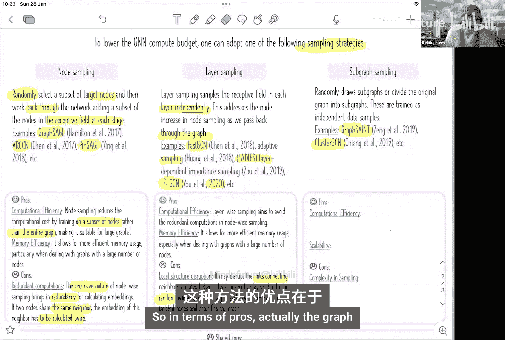

Other methods， the layer y sampling and the node based sampling methods。

So it can easily it can it allows to scale， I wouldn't say easily by breaking you know the graph down into smaller graphs now in terms of disadvantages or cons we have a complexity in the sampling and the design of an effective graph partitioning or graph subgraph sampling method so how to actually cluster these graphs so remember the clustering method depends on the similarity between the edges on the features in doing the clustering may not be very reliable so the quality of the clustering or the quality of the partitioning will influence your your learning and this could be complex and like you know not very trivial I would say so and it also may require additional computational resources if the graph is huge and some clustering algorithm such as a manifold based learning algorithms that learn similarities between different samples for clustering。

😊，They are not scalable， so which means when as the graph increases in size。

 you cannot do clustering so you cant you get an outer memory so you cannot run the clustering algorithm。

So yeah， so this is an overview， a recap on the GN sampling。

