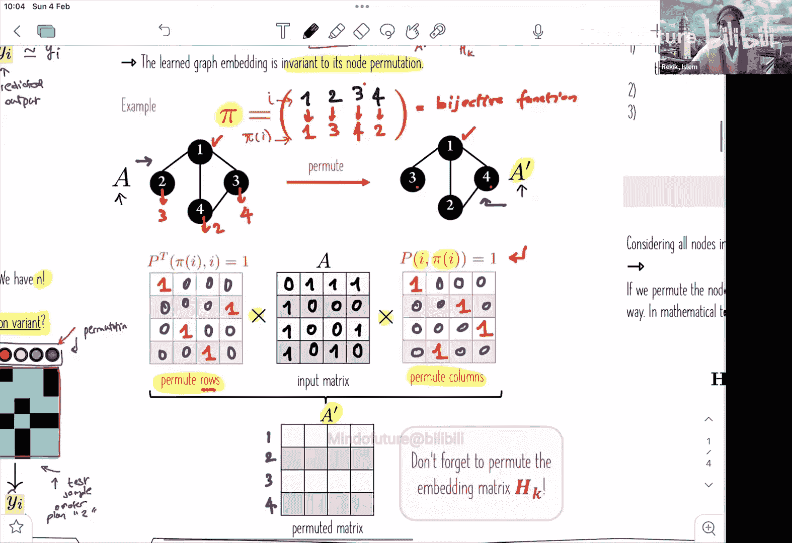
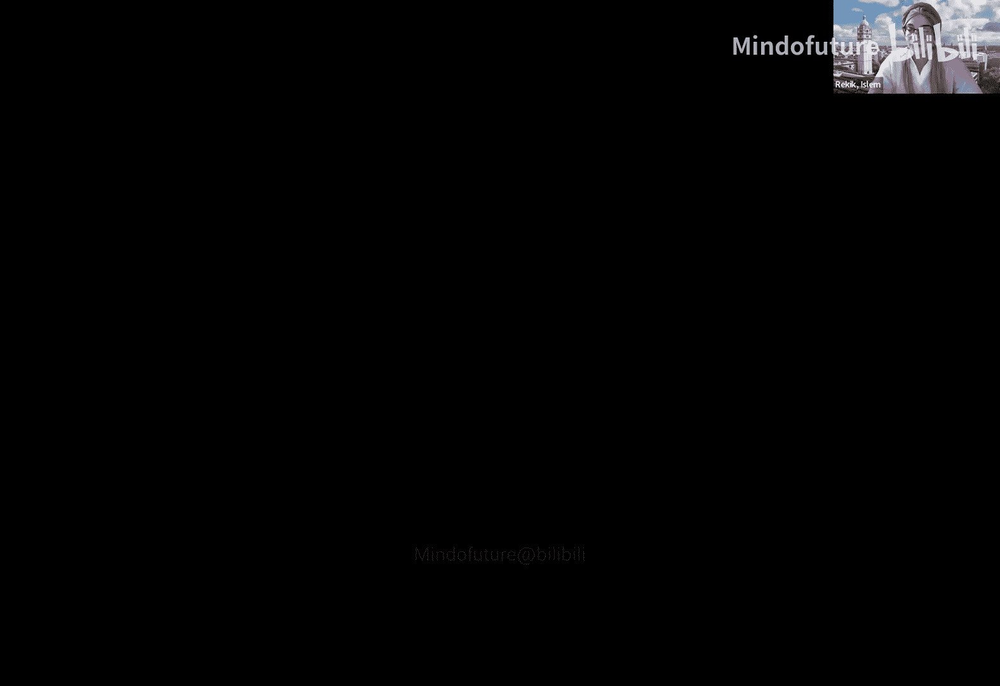
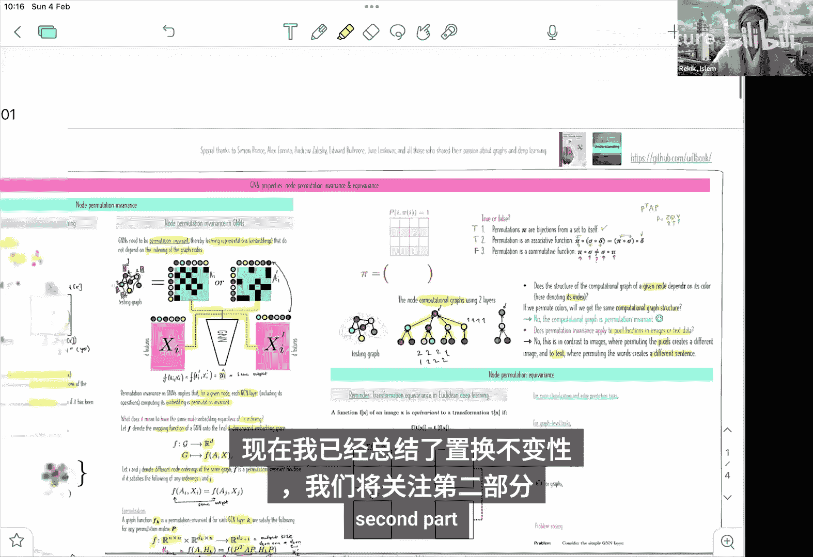

# 【伦敦帝国学院】深度图学习 ｜ Deep Graph Learning p20 P20_5.1_图神经网络中的节点排列不变性 -BV1WZUKBmEQA_p20-

In today's lecture we will learn about some exciting theoretical properties。

 graph neural networks and these include invariance equivariance and expressiveness okay so let's start the first property which is invariance to node permutation okay so first let me give you a reminder about the concept of invariance in Euclidean deep learning so Euclidean deep learning operates on images as you guys know and here for example。

 in conventionalal deep learning when we say that the model is transformation invariant okay。

And imply that for an input for our input data here， for example。

 an image X we say x is invariant to a transformation t of x t of x could be translation rotation a combination of different transformations that we can apply to the image so x variant to a transformation t of x if the output the final output of the transformed image is the same as the output of the image itself or the input itself so let's look at this example so here for example if we ask is there a in the image so here we can see that there is a tree okay so this is the tree and then oops sorry guys so let's。

So there is a tree here in the image。Okay， so going back。So， if we。

If we draw the tree again so I want to draw this tree and then take the tree and let's say this tree。

 I'm going to translate it okay so if I translate the tree apply the tree a translation to the tree for example so I have translated it to the right so here we have an action and this is this action is t of x so this is actually now the input is t of x and we apply the function or then when we apply our network so this is a neural network mapping of function F so F of t of x will be equal to f of x okay so this is T of x which means if the label if we want to put for example a label or to do any intermediate transformation the final output here will be similar which means if there is a tree so F of T of X will give us。

For tree， which means yes。And here F of x also recognize or identifies that there is a tree here。

So this is an important property in deep learning because if we rotate the image。

 if we translate the image or scale it or apply any kind of you know。

 like transformation that is that preserves the pattern of the image itself。

 the network still need to recognize or you know like patterns in the image and classify it or regress it properly okay。

 so this is what it means and here。Let's summarize that so the output of the function f of x or the network is the same regardless of the transformation T of x that's what it means that we have x invariant to a transformation okay so not of course not all transformations you know kind of lead to this invariance there are transformation that can completely change the structure of the image so the invariance property is respected with you know with regard to particular family of transformations okay so for example here let's say we have you know networks for image classification so these networks for image classification classification they should be invariant to geometric transformations of the image and these would include for example let's say transformation rotation flipping or warping the image so the network f of x it should identify。

Definine image as containing the same object regardless of those so that's what it means you not have x the input invariant to a transformation t of x right and how the network reacts to that so this Iian learning okay。

So now let's move to the next question。So which type of data eventss are kind of， you know？

Wwhichhich type of theoretical invariance we need to preserve or we want to preserve NNNs and why okay。

 so let's look at this example and we're going to start with this nice example right here。

So in this example we have a data set composed of different brain graphs or different graphs okay so each graph has you know an in and also a feature matrix so it has for example graph I here has an adja matrix AI and we have iting feature matrix or feature matrix that has been collected or measured so that's an input data these to our inputs right so we predefined them and on the other hand because we have a training data here we have a label assigned or associated to with this graph so now what we want to do is to classify this graph so if you have a brain graph we want to for example distinguish between healthy brains and disordered brain or brain graphs so we want to do classification so we have our training set and let's say we feed this graph so this behavior actually represents。

This one， right？Okay， so and then we have the nodes D here it's an n we have an n by N matrix D by N feature matrix and we feed both to a GN model and this GNN model will be trained using all you know the set of training graphs that we have in D right and then we will get basically our let's say predicted。

Output。So here this is the predicted output and ideally if it is we have a good training so it will be very close to the ground truth output label Yi of sample I or of brain breath eye okay so now the question is。

😊，What happens？Let's say we train this network and then we won't change the order of the notes。

 so let's say。For example， here。We have a brain graph。

 what happens when the graph when the GNN model？Is node order variant， which means。😡。

Every time I change the order of notes， right， it means that。

The network will be affected by that so here if we permute the node indices the topology of the input graph we know it remains unchanged why because this is。

 for example， our input brain so this is the input graph and these two matrices okay they represent exactly the same brain the only thing that I've done here is basically to change the order in which I define the rows and the columns of the matrix so still when you look at these two matrices they represent exactly the same graph okay however the has changed as you can see so there is a permutation of the order or the indexing the order of the nodes here so how manyations can we have is actually if we do permutation of these nodes we have if we have n nodes will have n factorial potential matrixrices represented representing a graph with。

Okay， so it's a huge number of that scales quickly and dramatically with the number of the size of the graph。

 and we have different representations and all these representations。

 all these matrices represent exactly same of the same topology。😊，No。

What happens to the predicted output so this is a very important question I want you guys think about what happens to the predicted output if the GN model。

Is node or location variant。Which kind of problems this may cause。

 so which means if I look at this genna it has been trained always。😡。

the same order using the same ordering node， but if I feed into it。

 let's say it has been trained using this ordering okay this particular order plan let's called order and1 and when I test when I feed my testing sample my testing sample now it's this same graph right so here I'm feeding the same testing the same training sample that I used to train the model on and I feed it as a testing sample。

 but what I have done is I change the order plan of you know node so I have a second order here so there is a permutation that happened at this level of the order of notes right so then you guys can see if the network is node or location variant it will start looking or examining this matrix as an image so which means the patterns here it have learned on this particular order ordering of these patterns and if you。

Change the patterns， the network will think that actually the data itself has changed right because it's order variant or location variant。

 which means you know if you change the location， this will make the network think that they may be completely different graph and in this case if we look at these two predictions right here they may be very different so first one will give you one label and the second one may give you a zero or different completely different class if we do multiclass classification okay so this will confuse the network because the network。

What I wanted to keep in mind guys is that the network has been accustomed to recognize only so only one ordering。

Okay， only one ordering。So if you give it a different ordering。

 it will think that this may be an outlier sample or this sample does not belong to that particular class okay so it will recognize it or analyzes it differently so what means the network looks at this matrix right here。

It will。Analyze it using this ordering so it won't recognize that there is a permutation of the note so it will basically think that the first node is the purple note right so this guy the purple note right the second one etc cetera so it will think that we have the same ordering but it is not。

😡，So now I hope that this is clear， so let's move next， so here。

AtGN GenNs they need this case to be permutation invariant okay so should not vary or change with permutations and this basically the learning of representations to learn representations or embeddings that do not depend on the indexing of the graph nodes right so if I learn a representation for example or the embedding of this particular node right here。

 the purple node this embedding if I change the coloring here of this node if I give it a color yellow right so which means I change the index the first it was for example one to three and4 and I change one I give an index for so this becomes row4 right there okay so then in this case this should not impact the embedding why is that you can see from the graph so first hop right depends on these nodes second hop on so actually it's we have one。

2 three all of these okay so basically guys what you can see that the embeds regardless of the regardless of the indexing it will give us the same kind of put a here and this is because of the aggregation and the aggregation follows the local topology regardless of the indexing of the notes okay so you can give the of different names or different colors or different indices but it won't change the final embedding and this is a very nice property that we have in graph neural networks so。

What does this say， it says that if I look at this graph now， okay， so this graph here。

Let's call this X I prime because it has been permuted Okay。

 so it's a a permuted matrix X I permuted so first we have。

One representation so this is the first representation let me choose a different color so this is the first representation of F a matrix and I have its corresponding feature matrix I'm using the same ordering okay now when I'm going I'm going represent it differently and I'll train my network also using a different you know ordering and of course if I change the order here I will change the order corresponding feature matrix so are in correspondingence here AI prime so this is if this is AI this would be AI prime the permed matrix and we're going to feed it into the network and if we train the network using these two different or inputs right perm it and original we should get exactly the same output。

All right， and this is you know what it means to have this you know permutation andvariance so we go back to this you know like formula。

 which means if I permute my matrix right here and I give the original matrix so F of a prime would be so F。

Of。AI prime， the peri matrix will be equal to。For example， AI and we need to give all of them。

 by the way， guys， so let's write it down so F AI X I。And this is the network function F， okay。

 AI prime perm it。X I prime， it will give us the same label， the same output。 Alright。

 so that's for graphs in now。Let's look at this a bit more so here forize it better so permutation invariance in GNN implies that for given node okay each GCN layer including its operations which allow us to compute the embedding is permutation invariance so this property holds throughout the whole network for all operations that we have and what does it mean to have the same node embedding regardless of its indexing so here let's formalize it mathematically let's F denote the mapping function of a GNN onto the final de dimension embedding space so let's say this is the final de dimensionsional embedding space it could be also an intermediate you know like output in the midst of the GNN so we have a lot of heterogeneous and complex architectures but here for the sake of simplicity where we're just you know defining it this way okay so the F network takes in a graph G。

And with its adjacency and feature matrices and it will give us a particular output so now if I and J denote different node orderings of the same graph F is a permut permutation is a permutation variant function if it satisfies the following for any orderings in andJ for any kind of you know permutation that we apply we will always get the same output so here。

It means we're getting the same output regardless of the per mutation Okay。

 very good now so let's formalize this a bit a better so here。

We have a graph so let's say we have a graph function fK and this graph function is mutation invariant if for each GTN layer K for every single layer in the network we satisfy the following for any permutation matrix P so we're going to look at an example in detail right now so here basically what we have we have our function that is in the adjacency matrix a of in R and times n。

And the embedding the current embedding at layer K so here of dimension D by n all right。

 and then it maps the these into an output vector on the next layer， for example。

 decay plus one okay so this is the dimension of the output so this is the dimension or the size the output sum。

Okay。So now what we want to show is that if we apply a permutation。

 so this is what it means if we apply a permutation。

 if we permute the columns of the H matrix HK and if we here apply a permutation to the matrix a right so if you permute the we get the a prime here we get the HK prime over there then it means that we're going to still we will still have the same exact output so the output here will be identicals if we have the same。

Of these functions have applied to the original data and the permated data both adjacency matrix and trick。

 so let's look at an example here all right。So this is also something really nice because if this outputs。

 let's say the HK plus one and the next layer， it means that we're always going to have the same output so the embedding the learned graph embedding at each layer is and vary to the note permutation right which is a very nice property so let's look at an example here so。

In this example， I want you guys to take a few minutes。After I introduce a few preliminaries。

To take a few minutes to complete this okay so what do we have here first we have an input graph so this is the input adjacency matrix so we have the adjacency matrix a and we have another representation of the same graph but we permuted the nodes so we changed the indexing all right so how did we change the indexing we applied。

A permutation po so how does work first let's look at these permutation so we have the first indexing one I'm going to use a here so one。

 two， three and four okay， so if we look at what happened to the graph。

So first one means one so it's not permuted so one is one okay it's stable now two becomes three。

 so two becomes three。Four， let's see three becomes so first three comes four， right？

So we do some swapping of four。And then four becomes two。So see this actually a。Dejective function。

That it maps every single input to a particular a unique output all right so now how do we define the permutation matrix here from this pi so we're going to the permutation that we apply there and then we will turn it into a matrix right to transform to permute our matrix through p transpose a okay so first let's define this matrix so this means。

Has this formula so for each row I if we look at its you know the permutation I the index that we get so we should set it to one the rest is set to0 so basically here let's take that so we have one and pi one is equal so this is pi of I and this is actually I okay so we should put here the value one right so's stable now for two two becomes3 so here  three and then we have three becomes4 so three becomes4 we put a one there。

And then four becomes two so this is our permutation matrix and the ring elements all of them are actually set to zero so we can just put this right here because we're going do multiplications just in case no so it should be if we don't put them we know where the zeros are now what this does to the original a matrix so let's put the matrix first so let's put our matrix a so this is the we will basically define our adjacency matrix so one is connected to so here we will put selfcon0 we don't have any self- connections okay so one is connected to two3 and4 and two is connected to one okay00 three is connected to one and4 right and four is connected to one。

Actually in three。So you can see that your matrix is symmetric with respect to the diagonal。

 which means we didn't make any mistakes here， so all looks good Okay cool now what happens is that when we do this。

When we do this permutation first we permute the column so this P basically swaps columns okay and the second P it swaps rows so when you do a permutation if you permute the columns you need to also then permute the rows to make it consistent and have asymmetric matrix so this is what happens when you apply permutation matrix to any input matrix A so we need to do here because so it's an P P transpose and remember guys that this will output the the permut it。

Adjacency matrix a prime so here if we you do the math correctly this multiplication correctly。

 we should get exactly this matrix right here， so we should get the adjacency matrix light there。

 So if we put， you know if we define。The output so we'll mathematically we'll do the multiplication in a minute。

 so let's do the permutation here so P transpose permes that row so it makes sense actually because you're transposing it right so if we transpose we have one here we have one in the third element the fourth element in the second element and this is our transposed permutation matrix so I would like you guys to kind of pause the video and then take few minutes to complete this mathematical operation and see where you get actually this matrix right here a prime and this is the indexing one to34 and you should get this kind of you know like representation of this matrix okay so one important point here do not forget to permute the embedding matrix hk so here when we do the permutation we are showing the case on the a but you need to also do。

PHK， so we do need to the HKP is like an end by N matrix。

And here is HK is D is actually d by n all right so we have well it's called dk times n and we have n times n so we should get a times n matrix that should be the size of the output right the permutated HK matrix which is a HK prime all right so let's take a few minutes and then solve this multiplication。

So if you guys have done your multiplications correctly you should get this matrix at the end Okay cool now we have looked at a node permutation invariance and graph and how this basically a very important property that applies to both input feature matrix and the matrix and embeddings the learned embeddings at any layer DNA layer in the architecture that we design it should be permutation andvariant one thing I wanted to keep in mind guys that this property applies to graphs that are not spatial which means I don't have a spatial location here so if for example this node right here has a particular location it has spatial coordinates like x Y is that for example then this property you know stipulating these invariances and equivariance is much more challenging okay so we will not look at this particular case。

Here we take graphs where the node doesn't have any spatial location Okay， cool so now。

Let's look at this quickly。😊，All right so we have our P matrix that we defined we defined our permutations right and what I wanted to。

 we're going to look at this a bit different before we move to the equivaris okay so true let's look at this true and false questions。

Permutation pi are rejectionjects from a to itself。So true or false。This is actually。True okay。

 so that's we have seen this book in the previous section and permutation is an associative function is it associative。

So if you per， for example， if you have three permutations here。

 pi Sigma in deelta and you first apply these， then you apply pi last or you basically apply delta and then you apply the composition of these two functions where we get the term same per matrix and you guys can try this by the way。

 so you can have here if we look at our formula。It's we have P transpose AP P so P transpose AP P so if I multiply by another matrix if p is equal to for example Z Q so you can you can see if you Zq and let's add another one okay for example。

V right and you can apply a bunch of permutations different consecutive permutations and you'll see if this associative power is there or not or property is there not so intuitively yes actually it makes sense that whatever you know you're going tomute apply the and the first permutation then a composition of permutations or the other way around so this should be actually true and you can verify this okay so permutation is a commutative function is it。

True false so if we change the order of the permutation here so we applied pi then sigma or and then sigma and pi get the same permuted matrix so this is something also you guys can try and play with actually the answer here is false so these should be different okay so these this function does not commute Okay cool so now in addition to these nice mathematical properties of permutations let's look at this example so this is an example。

Where we have different we have different properties， so let me just。Take a second here。

To mask this out。Okay。All right so let's look at the computational graphs of this testing graph so we take the purple node as root node and we're also looking at the green node so we need to identify its neighbors so these are the neighbors or the aggregation these contribute to the aggregation。

Function that we have of this node right and then we need to identify also their neighbors so the neighbors of the neighbors this is the second layer so this is layer two this will define the computational graph you know the two layer computational graph of the purple node now what happens we can see also for the green node we have a V light compared to this one a lighter computational graph that looks like this okay so now。

The thing， the idea of the permutation is that will it change， for example。

 the computational gap if we change the indexing so let's look at these questions important questions together。

So the first question is does the structure of the computational graph of a given node depends does it depend depend okay on its color here denoting its index so if we per colors where we get the same computational graph structure and the answer here is that if you change the colors youll always get the same structure so we'll always get this kind of tree like structure where you have two。

 two，2 one so you should have basically one，1，1 one okay and then you have somewhere two two，2。

1 so if you change the order of course like one， two， two。

 two doesn' it doesn't really matter but you're gonna get a tree like that okay so you will get a tree that looks like this this particular topology all right so now then if we permute the colors the answer is no the computational graph is permutation。

Invariant and this is something very nice and this explains why the aggregation the output。

 you know the output embedding actually does not depend the on the indexing because the structure of the computational graph is invariant to the indexing too so we have the same structure which means we have the same way of aggregating our neighbors to update you know the the embedding of the current node of a node so that permutation andvaris apply。

This is an important question， so does permutation variance apply to pixel location。

 images or text data？So if we change the location of the pixel， so you have an image and you change。

 you only permute the pixels in the image， the locations you randomly change those locations right。

 will we get you know like the same output。So here if you think about you're taking the pixels and you're shuffling them randomly you're creating some noise right so you're transforming the image to something that doesn't have any spatial structure so the answer is no so this is in contrast to images so permuting basically pixels creates a different image and also for text souting creates a different sentence so you know the permutation of images and text is variant so to the location of these pixels okay。

So these properties do not hold for Euclidean Gians， the permutation。

 locationation or the order permutation property， so we don't have imvariance in that sense in those images。

Now I've wrapped up the permutation invari and we're going to look。At the second part。

 which is the second property， which is the equivariaries to node permutations。

