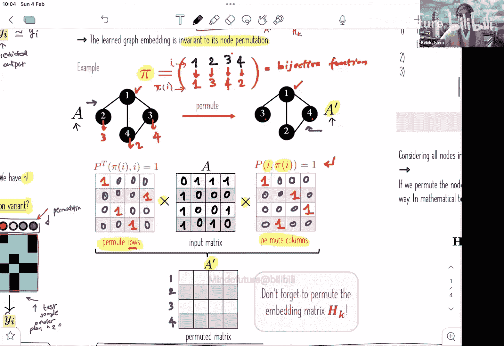
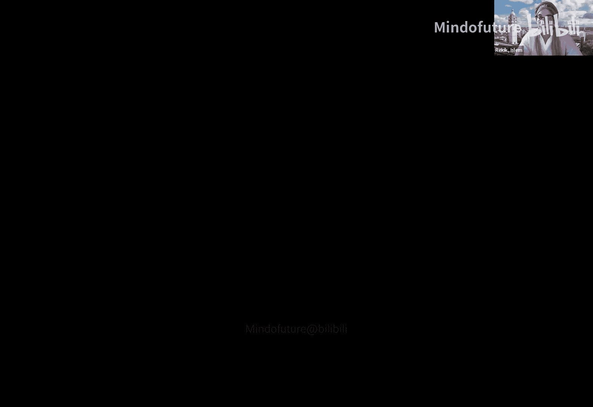
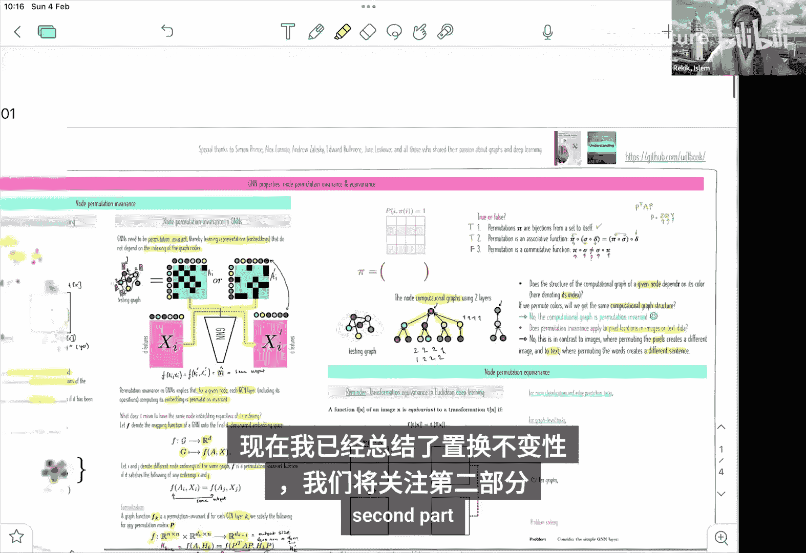

# 深度图学习：P20：图神经网络中的节点排列不变性 🧠

在本节课中，我们将学习图神经网络（GNN）的一些重要理论性质，包括不变性、等变性和表达能力。我们将从第一个性质——节点排列不变性开始。

## 概述

首先，让我们回顾一下欧几里得深度学习中的不变性概念。在传统的深度学习中，模型对输入的某些变换具有不变性。例如，对于一张图像 **X**，如果模型对变换 **T(X)**（如平移、旋转）具有不变性，则意味着无论输入是原始图像 **X** 还是变换后的图像 **T(X)**，模型的最终输出都是相同的。这可以表示为：

**F(T(X)) = F(X)**

其中 **F** 代表神经网络函数。这种性质对于图像分类等任务至关重要，因为模型需要识别出经过几何变换（如旋转、翻转）后图像中的相同物体。

## 图神经网络中的节点排列不变性

现在，让我们将视角转向图神经网络。我们需要思考：在图数据中，我们希望保留哪种理论上的不变性？为什么？

考虑一个由不同大脑图组成的数据集。每个图 **i** 有一个邻接矩阵 **A_i** 和一个特征矩阵 **X_i**。我们的目标是对这些图进行分类，例如区分健康大脑和患病大脑。我们使用一个GNN模型 **F** 来处理这些图数据，并预测一个输出标签。

现在，关键问题出现了：如果我们改变图中节点的排列顺序会发生什么？例如，对于一个有 **n** 个节点的图，我们有 **n!** 种可能的邻接矩阵表示方式，它们都代表完全相同的图拓扑结构。然而，如果GNN模型是节点顺序敏感的（即排列可变），那么当输入一个节点顺序不同的相同图时，模型可能会将其视为一个完全不同的图，从而产生不同的预测输出。这显然不是我们期望的结果。

因此，GNN需要具备**节点排列不变性**。这意味着模型学习到的表示或嵌入不应依赖于图中节点的索引顺序。无论节点如何重命名或重新排序，对于同一个节点，其学习到的嵌入应该是相同的。这是因为GNN中的聚合操作遵循局部拓扑结构，而不依赖于节点的索引。

### 形式化定义

让我们更正式地定义这种不变性。设 **F** 表示一个GNN的映射函数，它将图 **G**（及其邻接矩阵和特征矩阵）映射到一个最终的 **d** 维嵌入空间。如果 **F** 是排列不变的，那么对于同一图 **G** 的任何两种节点排序 **I** 和 **J**，以及对应的排列矩阵 **P**，都应满足：

**F(P^T A P, P^T X) = F(A, X)**

这意味着，无论我们如何排列节点（通过排列矩阵 **P** 变换邻接矩阵 **A** 和特征矩阵 **X**），GNN的输出都保持不变。

更进一步，这种不变性应贯穿于GNN的每一层。对于第 **k** 层的函数 **f_k**，它接收邻接矩阵 **A** 和当前层嵌入 **H_k**，并输出下一层嵌入 **H_{k+1}**。排列不变性要求：

**f_k(P^T A P, P^T H_k) = P^T f_k(A, H_k)**

注意等式右边也乘以了 **P^T**，这确保了输出嵌入 **H_{k+1}** 的排列与输入保持一致，这是等变性（我们稍后会讨论）的体现，但核心是函数 **f_k** 的输出在排列下是“一致变化”的，从而保证了整个网络输出的不变性。

### 一个具体例子

让我们通过一个具体例子来理解排列矩阵如何工作。假设我们有一个包含4个节点的图，其邻接矩阵为 **A**。我们定义一个排列 **π**，它将节点顺序从 (1,2,3,4) 映射到 (1,3,4,2)。根据这个排列，我们可以构造一个排列矩阵 **P**，其中如果节点 **i** 被映射到新位置 **j**，则 **P** 的第 **i** 行第 **j** 列为1，其余为0。

根据排列 **π**，我们得到排列矩阵 **P**：

**P = [[1, 0, 0, 0], [0, 0, 0, 1], [0, 1, 0, 0], [0, 0, 1, 0]]**

那么，排列后的邻接矩阵 **A'** 可以通过以下计算得到：

**A' = P^T A P**

通过执行这个矩阵乘法，你将得到一个新的邻接矩阵 **A'**，它代表了与原始图 **A** 完全相同的连接关系，只是节点的行和列顺序按照 **π** 重新排列了。特征矩阵 **X** 也通过 **X' = P^T X** 进行类似的变换。

### 计算图视角

从计算图的角度可以更直观地理解为什么GNN具有排列不变性。每个节点的嵌入是通过聚合其邻居信息来更新的。这个聚合过程形成的“计算图”结构（例如，一个两层的计算图会包含节点本身、其一阶邻居和二阶邻居）完全由图的拓扑连接决定，而与节点被赋予的编号或颜色无关。

因此，即使我们改变节点的索引（颜色），一个特定节点的计算图结构保持不变。这意味着聚合其邻居信息的方式是固定的，所以最终学习到的节点嵌入也不会因索引变化而改变。

### 与欧几里得数据的对比

需要强调的是，这种排列不变性是图数据特有的优势。对于图像数据，如果随机打乱像素的位置（相当于排列像素），会彻底破坏图像的空间结构，产生一张完全不同的、无意义的图片。对于文本数据，打乱单词顺序也会产生一个语法错误的句子。在这些情况下，模型输出必然会改变，因此欧几里得神经网络不具备这种对元素位置任意排列的不变性。

## 总结

在本节课中，我们一起深入探讨了图神经网络的核心理论性质之一：**节点排列不变性**。

我们首先回顾了深度学习中对变换不变性的普遍追求。然后，我们重点分析了在图数据上为何需要这种性质：因为同一个图可以有多种等价的矩阵表示（通过节点排列），一个稳健的GNN模型必须保证对这些不同表示的输出是一致的。

我们通过数学公式 **F(P^T A P, P^T X) = F(A, X)** 形式化地定义了排列不变性，并通过构造排列矩阵 **P** 的实例展示了其工作原理。最后，我们从计算图的角度解释了这一性质的根源：节点嵌入的更新依赖于其局部拓扑结构（邻居关系），而这种结构不随节点编号的改变而改变。

理解排列不变性是理解GNN如何有效处理图结构化数据的基础。在下一节中，我们将继续探讨另一个相关的重要性质：节点排列等变性。