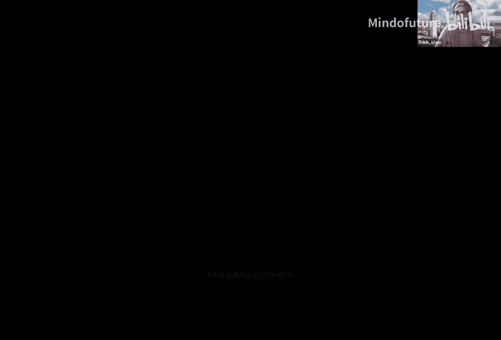
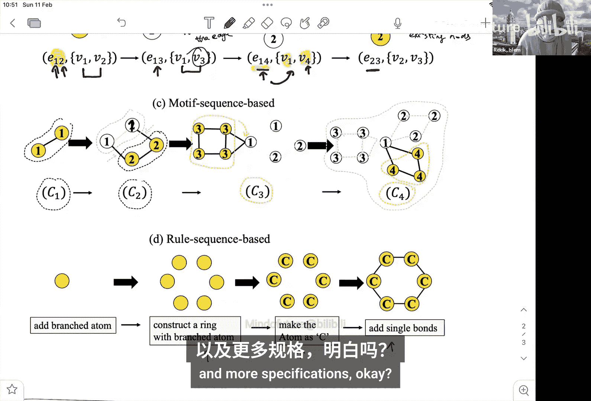

# 【伦敦帝国学院】深度图学习 ｜ Deep Graph Learning p26 P26_6.3_无条件序列图生成 -BV1WZUKBmEQA_p26-

All right so now were going to look at the taxonomy of genetic graph neural networks which was presented in this paper so you guys will find the references all references at the end of the the PDF of this lecture so here you can see there are so many methodologies for deep graph generation' it's a very hot topic and it's a very highly I would say it's a highly expensive research topic and here you have different categorizations and I really like this kind of you know taxonomy that was present in the survey paper published in 2023 and today we're going to look at a few examples so we can't cover all of these for if you guys are interested to expand your knowledge feel free to look at the paper and there are other papers also that you can explore I would recommend you starting with a review papers and survey papers that kind of present the whole field and。

The different methodologies so here today， according to this paper。

 there are different categorizations of and subcateorization of deep graph generation models and first。

We have the first layer or the first level that categorizes these models into unconditional generation so we have unconditional models right here and we have also conditional models conditional generation so under the unconditional generation we have what we call the one shot generating or one shot generation so we're going to look at the example of adjacency matrix based one shot generation today and we're going to look also quickly at the sequential generation generation or sequentially generating graphs so you have four subtypes you have the node sequence you have the edge sequence you have the moif sequence and you have the rule sequence okay so four subtypes so we're going to go over them very quickly just you know to give you an overview as I said this lectures about presenting the landscape of deep graph generation and at last so。

the conditional generation we're going to look at two examples so conditional generation conditioning we have three types sequence context and graphs so we will look at the conditioning on graphs okay and then we have the edge to simple examples edge transformation and node edge code transformation okay so here you can see what was what is highlighted in red it means that we're going to cover it we're going to go over it today so that's our roadmap。

So quickly， let's start with the unconditional generation。

And for the unconditional generation sequentially generating a graph so the inputs here as you guys can see so what I want to think about is of course you can read papers that worked on these problems and you can find existing source codes there are so many references in the survey but the idea that every time I present something to you I would like to think about how to leverage what we have learned in terms of message passing note update rule you propagation on graphs to do this kind of sequential learning right and you need to keep in mind that you know some maybe properties you want to stipulate such as invariances and equivaris so these are things that you can explore of course at a higher level but now let's start with very simple thing so first what we have as input so this is our input node so we have an input note to our network and the network will learn or the GN that we will design here that is designed here。

We'll learn how to generate nodes in a sequential manner So first we have the node V1 okay so that's our input node it doesn't have any edges and then we're going to add another node so node two so here we added node two so V2 is added and we added V2 and we connected it to node。

1， so we created an edge E12 Now next these two will have would have been generated。

 So now they are colored in gray right so this is the generated part already in the previous step and now we need to add a third node So another node so to add this node we need to learn how to connect it。

 So if we can connect the node only to for example。

 one so we can have a node ti3 or we can connect it to only you know node two or we can connect it to both So here for example。

 when we added this， of course it's learnable so we need to optimize a particular loss right to learn how to generate this properly and this is generated node of course。

 not in a random way but in an optimal way to optimize our target loss function that we have okay so here we added our。

V3 and we connected it to two our two nodes。 So we add the node and also it's edges So every time you add a node you add its edges。

 So if it's not connected to particular other node so that's zero it means the edge is  zero So every time you add a node you need to add the edges connected to that node All right now for V4 you guys can see here we're gonna to add another node and you can see that V4 is connected to only nodes 2 and3。

 so you can create its vectors so this is V4。In V4， if you look at1，2，3，4。

 so its connectivity vector and our adjacency matrix will be so 01 one and here without selfconn it's zero okay cool so this is no sequence based generation it's unconditional because we don't have any target graph here okay so in this case we don't have a target graph to to predict it's also based on self- supervision。

 it could be based on without any conditioning selfsvision or you know unsupervised。

 but the term unconditional here is a bit as I said in the categorization of the paper problematic it doesn't always imply you know does not always imply that。

We are in a fully。Unsupervised。Framework。Okay。doesn't always imply that so sometimes you can have you know some conditioning on a particular context or particular not label I mean you can have unconditional generation the conditioning will be on a particular additional information which means you can do supervised but you don't have that additional conditions so there are different terminologies I don't want to confuse you guys but here let's say mostly we would assume that unconditional is unsupervised okay so mostly so that was just between parentthesis so now let's look at the second。

The second。Example， so edge sequence base so in the edge sequence base we start with the edge okay so we have the edge we know we have an edge that connects nodes one and2 so we create the edge we know it's connecting these two nodes one and two all right so here I know my edge connects these two nodes next i'm going to add another edge so here we add another edge e13 so the edge of course needs to connect to one so here in this example it connects sequential so it connects to one of these nodes okay so one3 so we added this e13 right and it connects these two nodes one and3 and then we will keep on doing that so basically sequentially so here we have added one4 so that's our new edge that we added it and now it connects it adds a node4 so with it but the focus is on the edge so these two are actually quite similar but it depends whether you want to focus on the edge generation。

First or the node generation first right so you you focus on the edge generation so you define the edge and then you add the node。

 define edge add node or define node add edges Alright so that's very easy I think and then for example here we get the final graph so you can see we added a node two and this node two is connected to to three Okay so sorry we added note here。

We added edge2 three Okay， so now we're adding edges between these existing node so we added this edge。

That is right there Okay so there are different ways of defining this so an edge sequence base there are so many algorithms。

 so many approaches you can condition you can guide your edge sequence generation。

According to some rules you define so it's very， you know I would say there there is there are lots of options and different algorithms that you can explore and this is just you know the basic ideas first to kind of know add the edge and then do connect these nodes or add keep on adding notess or connect existing nodes like here for example。

 you connect existing notes so these are let me write it here， connect。Existing。Notes。😮，And here。

For example。Add。And you note。With the edge because it's not because V3 does not exist okay so it wasn't there so yeah so now the third one is motif sequence base so the motif sequence base it means we add blocks of subgraphs so it's kind of also simple so instead of generating one node at a time one edge at a time now we generate a subgraph at a time or a motif at a time and here for example we started with this you know a motif C1 so this is the input motif right C1 and then we added a C2 so a second motif here so we connected it so you connected a whole block to the original the previous motif so herefuse gray so this is our mo and we need to create the connections so created two connections here and we need to learn how to connect okay so that's the key challenge now for example now we have a moif。

3 so the moif3 is this block so we added this block and now you can see that this block we connected it only to node one okay so we could have connected differently and remember this is an an optimization process so you need to learn how to connect it a learnable process and that's the goal of this is to learn how to connect these motifs right and yeah so now we have for example here another moif4 so it has three connected nodes so now C4 is connected to one also and you can see how we generated the whole the whole graph the final graph as a bulk of or a concatenation of different motifs all right。

So this is the graph here so if you guys can see it right here we go Allright cool so now the rule sequence based is a bit more context or domain specific so if you have particular for example。

 if you want to generate particular molecules or biological entities or to you have some rules about the graph topology that you want toipulate so you can do that so for example here you can start with a node and say add branched atom so this will give you a ring so construct the ring right make the atom as C so you add the C inside the atom right so you're constructing atoms here and then add a single bond add single bonds between theses so this is for example these are rules that we define in by following these rules we can we can generate or upgrade the graph and keep on adding more elements and more as specifications okay。

