# 【伦敦帝国学院】深度图学习 ｜ Deep Graph Learning p28 P28_6.5_基于图的监督条件生成 -BV1WZUKBmEQA_p28-

right so it's unsupervised or selfsvised and then conditional here in this case， as I said。

 I would like to use the word conditioning when when we do have you graphs。

 but when we do have target outputs。

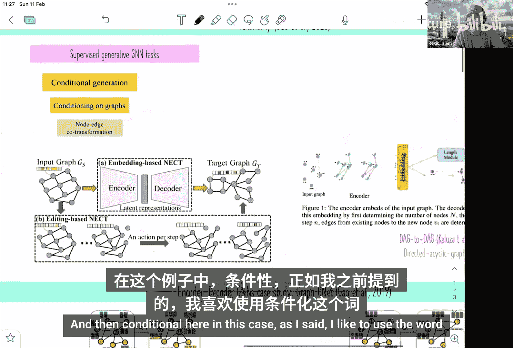

But yeah so here in this case， we have supervised generative GNNs。

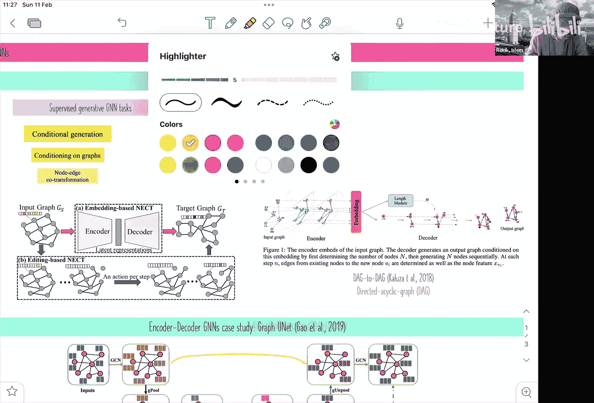

And we're going to look。Apt conditional generation on graphs in this simple example， so here。

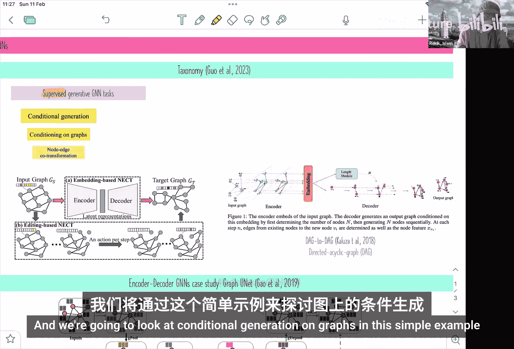

What we have actually。

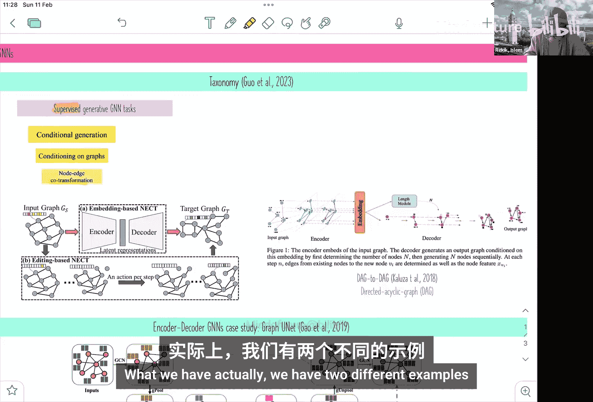

We have two different examples， so first。You guys can take a minute to look at this and think about what is actually happening。

 let's do that。

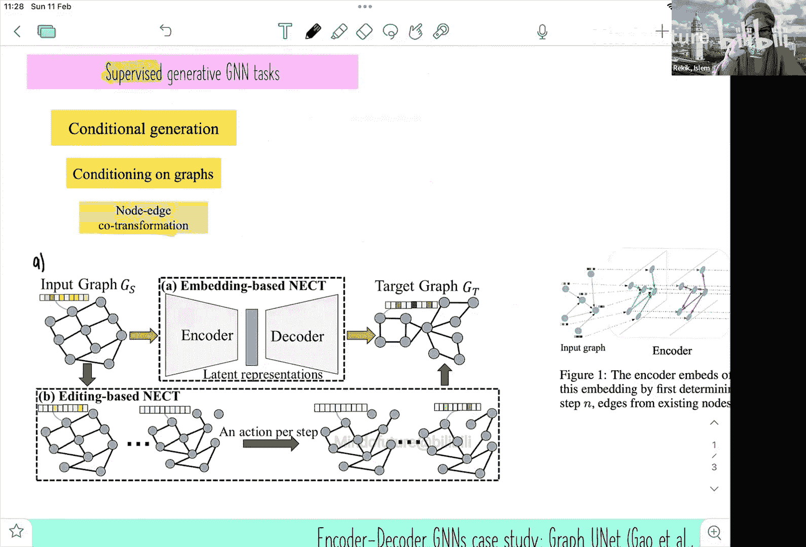

So we have a source graph， so this is the input source graph。Okay， and we have a target graph。

So from this particular source there is parity here so given the source we want to predict a target so that's why it's supervised so these are in correspondence there these are kind of you know paired。

Or in correspondence here in this example。So the goal is to do a node edge。

A node edge code transformation， so this is theect Okay node edge code transformation and it's actually very simple so。

You using what we had done before instead of。Reconstructing， so you have the GS。You move to that。

So and then from Zed， we reconstruct the GS。And now we're going to do something else。

 so we have basically。G， S， Z， and G target。Okay， so in this case。

 the first example is very important。 So the first this is。Self supervised。

 also we called unsupervised is self encoding。Or self generation sometimes call it or reconstruction。

And the second one is supervised。Because we encode the source graph into the Z here。

And we decode it into something different into a different target graph。Okay。So encode， decode。

 encode， decode， all right， two different scenario。

 So so far previously we have seen this scenario in these two examples in the MLP based one shot and in the message passing base one shot。

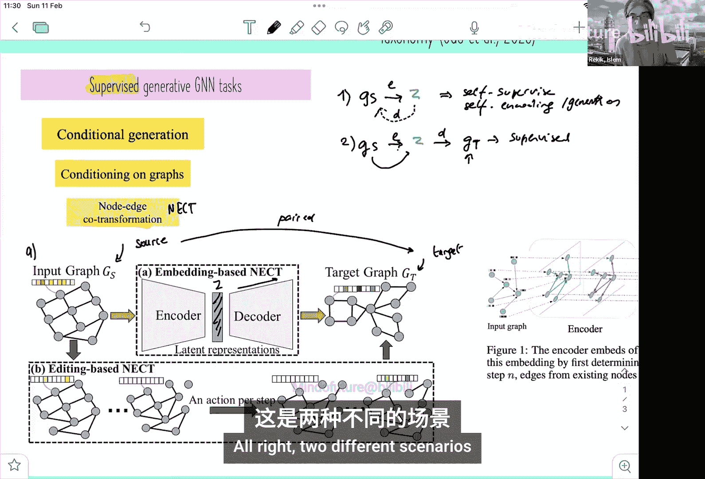

And now we're going to see the you know conditional generation on graphs。 So yeah。

 so this is actually very simple。 All you need to do is to manipulate the loss so the loss function here。

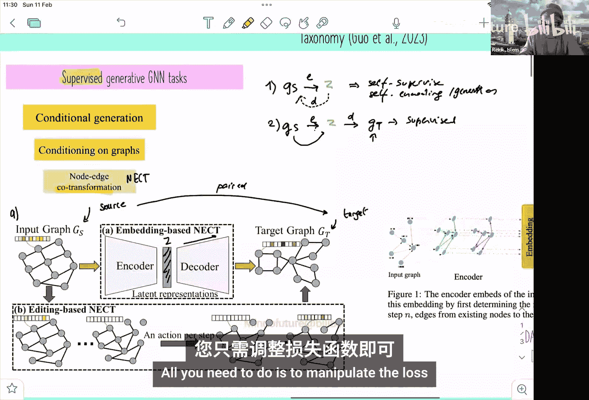

If we write it in linear algebra， so if we have a target right and you want to minimize the tilde。

 the prediction by the network。What I predict by the network and the ground truth。

 so this is a ground truth and this is my prediction。

Predition PR okay so you want to minimize this kind of loss and you know if you want to also do the features we're going to add you know plus a lambda and you do the feature matrix of target minus the predicted feature of target as we have seen in the very at the very beginning of this lecture and you can use different distances here okay so all right so this is this is just an example。

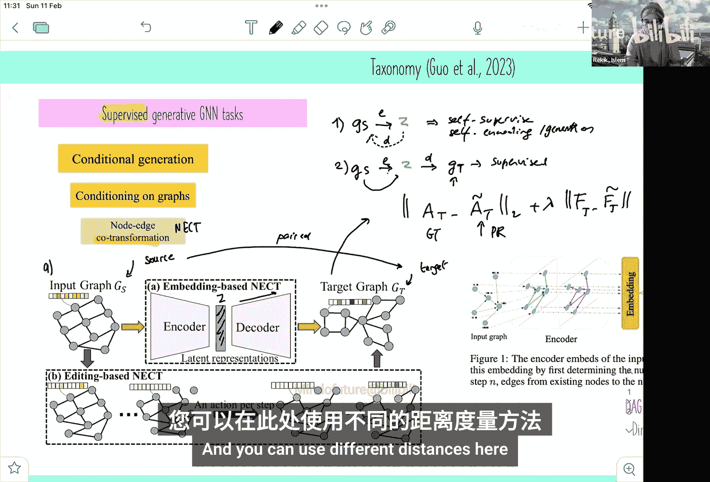

And in B， we do what we call editing based next， so you do edit the graph， so by editing the graph。

 you take the source graph。

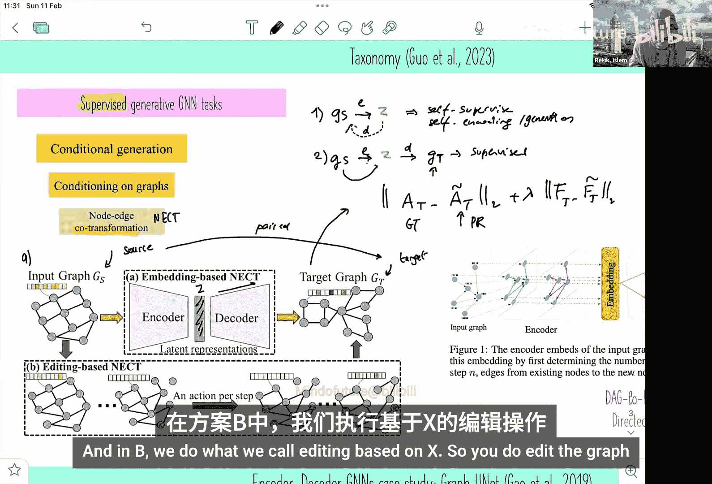

And you have the target so you do some editing and using of course GCN note you know node embedding update and you add it based on these embedding so you can think about how to do the editing right how to remove an edge for example here this edge has been removed here so it doesn't exist anymore and how to add an edge right so for example you can see that we added this edge right here so this edge has been added right right here so editing graph editing it means you added an edge add and remove。

Edges， but not only edges you can see that here we can do also we can add and remove nodes right remove edges slash nodes so end nodes so this process of editing right of node edge editing is important because it allows us to gradually learn how to transform graphs so these are these are a bit different this is a different formalization from using the encoder decor networks so here we learn how to operate on the graph and we learn the transformation process so we learn。

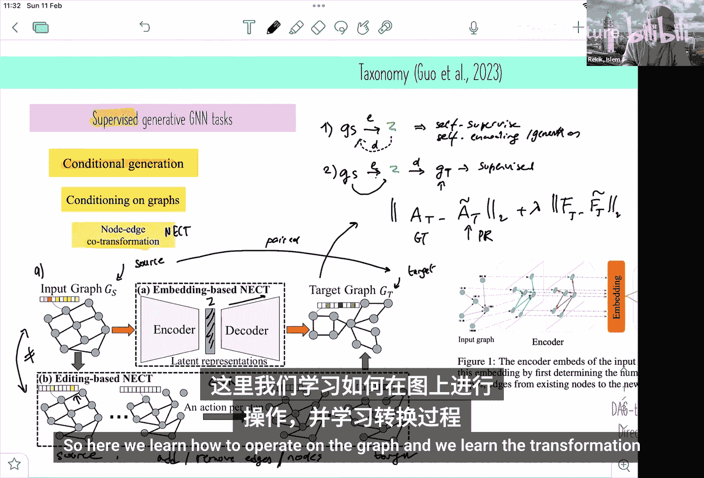

The transformation so that's a co transformation actually it's co transformation because it's for both。

Adges and notes process， and it would be interesting to read these papers， for example。

 this paper right here。

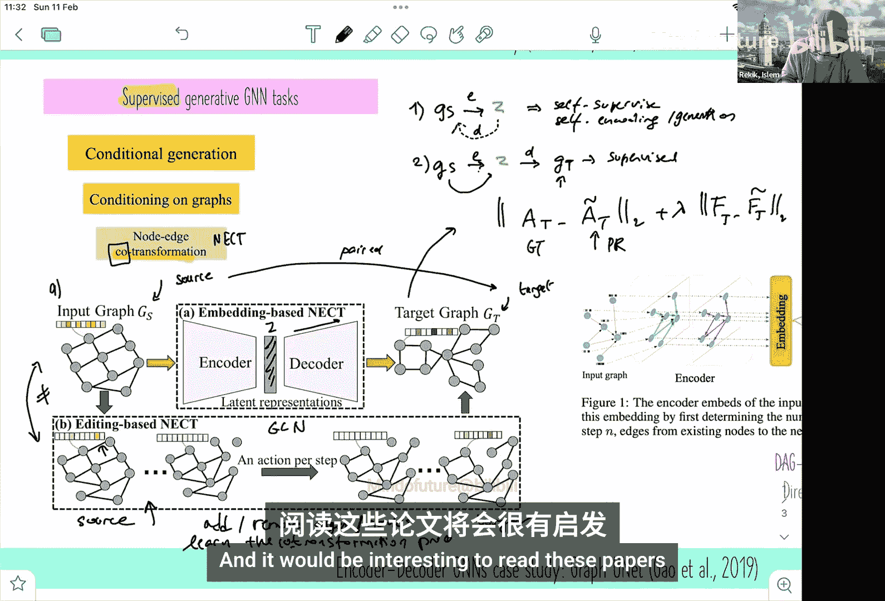

It uses the first paradigm a which is an encoder decoder network so it's a Dg to Dg a translation network DG is D G so it's a directed acyclic graph okay and it means that the graph can be directed so we have a note that you know different weights for example we may have something like this okay so this is directed graph and it doesn't have a cycle it means we don't have a cycle like this in the graph Okay so closed kind of cycles so here in this example what we have first so let's look at this figure so what is this graph translation about first。

We start with the inputs， so what are our inputs and outputs。The input graph is this one。

 so this is our input graph has initial features and this is our output graph。All right。

 so we want to learn how to generate this graph。From this input graph so first we do an encoder we use an encoder network。

 a graph encoder， so you can easily encode the graph using you know like the the methods that we have seen before and so you do a graph encoding or embedding so we get the H here and after that basically you pass this onto a decoder so you encode the graph the whole graph look。

Guys， very simple。 So it's also good to remember this。 So this is a graph for example。 This is G。

 I encode it。 So when we encode a graph when we do graphbased classification。

 we have all these pink embeddings that we have before right so all these embeddings Now what we're going do we're going create a single we're going to collapse the whole graph onto a single embedding which is almost one node right so this is one node this is what we have here so this is Hg of the whole graph so we can use different types of poolings and we learned about different types of pullingings to do graph pooling okay and transform you know graph embeddings across different nodes into a single embedding。

 so that's what we do And here we can use this later on to we can pass this through a decoder So what happens is that we're going pass this entity here the input the graph basically。

The encoded graph into single node and decod it into a full graph so we do the decoding process depending on the number of nodes so we have n modules so N decoding steps so every time we're gonna to add a node and connect it to the previous one and update the embedding of that node so sequentially so here until we get to the final node right here so here we need end steps because the final graph has end node so if we have。

 for example，100 nodes we need the module will have you know 100 steps okay so every single step and each step we will generate a node okay cool so according to some rules and if you guys are interested in learning about how are we actually generating how are we actually creating this direction right here how are we updating the embeddings of this node and creating this third node right here right and then a fourth node over there so how are we doing this。

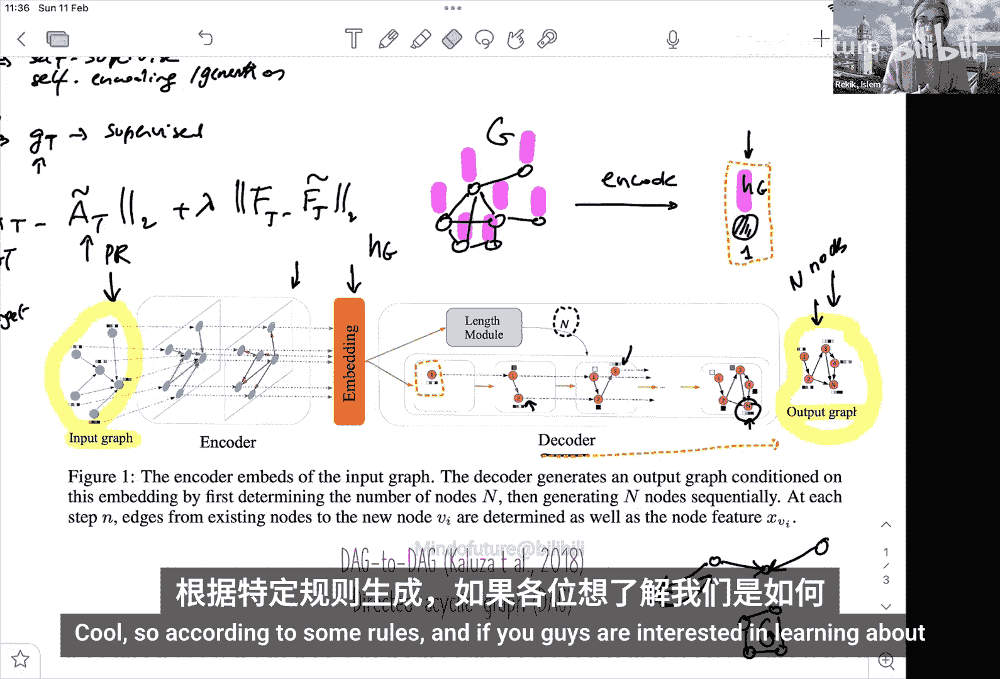

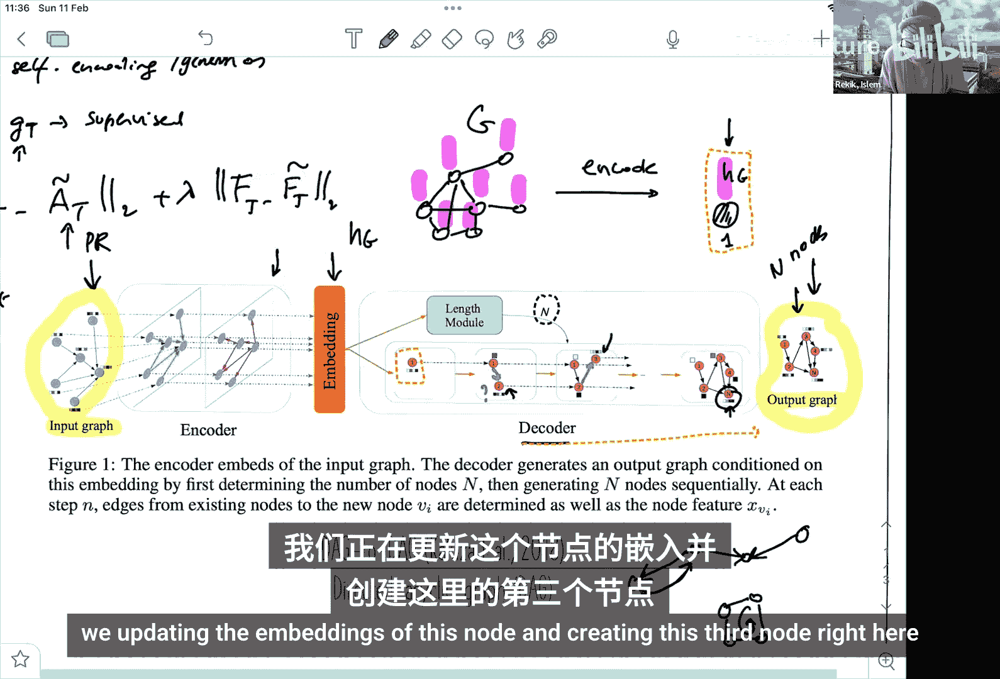

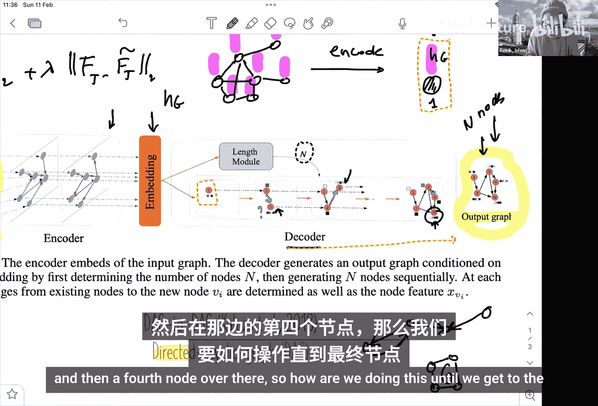

Until we get to the final note and so you can read the paper and it's also in the reference。

 but before you read the paper I really encourage you guys to。

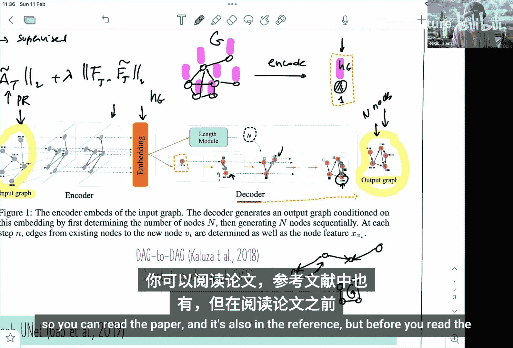

To think about this problem so think about these problems， take pen and paper， scribble。

 use lecture notes what we have learned before and try to formalize it mathematically try to kind of use the update rules define you know should I predict the note the mes first and then like you know get the link based on the dot product or maybe you know like there are different ways of doing this and you can mix different strategies。

 but it's important to justify the logic behind your design and your intuition。

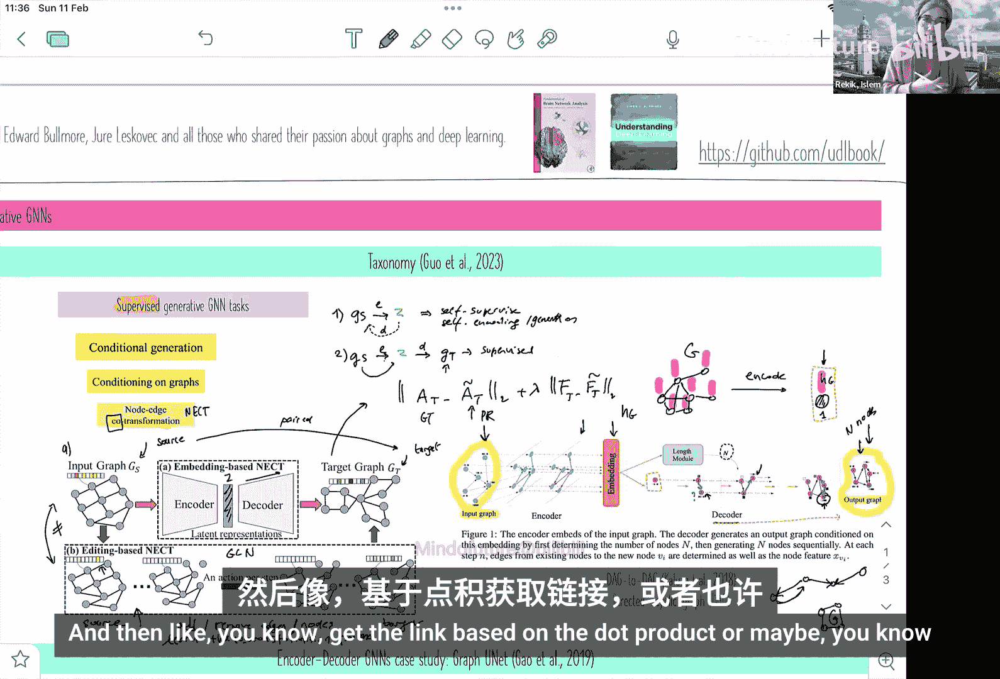

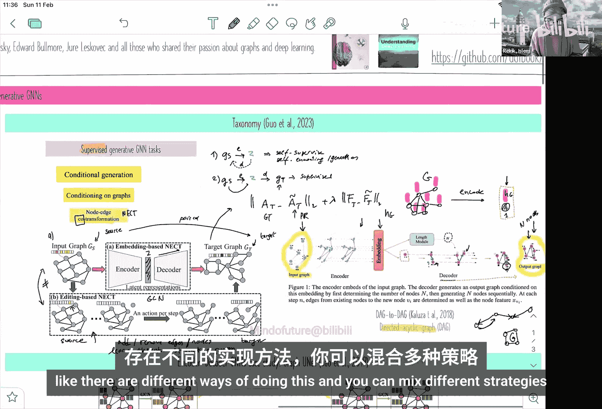

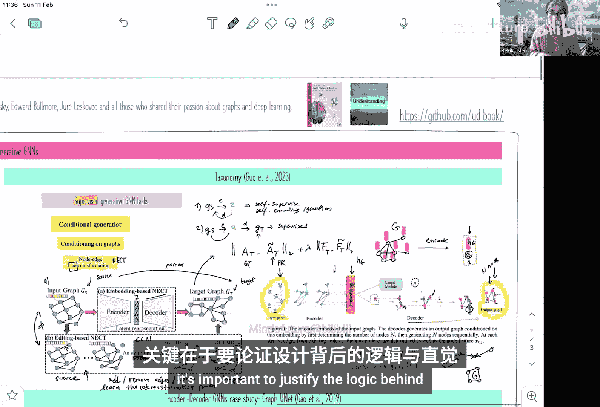