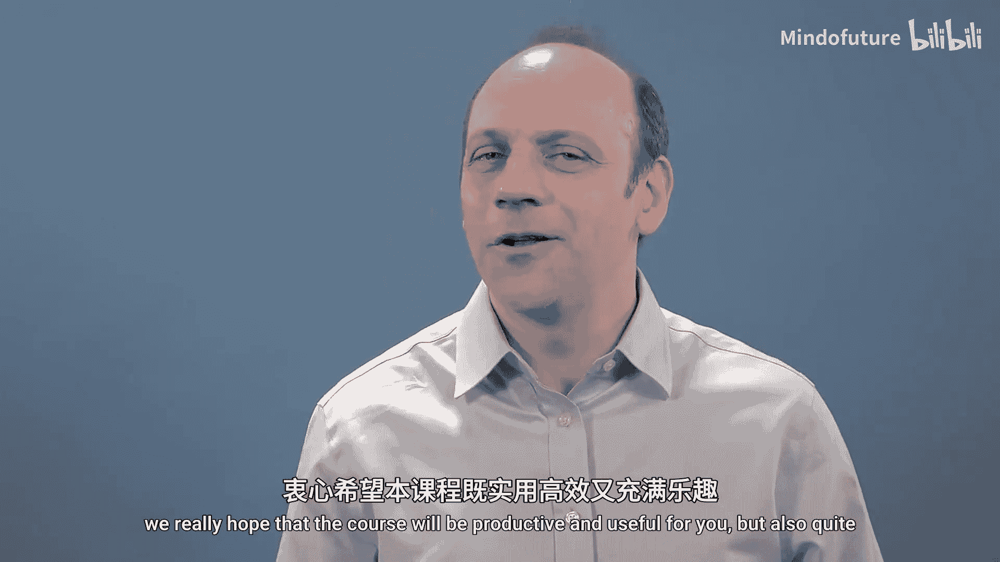

# 001：线性代数介绍 🧮

在本课程中，我们将开启“机器学习数学”专项课程的学习之旅。我们将首先聚焦于线性代数，这是理解机器学习核心算法的基础数学工具。本课程旨在帮助你建立对向量、矩阵和线性变换的直观理解，而非深陷复杂的数学细节。

## 课程背景与目标

机器学习是一套强大的数学工具集，它使我们能够表示、解释和控制周围的复杂世界。然而，“数学”这个词本身可能会让一些人感到不安。本专项课程的目的，正是要带你游览支撑这些机器学习方法的基础数学，特别侧重于培养你的直觉。

得益于出色的机器学习社区，即使不完全理解其背后的数学原理，通过使用开源库，我们也能应用许多强大的机器学习方法。这很棒，但问题也可能随之出现。如果不了解相关数学的语言和含义，你可能很难找出问题所在或进行修复。

本专项课程的理想成果是，它能给你信心和动力，让你能立即投身于网络上已有的数百个优秀的应用机器学习课程，并且不会被矩阵符号或微积分吓倒。我们希望让机器学习向尽可能多的人开放，而不仅仅是把乐趣留给计算机科学家。

## 线性代数概览

本课程是线性代数的入门介绍。线性代数本质上是一套符号约定和便捷的操作方法，它允许你方便地处理大型方程组。

在接下来的五个模块中，我们将通过测验和交互式工具，重点培养你对向量和变换的直观理解，同时偶尔会要求你补充一些Python代码示例的空白部分。

在最后一个模块中，Sam Cooper博士将通过展示线性代数如何成为谷歌著名的网页排名算法（用于决定搜索结果中网页的顺序）的核心，将所有内容串联起来。

## 后续学习路径

如果你觉得本课程有用，希望你继续学习我们的后续课程。在那里，Sam和我将向你介绍多元微积分。在另一门课程中，Mark Dnroth博士将介绍主成分分析。

我们真诚地希望这门课程对你来说既富有成效、实用，同时也充满乐趣。期待在论坛中听到你的反馈。

---

**本节课总结**：我们一起了解了“机器学习数学”专项课程的目标，明确了线性代数作为机器学习基础工具的重要性。本课程将采用直观、互动的方式，帮助你克服对数学的畏惧，为后续深入学习机器学习算法打下坚实的基础。