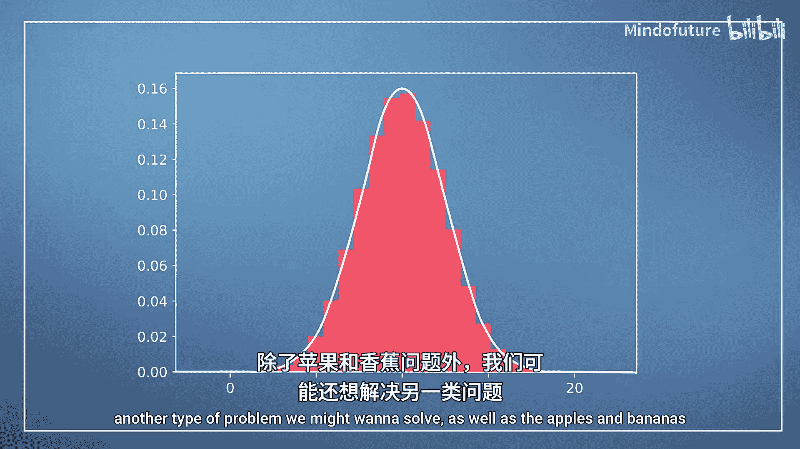

# 002：线性代数的动机

在本节课中，我们将探讨我们可能希望解决的问题类型，揭示线性代数的本质，并了解它如何帮助我们解决这些问题。

## 价格发现问题

首先，我们来看一个价格发现的问题。假设我进行了两次购物，每次都购买苹果和香蕉。第一次，我买了2个苹果和3个香蕉，总价为8元。第二次，我买了10个苹果和1个香蕉，总价为13元。这里的A和B分别代表单个苹果和单个香蕉的价格。为了找出单个苹果和香蕉的价格，我需要解这些所谓的**联立方程**。

在一般情况下，如果涉及多种商品和多次购物记录，手动求解所有这些方程可能会非常困难。因此，我们可能希望有一个计算机算法来在一般情况下为我们解决这个问题。

这是一个线性代数问题的例子。这里有一些恒定的线性系数，即数字2、10、3、1。这些系数将输入变量A和B与输出8和13联系起来。如果我们考虑一个描述苹果和香蕉价格的向量 **AB**，那么当我已知购买数量时，这个向量就会被转化为总成本，第一次购物的成本是8，第二次是13。

我可以将其写成一个矩阵问题，其中[2, 3]代表第一次购物，[10, 1]代表第二次购物。这些就是矩阵和向量。在本课程的第1到第3模块中，我们将逐步学习这些不同类型的数学对象，理解它们是什么以及如何操作这些向量和矩阵。之后，我们将回过头来找出在一般情况下如何解决这个问题。

## 数据拟合问题

另一个我们可能感兴趣的问题是为一些数据拟合一个方程。实际上，在神经网络和机器学习中，我们希望计算机不仅能拟合方程，还能找出应该使用什么方程。这虽然是对实际情况的高度不精确描述，但它给出了正确的方向。

假设我们有一些像这个直方图一样的数据，它看起来像一个具有平均值和一定变化范围（宽度）的总体分布。

除了苹果和香蕉问题，你可能想解决的另一个问题是如何找到描述这条线的方程中的最佳参数值，即那些最符合直方图中数据的参数。

使用这个方程会非常方便，因为我们将拥有一个易于携带的总体描述，而无需携带所有原始数据。例如，这可以使我们摆脱隐私问题的困扰。

我们可以根据参数绘制拟合的好坏程度，这将是下一个视频的内容。

## 本节总结

在本视频中，我们在线性代数的第一个模块中设置了两个问题。第一，苹果和香蕉的联立方程求解问题。第二，使用带有某些拟合前提的方程来拟合数据的优化问题。这些问题将继续引导和激励我们在整个线性代数及其与多元微积分的合作课程中进行学习。