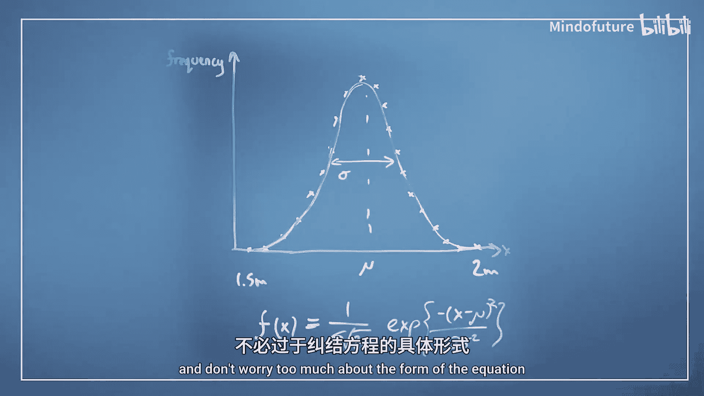

# 003：掌握向量


## 概述
在本节课中，我们将学习向量的概念，并理解它为何对解决机器学习中的线性代数问题至关重要。我们将从一个简单的数据拟合问题入手，探讨如何将参数空间中的变化视为向量，从而为后续的优化和机器学习算法打下基础。

## 从数据拟合问题引入向量
上一节我们提到了用函数拟合数据的问题。本节中我们来看看一个具体例子：拟合人群身高的分布直方图。

假设我们想用一个方程来描述人群身高的分布。这个方程可能只有两个参数：一个描述分布的中心位置，我们称之为 **μ**；另一个描述分布的宽度，我们称之为 **σ**。我们可以使用如下形式的方程进行拟合：



```math
f(x) = \frac{1}{\sigma \sqrt{2\pi}} \times e^{-\frac{(x - \mu)^2}{2\sigma^2}}
```

这个方程被称为正态分布或高斯分布。它有一个中心 **μ**，一个宽度 **σ**，并且其曲线下的总面积归一化为1。

## 如何评估拟合的好坏
现在，我们如何找到能最好地拟合数据的 **μ** 和 **σ** 呢？

想象一下，如果我们猜测的 **σ** 比实际值大，但保持总面积不变，那么拟合曲线就会变得更宽、更矮。这会导致曲线在中间区域低于数据点，在两侧边缘又高于数据点。

我们可以计算所有数据点与拟合曲线对应点之间的差异。通常，我们会计算这些差异的平方和，以此作为衡量拟合“好坏”的指标。这个值越小，说明拟合得越好。

## 参数空间与拟合景观
我们可以将不同的 **μ** 和 **σ** 组合视为一个二维空间中的点。对于每一组参数，我们都能计算出一个“坏度”值。如果我们在整个参数空间上绘制这个“坏度”值，就会得到一个像地形图一样的曲面。

*   最佳拟合参数对应于这个曲面上的最低点（山谷）。
*   较差的参数组合则对应于较高的点（山坡）。

我们的目标就是在这个“地形图”上找到最低点。

## 向量作为参数空间中的移动
假设我们从某个猜测的参数组合开始，例如 **μ** 太大而 **σ** 太小。我们想知道朝哪个方向调整参数能使拟合变得更好。

我们可以将参数的调整量视为一个向量：`[Δμ, Δσ]`。这个向量告诉我们如何在参数空间中移动。通过计算移动后新位置的“坏度”，我们可以判断这个移动方向是“下山”（变好）还是“上山”（变差）。

理想情况下，我们希望找到最陡的“下山”方向，以便快速到达最低点。这个过程就是优化。

## 向量的广义理解
由此可见，向量不必局限于物理空间中的几何箭头。它可以表示任何一组有序的数字列表。

以下是向量在不同领域的例子：

*   **计算机科学**：一辆汽车可以表示为一个向量 `[价格, 碳排放量, 噪音污染, 安全评级, 最高时速]`。
*   **材料科学**：一种合金可以表示为其各组分含量的向量。
*   **物理学**：爱因斯坦将时间视为第四维度，时空就是一个四维向量 `[x, y, z, t]`。

同样，机器学习模型的全部参数也可以构成一个高维空间中的一个点，而参数更新就是在这个空间中的向量移动。


## 总结
本节课中，我们一起学习了向量的核心概念。我们从一个数据拟合问题出发，看到函数的参数可以构成一个空间，而参数的变化可以用向量来描述。优化拟合过程，就是在这个参数空间的地形图中，寻找“坏度”最低点的过程。理解向量是理解后续微积分（用于寻找梯度方向）和机器学习优化算法的基础。