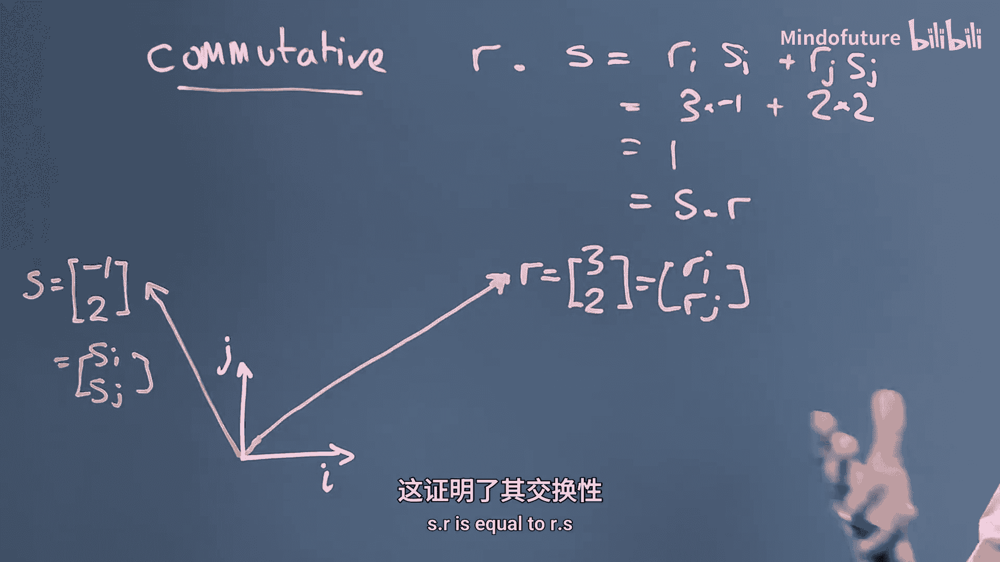

# 007：模与内积

在本节课中，我们将学习向量的两个核心概念：向量的长度（模）以及向量之间的内积（点积）。我们将从几何和代数两个角度理解这些概念，并探讨它们的基本性质。

上一节我们介绍了向量的加法和数乘运算。本节中我们来看看如何定义和计算向量的长度，以及如何定义一种向量乘法——点积。

## 向量的长度（模）

一个向量，例如这里的 **R**，作为一个几何对象，具有两个基本属性：它的长度和它所指的方向。我们希望知道如何计算这两个属性，而不依赖于我们选择的具体坐标系。

如果坐标系是由两个相互正交的单位向量（例如 **i** 和 **j**）构成的，那么向量 **R** 可以表示为：
**R** = a**i** + b**j**

其中，单位向量意味着它们的长度为1，通常用一个小帽子表示，如 **î** 和 **ĵ**。

根据勾股定理，向量 **R** 的长度可以通过其分量计算得出。以下是计算步骤：
1.  **i** 方向的分量长度为 `a`（因为 **i** 的长度为1）。
2.  **j** 方向的分量长度为 `b`。
3.  因此，向量 **R** 的长度（模）为：`√(a² + b²)`

我们通常将向量 **R** 写为列向量形式：`R = [a, b]ᵀ`。那么其模（用双竖线表示）定义为：
`||R|| = √(a² + b²)`

这个定义不仅适用于空间维度（如x和y方向），也适用于分量具有不同物理单位（如长度、时间、价格）的向量。向量的模总是通过其各分量平方和的平方根来定义。

## 向量的点积（内积）

点积是线性代数中一个极其重要且美妙的概念。它定义了向量之间的一种乘法运算，结果是一个标量（数字）。

假设我们有两个向量 **R** 和 **S**，在二维坐标系中，它们的分量分别为：
`R = [R_i, R_j]ᵀ`
`S = [S_i, S_j]ᵀ`

那么，向量 **R** 和 **S** 的点积定义为将它们对应的分量相乘，然后求和：
`R · S = R_i * S_i + R_j * S_j`

例如，如果 `R = [3, 2]ᵀ`，`S = [-1, 2]ᵀ`，那么：
`R · S = (3 * -1) + (2 * 2) = -3 + 4 = 1`

所以，在这个例子中，`R · S = 1`。

## 点积的基本性质

点积运算具有几个非常重要的数学性质，这些性质使其在理论和应用中都极为有用。

以下是点积的三个核心性质及其简要证明：

1.  **交换律**
    点积满足交换律，即 `R · S = S · R`。这是因为乘法运算本身是可交换的，所以对应分量相乘的顺序不影响结果。

2.  **对向量加法的分配律**
    点积对向量加法满足分配律。这意味着，对于任意三个向量 **R**、**S**、**T**，有：
    `R · (S + T) = R · S + R · T`
    我们可以通过将分量展开并重新组合来证明这一点。

3.  **对标量乘法的结合律**
    点积对标量乘法满足结合律。这意味着，对于一个标量 `a` 和向量 **R**、**S**，有：
    `R · (a * S) = a * (R · S)`
    标量 `a` 可以从点积运算中提取出来。

> **符号说明**：在物理学和工程学中，常用粗体表示向量（如 **v**），以区别于标量。在数学和计算机科学中，这种区分可能不那么严格。这只是一种记法上的差异，不影响概念本身。

## 点积与向量模的关系

点积与向量的模有着直接而优雅的联系。考虑一个向量 **R** 与自身的点积：
`R · R = R₁² + R₂² + ... + R_n²`

这正是向量 **R** 各分量平方的和。回想一下，向量模的平方正是这个和：
`||R||² = R₁² + R₂² + ... + R_n²`

因此，我们得到了一个关键公式：
`R · R = ||R||²`

这意味着，要计算一个向量的模，我们可以先计算该向量与自身的点积，然后取平方根：
`||R|| = √(R · R)`

这个关系非常简洁，它将向量的长度（一个几何概念）与其分量的代数运算紧密联系了起来。

## 总结

本节课中我们一起学习了向量的两个基本度量：模（长度）和内积（点积）。
*   向量的**模** `||v||` 衡量其大小，计算公式为各分量平方和的平方根。
*   向量的**点积** `u · v` 是一种乘法运算，结果为标量，计算公式为对应分量乘积之和。
*   点积具有**交换律**、**分配律**和**对标量乘法的结合律**。
*   一个向量与自身的点积等于其模的平方：`v · v = ||v||²`。这是连接代数运算与几何概念的重要桥梁。

理解模和点积是深入学习向量投影、角度计算以及更高级机器学习算法（如支持向量机、主成分分析）的基础。