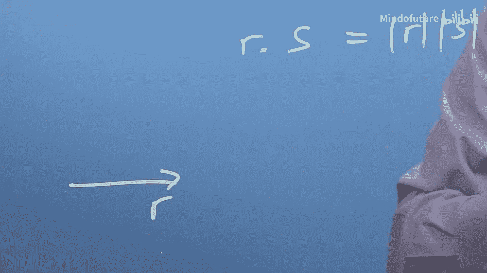

# 008：余弦与点积

在本节课中，我们将学习如何从几何角度理解向量的点积。我们将通过一个熟悉的数学工具——余弦定理，来推导出点积的几何定义，并探讨其深刻的几何含义。

## 从余弦定理出发

上一节我们介绍了点积的基本代数定义。本节中，我们来看看点积的几何意义。为此，我们需要借助余弦定理。

余弦定理指出，对于一个边长为 `A`、`B`、`C` 的三角形，其中 `C` 是 `A` 和 `B` 的夹角 `θ` 的对边，有如下关系：

**公式：** `C² = A² + B² - 2AB * cos(θ)`

## 将定理转化为向量语言

现在，我们将这个几何关系翻译成向量语言。考虑两个向量 **r** 和 **s**。

向量 **r** 和 **s** 的差向量是 **r - s**。在图中，这个差向量的长度就是边 `C`。根据余弦定理，我们可以写出：

**公式：** `|r - s|² = |r|² + |s|² - 2|r||s|cos(θ)`

## 关键推导：利用点积展开

以下是推导的核心步骤。我们知道，一个向量长度的平方等于它与自身的点积。因此，我们可以将等式的左边用点积展开：

**公式：** `|r - s|² = (r - s) · (r - s)`

接下来，我们像展开代数乘法一样展开这个点积：

**公式：** `(r - s) · (r - s) = r·r + (-s)·r + r·(-s) + (-s)·(-s)`

让我们一步步简化这个表达式：

*   `r·r` 就是 `|r|²`。
*   `(-s)·r` 和 `r·(-s)` 都等于 `-(s·r)`，所以合并后是 `-2(s·r)`。
*   `(-s)·(-s)` 等于 `s·s`，也就是 `|s|²`。

因此，展开后的结果是：

**公式：** `|r - s|² = |r|² - 2(s·r) + |s|²`

## 建立等式并得出结论

现在，我们让这个用点积表示的结果，等于之前用余弦定理表示的结果：

**公式：** `|r|² - 2(s·r) + |s|² = |r|² + |s|² - 2|r||s|cos(θ)`

观察等式两边，`|r|²` 和 `|s|²` 可以消去。然后，两边同时消去 `-2`，我们得到了一个简洁而重要的结论：

**公式：** `r · s = |r| |s| cos(θ)`

这就是点积的几何定义。它告诉我们，两个向量的点积，等于它们的长度（模）相乘，再乘以它们之间夹角的余弦值。

## 点积的几何含义

这个公式揭示了点积如何衡量两个向量的方向关系。让我们通过几个关键情况来理解：

以下是点积在不同夹角下的表现：

1.  **向量同向 (θ = 0°)**
    *   `cos(0°) = 1`
    *   此时，`r · s = |r| |s|`。点积取得最大值，为两个向量长度的乘积。

2.  **向量垂直/正交 (θ = 90°)**
    *   `cos(90°) = 0`
    *   此时，`r · s = 0`。**两个向量垂直时，它们的点积为零。** 这是判断向量是否正交的重要条件。

    

3.  **向量反向 (θ = 180°)**
    *   `cos(180°) = -1`
    *   此时，`r · s = -|r| |s|`。点积取得最小值（最大的负值）。

## 总结

本节课中，我们一起学习了点积的几何意义。我们从余弦定理出发，通过向量运算推导出了核心公式 **`r · s = |r| |s| cos(θ)`**。这个公式表明，点积本质上度量了两个向量的“方向一致性”：
*   当向量方向相同时，点积为正且最大。
*   当向量垂直时，点积为零。
*   当向量方向相反时，点积为负且最小。
理解点积的这一几何特性，对于后续学习向量投影、机器学习中的相似度计算（如余弦相似度）等概念至关重要。