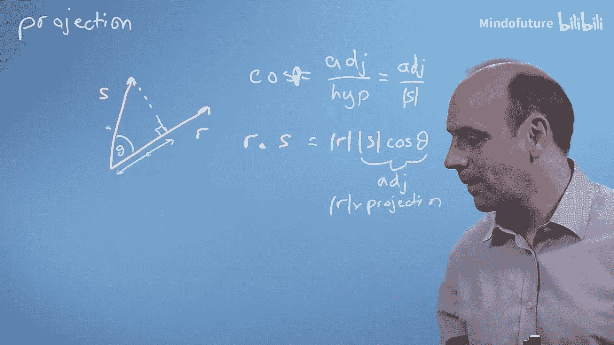

# 009：投影

在本节中，我们将学习线性代数中的一个核心概念：**投影**。我们将探讨如何将一个向量“投射”到另一个向量上，并理解点积在此过程中扮演的关键角色。

---

## 投影的几何意义

上一节我们介绍了点积可以计算向量间的夹角。本节中，我们来看看点积的另一个重要几何解释——投影。

假设我们有两个向量 **R** 和 **S**。从向量 **S** 的末端向向量 **R** 作一条垂线，可以构成一个直角三角形。这个直角三角形的邻边（即 **S** 在 **R** 方向上的“影子”长度）就是 **S** 在 **R** 上的投影。

根据三角学，这个投影的长度等于 **|S| cos θ**，其中 θ 是两向量间的夹角。

## 点积与投影的关系

点积的定义公式为：
**R · S = |R| |S| cos θ**

从这个公式可以看出，点积 **R · S** 的值等于 **R** 的长度乘以 **S** 在 **R** 方向上的投影长度（即 **|S| cos θ**）。

如果向量 **S** 垂直于 **R**（θ = 90°），那么 cos θ = 0，投影长度为零，点积结果也为零。这印证了点积能反映向量的方向一致性。

## 标量投影与向量投影

基于点积，我们可以定义两种投影：

**1. 标量投影**
标量投影是指 **S** 在 **R** 方向上的投影长度（一个纯数值）。计算公式为：
**标量投影 = (R · S) / |R|**

这个公式直接由点积公式变形得到，它去掉了 **R** 自身长度的影响，只留下投影的数值大小。

**2. 向量投影**
向量投影不仅包含投影的长度，还指明了投影的方向（即 **R** 的方向）。计算公式为：
**向量投影 = [(R · S) / (R · R)] * R**

其中，**(R · S) / (R · R)** 计算的是标量投影与 **R** 长度的比值，再乘以向量 **R** 本身，最终得到一个与 **R** 方向相同、长度等于标量投影的向量。如果 **R** 是单位向量（长度为1），那么向量投影就简化为 **(R · S) * R**。

以下是两种投影的关键点总结：
*   **标量投影**：一个数值，表示投影的长度。
*   **向量投影**：一个向量，同时包含了投影的长度和方向信息。

## 本节总结

本节课我们一起学习了投影的概念。我们了解到：
1.  点积 **R · S** 的几何意义之一是 **R** 的长度乘以 **S** 在 **R** 上的投影长度。
2.  通过点积可以计算出**标量投影**（纯长度）和**向量投影**（带方向的向量）。
3.  投影概念帮助我们理解一个向量如何“分解”或“映射”到另一个向量的方向上。

这是本周的核心内容。我们定义了向量的大小（模长），引入了点积（投影积），并探索了它的数学性质（分配律、结合律、交换律）和几何意义（求夹角、求投影）。理解投影是理解后续许多线性代数概念（如坐标变换、降维）的基础。建议在此暂停，尝试一些练习题来巩固这些概念，然后再继续学习。