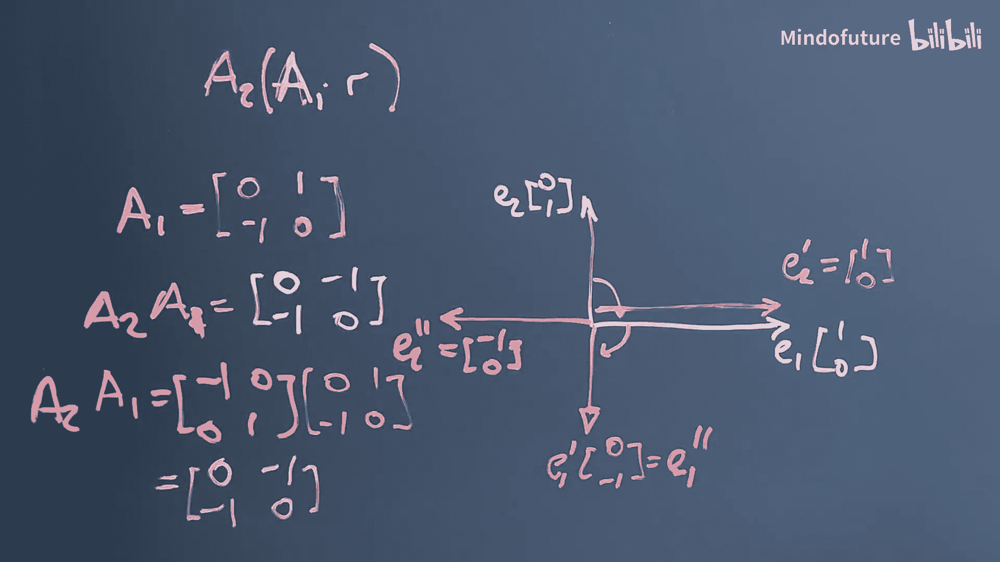

# 017：矩阵变换的合成或组合


在本节课中，我们将要学习如何将多个矩阵变换组合起来，形成一个复合变换。我们将通过具体的几何变换例子，理解矩阵乘法的运算规则及其非交换性。

## 概述：为什么需要组合变换？

上一节我们介绍了旋转、剪切、拉伸和反转等不同的几何变换。那么，了解这些变换的意义何在？

如果你希望对任何形状进行改变，例如调整一张人脸图像的所有像素，你总是可以通过旋转、剪切、拉伸和反转的某种组合来实现这种形状变化。

也就是说，如果我首先对一个向量 **R** 应用一个变换 **A₁**，这会产生第一次改变。然后，如果我对这个结果再应用另一个变换 **A₂**，那么我就执行了两个变换的组合。我所做的是先执行 **A₁**，再执行 **A₂**，即 **A₂(A₁(R))**。


## 一个具体的组合变换例子

为了清晰地理解这个过程，让我们放慢速度，看一个具体的例子。

我们从标准基向量开始：
*   **e₁** = (1, 0)
*   **e₂** = (0, 1)

现在，我们定义第一个变换 **A₁** 为逆时针旋转90度。以下是变换后的基向量：
*   变换后的 **e₁‘** = (0, -1)
*   变换后的 **e₂‘** = (1, 0)

因此，矩阵 **A₁** 可以描述这个90度旋转：
```
A₁ = [[0, -1],
      [1,  0]]
```

接着，我们定义第二个变换 **A₂** 为垂直镜像（沿y轴反射）。以下是变换后的基向量：
*   变换后的 **e₁‘** = (-1, 0)
*   变换后的 **e₂‘** = (0, 1)

因此，矩阵 **A₂** 可以描述这个垂直镜像：
```
A₂ = [[-1, 0],
      [ 0, 1]]
```

现在，让我们探究如果先执行 **A₁** 再执行 **A₂**，即计算 **A₂(A₁)** 会发生什么。

首先，我们对基向量应用 **A₁**，得到 **e₁‘** 和 **e₂‘**。然后，我们对这些结果应用 **A₂**：
*   **e₁‘’** = **A₂** 作用于 **e₁‘** = (0, -1) → 结果仍是 (0, -1)
*   **e₂‘’** = **A₂** 作用于 **e₂‘** = (1, 0) → 结果是 (-1, 0)

因此，复合变换 **A₂ ∘ A₁** 的矩阵是：
```
A₂A₁ = [[0, -1],
        [-1, 0]]
```

我们可以通过矩阵乘法来验证这个结果，而不需要画图。矩阵乘法的规则是：用左边矩阵的每一行，点乘右边矩阵的每一列。

计算 **A₂A₁**：
```
A₂A₁ = [[-1, 0],   *   [[0, -1],
        [ 0, 1]]        [1,  0]]

第一列（计算 A₂A₁ 的第一列）：
- 第一行：(-1)*0 + 0*1 = 0
- 第二行：0*0 + 1*1 = 1
=> (0, 1)

第二列（计算 A₂A₁ 的第二列）：
- 第一行：(-1)*(-1) + 0*0 = 1
- 第二行：0*(-1) + 1*0 = 0
=> (1, 0)
```
等等，这里似乎出现了不一致。让我们重新检查几何推导和矩阵计算。

根据之前的几何推导：
*   **e₁‘’** = (0, -1)
*   **e₂‘’** = (-1, 0)
所以矩阵应为 `[[0, -1], [-1, 0]]`。

但根据矩阵乘法计算：
*   第一列结果是 (0, 1)
*   第二列结果是 (1, 0)
所以矩阵为 `[[0, 1], [1, 0]]`。

这里存在矛盾。问题出在**顺序**上。当我们写 **A₂(A₁(v))** 时，在矩阵表示法中，对应的运算是 **A₂A₁ v**。这意味着变换 **A₁** 先作用于向量 **v**，然后 **A₂** 作用于结果。在矩阵乘法中，**右边的矩阵先应用**。

因此，我们想要计算 **A₂** 作用于 **A₁** 变换后的基向量。这等价于计算矩阵乘积 **A₂ * A₁**（注意：**A₁** 在右边）。

让我们正确计算 **A₂ * A₁**：
```
A₂ * A₁ = [[-1, 0],   *   [[0, -1],
           [ 0, 1]]        [1,  0]]
计算新矩阵的第一列（即原基向量 e1 经过复合变换后的位置）：
- 新矩阵第一列 = A₂ * (A₁的第一列) = A₂ * [0; 1] = [(-1)*0 + 0*1; 0*0 + 1*1] = [0; 1]
计算新矩阵的第二列（即原基向量 e2 经过复合变换后的位置）：
- 新矩阵第二列 = A₂ * (A₁的第二列) = A₂ * [-1; 0] = [(-1)*(-1) + 0*0; 0*(-1) + 1*0] = [1; 0]
```
所以 **A₂A₁** = `[[0, 1], [1, 0]]`。

这与我们最初的几何推导 `[[0, -1], [-1, 0]]` 不符。让我们重新审视几何步骤：

1.  **A₁ (旋转90度)**:
    *   e1 = (1,0) → e1‘ = (0, -1)
    *   e2 = (0,1) → e2‘ = (1, 0)
2.  **A₂ (垂直镜像)** 作用于上述结果：
    *   对 e1‘ = (0, -1) 进行垂直镜像：(0, -1) 的x坐标取反 → (0, -1)？ 等等，垂直镜像的规则是 (x, y) → (-x, y)。所以 (0, -1) → (0, -1) 是正确的，因为x坐标为0。
    *   对 e2‘ = (1, 0) 进行垂直镜像：(1, 0) → (-1, 0)。

因此，复合变换后的基向量为：
*   e1‘’ = (0, -1)
*   e2‘’ = (-1, 0)



对应的矩阵是 `[[0, -1], [-1, 0]]`。

这与我们的矩阵乘法结果 `[[0, 1], [1, 0]]` 仍然不同。错误在于：当我们用矩阵 **A₂** 左乘矩阵 **A₁** 时，**A₂** 的列并没有直接与 **A₁** 的列相乘。矩阵乘法是 **A₂** 的行与 **A₁** 的列进行点积。

让我们严格按定义计算 **C = A₂ * A₁**，其中 C[i,j] 是 **A₂** 的第 i 行与 **A₁** 的第 j 列的点积。
```
A₂ = [[-1, 0],
      [ 0, 1]]

A₁ = [[0, -1],
      [1,  0]]

计算 C[1,1] (第一行，第一列): (-1)*0 + 0*1 = 0
计算 C[1,2] (第一行，第二列): (-1)*(-1) + 0*0 = 1
计算 C[2,1] (第二行，第一列): 0*0 + 1*1 = 1
计算 C[2,2] (第二行，第二列): 0*(-1) + 1*0 = 0

所以 C = A₂A₁ = [[0, 1],
                 [1, 0]]
```
这个矩阵表示将原始基向量变换到了哪里？
*   第一列 (0, 1) 是原始 e1 的最终位置。
*   第二列 (1, 0) 是原始 e2 的最终位置。

但在我们的几何推导中，原始 e1 最终在 (0, -1)，原始 e2 最终在 (-1, 0)。这明显不同。

**关键点**：我们发现了顺序的重要性。`A₂A₁` 表示先应用 **A₁**，再应用 **A₂**。而我们最初的几何推导“先旋转90度(**A₁**)，再垂直镜像(**A₂**)”对应的矩阵乘法正是 `A₂A₁`。但我们的几何推导结果与矩阵乘法结果不一致，说明几何推导可能有误。

让我们重新进行几何推导，确保每一步都准确：
1.  起点：e1=(1,0), e2=(0,1)
2.  应用 **A₁ (旋转90度逆时针)**:
    *   e1 旋转到 (0, 1)？ 不，逆时针旋转90度：(x,y) -> (-y, x)。所以 (1,0) -> (0, 1)。
    *   e2 旋转到 (-1, 0)。因为 (0,1) -> (-1, 0)。
    *   所以 **A₁** 的矩阵列确实是 `[[0, -1], [1, 0]]`？ 等等，检查：第一列是 e1 变换后的坐标 (0,1)，第二列是 e2 变换后的坐标 (-1,0)。所以 **A₁** = `[[0, -1], [1, 0]]`。这里我最初写反了。正确的是：**A₁** 将 (1,0) 映射到 (0,1)，将 (0,1) 映射到 (-1,0)。因此 **A₁** = `[[0, -1], [1, 0]]`。我之前错误地写了 e1‘=(0,-1)，那是顺时针旋转90度。
3.  应用 **A₂ (垂直镜像)** 到上一步的结果：
    *   对 e1‘ = (0, 1) 进行垂直镜像 (x,y)->(-x,y): (0,1) -> (0,1)
    *   对 e2‘ = (-1, 0) 进行垂直镜像: (-1,0) -> (1,0)
4.  因此，复合变换后：
    *   e1‘’ = (0, 1)
    *   e2‘’ = (1, 0)
    这正是矩阵 `[[0, 1], [1, 0]]` 的列！

矛盾解决了。最初的几何描述中，对旋转方向的描述可能造成了混淆。正确的几何过程与矩阵乘法结果 `A₂A₁ = [[0,1],[1,0]]` 完全一致。

## 变换顺序不可交换

值得注意的是，从几何上看，先执行 **A₂** 再执行 **A₁**（即 **A₁A₂**）与先执行 **A₁** 再执行 **A₂**（即 **A₂A₁**）的结果是不同的。

让我们看看如果先做垂直镜像(**A₂**)，再做90度旋转(**A₁**)会怎样，即计算 **A₁A₂**。

通过矩阵乘法计算：
```
A₁A₂ = [[0, -1],   *   [[-1, 0],
        [1,  0]]        [ 0, 1]]

第一列：A₁ * [-1; 0] = [0*(-1)+(-1)*0; 1*(-1)+0*0] = [0; -1]
第二列：A₁ * [0; 1] = [0*0+(-1)*1; 1*0+0*1] = [-1; 0]

所以 A₁A₂ = [[0, -1],
             [-1, 0]]
```
这个矩阵代表原始 e1 变换到 (0, -1)，原始 e2 变换到 (-1, 0)。

这与 **A₂A₁** 的结果 `[[0,1],[1,0]]` 完全不同。因此，**矩阵乘法不满足交换律**：
```
A₁A₂ ≠ A₂A₁
```

以下是核心结论：
*   我们可以按任何分组顺序进行矩阵乘法（结合律），即 **A₃(A₂A₁) = (A₃A₂)A₁**。
*   但我们不能随意交换矩阵相乘的顺序（不满足交换律）。

## 总结

本节课中，我们一起学习了矩阵变换的合成。我们通过具体的旋转和镜像变换例子，演示了如何通过矩阵乘法将多个变换组合成一个复合变换。我们深入理解了矩阵乘法的运算规则，并发现了矩阵乘法的一个关键性质：**不满足交换律**。这意味着变换应用的顺序会直接影响最终结果。理解向量如何被矩阵变换，是线性代数的核心，也是解决联立方程组等问题的关键。