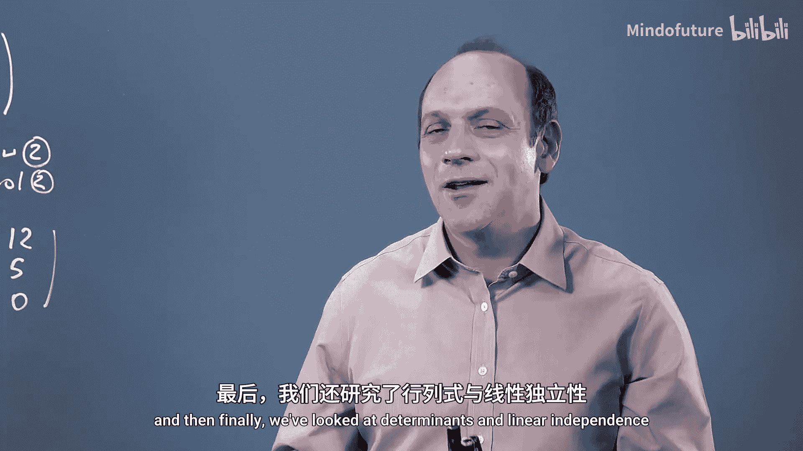
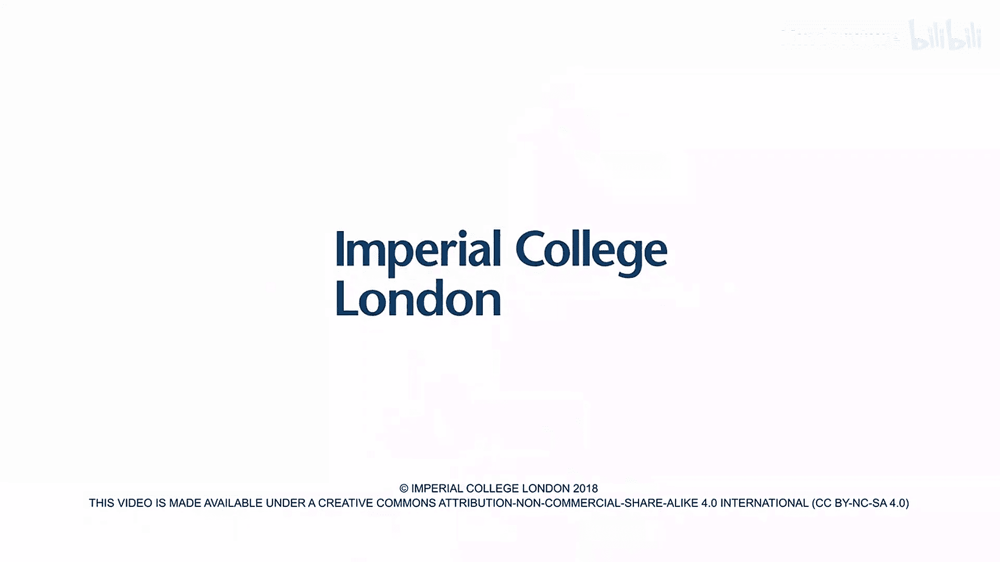

# 020：行列式与逆矩阵

在本节课中，我们将学习矩阵的一个重要属性——行列式，并探讨当矩阵的基向量不线性独立时会发生什么。我们将从几何和代数两个角度理解行列式的意义，以及它与矩阵可逆性的关系。

## 行列式的几何意义

上一节我们介绍了基向量，本节中我们来看看矩阵如何变换空间。考虑一个简单的对角矩阵：

\[
A = \begin{bmatrix}
a & 0 \\
0 & d
\end{bmatrix}
\]

这个矩阵的作用是缩放空间。它将原始基向量 \(\hat{e}_1\) 和 \(\hat{e}_2\) 分别沿各自方向缩放 \(a\) 倍和 \(d\) 倍。原始空间是一个1x1的单位正方形，变换后，空间中的所有面积都被放大了 \(a \times d\) 倍。这个缩放因子 \(ad\) 就被称为该变换矩阵的**行列式**。

现在，考虑一个更一般的矩阵：

\[
A = \begin{bmatrix}
a & b \\
c & d
\end{bmatrix}
\]

它将单位正方形变换为一个平行四边形。通过几何计算可以得出，这个平行四边形的面积等于 \(ad - bc\)。我们用竖线符号表示求行列式的操作：

\[
\text{det}(A) = \begin{vmatrix}
a & b \\
c & d
\end{vmatrix} = ad - bc
\]

## 行列式与逆矩阵的关系

在学校里，你可能学过如何求一个2x2矩阵的逆：交换主对角线元素，并对副对角线元素取负，再除以某个因子。让我们验证一下：

矩阵 \(A\) 的逆通常写作：
\[
A^{-1} = \frac{1}{ad-bc} \begin{bmatrix}
d & -b \\
-c & a
\end{bmatrix}
\]

如果我们计算 \(A \times A^{-1}\)：
\[
\begin{bmatrix}
a & b \\
c & d
\end{bmatrix}
\times
\frac{1}{ad-bc} \begin{bmatrix}
d & -b \\
-c & a
\end{bmatrix}
= \frac{1}{ad-bc} \begin{bmatrix}
ad-bc & 0 \\
0 & ad-bc
\end{bmatrix}
= \begin{bmatrix}
1 & 0 \\
0 & 1
\end{bmatrix}
\]

结果正是单位矩阵。这里的关键是，我们必须除以行列式 \((ad-bc)\) 才能得到正确的逆矩阵。从几何角度看，原矩阵将空间放大了 \(\text{det}(A)\) 倍，而其逆矩阵需要将空间缩小回原来的大小，因此必须除以这个行列式值。

## 行列式为零的情况

现在，让我们思考一个特殊的矩阵：
\[
A = \begin{bmatrix}
1 & 2 \\
1 & 2
\end{bmatrix}
\]

这个矩阵将基向量 \(\hat{e}_1\) 变换到 \((1,1)\)，将 \(\hat{e}_2\) 变换到 \((2,2)\)。这两个新向量位于同一条直线上，是线性相关的。这个矩阵将整个二维平面压缩到了一条一维的直线上。

计算其行列式：
\[
\text{det}(A) = (1 \times 2) - (2 \times 1) = 0
\]

行列式为零。从几何意义上说，任何面积经过变换后都变成了零（因为被压缩到了没有面积的线上）。对于3x3矩阵，如果三个新基向量不是线性独立的（例如其中一个可以由另外两个线性表出），那么变换会将三维空间压缩为一个平面或直线，其体积（三维行列式）同样为零。

## 线性相关性与求解方程

行列式为零与线性相关性直接相关，这会影响我们求解线性方程组的能力。

考虑以下方程组及其增广矩阵：
\[
\begin{aligned}
x + 2y + 3z &= 10 \quad &(1) \\
2x + 5y + 5z &= 20 \quad &(2) \\
3x + 7y + 8z &= 30 \quad &(3)
\end{aligned}
\]
其系数矩阵为：
\[
\begin{bmatrix}
1 & 2 & 3 \\
2 & 5 & 5 \\
3 & 7 & 8
\end{bmatrix}
\]

观察可以发现，第三行恰好是第一行和第二行之和，第三列也依赖于前两列。这意味着三个行向量（或列向量）不是线性独立的。

当我们尝试用行阶梯形（Row Echelon Form）法求解时：

以下是化简步骤：
1.  从第二行减去第一行的2倍。
2.  从第三行减去第一行的3倍。
3.  从新的第三行减去新的第二行。

完成这些操作后，第三行会全部变为零，即得到 \(0z = 0\)。这个方程总是成立，没有提供关于 \(z\) 的新信息，因此 \(z\) 可以取任意值。我们无法得到唯一的解，方程组有无限多解。

这好比你去商店买苹果、香蕉和胡萝卜，但第三次购买的商品只是前两次的重复组合，没有提供新的信息，因此你无法唯一确定每种商品的单价。

## 不可逆矩阵的后果

当矩阵的行列式为零时，意味着其列向量（即新的基向量）线性相关。这会导致两个重要后果：
1.  **矩阵不可逆**：因为逆矩阵公式中包含 \(1 / \text{det}(A)\)，而行列式为零会使计算无意义。
2.  **信息丢失**：变换将空间压缩到了更低的维度，丢失了部分信息。就像把一张纸揉成一条线，你无法再从这条线完美地恢复出原来的纸。由于信息丢失，逆变换不存在。

因此，在提议一组新的基向量并用矩阵变换数据之前，检查这些新基向量是否线性独立（即矩阵是否可逆）通常是很重要的。

## 总结

本节课中我们一起学习了：
1.  **行列式**的几何意义：它衡量矩阵变换对空间面积的缩放因子。对于2x2矩阵，计算公式为 \(\text{det}(A) = ad - bc\)。
2.  **行列式与逆矩阵**的关系：逆矩阵需要除以行列式来抵消原变换的缩放效应。
3.  **行列式为零**的情况：当矩阵的列向量线性相关时，行列式为零。这意味着变换将空间压缩到更低维度，导致信息丢失。
4.  **不可逆性**：行列式为零的矩阵没有逆矩阵，对应的线性方程组可能无解或有无穷多解，我们无法通过变换后的数据完美恢复原始数据。

理解行列式和线性独立性是判断矩阵是否可逆、变换是否可逆的关键，这在机器学习的许多算法（如求解参数、坐标变换）中至关重要。