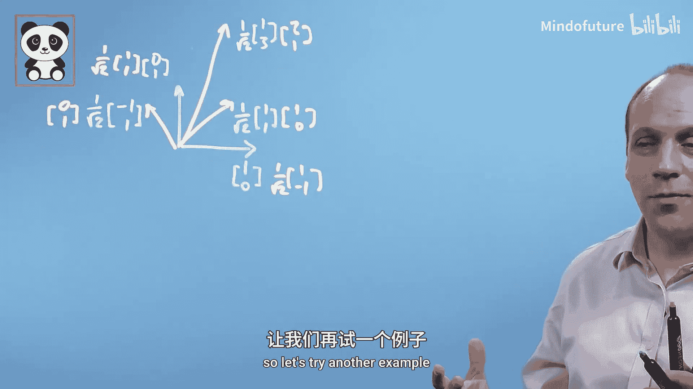

# 023：P23_矩阵 - 改变基_04_02_01


## 概述
在本节课中，我们将学习如何将一个向量从一组基向量转换到另一组基向量。我们将探讨使用变换矩阵及其逆矩阵进行转换的方法，并特别关注当新基向量正交时，如何使用更简单的点积投影方法来完成同样的任务。

---

## 变换矩阵的列向量含义
我们之前提到过，变换矩阵的列向量是映射中新基向量在我坐标系中的坐标轴。

现在，我们将花一些时间研究如何将向量从一组基向量转换到另一组基向量。

## 从熊猫的基向量转换到我的基向量
假设我有两个新的基向量来描述熊猫的世界。熊猫的世界是橙色的。熊猫的第一个基向量在那里，另一个基向量在那里。

在我的世界里，熊猫的基向量是 `[3, 1]` 和 `[1, 1]`。而我的基向量是 `E1_hat = [1, 0]` 和 `E2_hat = [0, 1]`。这些是我的基向量，橙色的则是熊猫的基向量。

在熊猫的世界里，它的第一个基向量是 `[1, 0]`，第二个基向量是 `[0, 1]`。但在我的蓝色坐标系中，熊猫的基向量是 `[3, 1]` 和 `[1, 1]`。因此，我可以将熊猫的变换矩阵 `B` 写为：
```
B = [[3, 1],
     [1, 1]]
```

现在，让我们取一个要转换的向量。假设这个向量在熊猫的世界里是 `[3/2, 1/2]`。这个指令的意思是：在我的坐标系中，执行 `(3/2) * [3, 1]` 加上 `(1/2) * [1, 1]`。

在我的世界里，这将得到：
```
x = 3*(3/2) + 1*(1/2) = 9/2 + 1/2 = 10/2 = 5
y = 1*(3/2) + 1*(1/2) = 3/2 + 1/2 = 4/2 = 2
```
所以，在我的世界里，这个向量是 `[5, 2]`。因此，`[3/2, 1/2]`（熊猫的向量）和 `[5, 2]`（我的向量）是同一个东西。

这里的变换矩阵 `B` 的列是熊猫的基向量在我的坐标系中的坐标。它将熊猫的向量转换到我的世界。这通常会产生一个问题：我们通常希望将我的世界转换到熊猫的世界。因此，我们需要弄清楚如何进行反向操作。

## 如何进行反向转换？
我的下一个问题是：如何执行反向过程？这将会涉及到逆矩阵。

如果我称熊猫的变换矩阵为 `B`，那么我将需要 `B` 的逆矩阵 `B^{-1}`。这个矩阵的逆实际上很容易计算。对于一个 `2x2` 矩阵 `[[a, b], [c, d]]`，其逆矩阵公式为 `(1/(ad-bc)) * [[d, -b], [-c, a]]`。

对于我们的矩阵 `B = [[3, 1], [1, 1]]`：
- 行列式 `det(B) = 3*1 - 1*1 = 2`
- 逆矩阵 `B^{-1} = (1/2) * [[1, -1], [-1, 3]] = [[1/2, -1/2], [-1/2, 3/2]]`

这个逆矩阵 `B^{-1}` 的列是我的基向量在熊猫坐标系中的坐标。也就是说，我的 `[1, 0]` 在熊猫的系统中是 `(1/2)*[1, -1]`，而我的 `[0, 1]` 在熊猫的系统中是 `(1/2)*[-1, 3]`。

我们可以验证这是正确的。如果我们取 `(1/2)*[1, -1]` 并用熊猫的基向量（即矩阵 `B` 的列）来组合它：
```
(1/2) * (1*[3, 1] + (-1)*[1, 1]) = (1/2) * ([3, 1] - [1, 1]) = (1/2) * [2, 0] = [1, 0]
```
这正是我的单位向量 `[1, 0]`。所以，这确实执行了反向操作。

那么，如果我取我的向量 `[5, 2]`，然后用 `B^{-1}` 乘以它，我应该得到该向量在熊猫基下的坐标。
```
B^{-1} * [5, 2]^T = [[1/2, -1/2], [-1/2, 3/2]] * [5, 2]^T = [ (5/2 - 2/2), (-5/2 + 6/2) ] = [3/2, 1/2]
```
我们得到了熊猫的向量 `[3/2, 1/2]`，这正是我们开始时的向量。

所以，这就是进行反向过程的方法。如果你想将熊猫的向量带入我的世界，你需要熊猫的基在我的坐标系中的矩阵 `B`。如果你想做反向过程，你需要我的基在熊猫坐标系中的矩阵 `B^{-1}`。

这可能相当违反直觉。因此，让我们尝试另一个例子。

## 正交基的转换示例
这次，熊猫的世界将是一组正交归一化的基向量。在我的蓝色世界里，基向量是 `[1, 0]` 和 `[0, 1]`。熊猫的世界是橙色的。

熊猫的世界有基向量 `[1/√2, 1/√2]` 和 `[-1/√2, 1/√2]`。我使它们成为单位长度。你可以计算点积来验证这两个向量彼此成90度角。在熊猫的世界里，它的向量 `[1, 0]` 和 `[0, 1]` 对应着这些。



那么，我可以写下熊猫的变换矩阵 `B`，它将熊猫世界的一个向量转换到我的世界。
```
B = (1/√2) * [[1, -1],
               [1,  1]]
```

现在，如果我在熊猫世界里有一个向量 `[2, 1]`，那么我可以写下它，并因此得到它在我世界里的向量。
```
在我的世界里的向量 = B * [2, 1]^T
= (1/√2) * [[1, -1], [1, 1]] * [2, 1]^T
= (1/√2) * [ (2*1 + 1*(-1)), (2*1 + 1*1) ]
= (1/√2) * [1, 3]
```

所以，在我的世界里，这个向量是 `(1/√2) * [1, 3]`。

如果我想做反向变换，我需要 `B^{-1}`。由于这是一个正交归一基，这个矩阵的行列式是1，所以计算变得非常简单。对于正交矩阵，其逆矩阵等于其转置矩阵。
```
B^{-1} = B^T = (1/√2) * [[1, 1],
                         [-1, 1]]
```
如果你代入计算，你会发现 `B^{-1} * [1, 0]^T` 确实得到熊猫世界的 `[1/√2, 1/√2]`，反之亦然。

那么，如果我取我世界里的向量 `W = [1, 3]`（注意，这里我们忽略了之前的缩放因子 `1/√2`，实际上完整的向量是 `(1/√2)*[1, 3]`，但为了与投影法对比，我们先看坐标部分），并用 `B^{-1}` 乘以它，那么我得到的是熊猫世界里的向量。
```
B^{-1} * [1, 3]^T = (1/√2) * [[1, 1], [-1, 1]] * [1, 3]^T
= (1/√2) * [ (1+3), (-1+3) ]
= (1/√2) * [4, 2]
= [4/√2, 2/√2] = [2√2, √2]
```
但注意，我们原始的熊猫向量是 `[2, 1]`。这里出现了不一致，因为我们在前面计算 `B * [2, 1]` 时得到了 `(1/√2)*[1, 3]`，这意味着我世界里的坐标是 `[1/√2, 3/√2]`，而不是 `[1, 3]`。让我们纠正一下。

**正确计算：**
熊猫向量 `v_bear = [2, 1]`。
我的向量 `v_my = B * v_bear = (1/√2)*[[1, -1],[1, 1]] * [2, 1]^T = (1/√2)*[1, 3]`。
所以 `v_my = [1/√2, 3/√2]`。

现在反向，用 `B^{-1}` 乘以 `v_my`：
`B^{-1} * v_my = (1/√2)*[[1, 1],[-1, 1]] * [1/√2, 3/√2]^T = (1/2)*[[1, 1],[-1, 1]] * [1, 3]^T = (1/2)*[4, 2] = [2, 1]`。
我们找回了熊猫的向量 `[2, 1]`。这确实有效。

## 使用投影法进行转换（仅限正交基）
以上都是准备工作，真正有趣的部分是：我们之前在向量模块中说过，如果新的基向量是正交的，我们可以仅通过使用投影来做到这一点，而这里的熊猫基向量正是正交的。让我们看看投影法如何工作。

我们之前说过，如果我取我的向量版本，并将其与熊猫的坐标轴（在我的世界里）进行点积，我将得到该向量在熊猫世界里的答案。

所以，对于我的向量 `v_my = [1/√2, 3/√2]`（或者我们只关心它的方向/坐标部分 `[1, 3]`，但点积时会处理长度），以及熊猫的第一个基向量 `b1 = [1/√2, 1/√2]`：
```
在熊猫世界里的第一个分量 = v_my · b1
= (1/√2)*(1/√2) + (3/√2)*(1/√2)
= (1/2) * (1 + 3)
= (1/2) * 4
= 2
```
这将是熊猫向量的第一个分量，因为它是熊猫的第一个轴。

我可以再用熊猫的另一个轴做一次。熊猫的第二个基向量 `b2 = [-1/√2, 1/√2]`。
```
在熊猫世界里的第二个分量 = v_my · b2
= (1/√2)*(-1/√2) + (3/√2)*(1/√2)
= (1/2) * (-1 + 3)
= (1/2) * 2
= 1
```
因此，通过点积，我们得到熊猫向量 `[2, 1]`。注意，我们在这里使用了投影将我的向量转换为熊猫的向量。

使用向量点积时，我必须记住在乘以熊猫的向量时进行归一化（即除以它们的长度）。但在本例中，它们的长度已经是1（因为它们是单位向量），所以实际上非常简单。因此，我们不需要复杂的矩阵数学，只需使用点积即可——前提是熊猫的向量是正交的。

## 非正交基的注意事项
最后一点：如果你尝试在我们之前做的第一个例子中使用点积法，其中熊猫的向量是 `[3, 1]` 和 `[1, 1]`（它们彼此不正交），那么它将无法工作。请你自己尝试并验证这一点：它们需要是正交的，这种方法才能奏效。

如果你的基向量不是正交的，你仍然可以使用矩阵变换来完成转换，只是不能使用点积法。

---

## 总结
在本节课中，我们一起学习了基变换的核心概念：
1.  **变换矩阵** `B` 的列是新基向量在旧坐标系下的坐标，用于将向量从新基转换到旧基。
2.  反向转换需要使用变换矩阵的**逆矩阵** `B^{-1}`，其列是旧基向量在新坐标系下的坐标。
3.  当新基向量是**正交归一**的时候，转换可以简化为使用**点积投影**的方法，分别计算向量在新每个基向量方向上的投影长度作为新坐标。
4.  如果基向量非正交，则必须使用矩阵变换方法，投影法不再适用。

通过理解这些原理，你可以在不同的坐标系之间自由地转换向量的表示，这是理解许多机器学习算法中数据变换和特征提取的基础。