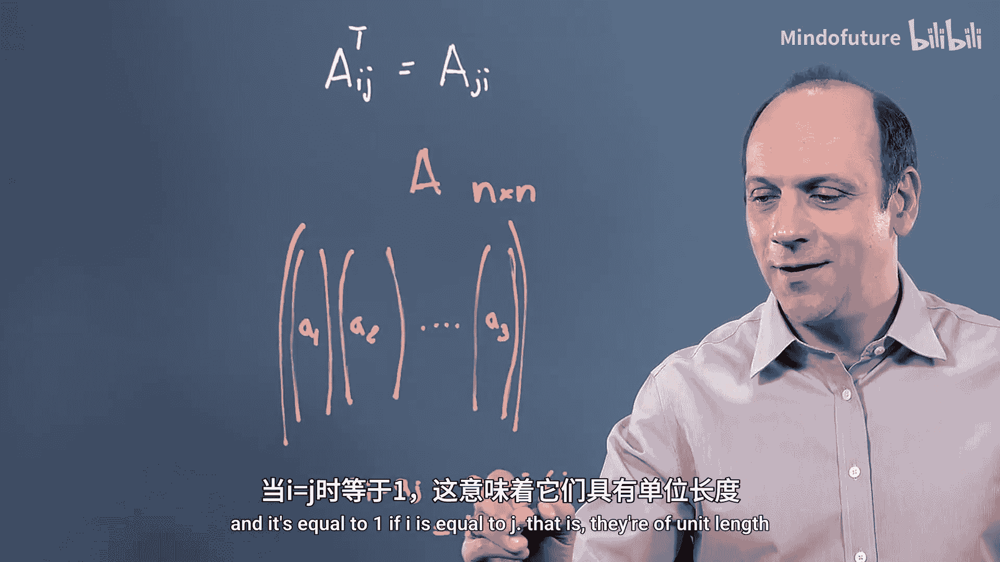

# 025：正交矩阵

在本节课中，我们将要学习一种特殊的矩阵——正交矩阵。这种矩阵的列向量构成了一组正交基，这使得它在变换数据时具有许多优良的性质，例如其逆矩阵就是其转置矩阵，计算非常方便。

## 转置操作

在深入探讨正交矩阵之前，我们首先需要定义矩阵的一个新操作：**转置**。

转置操作是指交换矩阵所有行和列的元素。我们用上标 **T** 来表示一个矩阵的转置。其定义是：转置矩阵的第 **i** 行第 **j** 列元素，等于原矩阵的第 **j** 行第 **i** 列元素。

用公式表示如下：
`(A^T)_{ij} = A_{ji}`

例如，对于一个矩阵：
`A = [[1, 2], [3, 4]]`
它的转置 `A^T` 为：
`A^T = [[1, 3], [2, 4]]`
可以看到，对角线上的元素 `1` 和 `4` 位置不变，而非对角线上的元素 `2` 和 `3` 交换了位置。

## 正交矩阵的定义

现在，让我们想象一个 `n x n` 的方阵 `A`，它定义了一个变换，其列向量 `a1, a2, ..., an` 构成了新空间的一组基向量。

如果我们对这组基向量施加两个特殊条件，就会得到一个非常特殊的矩阵：
1.  所有向量彼此**正交**（垂直）。
2.  所有向量都是**单位长度**（长度为1）。

用数学公式来描述这两个条件就是：
`ai · aj = 0`，当 `i ≠ j` （正交）
`ai · aj = 1`，当 `i = j` （单位长度）

满足这两个条件的向量组被称为**标准正交基**。由标准正交基作为列向量构成的矩阵，就叫做**正交矩阵**。

## 正交矩阵的逆矩阵

正交矩阵有一个非常美妙的性质：它的逆矩阵就是它的转置矩阵。

让我们看看为什么。根据定义，矩阵 `A` 的列向量是标准正交的。那么，当我们计算 `A^T * A` 时会发生什么呢？

`A^T` 是将 `A` 的行列互换得到的，所以它的行向量就是 `A` 的列向量 `a1, a2, ..., an`。

当我们进行矩阵乘法 `A^T * A` 时：
*   结果的第 `i` 行第 `j` 列元素，是 `A^T` 的第 `i` 行（即 `ai`）与 `A` 的第 `j` 列（即 `aj`）的点积。
*   根据标准正交基的定义：如果 `i = j`，点积为 `1`；如果 `i ≠ j`，点积为 `0`。

因此，`A^T * A` 的结果是一个单位矩阵 `I`：
`A^T * A = I`

根据逆矩阵的定义，如果 `B * A = I`，那么 `B` 就是 `A` 的逆矩阵。这里我们得到了 `A^T * A = I`，所以 `A^T` 就是 `A` 的逆矩阵：
`A^{-1} = A^T`

同理，我们也可以得到 `A * A^T = I`。这意味着正交矩阵的行向量同样构成一组标准正交基。

## 正交矩阵的行列式

关于正交矩阵，还有一点需要知道：因为它的所有基向量都是单位长度，所以它对空间的缩放因子必须是1。因此，正交矩阵的行列式值只能是 **+1** 或 **-1**。

*   **行列式为 +1**：表示变换保持了空间的“手性”（例如，右手坐标系保持为右手坐标系），这通常意味着基向量是按“正确”顺序排列的纯旋转。
*   **行列式为 -1**：表示变换翻转了空间（例如，将右手坐标系变成了左手坐标系），这包含了反射操作。

如果我们发现一个正交矩阵的行列式是 -1，只需交换其中任意两个列向量的位置，其行列式就会变为 +1。

## 正交矩阵在数据科学中的意义

在上一节我们介绍了正交矩阵的数学性质，本节中我们来看看它在数据科学中的实际意义。

在数据科学中，我们经常需要对数据进行坐标变换。使用正交矩阵（即标准正交基）作为变换矩阵，会带来诸多好处：

以下是使用正交矩阵作为变换基的主要优势：
*   **逆变换易于计算**：逆矩阵就是转置矩阵，计算成本极低。
*   **变换可逆且保形**：变换不会挤压或拉伸空间（行列式为±1），信息不会丢失，变换是完全可逆的。
*   **投影计算简单**：正如我们在向量模块中学到的，将一个向量投影到一组正交基上，只需要计算它与每个基向量的点积。这在正交矩阵变换下依然成立，计算非常高效。
*   **数值稳定性好**：正交变换能很好地保持向量的长度和夹角，在数值计算中更稳定。

因此，在可能的情况下，我们总是希望使用正交矩阵来变换我们的数据。

## 总结

本节课中我们一起学习了正交矩阵的核心概念。我们首先定义了矩阵的转置操作，然后引出了由标准正交基构成的正交矩阵。我们证明了正交矩阵的逆矩阵就是其转置矩阵，并讨论了其行列式必须为 ±1 的特性。最后，我们探讨了在数据科学中使用正交基进行变换的诸多优点，包括计算简便和保持几何结构。理解正交矩阵是掌握许多机器学习算法（如主成分分析PCA）中线性代数基础的关键一步。