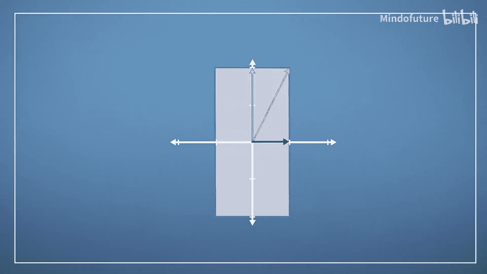

# 029：什么是特征值和特征向量

在本节课中，我们将要学习线性代数中的一个核心概念：特征值与特征向量。我们将通过几何图像来直观理解它们的含义，而不是一开始就陷入复杂的公式推导。

## 从“特征”一词说起

“Eigen”一词源自德语，最贴切的翻译是“特征”。因此，当我们讨论特征问题时，我们实际上是在寻找事物的**特征属性**。但具体是什么事物的特征呢？和之前几周的内容一样，本节将主要通过几何解释来阐明“特征”这一概念，这让我们可以先从图像入手，而不是立刻被数学符号所困扰。

## 变换与空间可视化

正如前几周所学，我们可以用矩阵来表示线性变换。这些操作包括缩放、旋转和剪切。通常，我们在应用这些变换时，会考虑它们对某个特定向量的影响。然而，思考变换作用于空间中**所有向量**时的整体效果也很有用。

这可以通过在原点中心画一个正方形来轻松可视化，然后观察应用变换后这个形状如何扭曲。

*   如果我们应用一个垂直方向放大2倍的缩放，正方形会变成一个长方形。
*   如果我们对这个空间应用一个水平剪切，它可能会变成类似这样的形状。

## 关键概念：特征向量的出现

我们使用小正方形来帮助可视化许多向量的变化。但请注意，有些向量最终仍停留在它们起始时的直线上，而其他向量则不会。为了突出这一点，我将在初始正方形上画出三个特定的向量。

现在，让我们再次考虑垂直缩放，并思考这三个向量会发生什么。

以下是具体变化：
*   绿色的水平向量保持不变，指向相同的方向且长度相同。
*   粉色的垂直向量也仍然指向与之前相同的方向，但其长度增加了一倍。
*   橙色的对角线向量原本与坐标轴成45度角。现在它的角度和长度都发生了变化。

可以看到，除了水平和垂直向量，任何其他向量的方向都会被这个垂直缩放所改变。因此，在某种意义上，水平和垂直向量是特殊的，它们是这个特定变换的**特征**，这就是为什么我们称它们为**特征向量**。

## 特征值的含义

此外，因为水平向量的长度没有改变，我们说它对应的**特征值**为1。而垂直特征向量的长度加倍了，所以我们说它的特征值为2。

从概念上讲，这就是二维特征问题的全部。我们取一个变换，寻找那些在变换后仍保持在原直线方向上的向量，然后测量它们的长度改变了多少。这基本上就是特征向量及其对应特征值的含义。

## 更多示例与推广

让我们再看两个经典例子，以确保我们能推广所学的知识。

这是我们的标记正方形。现在让我们看看**纯剪切**（“纯”意味着我们不进行任何额外的缩放或旋转，因此面积不变）。正如你可能发现的，只有绿色的水平线仍然沿着其原始方向延伸，所有其他向量都发生了偏移。

最后，让我们看看**旋转**。显然，这个变换没有任何特征向量，因为所有向量都从它们原始的直线上被旋转开了。

在本节课中，我们已经涵盖了关于特征值和特征向量几乎所有你需要知道的核心概念。虽然目前我们只在二维空间中讨论，但这个概念在三维或更高维度中是完全相同的。在本模块的其余部分，我们将查看一些特殊情况，并讨论如何用更数学化的术语来描述我们观察到的现象。

## 总结

本节课我们一起学习了特征值与特征向量的几何意义。我们了解到，对于一个线性变换，**特征向量**是那些在变换后方向保持不变的向量，而**特征值**则描述了这些向量长度缩放的比例。通过可视化变换对空间中所有向量的影响，我们可以直观地找出这些“特殊”的向量。这是理解矩阵深层属性和结构的重要基础。