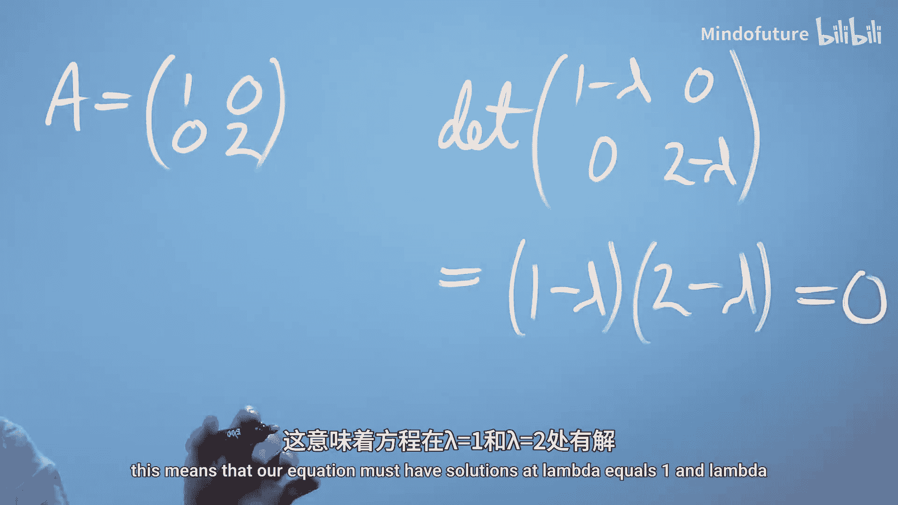

# 031：计算特征向量


在本节课中，我们将把对特征向量的几何理解，转化为一个严谨的代数表达式。这个表达式将允许我们计算特征值和特征向量。通过几个简单的例子，我们将验证这个方法的有效性，并理解为何在实际应用中我们通常依赖计算机来完成这些计算。

## 从几何到代数 🧮

上一节我们介绍了特征向量的几何意义。本节中，我们来看看如何用数学公式来定义它。

考虑一个变换矩阵 **A**。如果存在特征向量，那么这些向量在变换后仍然停留在原来的张成空间（span）上。它们可以改变长度甚至完全反向，但只要保持在同一根直线上，它们就是特征向量。

如果我们称特征向量为 **x**，那么可以写出以下表达式：
```
A x = λ x
```
在这个公式中：
*   左侧是将变换矩阵 **A** 应用于向量 **x**。
*   右侧是将向量 **x** 拉伸某个标量因子 **λ**（λ 只是一个数字）。

我们的目标是找到能使等式成立的 **x** 和 **λ** 的值。

## 构建特征方程 🔍

为了求解，我们可以重写这个表达式，将所有项移到一边并进行因式分解：
```
(A - λ I) x = 0
```
这里引入的 **I** 是单位矩阵，其大小与 **A** 相同，主对角线为1，其余为0。引入 **I** 是为了让矩阵减法在数学上成立，而不改变等式的含义。

现在，要使左边等于零，有两种可能：括号内的矩阵是零矩阵，或者向量 **x** 是零向量。我们对零向量解不感兴趣，它是一个平凡解。因此，我们必须找到使括号内项“作用”为零向量的情况。

## 引入行列式 📐

回顾课程前面的内容，我们可以通过计算矩阵的行列式来判断一个矩阵变换是否会将某个非零向量压缩为零向量。

因此，我们令：
```
det(A - λ I) = 0
```
这个方程被称为**特征方程**。对于高维矩阵，手动计算行列式工作量很大。我们以一个任意的2x2变换矩阵为例：
设
```
    [a  b]
A = [c  d]
```
代入特征方程，计算行列式：
```
det( [a-λ  b  ] ) = (a-λ)(d-λ) - bc = 0
     [c    d-λ]
```
展开后，我们得到一个关于 **λ** 的二次多项式，称为**特征多项式**：
```
λ² - (a+d)λ + (ad - bc) = 0
```
特征值就是这个方程的解。求得特征值 **λ** 后，我们可以将其代回原始表达式 `(A - λ I) x = 0` 中来计算对应的特征向量。



## 应用示例：垂直缩放 ✨

与其继续讨论一般形式，不如将此方法应用到一个我们已知解的简单变换上。

以一个垂直方向缩放2倍的变换为例，其变换矩阵为：
```
    [1  0]
A = [0  2]
```
应用上述方法，计算 `A - λ I` 的行列式并令其为零：
```
det( [1-λ   0 ] ) = (1-λ)(2-λ) = 0
     [0    2-λ]
```
解得特征值为 **λ₁ = 1** 和 **λ₂ = 2**。

接下来，将每个特征值代回原式 `(A - λ I) x = 0` 求特征向量。

以下是求解过程：
*   当 **λ = 1** 时：
    ```
    (A - 1*I) x = [0  0] [x₁] = [0]
                  [0  1] [x₂]   [0]
    ```
    得到方程 `x₂ = 0`。这意味着特征向量在垂直方向分量为0，但水平分量 `x₁` 可以是任意值。因此，特征向量为沿水平轴的任何向量，记作 `[t, 0]^T`，其中 `t` 为任意非零标量。
*   当 **λ = 2** 时：
    ```
    (A - 2*I) x = [-1  0] [x₁] = [0]
                   [0  0] [x₂]   [0]
    ```
    得到方程 `-x₁ = 0`，即 `x₁ = 0`。这意味着特征向量在水平方向分量为0，垂直分量 `x₂` 可以是任意值。因此，特征向量为沿垂直轴的任何向量，记作 `[0, t]^T`。

## 应用示例：90度旋转 🔄

现在，尝试一个我们预期没有（实）特征向量的变换：逆时针旋转90度。其变换矩阵为：
```
    [0  -1]
A = [1   0]
```
再次应用公式：
```
det( [-λ   -1] ) = λ² + 1 = 0
     [1    -λ]
```
特征方程为 **λ² + 1 = 0**，它在实数范围内无解。因此，该变换没有实特征值，也就没有实特征向量（尽管存在复数解，但本课程不涉及）。

## 核心要点与总结 🎯

本节课中我们一起学习了如何将特征向量的几何概念转化为代数计算方法。

我们建立了核心公式 `A x = λ x` 和 `det(A - λ I) = 0`，并通过两个例子验证了其正确性：
1.  对于垂直缩放变换，我们成功求得了特征值和对应的特征向量空间。
2.  对于90度旋转变换，特征方程无实根，证实了其没有实特征向量的几何直观。

尽管手动计算很有趣，但你必须明白，在实际应用中你几乎不需要手工进行这种计算。随着矩阵维度增加，求解N次特征多项式将很快无法通过解析方法完成。计算机在求解特征问题时，使用的是迭代数值方法。


培养对特征问题的深刻概念性理解，远比擅长手工计算更有价值。在接下来的视频中，我们将回顾基变换的概念，看看当使用特征向量作为基时会发生什么奇妙的事情。