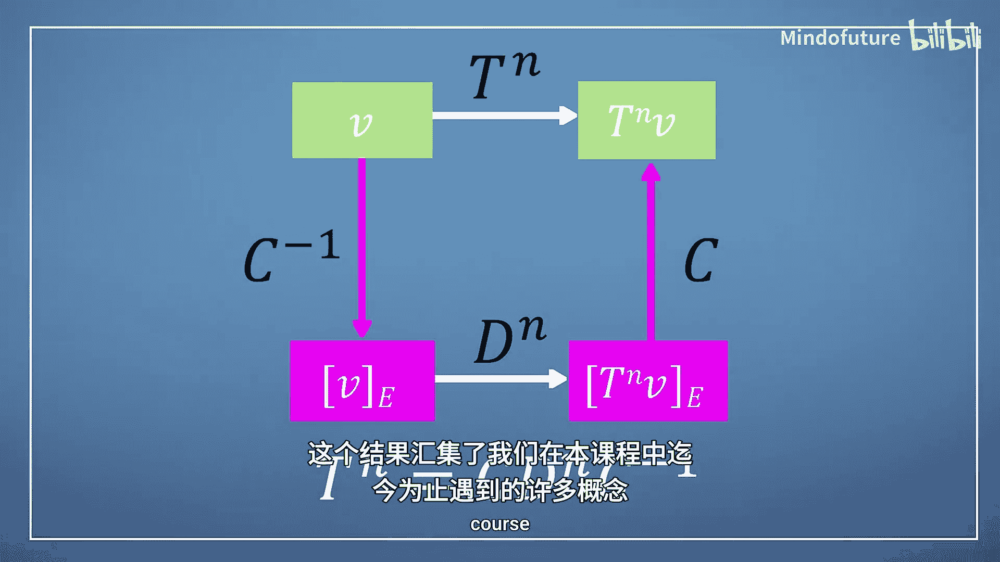

# 032：变换到特征基

在本节课中，我们将要学习如何将特征向量与基变换的概念相结合，从而得到一个强大的工具——对角化。这个方法能让我们高效地计算矩阵的幂运算，例如计算 `T` 的 `n` 次方。

## 问题引入：重复的矩阵乘法

上一节我们介绍了特征向量的概念和计算方法。本节中我们来看看如何利用它们来简化复杂的矩阵运算。

有时我们需要重复进行相同的矩阵乘法。例如，假设一个变换矩阵 `T` 描述了粒子在一个时间步长内的位置变化。

初始位置由向量 `v0` 描述，乘以变换 `T` 后得到新位置 `v1`：
`v1 = T * v0`

要计算粒子在两个时间步长后的位置 `v2`，只需将 `v1` 再乘以 `T`，这等价于将 `v0` 乘以 `T` 两次：
`v2 = T * v1 = T * T * v0 = T² * v0`

现在，假设这个线性变换在每个时间步长都发生，持续 `n` 步，那么 `n` 步后的位置为：
`vn = Tⁿ * v0`

对于一个三维矩阵，单次乘法已经需要不少计算量。如果 `T` 描述一秒内的变化，而我们想预测两周后（约120万秒）的位置，就需要计算 `T` 的120万次方，计算量巨大。

## 对角矩阵的便利性

如果矩阵中除了主对角线上的元素外，其余元素均为0，我们称其为**对角矩阵**。对于对角矩阵，计算其幂次方非常容易。

以下是计算对角矩阵 `D` 的 `n` 次方的方法：
`Dⁿ = [[aⁿ, 0, 0], [0, bⁿ, 0], [0, 0, cⁿ]]`
你只需要将每个对角线元素分别取 `n` 次幂即可。

这非常简单。但如果 `T` 不是对角矩阵呢？答案就在于特征分析。

## 构建特征基

正如你可能猜到的，解决方案来自于特征分析。本质上，我们要做的是**变换到一个新的基**，使得在这个新基下，变换 `T` 表现为一个对角矩阵。这个新基就是**特征基**。

在基变换章节中我们学到，变换矩阵的每一列代表变换后的单位基向量的新位置。因此，要构建我们的特征基转换矩阵 `C`，我们只需将每个特征向量作为列向量放入矩阵中。

对于一个三维的例子，假设我们有三个特征向量 `ξ1`， `ξ2`， `ξ3`：
`C = [ξ1, ξ2, ξ3]`
需要注意的是，某些特征向量可能是复数，在纯几何视角下不易观察，但在数学计算中它们与其他特征向量无异。

## 在对角化形式下进行变换

应用这个基变换后，我们进入了一个新“世界”。在这个世界里，乘以 `T` 的效果本质上只是纯粹的缩放。换句话说，`T` 现在可以用一个对角矩阵 `D` 来表示。

关键点在于，这个对角矩阵 `D` 包含了矩阵 `T` 对应的特征值：
`D = [[λ1, 0, 0], [0, λ2, 0], [0, 0, λ3]]`
其中 `λ1`， `λ2`， `λ3` 是特征值，其余位置为零。

## 核心公式：矩阵的对角化

现在，我们将所有概念串联起来。应用变换 `T`，等价于先转换到特征基，然后应用对角矩阵 `D`，最后再转换回原来的基。

因此，我们可以得到核心关系式：
`T = C * D * C⁻¹`

这个公式意味着，原矩阵 `T` 可以分解为三个矩阵的乘积。

## 计算矩阵的幂

基于上述分解，计算 `T` 的平方就变得简单了：
`T² = (C * D * C⁻¹) * (C * D * C⁻¹)`
观察等式右边中间部分，是 `C⁻¹ * C`。一个矩阵乘以它的逆矩阵等于单位矩阵，相当于没有操作，因此可以消去：
`T² = C * D * (C⁻¹ * C) * D * C⁻¹ = C * D * I * D * C⁻¹ = C * D² * C⁻¹`

我们可以将此推广到 `T` 的任意次幂 `n`。最终，我们得到计算 `Tⁿ` 的强大公式：
`Tⁿ = C * Dⁿ * C⁻¹`

## 方法优势

现在我们有了一个方法，可以让我们以较低的计算成本，将变换矩阵应用任意多次。我们不再需要将 `T` 自乘 `n` 次，而只需计算对角矩阵 `D` 的 `n` 次方（这非常容易），然后进行两次矩阵乘法（`C` 和 `C⁻¹`）即可。

## 总结

本节课中我们一起学习了矩阵对角化的核心思想与应用。我们了解到，通过将矩阵变换到其特征基，可以将其表示为对角矩阵。利用公式 `T = C * D * C⁻¹` 及其推论 `Tⁿ = C * Dⁿ * C⁻¹`，我们能高效地计算矩阵的幂，从而解决诸如预测粒子长期运动轨迹等需要重复应用线性变换的问题。

这个结果融合了本课程中迄今为止遇到的许多概念。在下一个视频中，我们将通过一个简单的例子来演练，以确保这种方法在应用时符合我们的预期。

