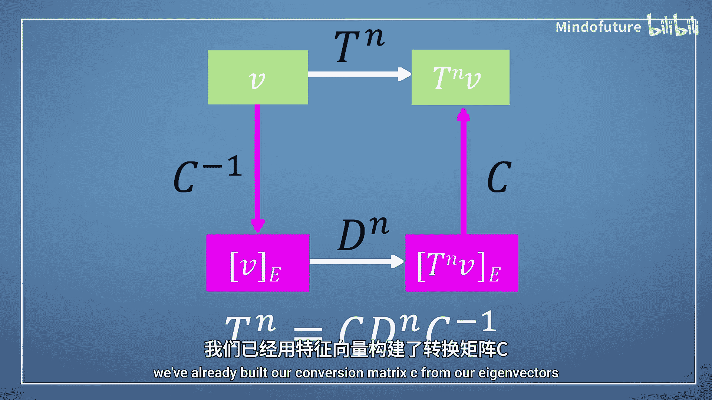

# 033：特征基例子


在本节课中，我们将通过一个简单的二维例子，直观地理解特征基与对角化的理论，并验证其计算过程。

上一节我们介绍了特征基与对角化的理论，本节中我们来看看一个具体的二维变换例子。

考虑变换矩阵 **T**：
```
T = [1, 1]
    [0, 2]
```
矩阵的第一列是 `[1, 0]`，这意味着基向量 **i hat** 在变换后保持不变。第二列是 `[1, 2]`，这意味着基向量 **j hat** 会变换到坐标 `[1, 2]`。

我们同时考虑一个额外的向量 `[1, 1]`。将其与矩阵 **T** 相乘：
```
[1, 1]   *   [1, 1]   =   [1*1 + 1*0, 1*1 + 1*2]   =   [1, 3]
[0, 2]       [1, 1]       [0*1 + 2*0, 0*1 + 2*1]       [0, 2]
```
结果是 `[1, 3]`。这个变换可以分解为：先进行垂直方向2倍的缩放，再进行水平方向0.5步的剪切。

由于我们选择了一个简单的变换，其特征向量和特征值很容易观察出来。

以下是其特征值与特征向量：
*   当特征值 **λ = 1** 时，对应的特征向量是 `[1, 0]`。
*   当特征值 **λ = 2** 时，对应的特征向量是 `[1, 1]`。



现在，让我们考虑对向量 `[-1, 1]` 连续应用两次变换 **T**。

首先，计算 **T * [-1, 1]**：
```
[1, 1]   *   [-1]   =   [1*(-1) + 1*1]   =   [0]
[0, 2]       [ 1]       [0*(-1) + 2*1]       [2]
```
得到结果 `[0, 2]`。

然后，计算 **T * [0, 2]**：
```
[1, 1]   *   [0]   =   [1*0 + 1*2]   =   [2]
[0, 2]       [2]       [0*0 + 2*2]       [4]
```
最终得到 `[2, 4]`。

接下来，我们尝试先计算 **T²**，再将其作用于向量 `[-1, 1]`，看结果是否一致。

计算 **T²**：
```
T² = T * T = [1, 1]   *   [1, 1]   =   [1*1+1*0, 1*1+1*2]   =   [1, 3]
             [0, 2]       [0, 2]       [0*1+2*0, 0*1+2*2]       [0, 4]
```
然后计算 **T² * [-1, 1]**：
```
[1, 3]   *   [-1]   =   [1*(-1) + 3*1]   =   [2]
[0, 4]       [ 1]       [0*(-1) + 4*1]       [4]
```
结果同样是 `[2, 4]`。

现在，我们使用特征基对角化的方法来计算 **T²**。

首先，用特征向量构建转换矩阵 **C**：
```
C = [1, 1]
    [0, 1]
```
然后，求其逆矩阵 **C⁻¹**。由于 **C** 是一个向右平移一步的剪切矩阵，其逆矩阵就是向左平移一步：
```
C⁻¹ = [1, -1]
      [0,  1]
```
根据对角化公式，**T = C D C⁻¹**，其中 **D** 是由特征值构成的对角矩阵。因此，**T² = C D² C⁻¹**。

以下是计算步骤：
1.  构造对角矩阵 **D** 及其平方 **D²**：
    ```
    D = [1, 0]    D² = [1², 0] = [1, 0]
        [0, 2]         [0, 2²]   [0, 4]
    ```
2.  计算 **C * D²**：
    ```
    [1, 1]   *   [1, 0]   =   [1*1+1*0, 1*0+1*4]   =   [1, 4]
    [0, 1]       [0, 4]       [0*1+1*0, 0*0+1*4]       [0, 4]
    ```
3.  计算 **(C * D²) * C⁻¹**，即 **T²**：
    ```
    [1, 4]   *   [1, -1]   =   [1*1+4*0, 1*(-1)+4*1]   =   [1, 3]
    [0, 4]       [0,  1]       [0*1+4*0, 0*(-1)+4*1]       [0, 4]
    ```
我们得到了与直接计算相同的 **T²** 矩阵 `[1, 3; 0, 4]`。将其作用于向量 `[-1, 1]`，结果自然是相同的 `[2, 4]`。

在数学中，一旦真正理解了一个概念，借助计算机通常就不再需要手动进行这类计算。然而，亲手演算几个例子对于确保完全理解仍然非常有益。本系列视频并未涵盖特征理论的所有方面，例如不可对角化矩阵和复特征向量。但如果你已经掌握了我们讨论的核心主题，那么你的基础就非常扎实了。


本节课中我们一起学习了如何通过一个具体的二维变换例子，应用特征基对角化的方法验证矩阵幂的计算。在下一个视频中，我们将探讨特征理论的一个实际应用，这需要暂时抛开我们一直使用的几何直观，纯粹地信任数学推导。