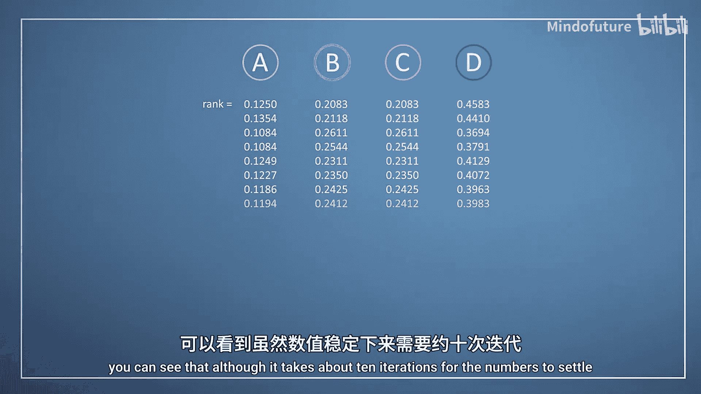

# 034：PageRank算法简介


在本节课中，我们将学习本模块，也是整个课程的最后一个主题：**PageRank算法**。该算法由谷歌联合创始人拉里·佩奇及其同事在1998年提出并命名，最初用于帮助谷歌决定在搜索结果中如何排序网站。我们将了解其核心思想、数学模型以及如何通过线性代数中的特征值问题来求解。

## 核心假设与模型

上一节我们介绍了特征值问题，本节中我们来看看它在网页排序中的一个经典应用。PageRank算法的核心假设是：**一个网站的重要性与其和其他网站之间的链接关系有关**。

我们可以用一个简单的“微型互联网”模型来理解。下图中的每个气泡代表一个网页（A、B、C、D），箭头代表一个网页上的链接，可以带你跳转到另一个网页。


我们的目标是，基于这个网络结构，构建一个表达式来判断哪个网页对搜索者最相关。

## “拖延症患者帕特”模型

为了量化网页的重要性，我们引入一个“拖延症患者帕特”的概念。帕特是一个虚构的人物，他上网时会随机点击页面上的链接来逃避工作。

通过映射所有可能的链接，我们可以建立一个模型，来估计帕特在每个网页上预期会花费的时间。

## 构建链接矩阵

我们可以将网页A上存在的链接描述为一个向量。向量的每一行根据是否存在指向对应页面的链接，取值为1或0，然后通过链接总数进行归一化，使其能描述从该页面出发的点击概率。

以下是构建链接向量的步骤：

*   **网页A**：有指向B、C、D的链接，共3个链接。因此其链接向量为 `[0, 1, 1, 1]`，归一化后为 `[0, 1/3, 1/3, 1/3]`。写作：
    **L_A = [0, 1/3, 1/3, 1/3]^T**
*   **网页B**：有指向A和C的链接，共2个链接。因此：
    **L_B = [1/2, 0, 1/2, 0]^T**
*   **网页C**：只有指向A的链接，共1个链接。因此：
    **L_C = [1, 0, 0, 0]^T**
*   **网页D**：有指向B和C的链接，共2个链接。因此：
    **L_D = [0, 1/2, 1/2, 0]^T**

现在，我们可以通过将每个链接向量作为一列，构建出**链接矩阵 L**：
```
L = [ L_A, L_B, L_C, L_D ] = [
    [0, 1/2, 1, 0],
    [1/3, 0, 0, 1/2],
    [1/3, 1/2, 0, 1/2],
    [1/3, 0, 0, 0]
]
```
矩阵L中的每一行描述了**指向**该行对应页面的、来自其他页面的链接概率（已根据源页面的总链接数归一化）。例如，要到达页面A，只能从页面B或C点击链接过来。

## 建立PageRank方程

我们使用向量 **R** 来存储所有网页的“排名”或重要性。计算网页A的排名 `R_A`，需要知道三件事：其他网页的排名、它们是否链接到A、以及它们总共有多少个出站链接。

以下表达式综合了这三方面信息，但仅针对网页A：
**R_A = Σ_{j=1}^{n} L_{A,j} * R_j**

这个求和遍历所有网页（j从1到n）。这意味着，网页A的排名等于所有链接到A的网页的排名之和，其中每个贡献的排名都按其特定的链接概率（来自矩阵L）进行加权。

我们希望为所有页面同时写出并求解这个方程。回顾线性代数知识，我们可以将上述应用于所有网页的表达式重写为一个简单的矩阵乘法：
**R = L R**

显然，我们开始时并不知道R。因此，我们简单地假设所有排名均等，并用分析中的网页总数（本例中为4）进行归一化作为初始猜测：
**R_0 = [1/4, 1/4, 1/4, 1/4]^T**

然后，我们每次用矩阵L乘以当前的R，就得到R的更新值。因此，迭代公式为：
**R_{i+1} = L * R_i**

反复应用这个表达式意味着我们正在**迭代地**解决这个问题。每次迭代都更新R中的值，直到最终R停止变化。此时，R真正满足 **R = L R**。

## 与特征值问题的联系

回顾本模块之前的视频，方程 **R = L R** 意味着 **R 现在是矩阵 L 的一个特征向量，对应的特征值为 1**。



你可能会想，既然我们需要将R乘以L很多次，或许应用上一节视频中看到的对角化方法是最好的。但别忘了，那需要我们事先知道所有特征向量，而这正是我们最初试图寻找的东西。

## 迭代求解与结果

现在我们有了方程，可以让计算机迭代应用它直到收敛，从而找到我们的排名向量R。


你可以看到，虽然数字大约需要10次迭代才能稳定下来，但排序在第一次迭代后就已经确定了。不过，这只是因为我们的系统（4个网页）太小而产生的特例。

现在我们得到了结果：当拖延症患者帕特在我们的网络中随机点击时，我们预计他大约会花费40%的时间在页面D上，而只有大约12%的时间在页面A上，页面B和C各占约24%。因此，我们的排名是D最高，A最低，B和C并列中间。

## 算法优势与阻尼因子

事实证明，尽管多年来已经开发出许多高效计算特征向量的方法，但反复用一个随机选择的初始猜测向量乘以矩阵（称为**幂法**）对于PageRank问题仍然非常有效，原因有二：

1.  **收敛到所需向量**：幂法显然只会给出一个特征向量（而我们知道对于一个n维系统会有n个）。但由于我们构建链接矩阵L的方式，它给出的向量始终是我们寻找的那个对应特征值为1的特征向量。
2.  **处理稀疏矩阵高效**：对于真实的互联网，链接矩阵L中几乎每个条目都是0（即大多数页面不连接到大多数其他页面）。这被称为**稀疏矩阵**，存在专门的算法可以非常高效地执行此类乘法。

我们尚未讨论的PageRank算法的一个关键方面是**阻尼因子 d**。它为我们的迭代公式增加了一个附加项：
**R_{i+1} = d * L * R_i + (1-d)/N**

其中，d是一个介于0和1之间的数。你可以将其理解为（1 - 帕特突然随机输入一个网址而不是点击当前页面上链接的概率）。这个因子在实际计算中的作用是在迭代收敛过程的**速度**和**稳定性**之间找到一个折衷。

## 总结

本节课中我们一起学习了PageRank算法的基本原理。我们从一个微型互联网模型出发，通过“拖延症患者帕特”的随机游走行为，将网页排序问题转化为一个线性方程 **R = L R** 的求解问题，这本质上是一个寻找矩阵特征值为1的特征向量的问题。我们介绍了如何使用幂法进行迭代求解，并简要提到了阻尼因子的作用和算法处理大规模稀疏矩阵时的效率优势。尽管自1998年PageRank算法发布以来，互联网规模已从数百万网站增长到超过十亿，搜索和排名方法也必须不断进化以提升效率，但其核心概念多年来保持不变。