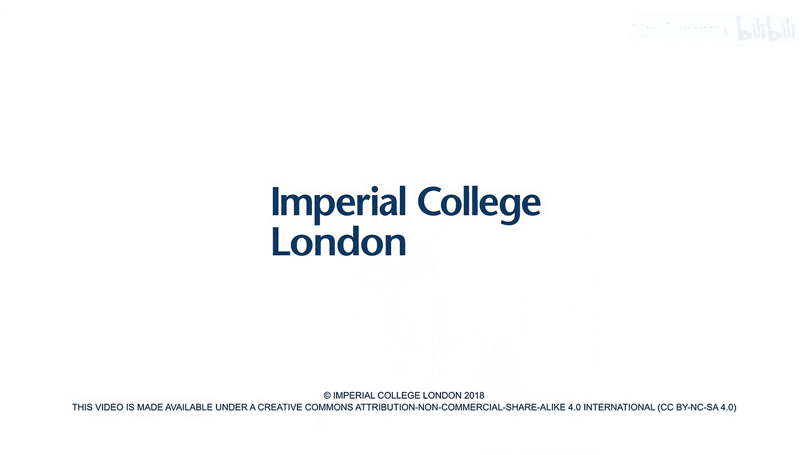

机器学习数学：线性代数：P36：课程总结

在本节课中，我们将对本线性代数专项课程进行总结，回顾所学内容，并展望后续的学习路径。

---

### 课程概述

本课程的目标是为您提供线性代数的基础知识，以便您能够更好地学习神经网络、机器学习以及更广泛的数据科学课程。本课程专为社会科学、工程或物理学背景的学习者设计，旨在培养理解机器学习工具所需的洞察力，从而能够在现实世界中运用机器学习解决问题。本课程并非研究生线性代数课程的基础，并且由于时间限制，我们也没有讨论如叉积等在机器学习中应用较少的主题。

### 课程内容回顾

我们从一个数据问题开始本课程，例如拟合函数到数据，或者解决苹果和香蕉的价格发现难题。这些问题引导我们踏上了线性代数的探索之旅。

首先，我们学习了向量及其矩阵表示。以下是本课程涵盖的核心概念：

*   **向量与矩阵**：向量是数字的有序列表，可以表示数据点或方向。矩阵是数字的矩形阵列，可以表示数据集或线性变换。
    *   向量表示：`v = [v1, v2, ..., vn]`
    *   矩阵表示：`A = [[a11, a12, ...], [a21, a22, ...], ...]`
*   **线性方程组**：我们学习了如何用矩阵形式 `Ax = b` 表示和求解线性方程组，其中 `A` 是系数矩阵，`x` 是未知数向量，`b` 是常数向量。
*   **矩阵运算**：我们探讨了矩阵的加法、标量乘法以及最重要的矩阵乘法。
    *   矩阵乘法：`C = AB`，其中 `C` 的元素 `cij` 是 `A` 的第 `i` 行与 `B` 的第 `j` 列的点积。
*   **行列式与逆矩阵**：行列式提供了矩阵缩放体积的信息，而逆矩阵 `A⁻¹` 使得 `A⁻¹A = I`（单位矩阵），用于求解方程 `Ax = b`，即 `x = A⁻¹b`。
*   **特征值与特征向量**：对于方阵 `A`，特征向量 `v` 在 `A` 作用下仅被缩放，满足 `Av = λv`，其中 `λ` 是特征值。这个概念在数据降维（如主成分分析）中至关重要。

在整个学习过程中，您通过练习巩固了所学知识，并在课程最后完成了几个Python编程练习。这将使您有信心声称自己正逐步获得对线性代数及其代码应用的直观理解。

### 后续学习路径

如果您喜欢本课程，我们将在本专项课程的下一门课中继续机器学习与数据科学的旅程：**多元微积分**。在那里，我们将学习微积分，以及如何求多元函数的梯度。掌握了最优化、线性代数和概率论之后，您将拥有研究主成分分析、机器学习和神经网络所需的所有基础数学工具和概念。

### 总结

在本节课中，我们一起回顾了线性代数课程的核心内容，从向量和矩阵的基础，到求解线性方程组，再到特征值与特征向量的高级概念。这些知识是您深入机器学习领域的基石。

Sam、Iya以及帝国理工学院的全体团队衷心希望您觉得本课程有价值、实用且有趣。当然，我们也祝愿您未来一切顺利，并期待在下一门课程中再次见到您。