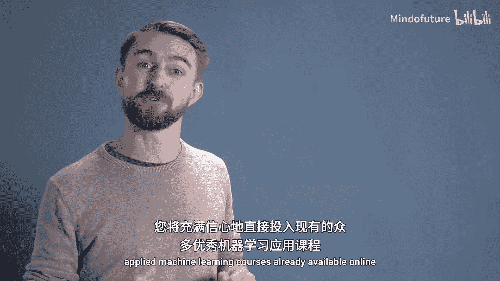

**机器学习数学：多元微积分：P01：课程介绍与概述**

欢迎来到多元微积分入门课程，这是机器学习数学专项课程的第二门课。我们将开启一次微积分的快速导览，特别侧重于交互式动画和实用的编程示例。

我是伦敦帝国理工学院戴森设计工程学院的 Sam Cooper 博士。我将机器学习作为工具，用于表征和设计能源材料。同时，我也是一位在线学习爱好者。

要理解多元微积分，你需要能够应用上一门课程中涵盖的线性代数方法。因此，如果你尚未完成该课程，可能需要先返回学习。

许多重要的机器学习方法，例如神经网络，其核心正是微积分。本课程的目标是让你看清数学原理与实际意义之间的联系。

理想的成果是，在你完成本专项课程后，能够有足够的信心立即投入到众多优秀的在线应用机器学习课程中去。

我们将通过建立直觉的动画来奠定微积分的基础，以此开始本课程。接着，我们会将这些概念推广到多维系统，你将学习如何在黑暗中“导航”山脉地形。

之后，你将具体学习微积分如何用于训练神经网络，并实际编写一些使用 Python 编程语言实现此过程的代码。

最后，你将与我的同事 David Dye 教授一起，运用你所有的多元微积分技能。他将解释回归的基本原理，然后要求你编写代码，将复杂函数拟合到真实数据中。

衷心希望你能享受这门课程，并期待在论坛中与你交流。