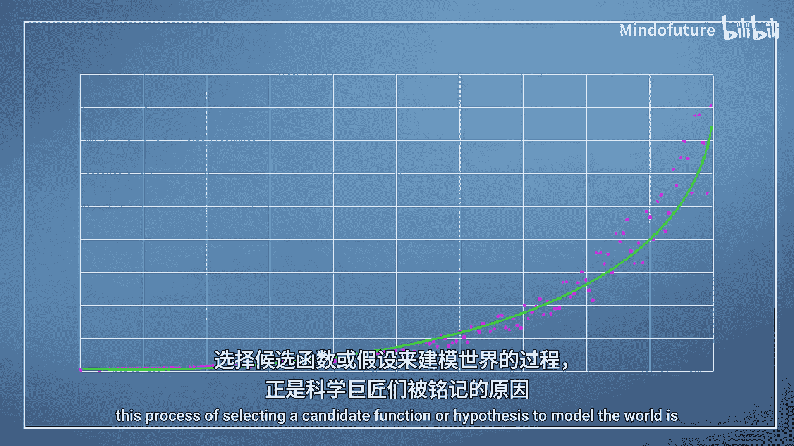

# 003：函数基础

在本节课中，我们将要学习函数的基本概念，了解它在科学和机器学习中的核心作用，并熟悉其数学表示方法。理解函数是学习微积分的重要前提。

## 什么是函数？🤔

在深入探讨微积分之前，我们首先需要简要讨论一下函数是什么以及我们在何处使用它们。

本质上，函数是某些输入与一个输出之间的关系。例如，如果我有一个用于模拟这个房间温度分布的函数，我可能会输入我感兴趣的特定位置的 X、Y 和 Z 坐标，以及时间 T，然后该函数将返回我在那个特定空间点和那个时间点的温度。

## 数学符号的挑战与重要性 📝

与数学的许多领域一样，即使概念相当简单明了，符号表示也常常会使事情变得不必要的混乱。在本课程后面我们还会遇到这种情况。

造成这种情况的原因有时是相当随意的历史因素，比如不同的人在不同的时间发明了数学的不同部分。也可能是因为特定的符号风格对于其最初被开发的具体应用来说更为方便。

然而，许多问题似乎源于：为了使用和探索数学有趣的应用，需要你完成大量通常相当枯燥的基础工作。在这方面，数学语言就像学习任何其他语言一样。在学会大量法语词汇和语法（包括其所有的特例和不规则之处）之前，你无法欣赏法语诗歌。可以理解的是，有些人觉得这很令人沮丧。例如，我的法语仍然很糟糕。

更糟糕的是，大多数人甚至没有意识到，在这条代数隧道的尽头，有大量的诗歌在等待着他们。机器学习就是这类诗歌的整个流派，所以请在本专项课程的剩余部分坚持下去，你将准备好欣赏它，甚至自己创作一些。

## 函数的表示法 📐

我们经常看到诸如 `f(x) = x² + 3` 这样的表达式。关于这种表示法，唯一值得提一下的是：是的，我承认，你应该以某种方式就知道 `f(x)` 表示 `f` 是 `x` 的函数，而不是 `f` 乘以 `x`，这确实有点荒谬。当表达式中出现其他括号项时，有时这会变得真正不清楚。

例如：`f(x) = g(h(x) + a)`。你可以假设 `g`、`h` 和 `a` 都不是变量，否则我就必须写成 `f(x, g, h, a)`。但你只有通过更多上下文解释才能确切知道这里发生了什么。例如，`g` 是一个应用于 `x` 的函数吗？这里的 `h` 和 `a` 呢？也许它们都只是常数。

不过，你在任何语言中都会面临同样缺少上下文的问题，就像那只著名的熊猫，它去了一家餐馆，吃了饭，开枪，然后离开。（译注：此处引用英文歧义笑话 “eats, shoots and leaves”，原意为“吃嫩芽和树叶”，但断句不同可理解为“吃了饭，开了枪，然后离开”。）它们都很美味。我只能代表数学道歉，并希望用两个事实来安慰你：首先，数学是我日常工作的核心，我自己也常常感到困惑。其次，我仍然热爱它，并且一直在变得更好，就像任何其他语言一样，总能获取缺失的上下文。

## 选择函数：科学的创造性本质 💡

在接下来的练习中，我将向你展示一些数据，或者向你描述一个概念。你需要选择一个你认为可以用来表示它的函数。

这并非一个困难的练习，但我希望你能理解的是：选择函数是科学的创造性精髓。这个选择候选函数或假说来模拟世界的过程，正是那些伟大的科学天才被人们铭记的原因。

随后是一个可能漫长而艰难的验证这个假说的过程，但如果没有最初那创造性的第一步，就没什么可验证的了。

## 微积分的作用 🔧

微积分简单地研究这些函数如何随其输入变量变化，它允许你研究和操作它们。但归根结底，它只是一套工具。到本课程结束时，你将亲自使用这些工具来模拟一些真实世界的数据。

## 总结 📚

本节课中我们一起学习了函数的基本定义，它作为输入与输出之间关系的核心思想。我们探讨了数学符号带来的挑战及其重要性，并认识到选择恰当的数学模型是科学探索中创造性的关键一步。最后，我们了解到微积分是分析和操作这些函数变化的工具集，为后续的深入学习奠定了基础。