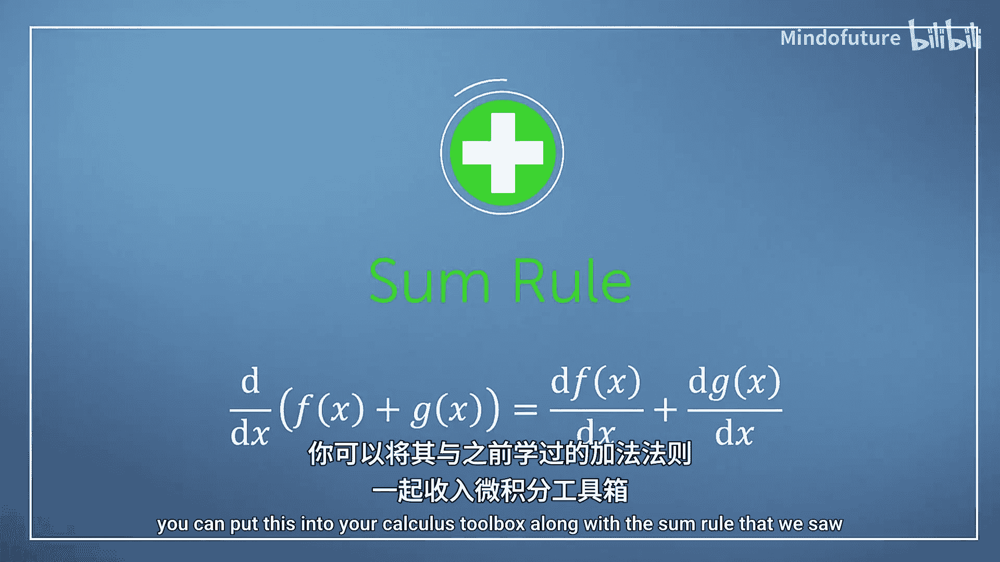

# 005：导数的定义

## 概述
在本节课中，我们将学习导数的正式定义。我们将从直观的“斜率”概念出发，将其转化为精确的数学表达式，并通过几个例子来演示如何使用这个定义计算简单函数的导数。

---

上一节我们探讨了函数与其斜率（梯度）之间的关系。本节中，我们来看看如何用数学语言正式地定义导数。

我们将把上一节视频中关于斜率的直观理解，转化为可以写下来的数学符号。很多人觉得这部分内容难以理解，我们会尽力让它变得清晰易懂。

我们在上一节提到，水平线的斜率为零，而向上和向下倾斜的线分别具有正斜率或负斜率。我们可以通过线性函数的例子来写下这个概念的定义，因为线性函数上每一点的斜率都相同。

首先，我们任意选择两个点。假设选这里和这里。那么，这条线的斜率等于函数在这段区间内的**增量**，除以我们所考虑的区间的**长度**。这个描述通常被简化为“**上升量比前进量**”，其中“上升量”是垂直方向的增加量，“前进量”是沿水平轴的距离。

所以，上升量在这里，前进量在这里。如果我们的函数是向下倾斜的，并且我们在相同的水平位置选点，那么我们的“前进量”相同，但“上升量”会变成负数。因此，我们的斜率等于上升量除以前进量。

到目前为止都很简单。但这与我们之前看到的更复杂的函数（每一点的斜率都不同）有什么关系呢？现在，这种“上升量比前进量”的斜率会随着我们选择点的位置而变化。

让我们选择一个我们想知道斜率的点，假设它在水平轴上的点 `x` 处。函数在这一点的值显然是 `f(x)`。我们将使用与之前相同的逻辑，所以现在需要选择第二个点来绘制我们的“上升量比前进量”三角形。

我们可以称两点之间的水平距离为 `Δx`。像往常一样，`Δ` 用来表示某个量的微小变化。这意味着我们的第二个点必须在位置 `x + Δx` 处。

我们也可以将第二个点的垂直位置写为函数 `f` 在新位置 `x + Δx` 处的值，即 `f(x + Δx)`。因此，我们现在可以基于点 `x` 和任意第二个点之间的“上升量比前进量”斜率，构建一个在点 `x` 处近似斜率的表达式。记住，“前进量”是我们的距离 `Δx`，而“上升量”只是两点的高度差。

这个过程的最后一步是注意到，对于我们展示的这种**光滑、连续**的函数，当 `Δx` 变得越来越小时，连接两点的线会越来越接近点 `x` 处的实际斜率。

我们可以使用**极限**符号来正式表达这个概念。它表示当 `Δx` 趋近于 0 时，我们的表达式将给出我们在任意选定点处的斜率函数。我们将其写为 `f'(x)` 或 `df/dx`，取决于你更喜欢哪种符号体系。这是一个有点奇怪的概念，因为我们并不是在谈论 `Δx` 等于 0（除以 0 没有定义），而是指当 `Δx` 无限接近 0 时的情况。这种“极端”的上升量比前进量的过程就是**微分**。所以，当你被要求对一个函数求导时，字面意思就是将函数代入这个表达式。

我们可以用几个视频来更严谨地解释这个无限小但非零的 `Δx`，但现在，不必过于担心。我们已经掌握了足够的知识来继续我们的旅程。

现在让我们将新的导数表达式付诸实践，看看它是否有效。首先，我们应该再次在线性函数上尝试，因为我们知道答案将只是一个常数。

### 示例 1：线性函数
那么，函数 `f(x) = 3x + 2` 的斜率是多少？

我们可以立即将其代入表达式：
`f'(x) = lim (Δx -> 0) of [ (3(x + Δx) + 2) - (3x + 2) ] / Δx`

现在进行代数运算：
`= lim (Δx -> 0) of [ (3x + 3Δx + 2) - (3x + 2) ] / Δx`
`= lim (Δx -> 0) of [ 3x + 3Δx + 2 - 3x - 2 ] / Δx`
`= lim (Δx -> 0) of [ 3Δx ] / Δx`
`= lim (Δx -> 0) of 3`
`= 3`

我们线性函数的斜率只是一个常数，正如我们所料。事实上，很多人可能已经知道形如 `f(x) = ax + b` 的方程的斜率就是 `a`，但看到这个结果从我们的表达式中出现还是令人安心的。

从这个简单例子中得到的另一个收获是，我们实际上同时微分了两部分：`3x` 部分和 `+2` 部分。我们可以分别对它们求导，然后将结果相加，仍然会得到相同的结果。这种方法的可互换性称为**和法则**，它非常方便。

### 示例 2：二次函数
现在让我们尝试一个稍微复杂一点的例子。取函数 `f(x) = 5x²`。

我们要做的就是把这个函数代入我们顶部的微分表达式：
`f'(x) = lim (Δx -> 0) of [ 5(x + Δx)² - 5x² ] / Δx`

现在进行代数运算：
`= lim (Δx -> 0) of [ 5(x² + 2xΔx + Δx²) - 5x² ] / Δx`
`= lim (Δx -> 0) of [ 5x² + 10xΔx + 5Δx² - 5x² ] / Δx`
`= lim (Δx -> 0) of [ 10xΔx + 5Δx² ] / Δx`
`= lim (Δx -> 0) of 10x + 5Δx`
`= 10x`

因此，表达式 `5x²` 的导数就是 `10x`。

我们可以将这个例子中的经验推广为处理 `x` 的幂次函数的规则。例如，如果我们取函数 `f(x) = a * x^b` 并将其代入我们的微分表达式，我们会发现导数总是：
`f'(x) = a * b * x^(b-1)`

原来的指数被乘到前面，然后新的指数比原来少 1。这被称为**幂法则**。你可以把它和之前看到的**和法则**一起放入你的微积分工具箱中。

## 总结
本节课中，我们一起学习了导数的正式定义，它源于“上升量比前进量”的极限概念。我们应用这个定义计算了线性函数 `f(x) = 3x + 2` 和二次函数 `f(x) = 5x²` 的导数，并从中引出了**和法则**与**幂法则**这两个重要的求导规则。你已经看到，对于复杂的表达式，直接使用极限定义求导会非常繁琐。在后续课程中，我们将看到更多像和法则与幂法则这样的规则，它们将帮助我们加快求导过程。然而，在此之前，我们将先看一些具有特殊性质的函数，它们的导数形式很有趣。