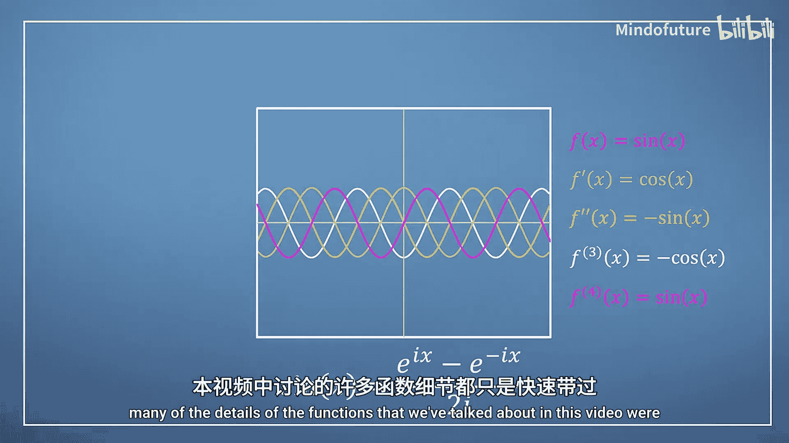

# 006：特殊情况

在本节课程中，我们将学习三个特殊的函数案例。当我们对它们进行微分时，会得到有趣的结果。理解这些特殊情况对于掌握微积分的核心概念至关重要。

## 示例一：函数 f(x) = 1/x

首先，我们来看函数 **f(x) = 1/x**。观察其图像可以发现，除了在 **x = 0** 这个点，函数在所有地方的梯度都是负的。在 **x = 0** 处，函数值本身是未定义的，因为除以零的操作没有意义，这导致函数在此处不连续。那么，它的梯度情况如何呢？让我们通过微分表达式来探究。

我们将函数代入微分定义式：

**f'(x) = lim (Δx→0) [ (1/(x+Δx) - 1/x) / Δx ]**

为了计算这个极限，我们需要合并分子中的两个分数。以下是计算步骤：

1.  首先，将分子中的两个分数通分。
2.  合并后，分子变为 **-Δx**，分母为 **x(x+Δx)**。
3.  此时，整个表达式为 **[-Δx / x(x+Δx)] / Δx**。
4.  分子和分母中的 **Δx** 可以相互抵消。
5.  我们得到：**f'(x) = lim (Δx→0) [ -1 / (x² + xΔx) ]**。
6.  当 **Δx** 趋近于0时，**xΔx** 项变得极小，可以忽略。因此，最终导数为：

**f'(x) = -1 / x²**

这个导数函数同样是负的，并且在 **x = 0** 处没有定义。

## 示例二：指数函数 f(x) = e^x

上一节我们探讨了倒数函数的微分，本节中我们来看看一个性质独特的函数。这个函数有一个特殊的性质：函数值 **f(x)** 始终等于其自身的梯度值 **f'(x)**。

当然，有一个平凡的函数满足此性质：**f(x) = 0**。但还有一个更有趣的非平凡解。通过分析可知，满足此性质的函数必须始终为正或始终为负，并且是单调的。唯一满足所有这些条件的函数就是指数函数 **e^x**，其中 **e** 是欧拉数（约等于2.718）。

对 **e^x** 求导，结果仍然是 **e^x**：

**d/dx (e^x) = e^x**

这意味着我们可以无限次地对它进行微分，结果永远不变。这种自相似性在数学和科学中非常有用。

## 示例三：三角函数 sin(x) 与 cos(x)

最后，我们来讨论三角函数。你可能还记得，在直角三角形中，**sin(x)** 代表对边与斜边的比值。它的图像是一个波浪形。

观察 **sin(x)** 的图像，我们可以推断其导数的大致形状：它从正梯度开始，逐渐减小到波峰处的0，然后变为负梯度，直到下一个波谷。事实上，**sin(x)** 的导数正是 **cos(x)**。

**d/dx (sin(x)) = cos(x)**

那么，对 **cos(x)** 求导会得到什么呢？结果是 **-sin(x)**。

**d/dx (cos(x)) = -sin(x)**

如果继续微分下去：
*   第三次微分得到 **-cos(x)**。
*   第四次微分则神奇地回到了起点 **sin(x)**。

这种循环模式与指数函数 **e^x** 的自相似性有内在联系，因为三角函数本质上是指数函数在复数域的一种表现形式。

## 总结与前瞻

本节课中，我们一起学习了三个微分中的特殊函数案例：
1.  **f(x) = 1/x**，其导数为 **-1/x²**，两者在 **x=0** 处均未定义。
2.  **f(x) = e^x**，这是一个其导数等于自身的函数。
3.  **sin(x)** 和 **cos(x)**，它们的导数以四步为一个循环。

需要明确的是，微分的核心概念始终是寻找每一点上“上升比平移”的梯度，即使代数运算有时会显得复杂。

这种实用的微积分观点在我们接下来开始讨论用计算机计算梯度时会再次出现。有时我们可以像目前所有示例一样，找到一个完美的梯度方程。然而，如果我们面对的不是光滑的函数，而只是一系列离散的数据点，似乎就无从微分了。但正如我们将要看到的，我们最根本的“上升比平移”概念将再次发挥作用，帮助我们解决问题。

