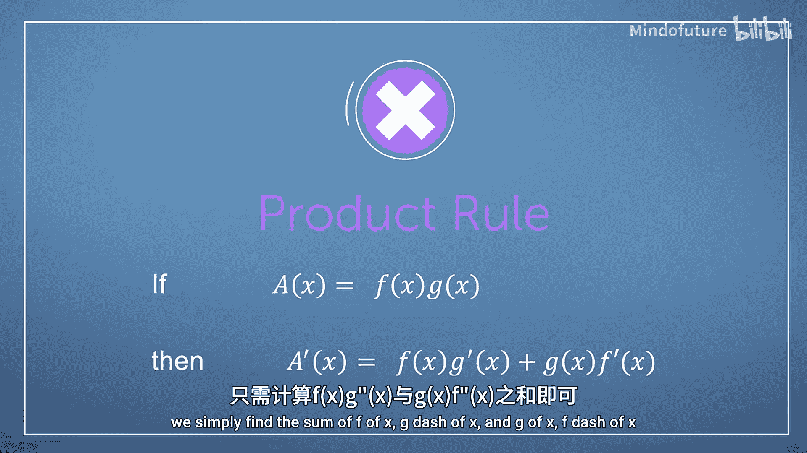

# 007：乘积法则

在本节课中，我们将要学习一个用于求导的便捷法则——乘积法则。它可以帮助我们轻松地计算两个函数乘积的导数，而无需每次都使用极限定义。

上一节我们介绍了导数的定义以及求和法则、幂法则。本节中我们来看看如何处理两个函数相乘的情况。

## 乘积法则的直观理解

虽然可以从代数上推导乘积法则，但直观的理解更有助于我们掌握其本质。让我们通过一个几何例子来建立直觉。

想象一个矩形，其一边的长度是函数 **f(x)**，另一边的长度是函数 **g(x)**。那么，这两个函数的乘积 **f(x) * g(x)** 就给出了矩形的面积，我们称之为 **A(x)**。

当我们对 **f(x) * g(x)** 求导时，我们实际上是在寻找当 **x** 变化时，矩形面积 **A(x)** 的变化率。

现在，让我们看看当 **x** 增加一个微小量 **Δx** 时，面积会发生什么变化。矩形的长和宽分别变为 **f(x+Δx)** 和 **g(x+Δx)**。

我们可以将新的矩形划分为四个区域，其中一个是原始面积 **A(x)**。新增的面积 **ΔA** 由三个新矩形的面积之和构成。

以下是新增面积 **ΔA** 的构成：
*   一个面积为 **f(x) * Δg** 的矩形（其中 **Δg = g(x+Δx) - g(x)**）。
*   一个面积为 **g(x) * Δf** 的矩形（其中 **Δf = f(x+Δx) - f(x)**）。
*   一个面积为 **Δf * Δg** 的小矩形。

当 **Δx** 趋近于 0 时，所有新矩形都会缩小，但最小的那个矩形 **Δf * Δg** 会以最快的速度趋近于 0。因此，在求导的极限过程中，我们可以忽略这个小矩形的贡献。

## 推导乘积法则

基于上述直观理解，我们现在来正式推导乘积法则。

我们想要求 **A(x)** 关于 **x** 的导数，即 **dA/dx**。这等于 **ΔA/Δx** 在 **Δx** 趋近于 0 时的极限。

根据前面的分析，**ΔA** 近似等于 **f(x) * Δg + g(x) * Δf**。因此，我们有：

**ΔA/Δx ≈ [f(x) * Δg + g(x) * Δf] / Δx**

将右边的式子拆分为两个分数：

**ΔA/Δx ≈ f(x) * (Δg/Δx) + g(x) * (Δf/Δx)**

现在，当 **Δx** 趋近于 0 时：
*   **Δg/Δx** 的极限就是 **g(x)** 的导数，记作 **g'(x)** 或 **dg/dx**。
*   **Δf/Δx** 的极限就是 **f(x)** 的导数，记作 **f'(x)** 或 **df/dx**。

于是，我们得到了乘积法则的最终表达式：

**d/dx [f(x) * g(x)] = f(x) * g'(x) + g(x) * f'(x)**

## 乘积法则总结

本节课中我们一起学习了乘积法则。这个法则为我们提供了一个强大的工具，可以轻松计算两个函数乘积的导数，而无需每次都回到极限定义。

其核心公式是：

**若 h(x) = f(x) * g(x)，则 h'(x) = f(x) * g'(x) + g(x) * f'(x)**

这个法则将在后续处理更复杂函数时变得非常有用。