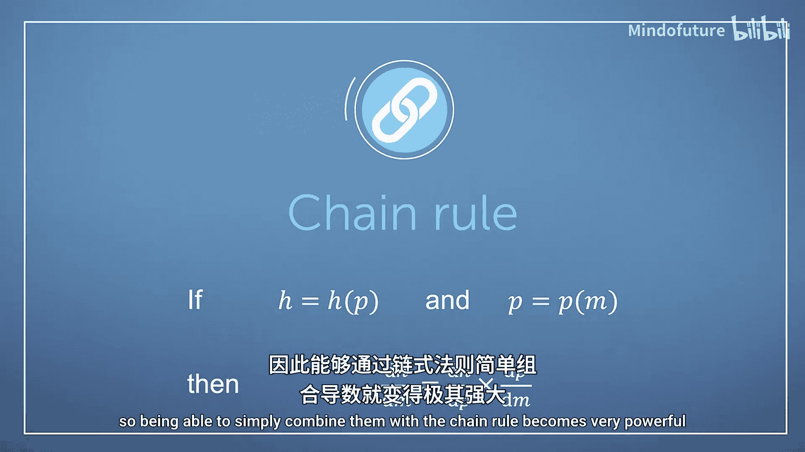

# 008：链式法则

在本节课中，我们将要学习本模块的第四个，也是最后一个核心工具——链式法则。在此之前，我们已经学习了求和法则、幂法则和乘积法则。掌握链式法则后，我们的工具箱将足够完备，可以开始处理更复杂、更有趣的问题了。

## 嵌套函数的概念

有时，我们会将一个函数作为另一个函数的输入。可以想象，描述这种情况可能会有点令人困惑。因此，我们将为每个函数赋予具体的含义，以便更好地理解整个过程。

考虑一个嵌套函数 **H(P(M))**。这里，函数 **H** 描述了我的快乐程度，它是关于 **P**（我当天吃的披萨数量）的函数。而我每天能吃的披萨数量 **P**，本身又是关于 **M**（我赚的钱）的函数。

所以，我们最终仍然是将金钱与快乐联系起来，但中间通过“披萨”这个概念来连接。这种嵌套函数的情景在科学和工程中经常出现，用于将一系列概念串联起来。我选择的这个例子，或许也让你了解了我生活中的一些优先事项。

## 定义我们的函数

首先，我来给出快乐与披萨之间的函数关系，它具有以下多项式形式：

**H(p) = - (1/3)p² + p + 1/5**

通过绘制函数图像，可以很容易理解它。我们可以看到，虽然在没有披萨的情况下，原则上仍然可能快乐，但我的快乐峰值出现在大约1.5个披萨时。超过这个数量，我的快乐感就会下降；超过大约3个披萨，我的快乐感会迅速变为负值。

接下来是披萨与金钱之间的函数关系：

**P(M) = eᴹ - 1**

通过观察图像，这个函数也相当直观：如果你没有钱，你就买不到任何披萨；但你拥有的钱越多，你购买披萨的能力就呈指数增长。起初，你可以利用批量折扣；当你变得非常富有时，你可以购买自己的披萨烤箱，甚至建造自己的披萨工厂。

## 问题的核心：快乐对金钱的变化率

我们想知道的是：考虑到我目前拥有的金钱，如果我的目标是变得快乐，我应该付出多少努力去赚更多的钱？要解决这个问题，我们需要知道快乐相对于金钱的变化率，也就是 **dH/dM**。

对于这个相对简单的例子，我们可以直接将披萨-金钱函数 **P(M)** 代入快乐-披萨函数 **H(p)** 中，得到复合函数 **H(P(M))**，然后直接对这个复合函数进行微分。

然而，链式法则为我们提供了一种更优雅的方法。重要的是，即使对于复杂的函数，直接代入可能不可行，链式法则仍然有效。

## 链式法则的引入与理解

考虑 **H** 对 **P** 的导数 **dH/dP**，以及 **P** 对 **M** 的导数 **dP/dM**。

你会注意到，在这种将导数表示为商的特定符号约定下，这两个量的乘积看起来正好会给出我们想要的函数 **dH/dM**。

事实上，这是一种非常合理的思考方式。这种方法被称为链式法则，因为在某种意义上，我们正在建立导数关系的链条。这虽然不能算作一个正式的推导，但已经足够让你有效地使用链式法则了。

## 应用链式法则

现在，让我们将这个法则应用到我们的函数上。

首先，分别对两个函数求导：
*   **dH/dP = 1 - (2/3)P**
*   **dP/dM = eᴹ**

然后将它们相乘很简单。不过，我们需要记住，如果我们不希望披萨 **P** 出现在最终的表达式中，那么我们需要将 **P** 用 **M** 表示的表达式代入。

以下是计算步骤：

1.  计算导数乘积：**dH/dM = (dH/dP) * (dP/dM) = [1 - (2/3)P] * eᴹ**
2.  代入 **P = eᴹ - 1**：**dH/dM = [1 - (2/3)(eᴹ - 1)] * eᴹ**
3.  整理项：**dH/dM = eᴹ - (2/3)eᴹ(eᴹ - 1) = eᴹ - (2/3)e²ᴹ + (2/3)eᴹ**
4.  合并同类项：**dH/dM = (5/3)eᴹ - (2/3)e²ᴹ**
5.  提取公因子：**dH/dM = (1/3)eᴹ (5 - 2eᴹ)**

最终，我们得到了视频开始时看到的表达式：

**dH/dM = (1/3)eᴹ (5 - 2eᴹ)**

## 链式法则的意义与图像分析

至此，我们完成了计算。不要忘记，对于这个简单的例子，与先代入再微分相比，链式法则并没有为我们节省大量时间，但不要被此迷惑。链式法则的神奇之处在于，对于一些实际应用，我们可能没有函数的解析表达式，但我们可能仍然拥有其导数。因此，能够简单地使用链式法则将它们组合起来就变得非常强大。

在结束之前，让我们快速看一下我们的金钱-快乐函数及其导数在图像上的表现。

如图所示，如果你身无分文，赚钱确实非常值得；但获得更多钱的收益（尤其是在你已经有足够披萨之后）会急剧下降，并迅速变为负值。

## 总结

本节课中，我们一起学习了本模块的第四个也是最后一个工具——链式法则。我们了解了嵌套函数的概念，学习了如何通过将中间变量的导数相乘，来求复合函数关于最终自变量的导数。链式法则在处理复杂函数关系时尤为强大。现在，我们的工具箱已经完备，在下一个视频中，我们将通过一个例子综合运用所有这些法则。