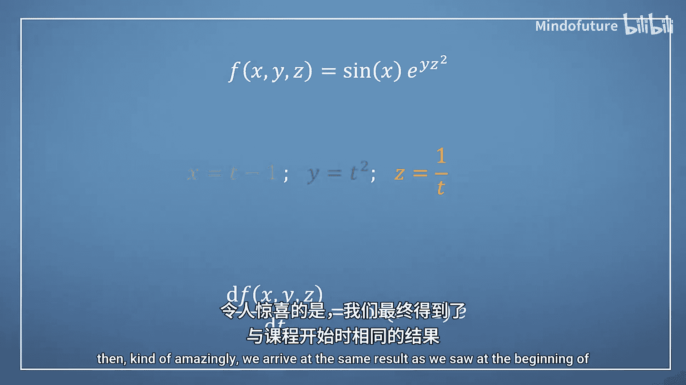

# 013：偏微分与全微分

在本节课中，我们将学习更复杂的偏微分计算，并引入一个重要的新概念——**全微分**。我们将通过一个具体的例子，逐步掌握如何对多变量函数求偏导，以及当所有变量都依赖于另一个参数时，如何计算总导数。

## 回顾与引入

上一节我们介绍了偏微分的基本思想，即将其视为单变量微分方法的简单扩展。本节中，我们将探索一些更复杂的偏微分例子，并构建一个称为函数**全微分**的工具。

让我们直接从一个比上次更复杂的问题开始。

## 复杂函数的偏微分

考虑一个三元函数：
`F(x, y, z) = sin(x) * e^(y * z^2)`

我们将分别求出该函数对每个变量 `x`, `y`, `z` 的偏导数。

### 对 `x` 求偏导

由于指数项 `e^(y * z^2)` 不包含 `x`，我们可以将其视为常数。同时，我们知道 `sin(x)` 的导数是 `cos(x)`。

因此，对 `x` 的偏导数为：
`∂F/∂x = cos(x) * e^(y * z^2)`

### 对 `y` 求偏导

此时，`sin(x)` 项不包含 `y`，可视为常数。对于指数项 `e^(y * z^2)`，我们可以应用链式法则，或者记住指数函数求导的结果是乘以指数内部的导数。

指数 `y * z^2` 对 `y` 的导数是 `z^2`。

因此，对 `y` 的偏导数为：
`∂F/∂y = sin(x) * e^(y * z^2) * z^2`

### 对 `z` 求偏导

同样，只有指数项包含 `z`。类似于对 `y` 求导，我们只需乘以指数对 `z` 的导数。

指数 `y * z^2` 对 `z` 的导数是 `2 * y * z`。

因此，对 `z` 的偏导数为：
`∂F/∂z = sin(x) * e^(y * z^2) * 2 * y * z`

## 引入全微分

现在我们已经得到了三个偏导数，接下来引入一个新概念：**全微分**。

想象一下，如果变量 `x`, `y`, `z` 本身都是另一个参数 `t` 的函数，具体关系如下：
`x = t - 1`
`y = t^2`
`z = 1 / t`

我们想要求的是函数 `F` 对 `t` 的导数 `dF/dt`。

### 方法一：直接代入法

一种简单的方法是直接将 `x`, `y`, `z` 用 `t` 表示，代入原函数 `F`，然后对 `t` 直接求导。经过化简，我们可以得到结果 `sin(t-1) * e`。

然而，在更复杂的场景中，如果变量很多，需要微分的表达式可能会变得异常复杂，甚至可能没有简洁的解析表达式。

### 方法二：链式法则（全微分）

另一种方法是利用链式法则的逻辑来解决这个问题。函数 `F` 对 `t` 的总导数，等于 `F` 对每个中间变量的偏导数，乘以该中间变量对 `t` 的导数，然后求和。

全微分的公式如下：
`dF/dt = (∂F/∂x)*(dx/dt) + (∂F/∂y)*(dy/dt) + (∂F/∂z)*(dz/dt)`

我们已经有了 `F` 对 `x`, `y`, `z` 的偏导数。现在只需要求出 `x`, `y`, `z` 各自对 `t` 的导数。

以下是各变量的导数：
`dx/dt = 1`
`dy/dt = 2t`
`dz/dt = -t^(-2)` （因为 `z = 1/t = t^(-1)`）

现在，将所有项代入全微分公式。最初的表达式看起来会有些复杂，但将 `x`, `y`, `z` 全部用 `t` 表示并化简后，你会发现第二项和第三项完全相同，只是符号相反，因此它们会相互抵消。

最终，我们得到了与直接代入法完全相同的结果：`sin(t-1) * e`。

## 总结与展望

本节课中，我们一起学习了如何处理更复杂的多变量函数偏微分，并掌握了**全微分**这一强大工具。全微分允许我们在变量之间存在依赖关系时，高效地计算函数对某个底层参数的总变化率。

希望你现在对偏微分感到比较得心应手，并且能体会到全微分函数的实用性。你现在已经准备好通过接下来的练习巩固所学知识。掌握这些内容后，我们将能够把偏导数组合成真正有用的工具。

下节课再见。