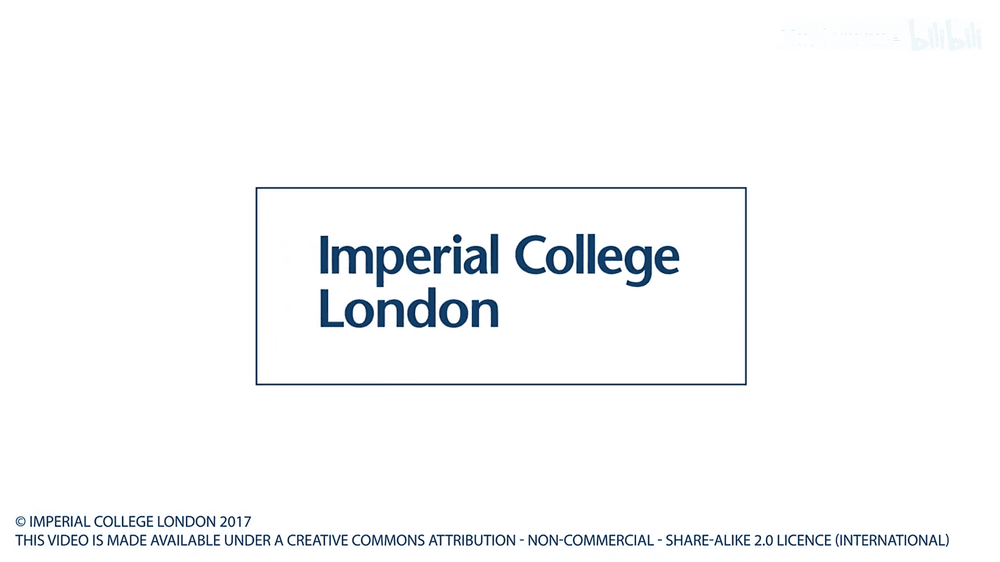

# 020：多元链式法则 🧮

在本节课中，我们将要学习如何将单变量链式法则升级，使其能够处理多元函数。我们将回顾前两个模块的核心内容，并引入新的工具来应对高维空间中的导数计算。

## 概述

在前两个模块中，我们学习了如何对单变量和多变量函数进行微分，并理解了微分过程的本质。我们还掌握了一些快速计算导数以及在多维空间中导航的有用工具。本节中，我们将重点介绍多元链式法则，并探讨其在实践中的应用。

## 回顾与过渡

上一节我们介绍了单变量和多变量微分的基本概念。本节中，我们来看看如何将这些概念结合起来，形成强大的多元链式法则。

## 核心概念：多元链式法则

多元链式法则允许我们计算复合函数的导数，其中函数本身可能依赖于多个变量。其核心思想是，一个变量的微小变化会通过多个路径影响最终输出。

以下是其基本形式。假设有一个函数 **f(x, y)**，其中 **x** 和 **y** 本身又是另一个变量 **t** 的函数，即 **x = g(t)** 和 **y = h(t)**。那么 **f** 关于 **t** 的全导数公式为：

**df/dt = (∂f/∂x) * (dx/dt) + (∂f/∂y) * (dy/dt)**

这个公式表明，**t** 的变化通过 **x** 和 **y** 两条路径影响 **f**，总的影响是每条路径贡献的加权和。

## 应用场景

多元链式法则在机器学习中非常有用，尤其是在神经网络的**反向传播**算法中。在反向传播中，我们需要计算损失函数相对于网络中每一个参数的梯度。网络中的每一层都可以看作是一个函数，其输入是前一层的输出，而参数则是该函数的变量。链式法则使我们能够高效地将误差从输出层逐层传递回输入层。

## 总结

本节课中我们一起学习了多元链式法则。我们理解了它是单变量链式法则在多维空间中的自然扩展，其核心公式描述了变量通过多条路径对最终结果的影响。掌握这个工具对于理解机器学习中复杂的优化过程至关重要。