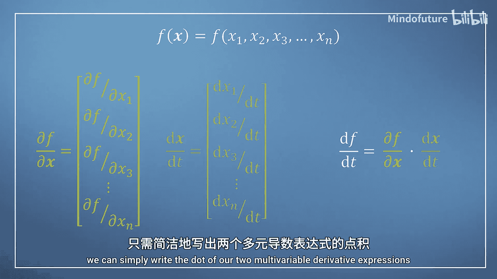

# 021：多元链式法则

## 概述

在本节课程中，我们将学习多元链式法则的通用形式。我们将从一个具体的例子出发，将其推广到任意多个变量的情况，并引入更简洁的向量记法。理解这个通用形式对于处理复杂的机器学习模型至关重要。

## 回顾：全导数

在上一模块中，我们学习了**全导数**的概念。它描述了当一个多元函数 `F(x, y, z)` 的每个变量 `x`, `y`, `z` 本身又是另一个变量 `t` 的函数时，如何计算 `F` 对 `t` 的导数。

其表达式为：
`dF/dt = (∂F/∂x)(dx/dt) + (∂F/∂y)(dy/dt) + (∂F/∂z)(dz/dt)`

这种方法允许我们分步计算，而不是一开始就代入所有函数关系，计算机非常擅长高效地处理这种分步问题。

## 推广到 n 维情况

现在，我们将这个概念进行推广，并简化其记法。

假设我们有一个 `n` 元函数 `F`，其变量为 `x1, x2, x3, ..., xn`。我们可以将其简洁地写作 `F(x)`。这里，**粗体的 `x`** 表示一个由 `n` 个变量组成的序列，我们可以更方便地将其视为一个 `n` 维向量：
`x = [x1, x2, ..., xn]^T`

同样，向量 `x` 的每一个分量 `xi` 本身都是另一个变量 `t` 的函数。我们的目标是求 `F` 对 `t` 的导数 `dF/dt`。

## 构建通用链式法则

为了建立连接 `F` 和 `t` 的表达式，我们需要以下两组导数：
1.  `F` 对每个变量 `xi` 的偏导数：`∂F/∂xi`
2.  每个变量 `xi` 对 `t` 的导数：`dxi/dt`

我们可以将这两组数分别存储在两个 `n` 维向量中：
-   梯度向量：`∇F = [∂F/∂x1, ∂F/∂x2, ..., ∂F/∂xn]^T`
-   导数向量：`dx/dt = [dx1/dt, dx2/dt, ..., dxn/dt]^T`

我们的目标是求这两个向量中**对应位置元素乘积之和**。这正是线性代数中**点积（内积）** 运算的定义。

因此，多元链式法则的通用形式可以优雅地表示为：
`dF/dt = ∇F · (dx/dt)`

或者更明确地写为：
`dF/dt = Σ (∂F/∂xi)(dxi/dt)`，其中求和 `i` 从 `1` 到 `n`。

## 工具列表更新与总结

至此，我们得到了多元链式法则的通用形式。我们可以将其加入我们的数学工具列表。

实际上，虽然我们在上一个模块已经实践过具体例子，但值得指出的是，我们之前学到的所有其他求导法则（如乘积法则、商法则）本身就适用于多元问题，无需修改。

本节课中，我们一起学习了如何将全导数的概念从三维推广到任意维，并引入了向量点积来简洁地表示多元链式法则 `dF/dt = ∇F · (dx/dt)`。这个强大的工具将帮助我们在后续课程中高效地处理更复杂的多变量函数求导问题。