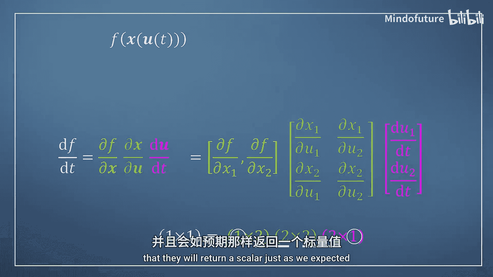

# 022：更多多元链式法则

在本节课中，我们将继续学习多元链式法则。我们将首先回顾并补充一个关于雅可比矩阵的细节，然后探讨当链式法则涉及两个以上环节时，如何将其推广到多元函数的情况。通过具体的例子，我们将看到线性代数与多元微积分是如何紧密结合的。

## 回顾与补充：雅可比矩阵与链式法则

上一节我们介绍了多元链式法则的紧凑形式。现在，我们来补充一个你可能已经注意到的细节。

如果我们有一个函数 **f(x)**，其中 **x** 是一个向量，且 **x** 的每个分量都依赖于标量 **t**，我们可以将其简洁地写作 **x(t)**。我们也有多元链式法则的紧凑形式与之对应。

你可能已经注意到，偏导数向量 **∂f/∂x** 与我们上一个模块中遇到的雅可比向量完全相同，只是我们将其写成了列向量而非行向量。根据线性代数的知识，我们可以说 **∂f/∂x** 必须是 **f** 的雅可比矩阵的转置。

最后需要认识到，对两个列向量进行点积运算，等同于用一个行向量乘以一个列向量。因此，我们最终可以看到，我们的老朋友——雅可比矩阵，为我们提供了多元链式法则最便捷的表示形式。

**公式表示：**
`df/dt = (∂f/∂x)^T · (dx/dt) = J_f(x) · (dx/dt)`

其中，`J_f(x)` 是函数 **f** 关于 **x** 的雅可比（行）向量。

## 链式法则的多环节推广

接下来我们将看到，链式法则对于两个以上的环节同样适用。我们先通过一个简单的单变量例子来开始，在这个例子中，我们在 **f** 和 **t** 之间加入另一个函数。

假设：
*   `f(x) = 5x`
*   `x(u) = 1 - u`
*   `u(t) = t^2`

我们有了三个函数，通过一个额外的步骤将 **f** 与 **t** 分离开。当然，我们可以直接将每一步代入，找到 **f** 作为 **t** 的直接函数表达式：`f(t) = 5(1 - t^2) = 5 - 5t^2`。然后直接求导：`df/dt = -10t`。

或者，我们可以应用两步链式法则：
`df/dt = (df/dx) * (dx/du) * (du/dt)`

代入各项：
`df/dt = 5 * (-1) * (2t) = -10t`

我们再次得到了相同的答案。由此可见，这种方法适用于单变量函数链，并且可以扩展到 **f** 和 **t** 之间任意多个中间函数。

## 多元情况下的多环节链式法则

那么多元情况呢？链式法则在这里同样有效，但我们只需要注意一些额外的细节。

让我们考虑函数 **f( x( u(t) ) )**。其中：
*   函数 **f** 以向量 **x** 作为输入。
*   **x** 是一个向量值函数，它又以向量 **u** 作为输入。
*   **u** 也是一个向量值函数，它以标量 **t** 作为输入。

最终，我们仍然是将标量输入 **t** 与标量输出 **f** 联系起来，但这次是通过两个中间的向量值函数 **x** 和 **u**。

如果我们想求 **f** 关于 **t** 的导数，我们基本上可以写出与单变量情况相同的表达式，只是现在其中几项是向量或矩阵。

我们已经知道：
*   对标量值函数 **f** 关于其输入向量 **x** 求导，得到的是雅可比行向量 `∂f/∂x`。
*   对向量值函数 **u** 关于标量变量 **t** 求导，得到的是导数列向量 `du/dt`。

那么中间项 **∂x/∂u** 呢？对于函数 **x**，我们需要找到它的两个输出变量分别关于两个输入变量的导数。因此，我们总共会得到四项，正如我们在上一个模块中所见，这四项可以方便地排列成一个矩阵。我们仍然称这个对象为雅可比矩阵。

现在我们可以说，**f** 关于 **t** 的导数是 **f** 的雅可比矩阵、**x** 的雅可比矩阵和 **u** 的导数向量的乘积。请注意，这些向量和矩阵的维度（如下图所示）使得这个运算是可行的，并且最终会返回一个标量，正如我们所期望的那样。

**公式表示：**
`df/dt = (∂f/∂x) * (∂x/∂u) * (du/dt)`
其中：
*   `(∂f/∂x)` 是 `1 x n` 的行向量（雅可比）。
*   `(∂x/∂u)` 是 `n x m` 的矩阵（雅可比）。
*   `(du/dt)` 是 `m x 1` 的列向量。

## 总结

本节课中，我们一起学习了多元链式法则的更多内容。我们首先明确了偏导数向量与雅可比矩阵转置之间的关系，使链式法则的表达更加统一。接着，我们探讨了链式法则如何推广到包含两个以上环节的情况，无论是单变量还是多元函数。关键在于，每一步的导数都用一个合适的线性代数对象（标量、向量或矩阵）来表示，并确保它们的维度在连续相乘时是兼容的。希望你现在开始看到线性代数与多元微积分的各个线索是如何交织在一起的。