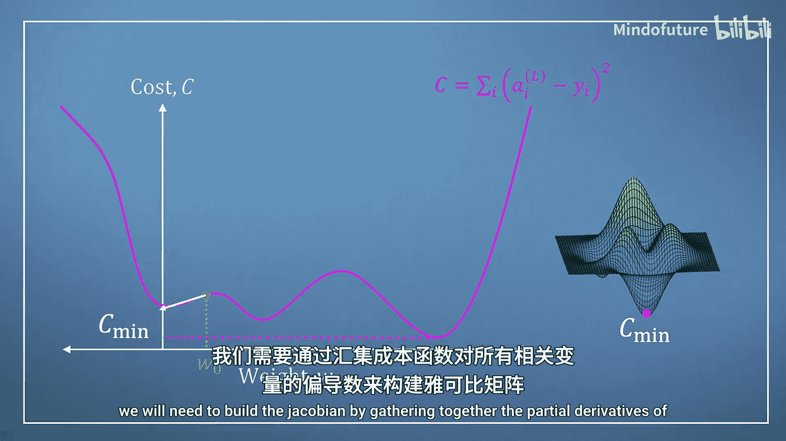

# 024：更多简单神经网络

在本节课中，我们将学习如何利用多元链式法则来迭代更新神经网络中所有权重和偏置的值，从而使网络能够根据一组训练样本来学习对输入数据进行分类。

上一节我们介绍了神经网络的概念，并推导了描述带隐藏层的全连接前馈网络所需的代数。本节中我们来看看如何应用多元链式法则。

## 网络训练与反向传播

当我们说训练一个网络时，通常指的是使用某种带标签的数据，即匹配的输入和输出对。

例如，如果我们构建一个网络来识别人脸图片并预测其是否快乐，那么对于训练数据，每个输入可能是图像中单个像素的强度，而与之配对的输出则仅说明该图像是否包含人脸以及是否是快乐的脸。

经典的训练方法被称为反向传播，因为它首先查看输出神经元，然后反向通过网络。

## 网络结构与目标

如果我们从选择一个简单的结构开始，例如这里展示的具有四个输入单元、隐藏层三个单元和输出层两个单元的结构。

我们试图做的是找到18个权重和5个偏置，使得我们的网络能够最佳地将训练输入与其标签匹配起来。最初，我们会将所有权重和偏置设置为随机数。因此，最初当我们向网络传入一些数据时，得到的输出将是毫无意义的。然而，我们可以定义一个成本函数。

成本函数简单地是期望输出 `y` 与我们未经训练的网络当前给出的输出之间差值的平方和。

## 成本函数与梯度下降

如果我们专注于某个特定权重与由此产生的成本函数之间的关系，它可能看起来像这样：如果权重太大或太小，成本就高；但在一个特定值上，成本处于最小值。

基于我们对微积分的理解，如果我们能够以某种方式计算出成本 `C` 相对于变量 `W` 在某个初始点 `W0` 处的梯度，那么我们就可以简单地朝相反方向移动。

例如，在图中所示的点上，梯度为正，因此增加 `W` 也会增加成本，所以我们应该减小 `W` 来改进我们的网络。

然而，值得注意的是，我们的成本函数可能看起来更像这条波动的曲线，它有几个局部最小值，导航起来更复杂。此外，这个图只是孤立地考虑我们的一个权重，但我们真正想做的是找到多维超曲面的最小值，就像我们在上一个模块中看到的二维例子一样。

## 构建雅可比矩阵

因此，也像上一个模块一样，如果我们想向山下走，就需要通过收集成本函数相对于所有相关变量的偏导数来构建雅可比矩阵。

## 应用链式法则

既然我们知道了目标，我们只需要再看一下我们简单的两节点网络。

此时，我们可以立即为成本相对于权重或偏置的偏导数写出链式法则表达式。我高亮了 `a1` 项，它连接了这两个导数。

然而，利用一个额外的项通常很方便，我们称之为 `Z1`，它将保存我们的加权激活加上偏置项。这将允许我们单独考虑对我们恰好选择的特定S型函数进行微分。

因此，我们必须在导数链中包含一个额外的链接。

我们现在有了两个链式法则表达式，它们是在二维 `W-B` 空间中导航以最小化这个简单网络对于一组训练样本的成本所必需的。

显然，当我们添加更多神经元时，事情会变得稍微复杂一些，但从根本上说，我们仍然只是应用链式法则将每个权重和偏置与其对成本的影响联系起来，最终使我们能够训练我们的网络。

## 总结与展望

在接下来的练习中，我们将学习如何将简单情况下的方法扩展到多层网络。但我希望你已经享受了看到微积分在行动中的乐趣。下次见。