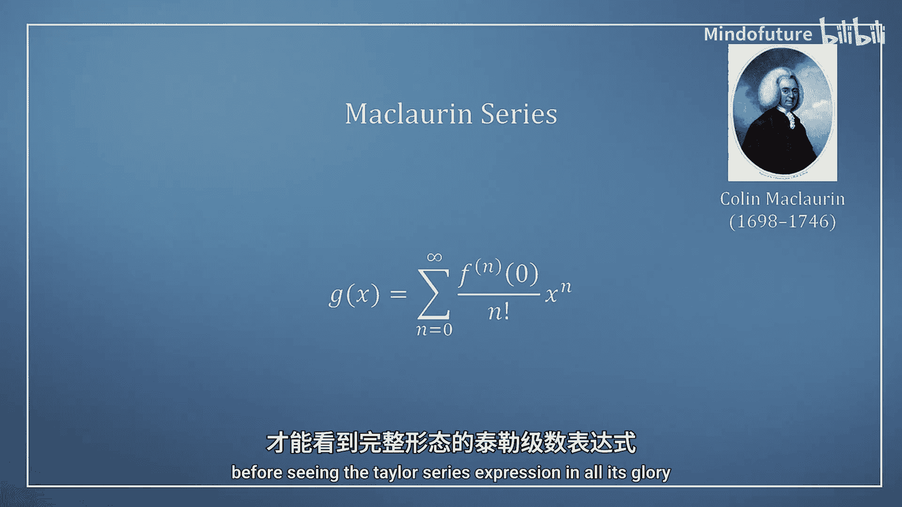

# 029：幂级数推导


## 概述

在本节课中，我们将学习如何推导函数的幂级数表示。其核心思想是，我们可以使用一个包含x的递增幂次的级数来重新表达函数。我们将通过图形化的方式，逐步构建对任意函数的近似，并最终推导出通用的幂级数公式。

## 幂级数概念

为了预热，我们可以看一个令人惊叹的例子：函数 **e^x**。我们可以将其重新表达为以下级数：
```
1 + x + x²/2! + x³/3! + ...
```
这非常不可思议。通过本视频的学习，你将理解如何为许多其他有趣的函数构建类似的级数。

## 泰勒级数方法

泰勒级数方法告诉我们：如果我们知道函数在某一点的所有信息（“所有信息”指的是函数在该点的值、一阶导数、二阶导数、三阶导数等），那么我们就可以利用这些信息来重构函数在其他所有点的值。

因此，如果我知道函数在某一点的所有信息，我就知道了它在所有点的信息。然而，这仅适用于一类我们称之为“表现良好”的函数，即连续且可以无限次求导的函数。幸运的是，我们认识很多这样的函数，所以这确实是一个非常有用的工具。

## 图形化解释

接下来，我们将尝试通过图形来解释这个概念。我们来看一个任意函数 **f(x)** 的图像，它看起来像这样。我们将构建一系列逐步改进的近似。

### 零阶近似

我们的第一个近似，称为 **g₀(x)**，将只使用函数的一个信息：我们感兴趣的点（此处设为 x=0）的函数值。

可以想象，如果我们的近似函数只基于这一个值，那么它显然无法捕捉像原函数这样复杂的形状。事实上，它只能是在点 **f(0)** 处的一条水平线。

我们可以画出这个一阶近似，并写出计算 **g₀(x)** 的表达式：
```
g₀(x) = f(0)
```
我们称之为零阶近似。显然，它并不好，但请注意，由于这条线是平的，它实际上甚至不是x的函数。

### 一阶近似

我们可以做得更好。现在来求一阶近似 **g₁(x)**。为此，我们将使用两个信息：函数在 x=0 处的值，以及函数在 x=0 处的梯度值，我们称之为 **f'(0)**。

利用这些，我们可以构建另一条直线，形式为 **y = mx + c**，其中垂直轴截距 **c** 就是 **f(0)**，而斜率 **m** 则用 **f'(0)** 代入。现在我们可以画出函数的一阶近似，它在 x=0 点具有与 **f(x)** 相同的函数值和梯度。

我们也可以写下它的表达式：
```
g₁(x) = f(0) + f'(0) * x
```
很明显，在 x=0 附近，**g₁(x)** 比 **g₀(x)** 能更好地近似 **f(x)**，但仍然不够好。

### 二阶近似

快速进入二阶近似 **g₂(x)**。我们将使用三个信息：**f(0)**、**f'(0)** 和二阶导数 **f''(0)**。

为了能利用这三个信息，我们需要一个二次方程。因此我们可以写成：
```
y = A x² + B x + C
```
对这个式子求两次导：
```
y' = 2A x + B
y'' = 2A
```
我们希望这个近似函数在代入点 x=0 时，其各项性质与 **f(x)** 相同。

1.  首先，对于二阶导数：在 x=0 处，我们希望 **y''** 等于 **f''(0)**。由于 **y'' = 2A** 不含 x，因此系数 **A** 简单地等于：
    ```
    A = f''(0) / 2
    ```
2.  其次，对于一阶导数：我们希望 **y'** 在 x=0 处等于 **f'(0)**。代入 x=0，**y' = B**，因此：
    ```
    B = f'(0)
    ```
3.  最后，对于函数值：我们希望 **y** 在 x=0 处等于 **f(0)**。代入 x=0，**y = C**，因此：
    ```
    C = f(0)
    ```

现在，我们有了方程的所有三个系数。我们可以回到图像，加上我们的二阶近似。由于它包含 **x²** 项，将是一条抛物线。

请注意，每次更新近似时，它与 **f(x)** 匹配的区域都会扩大一点。

### 三阶近似

让我们再深入一步，求三阶近似。我们可以写出：
```
y = A x³ + B x² + C x + D
```
根据从前三步已经看到的情况，我们只需要找到系数 **A**，因为 **B、C、D** 将与 **g₂(x)** 中的相同。

现在对这个式子求三次导：
```
y'   = 3A x² + 2B x + C
y''  = 6A x + 2B
y''' = 6A
```
显然，我们希望近似函数的三阶导数在 x=0 处等于原函数 **f(x)** 的三阶导数 **f'''(0)**。

令 **x=0**，**y''' = 6A**，因此：
```
f'''(0) = 6A
A = f'''(0) / 6
```
最后，我们可以将这个三阶近似添加到图中，并写出它的表达式。

你现在可以看到，近似不仅显著改善，而且我们可以逐项添加更高阶的项，并且在每种情况下，低阶项都保持不变。

## 构建通用表达式

我们现在想构建一个通用表达式，使得低阶项保持不变，从而无需逐步推导就能写出四阶近似。

注意到三次项前面的系数 **1/6**，是因为对三次项求了三次导数。当我们对 **x⁴** 求三次导时，前面会得到 **4 × 3 × 2**，导致系数为 **1 / (4 × 3 × 2)**，即 **1/24**。

运算 **4 × 3 × 2** 有一个名字，叫做 **4的阶乘**，记作 **4!**。事实上，所有项都可以被认为前面有一个阶乘，甚至是 **0!**（由于某些原因，它等于1）。

随着这最后一块拼图就位，我们现在可以说，近似中的第n项就是：
```
[ f⁽ⁿ⁾(0) / n! ] * xⁿ
```
因此，完整的幂级数可以写成如下形式：
```
f(x) ≈ Σ [n=0 到 ∞] [ f⁽ⁿ⁾(0) / n! ] * xⁿ
```

## 麦克劳林级数与泰勒级数

虽然我们在这里写出的式子确实算作泰勒级数，但由于我们特指在 **x=0** 点展开的情况，我们通常称这种情况为**麦克劳林级数**。所以，你还得再等一个视频才能看到完整形式的泰勒级数表达式。

## 总结



本节课中，我们一起学习了如何推导函数的幂级数（麦克劳林级数）表示。我们从图形化构建零阶、一阶、二阶和三阶近似开始，理解了每增加一阶信息（导数）如何改进对原函数的近似。最终，我们推导出了通用的第n项公式 **f⁽ⁿ⁾(0) xⁿ / n!**，并将其求和得到完整的幂级数表达式。这个工具允许我们仅通过函数在某一点的值和所有阶导数值，来重构整个“表现良好”的函数。

在本模块的其余部分，我们将把幂级数的概念应用到一些有趣的案例中，并将其推广到更高维度。在更高维度中，我们将不再是构建近似曲线，而是构造近似超曲面。下次见。