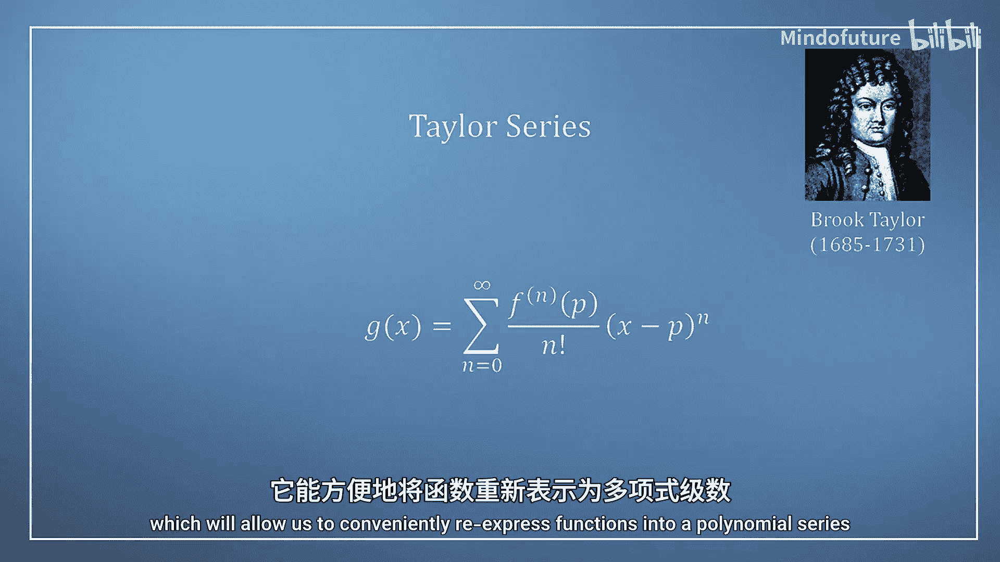

# 030：幂级数细节

在本节课中，我们将学习泰勒级数。我们将从回顾麦克劳林级数开始，然后将其推广到围绕任意点展开的泰勒级数，并最终得到其通用公式。

## 从麦克劳林级数到泰勒级数 🚀

上一节我们介绍了如何将函数 **e^x** 表示为幂级数。本节中我们来看看，当我们对这个级数逐项求导时会发生什么。

对多项式逐项求导并不困难。有趣的是，对于 **e^x** 的导数，这个无限长的级数保持不变，这与我们对 **e^x** 导数的预期一致。

现在，我们终于可以引出泰勒级数了。从根本上说，我们应用的是与之前推导麦克劳林级数相同的逻辑。麦克劳林级数表明，如果你知道一个函数在 **x=0** 处的所有信息，你就可以重构它在任何地方的信息。泰勒级数则指出，**x=0** 这个点并没有什么特殊性。因此，泰勒级数认为，如果你知道函数在**任意一点**的所有信息，你就可以重构该函数在任何地方的信息。这是一个微小但重要的改变。

## 围绕任意点展开 🔍

让我们再次以函数 **e^x** 及其前四个近似函数为例。利用我们对麦克劳林级数的理解，我们可以将其重写为简洁的求和符号形式，这样我们就可以根据需要，构建任意精度的多项式近似函数。

那么，如果我们现在不想围绕 **x=0** 展开，而是想从点 **x=p** 开始展开呢？首先，让我们看看在该点的前四个近似函数。

描述这些近似的表达式仍然需要函数在该点的值及其所有导数值。但我们如何调整通用方程，以允许在任意展开点 **x=p** 进行展开呢？

显然，零阶项很简单，它是一条水平线，处处使用 **f(p)** 的值。但如果我们仔细研究一阶近似，这应该能给我们足够的启示，以便处理所有其他高阶项。

## 推导一阶近似 📐

我们本质上是要在点 **P** 处构建曲线的切线。所有直线都具有 **y = mx + c** 的形式。现在，让我们利用所有可用信息来推导它。

假设我们有一个待处理的函数。点 **P** 的坐标是 **(p， f(p))**。我们想构建一个一阶近似函数，它有一个 y 轴截距和一个梯度，看起来会像一条经过该点的直线。

这条绿色直线的方程为 **y = mx + c**。我们立即知道 **m** 是这条直线的梯度，而函数在该点的梯度就是 **f'(p)**。因此，我们可以写成 **y = f'(p) * x + c**。剩下的就是求 **c**。

为了求 **c**，我们需要知道直线上的一个点 **(x， y)**。我们知道点 **(p， f(p))** 在直线上。将其代入方程：
**f(p) = f'(p) * p + c**

整理求 **c**：
**c = f(p) - f'(p) * p**

将 **c** 代回通用方程：
**y = f'(p) * x + [f(p) - f'(p) * p]**

最后，将 **f'(p)** 提取出来因式分解，得到一个简洁的形式：
**y = f'(p) * (x - p) + f(p)**

这个结果表明，当我们围绕点 **P** 构建近似时，在使用梯度项 **f'(p)** 时，我们不是直接将其应用于 **x**，而是应用于 **(x - p)**。你可以将 **(x - p)** 理解为距离点 **P** 有多远。

## 构建泰勒级数公式 🧩

现在，我们可以写出函数 **f(x)** 在点 **P** 处的前两个近似函数：零阶和一阶。

回想上一节视频中的麦克劳林级数。为了将其转换为泰勒级数，我们只需要用 **f''(p)** 代替 **f''(0)**，并用 **(x-p)** 代替 **x**。但请注意，系数 **1/2** 仍然保留。

以下是前几项：
*   **0阶近似**： **f(p)**
*   **1阶近似**： **f(p) + f'(p)(x-p)**
*   **2阶近似**： **f(p) + f'(p)(x-p) + (1/2!) f''(p)(x-p)²**

现在，我们可以看看麦克劳林级数的简洁求和符号，并将其全面升级为更通用的泰勒级数形式。当然，如果我们决定设 **p=0**，那么两个表达式将变得完全相同。

## 泰勒级数通用公式 ✅

我们现在得到了完整的一维泰勒级数表达式，它允许我们方便地将函数重新表达为多项式级数。

泰勒级数公式如下：

**f(x) = Σ [n=0 到 ∞] ( f⁽ⁿ⁾(p) / n! ) * (x - p)ⁿ**

其中 **f⁽ⁿ⁾(p)** 表示函数 **f** 在点 **p** 的 **n** 阶导数。

在本模块的剩余部分，我们将运用这个结果，并将其扩展到高维空间。下次见。

## 总结 📝

本节课中我们一起学习了泰勒级数。我们从逐项求导幂级数的有趣现象出发，回顾了麦克劳林级数围绕 **x=0** 展开的局限性。通过推导围绕任意点 **p** 的一阶近似（切线），我们引入了 **(x-p)** 项。最终，我们将麦克劳林级数推广为更通用的泰勒级数公式，该公式利用函数在某一点 **p** 的各阶导数信息，来近似函数在该点附近的行为。