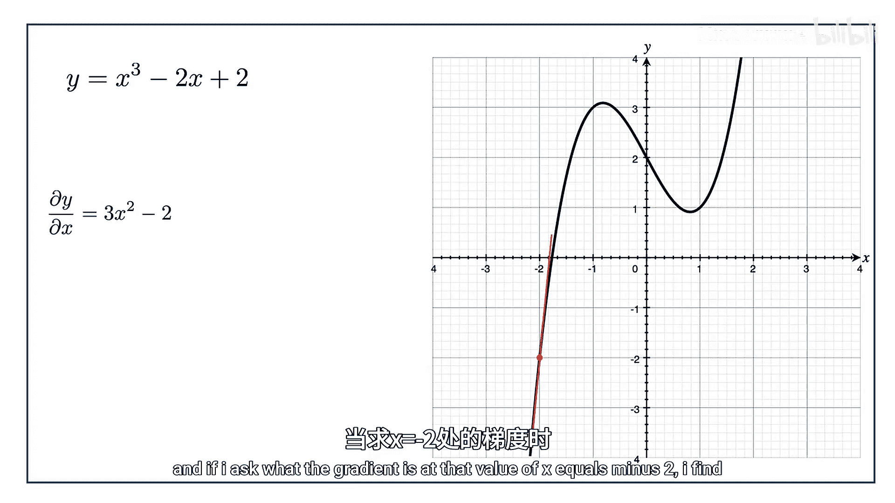
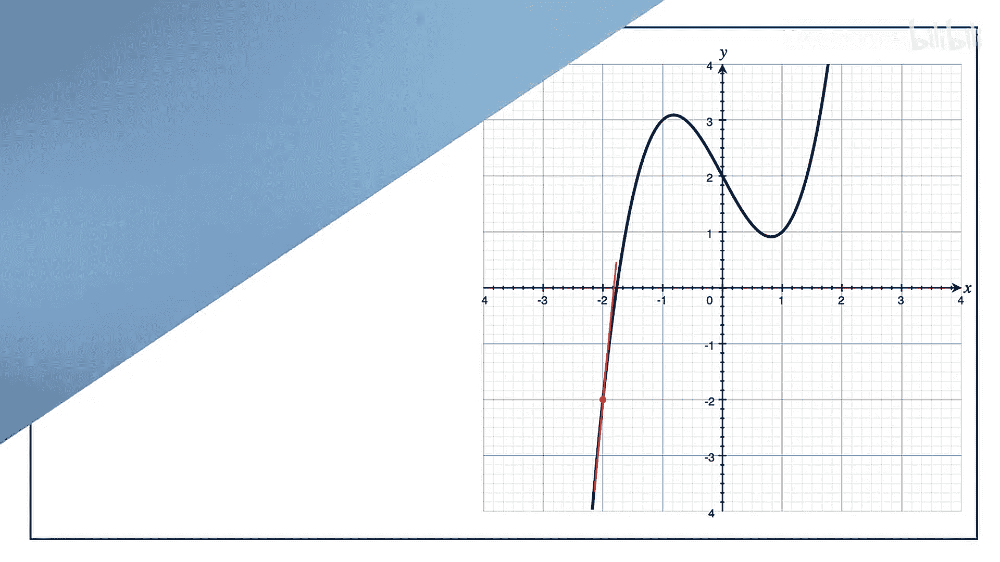
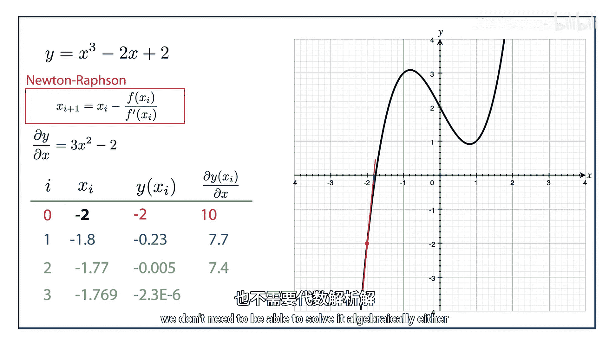
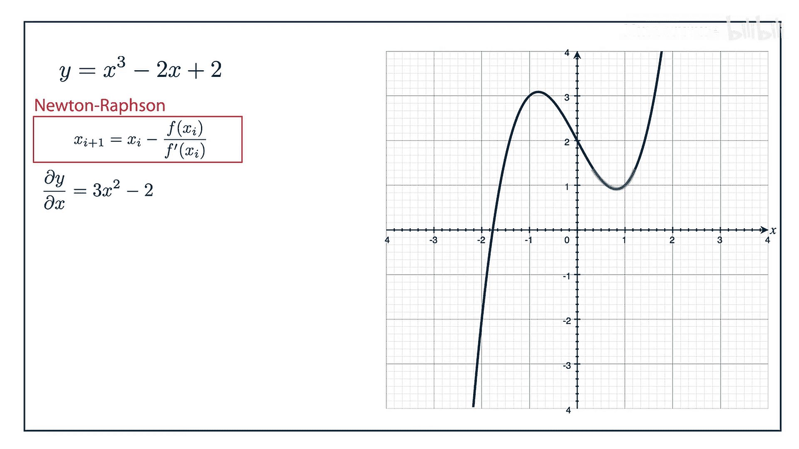

# 035：牛顿-拉夫森法

在本节课中，我们将学习如何使用微积分与向量结合来求解方程。我们将从一个简单但强大的方法开始：牛顿-拉夫森法。该方法仅需计算函数值及其梯度，即可迭代地逼近方程的解。

## 从问题出发：拟合模型参数

假设我们有一个身高分布数据，其均值为 `μ`，标准差为 `σ`。我们希望找到一个模型（例如高斯分布）来拟合这些数据，这样我们就不必处理所有原始数据点，而只需使用包含两个参数 `μ` 和 `σ` 的模型。这能让我们更快地进行计算和预测。

那么，如何找到模型的最佳参数 `μ` 和 `σ` 呢？我们将定义一个衡量模型与数据拟合程度的表达式，然后观察这个“拟合优度”如何随着拟合参数 `μ` 和 `σ` 的变化而变化。本质上，我们是在求解一个以拟合参数为变量的方程。

## 牛顿-拉夫森法原理

为了理解如何求解，我们首先看一个简单的一维例子。考虑方程：
`y = x³ - 2x + 2`
其导数为：
`dy/dx = 3x² - 2`

假设我们不知道这个函数的图像，也无法计算每个点的值（或者函数维度太高无法可视化），但我们想求解方程 `y = 0` 的解，即：
`x³ - 2x + 2 = 0`

我们从某个初始猜测值开始，例如 `x₀ = -2`。

以下是牛顿-拉夫森法的核心步骤：

1.  在初始猜测点 `xᵢ` 计算函数值 `f(xᵢ)` 和梯度（导数）`f'(xᵢ)`。
2.  利用当前点的梯度信息，沿切线方向外推至 `y=0` 的轴，得到一个新的猜测值 `xᵢ₊₁`。
3.  将新猜测值作为起点，重复上述过程。

更新猜测值的公式为：
`xᵢ₊₁ = xᵢ - f(xᵢ) / f'(xᵢ)`

## 迭代过程演示

让我们通过一个表格来演示这个过程：

| 迭代次数 (i) | 猜测值 (xᵢ) | 函数值 f(xᵢ) | 梯度 f'(xᵢ) | 新猜测值 xᵢ₊₁ |
| :--- | :--- | :--- | :--- | :--- |
| 0 | -2.000 | -2.000 | 10.00 | -1.800 |
| 1 | -1.800 | -0.232 | 7.720 | -1.770 |
| 2 | -1.770 | -0.005 | 7.399 | -1.769 |
| 3 | -1.769 | ~2.3e-6 | 7.393 | -1.769 |

可以看到，仅仅经过三次迭代，我们就得到了一个非常接近真实解（约 `-1.769`）的值。这种方法非常高效，我们不需要绘制整个函数图像或进行大量计算，只需要能够计算函数值及其导数即可。

## 方法的优势与潜在问题

牛顿-拉夫森法是一种迭代法，对于求解高维或复杂函数的根非常有效。然而，它并非总是完美工作。

以下是可能遇到的问题：

*   **循环震荡**：如果初始猜测不当，算法可能会在两个值之间循环，永远无法接近真实解。例如，从 `x=0` 开始，可能会在 `0` 和 `1` 之间震荡。
*   **梯度接近零**：如果当前猜测点非常靠近函数的极值点（梯度 `f'(xᵢ) ≈ 0`），那么更新公式中的除法会使下一步的猜测值变得非常大，导致算法发散。

## 总结与直观比喻

本节课我们一起学习了牛顿-拉夫森法。这是一种利用梯度信息逐步逼近方程解的强大迭代方法。

可以将其想象成在浓雾中下山：你知道当前的海拔高度（函数值）和脚下的坡度（梯度），但看不见整座山的全貌。你根据当前的坡度决定下一步的方向，迈出一步后，再次测量新的高度和坡度，如此反复，直到抵达目的地（解）。关键在于，你不需要了解整个地形（函数全局图像），只需要局部信息即可引导你前进。

在下一个视频中，我们将探讨如何将这个方法应用到多变量情况，这将会涉及到梯度向量的概念，以及如何在等高线图上“下山”。