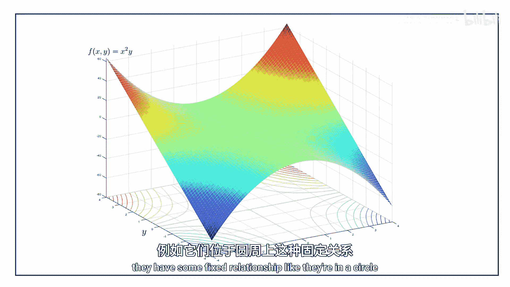

# 037：约束优化


## 概述

在本节课中，我们将要学习如何求解带有约束条件的函数最值问题。上一节我们介绍了梯度下降法，本节中我们来看看当我们需要在某个特定路径（例如一条线或一个圆）上寻找函数的最大值或最小值时，该如何处理。这种方法被称为**拉格朗日乘数法**。


## 从梯度到约束优化


我们之前了解到，梯度向量 `grad F` 指向函数 `F` 增长最快的方向，并且垂直于函数的等高线。基于此，我们发展出了寻找多元函数最小值和最大值的方法——梯度下降法。


现在，我们考虑一个不同的问题：如果我们想找到函数 `F(x, y)` 的最大值或最小值，但要求点 `(x, y)` 必须位于某个特定的路径上（例如一个圆），该怎么办？这被称为**约束优化**问题。

## 拉格朗日乘数法的核心思想

拉格朗日是一位法国数学家。他观察到，当函数的等高线**恰好**与约束路径相切时，我们就找到了该路径上的最大值或最小值点。

以下是其原理的直观解释：


*   当等高线值略小时，它可能完全不会与路径相交。
*   当等高线值略大时，它可能与路径相交于两个点。
*   当等高线值**恰好**使得等高线与路径相切于一点时，该点就是路径上的极值点（最大值或最小值）。


关键在于，在切点处，函数 `F` 的等高线的法线方向（即 `grad F` 的方向）与约束路径 `G` 的法线方向（即 `grad G` 的方向）是**共线**的（方向相同或相反）。因此，我们可以建立方程：

**`grad F = λ * grad G`**

其中，`λ` 是一个标量，被称为**拉格朗日乘子**。这个方程，连同约束方程 `G(x, y) = constant`，构成了我们求解问题所需的方程组。


## 实例解析：圆上的最值

让我们通过一个具体例子来应用这个方法。考虑函数 `F(x, y) = x²y`。我们想找到该函数在圆 `x² + y² = a²` 上的最大值和最小值。

### 第一步：建立方程组

根据拉格朗日乘数法，我们需要解以下方程组：

1.  **梯度相等**：`grad F = λ * grad G`
2.  **约束条件**：`G(x, y) = a²`

首先计算梯度：
*   `grad F = (∂F/∂x, ∂F/∂y) = (2xy, x²)`
*   `grad G = (∂G/∂x, ∂G/∂y) = (2x, 2y)`，其中 `G(x, y) = x² + y²`

因此，方程组为：
1.  `2xy = λ * 2x`
2.  `x² = λ * 2y`
3.  `x² + y² = a²`

### 第二步：求解方程组

以下是求解步骤：

1.  由方程 (1)：`2xy = 2λx`。假设 `x ≠ 0`，两边除以 `2x`，得到 `y = λ`。
2.  将 `λ = y` 代入方程 (2)：`x² = (y) * 2y = 2y²`。所以 `x² = 2y²`，即 `x = ±√2 * y`。
3.  将 `x² = 2y²` 代入约束方程 (3)：`2y² + y² = a²` => `3y² = a²` => `y = ± a / √3`。
4.  根据 `x = ±√2 * y`，我们可以得到四组解：

    ```
    (x, y) = ( √2 * (a/√3),   a/√3 )
    (x, y) = ( √2 * (a/√3),  -a/√3 )
    (x, y) = (-√2 * (a/√3),   a/√3 )
    (x, y) = (-√2 * (a/√3),  -a/√3 )
    ```

### 第三步：计算函数值并判断最值

现在，我们将这四组解代入原函数 `F(x, y) = x²y` 来计算函数值：

*   对于 `( √2*a/√3, a/√3 )`：`F = (2a²/3) * (a/√3) = (2a³)/(3√3)`
*   对于 `( √2*a/√3, -a/√3 )`：`F = (2a²/3) * (-a/√3) = -(2a³)/(3√3)`
*   对于 `(-√2*a/√3, a/√3 )`：`F = (2a²/3) * (a/√3) = (2a³)/(3√3)`
*   对于 `(-√2*a/√3, -a/√3 )`：`F = (2a²/3) * (-a/√3) = -(2a³)/(3√3)`

因此，在圆 `x² + y² = a²` 上：
*   **最大值**为 `(2a³)/(3√3)`，在点 `(±√2*a/√3, a/√3)` 处取得。
*   **最小值**为 `-(2a³)/(3√3)`，在点 `(±√2*a/√3, -a/√3)` 处取得。

从图像上看，两个位于上半圆（y为正）的点是最大值点，两个位于下半圆（y为负）的点是最小值点。这验证了我们的计算结果。

## 总结




本节课中我们一起学习了**拉格朗日乘数法**。这种方法利用梯度向量的几何性质，将“在约束路径上求函数极值”的问题，转化为求解一个由 `grad F = λ * grad G` 和约束方程 `G(x,y)=c` 构成的方程组。这是一个非常强大且实用的工具，在机器学习中，当模型参数需要满足某些特定关系（如总和为1、位于某个范围内）时，经常会用到约束优化技术。