# 039：简单线性回归

在本节课中，我们将应用多元微积分的知识来学习如何将函数拟合到数据上。这是数据分析中的一项核心技能，能帮助我们理解数据、进行统计检验，并将数学工具应用于现实世界。

## 数据准备 📊

在开始数学建模之前，首先需要处理原始数据。以下是数据准备的关键步骤：

*   **数据清洗**：处理缺失值、零值、重复项和无效数据。一个常见的方法是标记所有数据点，以便在重新排序后能恢复原状，然后排序并识别异常值，最后决定是删除还是用合理值替换它们。
*   **数据探索**：清洗完成后，可以开始绘制图表、计算平均值和标准差等，以初步了解数据特征。
*   **培养数据直觉**：深入理解你的数据至关重要，就像了解一位朋友。随着数据积累和变化，这种直觉能帮助你敏锐地察觉其中的模式与异常。

完成上述步骤后，你可能会得到类似下图的散点图。数据点大致呈直线分布。你可以根据对数据生成过程的物理理解，或者基于数据的外观（例如看起来像一条直线），来选择一个合适的模型进行拟合。

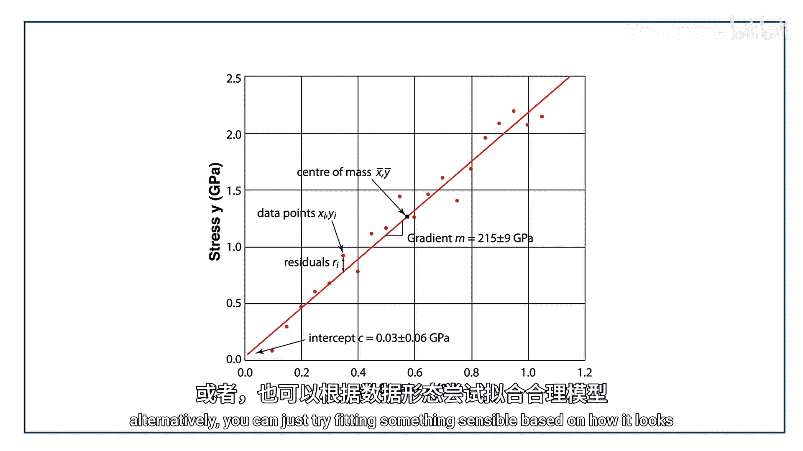
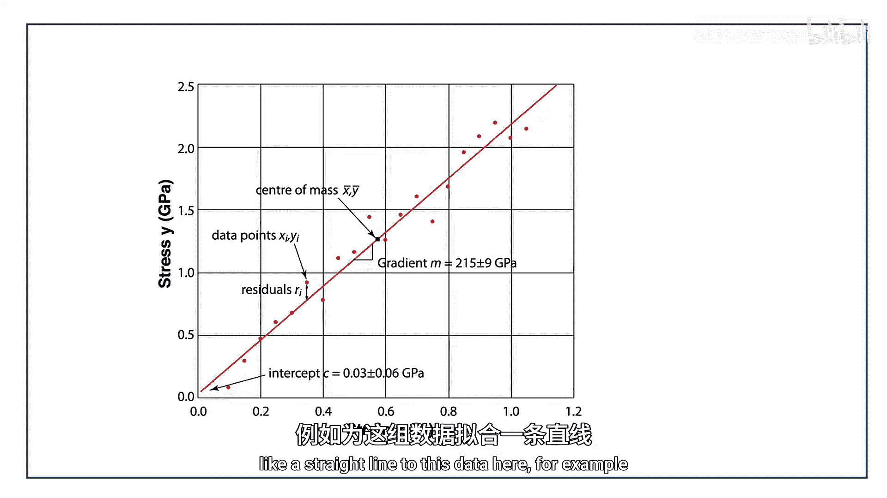

## 建立模型与定义目标 🎯

上一节我们讨论了数据准备，本节我们将具体看看如何为数据拟合一条直线。

我们可以用直线模型 `y = m*x + c` 来拟合数据。其中，`m` 是斜率，`c` 是截距。这两个参数构成了我们的参数向量 **A**。图中展示了对该数据的最优拟合直线，其斜率 `m` 为 2.15，截距 `c` 为 0.3。数据集的几何中心由 `x` 的平均值 `x̄` 和 `y` 的平均值 `ȳ` 表示。

为了找到最优的 `m` 和 `c`，我们首先定义**残差 `rᵢ`**，即每个数据点的观测值 `yᵢ` 与模型预测值 `ŷᵢ = m*xᵢ + c` 之间的差值：

**公式：** `rᵢ = yᵢ - (m*xᵢ + c)`

接着，我们定义一个衡量整体拟合优度的指标 **χ²**（卡方），它是所有残差平方的和：

**公式：** `χ² = Σᵢ (rᵢ)² = Σᵢ [yᵢ - (m*xᵢ + c)]²`

对残差进行平方可以确保正负偏差不会相互抵消，并且会对远离直线的点施加更大的惩罚。我们的目标就是找到使 `χ²` 值最小的 `m` 和 `c`，这是一个最小化问题。

## 可视化损失函数与求解思路 🗺️

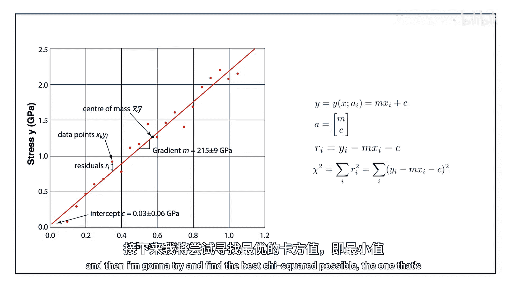

理解了拟合目标后，我们可以可视化 `χ²` 如何随 `m` 和 `c` 变化。下图是 `χ²` 关于 `m` 和 `c` 的等高线图。

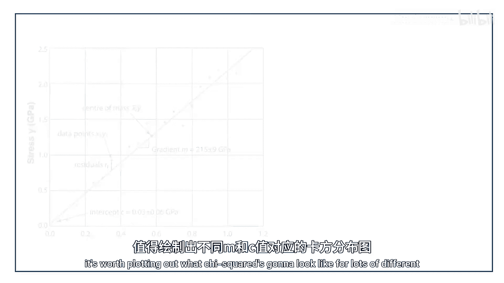

图中 `χ²` 的最小值出现在 `m ≈ 2.15`， `c ≈ 0` 附近。离这个点越远，`χ²` 值越大，拟合越差。注意，这个“山谷”是倾斜的，这意味着斜率 `m` 和截距 `c` 之间存在权衡：如果直线变陡（`m` 增大），为了更好拟合，截距 `c` 就需要变小，模型实际上是围绕数据质心 `(x̄， ȳ)` 旋转的。这个平缓的山谷对于梯度下降类算法可能是个挑战，容易快速下到谷底，但精确找到最低点则较难。

不过，这个问题整体上只有一个明显的最小值，因此是可解的。但通过穷举计算（如图中绘制等高线图需要约20万次计算）效率太低。更高效的方法是找到 `χ²` 的梯度为零的点：

**核心条件：** `∇χ² = 0`

对于这个简单线性回归问题，我们可以直接求出解析解。本视频将展示这一过程，后续课程则会介绍梯度下降法等数值方法，以处理更复杂、无法显式求解的情况。

## 推导解析解 📝

现在，我们通过求解 `∇χ² = 0` 来得到 `m` 和 `c` 的解析解。我们需要分别对 `m` 和 `c` 求偏导数并令其为零。

**对 `m` 求偏导：**
`∂χ²/∂m = Σᵢ 2 * [yᵢ - (m*xᵢ + c)] * (-xᵢ) = -2 Σᵢ xᵢ(yᵢ - m*xᵢ - c)`

**对 `c` 求偏导：**
`∂χ²/∂c = Σᵢ 2 * [yᵢ - (m*xᵢ + c)] * (-1) = -2 Σᵢ (yᵢ - m*xᵢ - c)`

令这两个偏导数等于零，并整理方程组（忽略常数因子-2），我们得到：

1.  `Σᵢ (yᵢ - m*xᵢ - c) = 0`
2.  `Σᵢ xᵢ(yᵢ - m*xᵢ - c) = 0`

由第一个方程，并利用平均值定义 `ȳ = (Σ yᵢ)/N`， `x̄ = (Σ xᵢ)/N`，可以推导出截距 `c` 的表达式：

**公式：** `c = ȳ - m * x̄`

这表明最优拟合直线必然穿过数据的质心 `(x̄， ȳ)`。将 `c` 的表达式代入第二个方程，经过代数运算（此处省略详细步骤），可以解出斜率 `m`：

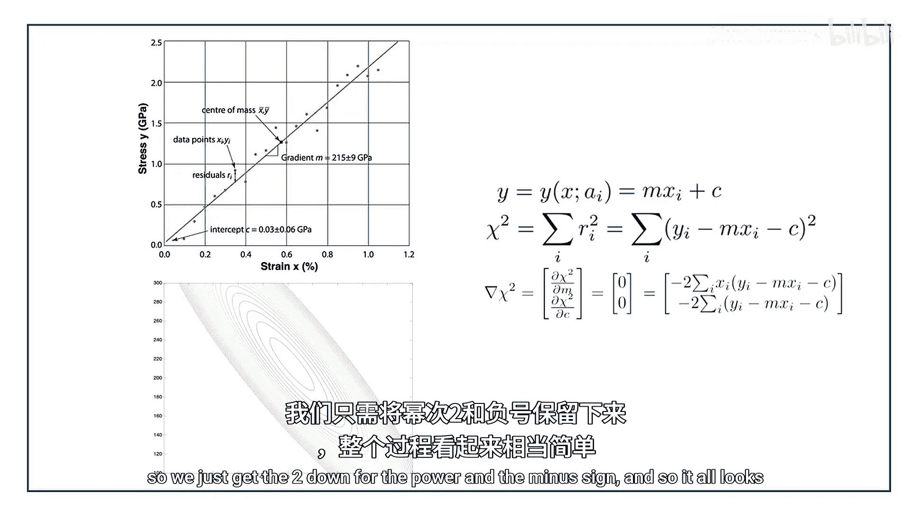

**公式：** `m = Σ[(xᵢ - x̄)(yᵢ - ȳ)] / Σ[(xᵢ - x̄)²]`

此外，我们还可以估计参数的不确定性（标准差）：

**公式：**
`σ_m² = (χ²/(N-2)) / Σ[(xᵢ - x̄)²]`
`σ_c² = σ_m² * [ (Σ xᵢ²)/N ]`

在报告拟合结果时，同时给出参数值及其不确定性至关重要。

## 结果验证与重要警示 ⚠️

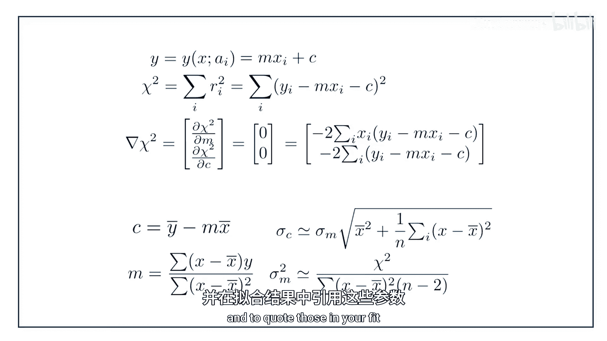

让我们回到拟合结果。下图再次展示了拟合直线。

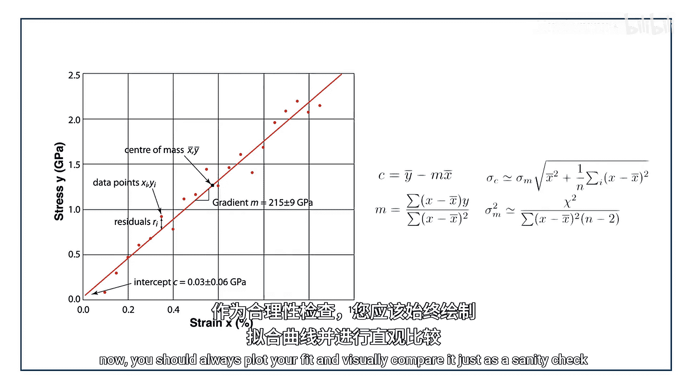

尽管数据存在噪声，我们得到的斜率 `m = 2.15 ± 0.09` 精度很高（不确定度约5%）。**始终应该将拟合结果与原始数据绘制在一起进行视觉检查**，这能帮助发现潜在问题。著名的**安斯库姆四重奏**（Anscombe‘s quartet）完美地阐释了这一点。

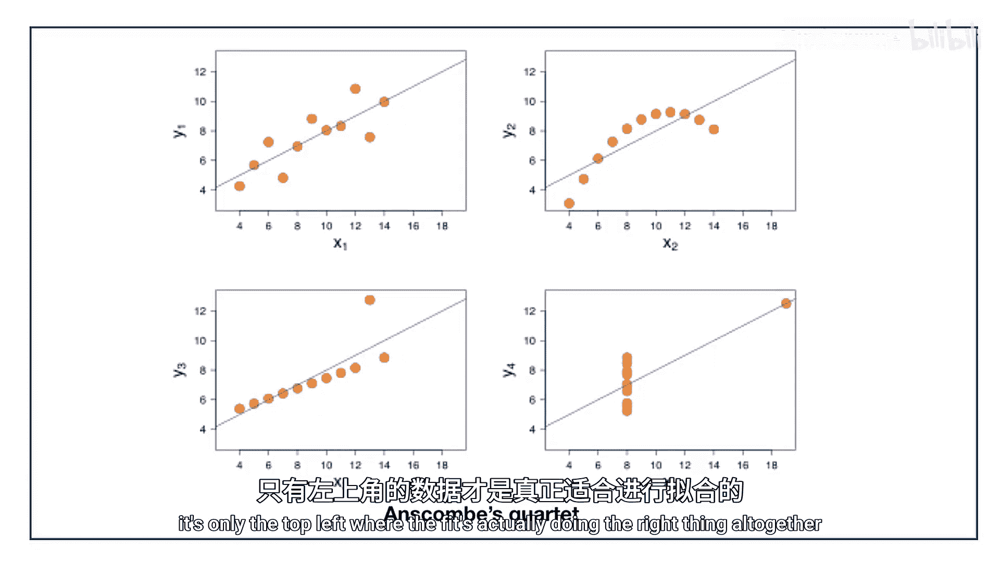

这四组数据拥有完全相同的统计特征（均值、最佳拟合直线、参数不确定性等），但数据分布截然不同。只有左上角的数据适合用直线拟合。右下两组数据明显需要用曲线拟合，而左下组数据中存在一个强影响力的离群点。这警示我们，不能仅仅依赖 `χ²` 等数值指标，可视化检查必不可少。

## 优化参数化：消除相关性 🔄

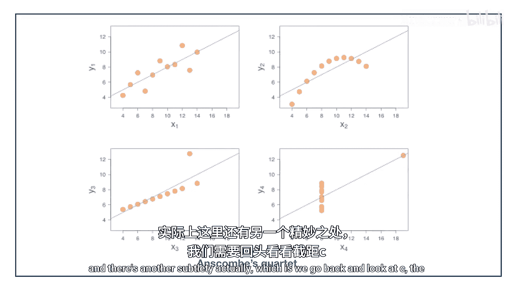

回顾之前 `χ²` 的倾斜山谷图，它揭示了 `m` 和 `c` 之间的相关性。这种相关性也体现在 `c` 的不确定性公式 `σ_c` 依赖于 `m` 上。我们可以通过重新参数化来消除这种相关性。

定义新的变量：`x’ = x - x̄`，即使用相对于质心 `x̄` 的偏差。此时，模型变为：
`y = m * (x - x̄) + b`
其中，新的常数项 `b` 恰好等于 `ȳ`。在这个参数化下：

*   常数项 `b` 不再依赖于斜率 `m`。
*   `b` 的不确定性 `σ_b` 也不再包含来自 `m` 的贡献。
*   此时 `χ²` 关于 `m` 和 `b` 的等高线图将不再是倾斜的，而更接近圆形，使优化问题在数学上更“良态”。

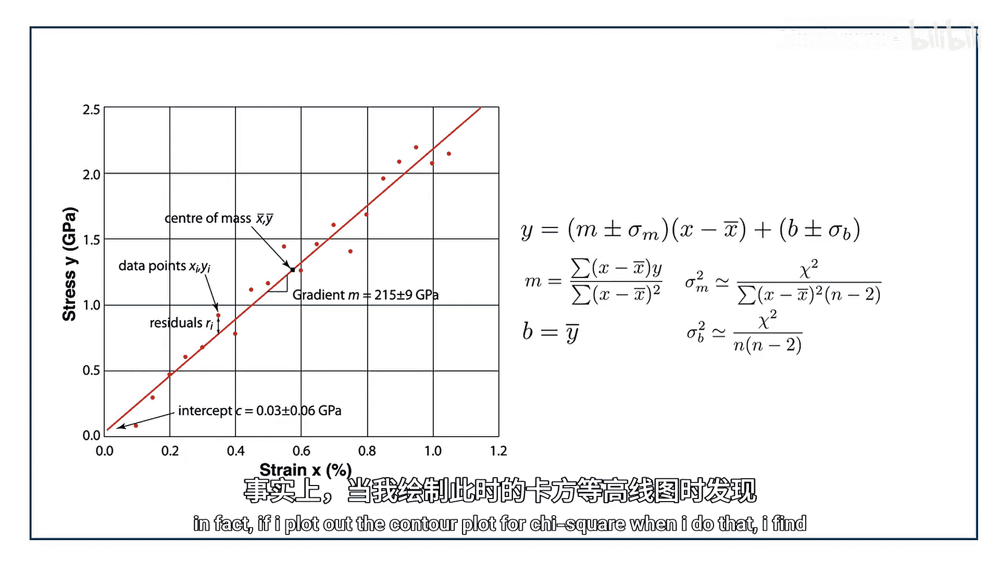

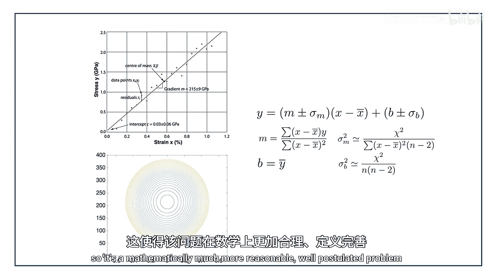

## 总结 📚

本节课我们一起学习了简单线性回归的核心内容：
1.  **目标**：通过最小化残差平方和 `χ²`，找到数据的最佳直线拟合。
2.  **方法**：推导并求解了模型参数 `m`（斜率）和 `c`（截距）的解析解，并了解了如何估计其不确定性。
3.  **关键步骤**：数据可视化检查至关重要，安斯库姆四重奏展示了仅依赖统计数字的风险。
4.  **优化技巧**：通过将数据中心化（减去均值），可以消除拟合参数之间的相关性，简化问题。

我们定义的核心拟合优度估计量 `χ²` 在未来处理更复杂的模型时将继续发挥重要作用。在接下来的课程中，我们将探索如何将这些思想扩展到拟合更复杂的函数以及多元回归等情况。