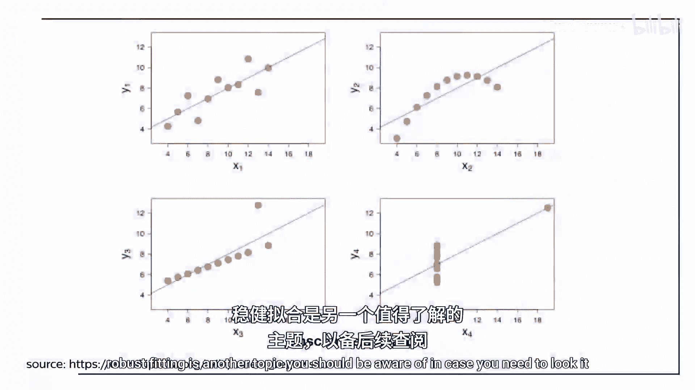
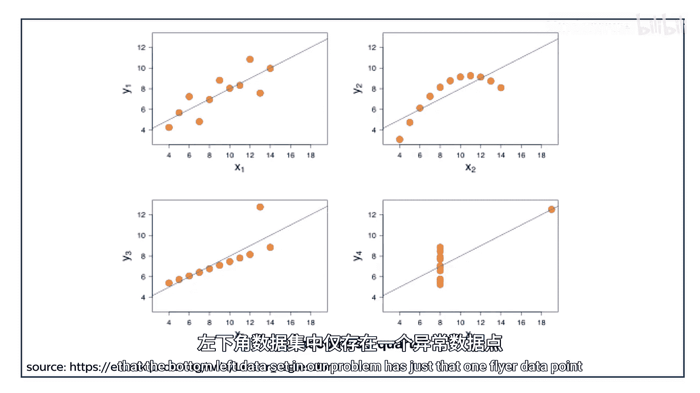
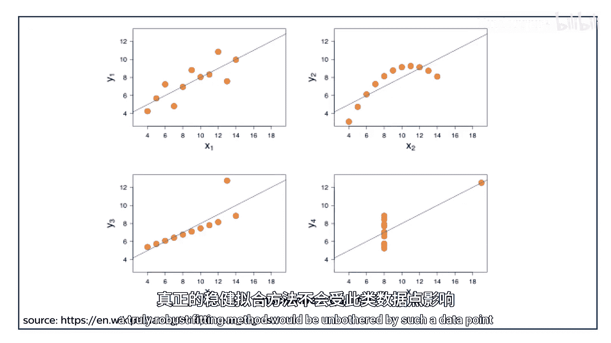
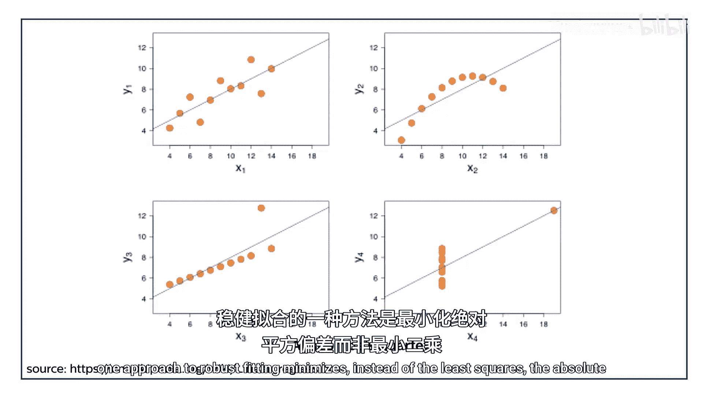
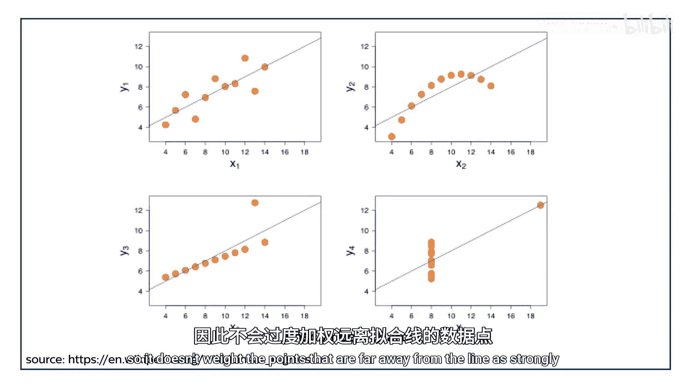
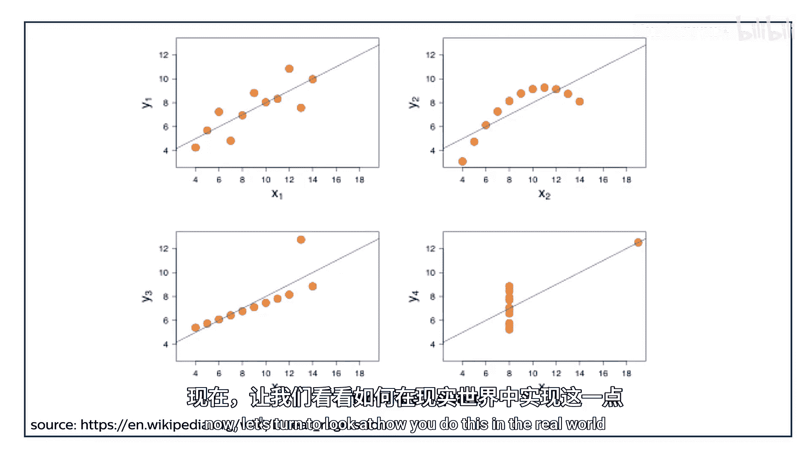

# 041：实践中进行最小二乘回归分析

在本节课中，我们将对数据的最小二乘回归拟合进行总结，并探讨如何在实践中使用 MATLAB、Python 或 R 等计算工具来完成这项工作。

上一节我们介绍了如何构建梯度下降法来最小化平方和，并解决了示例问题。在深入探讨之前，我们还需要做一些补充说明。

## 🧠 非线性最小二乘求解器

在实际应用中，存在大量用于求解非线性最小二乘问题的算法。

我们可以观察到，如果对 **χ²** 进行泰勒级数展开，其第二项（二阶导数）就是**海森矩阵**。海森矩阵提供了关于梯度（即雅可比矩阵的梯度）的曲率信息。

因此，我们可以像牛顿-拉夫森法那样，直接求解雅可比矩阵为零的点。使用海森矩阵会比单纯的梯度下降算法更快。本质上，我们会利用海森矩阵来预估梯度下降中应采取的步长。

然而，问题在于海森矩阵通常不够稳定，尤其是在远离最小值点时。

以下是几种常见的优化算法：

*   **列文伯格-马夸尔特方法**：在远离最小值时使用最速下降法，当接近最小值时（根据 χ² 是否改善的标准）切换到使用海森矩阵。
*   **高斯-牛顿法**和**BFGS法**：这两种方法以及其他许多算法，要么直接使用海森矩阵，要么在迭代过程中逐步构建海森矩阵的信息。

根据收敛情况，不同的方法可能各有优劣。

## 🛡️ 鲁棒拟合简介

鲁棒拟合是另一个你应该了解的主题，以备后续查阅。

回顾安斯康姆四重奏，我们看到左下角的数据集存在一个明显的离群点。一个真正鲁棒的拟合方法应不受此类数据点的影响。

一种鲁棒拟合的方法是，不再最小化最小二乘，而是最小化**绝对偏差**或**平方偏差**。这样不会给远离直线的点赋予过高的权重，从而能得到视觉上看起来更合理的拟合线。

## 💻 现实世界中的实践方法

现在，让我们来看看如何在现实世界中完成这项工作。

### 在 MATLAB 中

操作很简单。你只需使用屏幕顶部的“导入数据”选项卡导入数据，然后切换到“应用程序”选项卡并启动“曲线拟合”应用程序。你甚至可以符号化地定义自己的算法，需要选择一个初始猜测值，应用程序就会为你拟合函数。或者，你也可以使用预置的函数，这些函数已知其雅可比矩阵，因此会更快、更高效。

### 在 Python 中

在科学 Python（SciPy）模块集中，操作几乎同样简单。`scipy.optimize` 模块包含一个名为 `curve_fit` 的最小二乘曲线拟合优化器（视频下方提供了链接）。

伴随本视频，我们为你准备了一个 SciPy 拟合数据的示例，以便你了解如何使用它。它非常出色，拟合效果很好。拟合过程仅需三行代码（此处加粗显示）：两行定义函数，一行执行拟合。其余代码用于绘图、导入数据等。实际上，SciPy 中的这套例程是现代版 **MINPACK** 的实现，后者是由 Jorge Moré 在 1980 年发布的一套 FORTRAN 例程，并在《Numerical Recipes》一书中描述。现在做这些事情变得异常简单。

### 在 R 语言中

与 Python 类似，在 R 统计编程语言中，也有用于将模型非线性最小二乘拟合到数据的优化器。如果你喜欢用 R 处理数据，同样可以轻松完成所有这些工作。

## 📝 动手练习：拟合高斯分布

现在，我希望你编写一个 Python 代码块来拟合此处所示的高斯分布。

你需要提供一个初始猜测值。我们为你提供了人口身高分布的输入数据集，这就是我们在这两门课程中一直以示意图方式讨论的最终身高分布数据集。

你会发现，此处的平均身高 **B** 约为 178 厘米，该分布的特征宽度 **C** 约为 11 厘米。

此时，思考为什么需要初始猜测值很有用。如果我们从平均值为 100 厘米开始猜测，模型曲线将与数据完全不重叠。因此，当我们对 B 做微小调整时，χ² 不会有变化，导致 χ² 关于均值 B 的梯度为 0。算法将不知道朝哪个方向前进，我们无法得到有意义的雅可比矩阵或梯度值，因此算法无法找到最小值。

在进行任何数据拟合时，想出一个好的初始猜测方法至关重要。在这个例子中很简单，例如选择最大值所在的位置。同样重要的是，要将拟合结果与数据进行比较，并判断你是否相信最终的拟合。

## 🎯 总结

在本视频中，我们结束了关于结合使用向量和多元微积分来优化函数以及将数据拟合到函数的讨论。最终，计算变得非常简单，我们只需几行 Python、MATLAB 或 R 代码即可拟合函数。

但经过所有这些工作，你现在对这些算法底层的运作原理有了一定的理解。这意味着，当算法出错时（例如雅可比矩阵无意义），你将能更好地找出修复方法。同时，你也掌握了学习本机器学习专项课程下一门课程所需的全部数学知识。