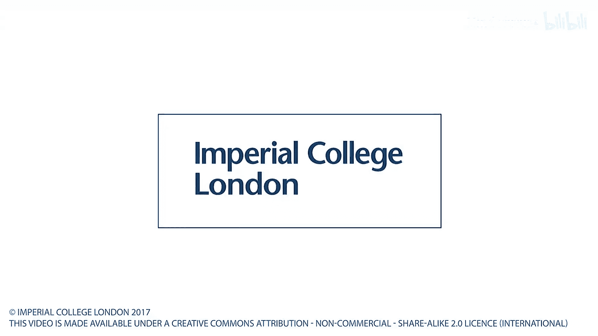

# 001：主成分分析PCA | 课程介绍

## 概述

在本节课中，我们将学习主成分分析（PCA）的数学基础，这是一种用于数据降维的经典线性方法。我们将从理解高维数据的挑战与特性开始，逐步推导PCA背后的核心数学原理。

## 高维数据的挑战与特性

现实中的数据通常是高维的。例如，预测未来房价时，我们需要考虑房屋类型、面积、卧室数量、社区房价、交通便利性、犯罪率、经济环境等诸多因素。另一个例子是一张640x480像素的彩色图片，每个像素包含红、绿、蓝三个颜色通道，因此每个数据点位于一个维度高达 $640 \times 480 \times 3 = 921,600$ 的空间中。

处理高维数据面临一些困难：分析难度大、解释性差、可视化几乎不可能，并且从实践角度看，存储成本可能非常高昂。

然而，高维数据也具备一些有利特性。例如，高维数据常常是“过完备”的，这意味着许多维度是冗余的，可以通过其他维度的组合来解释。以一张包含红、绿、蓝和灰度四个通道的彩色图片为例，灰度通道可以由其他三个通道组合而成，因此仅使用红、绿、蓝三个通道就足以完整地表示这张图片。

## 降维的目的与类比

降维技术利用数据中的结构和相关性，使我们能够使用更紧凑的形式来表示数据，理想情况下不丢失信息。

我们可以将降维视为一种压缩技术，类似于用于图像的JPEG或用于音乐的MP3压缩算法。以一个手写数字“8”的28x28像素二值图像为例，它可以表示为一个784维的向量。但在这个数据集中，像素值并非随机，而是具有结构性的——相邻像素的值通常相同。所有“8”的图像虽然略有差异，但足够相似，可以被识别为同一类别。降维可以帮助我们找到所有“8”图像的一个更低维度的表示，这种表示比原始的784维向量更易于处理。高维数据点的低维表示通常被称为“特征”或“代码”。

## 课程结构

本课程将深入探讨用于线性降维的经典算法——主成分分析（PCA）的数学推导细节。课程内容分为四个模块：

以下是四个核心模块的介绍：

1.  **数据统计表示**：我们将学习如何使用均值和方差等统计量来描述数据，并探讨数据经过线性变换后，其均值和方差如何变化。
2.  **向量空间几何**：我们将研究向量空间中的几何关系，定义如何计算向量之间的距离和夹角。
3.  **子空间投影**：我们将运用前面的结果，学习如何将数据投影到更低维度的子空间上。
4.  **PCA推导**：最后，我们将推导PCA，将其定义为一种使用正交投影来降低数据维度的方法。

## 总结

本节课我们一起介绍了主成分分析（PCA）的学习背景和目标。我们认识到高维数据带来的分析、可视化和存储挑战，也了解了其常有的冗余特性。降维，特别是PCA，正是利用这种冗余来寻找数据的紧凑表示。在接下来的课程中，我们将从数据统计、向量几何等数学基础开始，一步步构建起对PCA的完整理解。