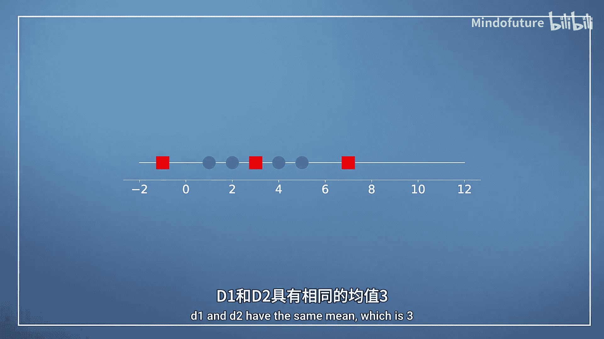

# 004：一维数据集的方差 📊

在本节课中，我们将要学习如何描述数据集的另一个重要属性——方差。上一节我们介绍了数据集的均值，它代表了数据的平均位置。本节中，我们来看看如何衡量数据点围绕均值的分散程度。

## 理解数据集的分散程度

让我们观察两个不同的数据集 D1 和 D2。

*   D1 由位于 1、2、4 和 5 的蓝色圆点表示。
*   D2 由位于 -1、3 和 7 的红色方块表示。

D1 和 D2 拥有相同的均值，都是 3。然而，D2 中的数据点比 D1 中的数据点更分散，离均值更远。均值代表了平均期望的数据点，但要描述数据点围绕均值的集中程度，我们可以使用方差的概念。

## 什么是方差？

方差用于表征数据集中数据点的变异性或分散程度。在一维情况下，我们可以计算数据点与数据集均值之间距离平方的平均值。

以下是计算 D1 和 D2 方差的具体步骤。

### 计算示例

**数据集 D1**：数据点为 1, 2, 4, 5，均值 μ = 3。

**数据集 D2**：数据点为 -1, 3, 7，均值 μ = 3。

首先计算 D1 的平均平方距离：
1.  计算每个数据点与均值的差，然后平方：
    *   (1 - 3)² = 4
    *   (2 - 3)² = 1
    *   (4 - 3)² = 1
    *   (5 - 3)² = 4
2.  将这些平方值求和：4 + 1 + 1 + 4 = 10
3.  除以数据点的数量（4），得到方差：10 / 4 = 2.5

接着计算 D2 的平均平方距离：
1.  计算每个数据点与均值的差，然后平方：
    *   (-1 - 3)² = 16
    *   (3 - 3)² = 0
    *   (7 - 3)² = 16
2.  将这些平方值求和：16 + 0 + 16 = 32
3.  除以数据点的数量（3），得到方差：32 / 3 ≈ 10.67

D2 的方差（约10.67）大于 D1 的方差（2.5）。这表明 D2 数据点与均值的平均平方距离更大，即 D2 中的数据比 D1 中的数据更为分散。

## 方差的正式定义

我们可以将上述计算过程形式化。假设我们有一个包含 N 个数据点的数据集 **X** = {x₁, x₂, ..., x_N}，其均值为 μ。

该数据集的方差定义为：

**公式：**
`方差(σ²) = (1/N) * Σ_{n=1}^{N} (x_n - μ)²`

这个公式所做的，正是我们之前为 D1 和 D2 所做的计算：计算数据集中所有数据点与均值之差的平方的平均值。

## 方差与标准差

关于方差，有几点需要注意：
*   根据定义，方差永远不会是负数，因为我们求和的是平方值。
*   我们可以对方差取平方根，得到的结果称为**标准差**。

**公式：**
`标准差(σ) = √方差`

标准差与均值使用相同的单位，而方差的单位是原始单位的平方。因此，在讨论数据的分散程度时，使用标准差通常更为直观和方便。

## 总结

本节课中我们一起学习了一维数据集的方差。我们了解到，方差是衡量数据点围绕均值分散程度的重要指标，它通过计算数据点与均值距离平方的平均值来获得。同时，我们引入了标准差的概念，它是方差的平方根，与数据具有相同的单位，便于直接理解和比较数据的波动性。下一节，我们将把方差的概念推广到更高维度的数据中。