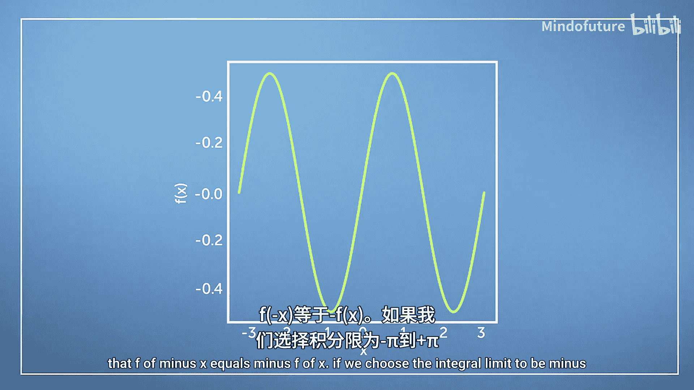

# 015：函数与随机变量的内积（可选）

在本节课中，我们将学习内积概念在两种特殊对象上的应用：连续函数和随机变量。我们将看到，即使对于这些非向量的对象，内积依然能帮助我们定义长度、角度和正交性，从而获得几何直观。

## 函数的内积

上一节我们介绍了有限维向量空间的内积性质。本节中，我们来看看内积概念如何推广到连续函数。

我们之前讨论的内积是针对具有有限个分量的向量定义的，这些向量可以看作是具有有限个函数值的离散函数。内积的概念同样可以推广到连续值函数，此时向量分量的求和就变成了积分。

两个函数 **u** 和 **v** 的内积定义如下：

⟨u, v⟩ = ∫ab u(x) v(x) dx

与普通的内积一样，我们可以通过这个内积来定义范数和正交性。如果上述积分的结果为0，则函数 **u** 和 **v** 是正交的。

让我们看一个例子。

如果我们选择：
*   **u(x) = sin(x)**
*   **v(x) = cos(x)**

并定义 **f(x) = u(x) v(x) = sin(x) cos(x)**，我们会得到下图所示的函数。

这个函数是奇函数，意味着 **f(-x) = -f(x)**。如果我们选择积分限为 **-π** 到 **+π**，那么这个乘积 **sin(x) cos(x)** 的积分结果为0。

这意味着 **sin** 和 **cos** 是正交的。事实上，如果我们观察一组函数，例如 **1, cos(x), cos(2x), cos(3x), ...**，在从 **-π** 到 **+π** 的积分下，所有这些函数彼此都是正交的。

## 随机变量的内积

另一个在内积定义中不常见的对象是随机变量或随机向量。

如果我们有两个不相关的随机变量，我们知道以下关系成立：**Var(X + Y) = Var(X) + Var(Y)**，其中 **X** 和 **Y** 是随机变量。

由于方差是以平方单位度量的，这个公式看起来非常像直角三角形的勾股定理：**c² = a² + b²**。

让我们看看是否能找到不相关随机变量方差关系的几何解释。

随机变量可以被视为向量空间中的向量，我们可以定义内积来获得这些随机变量的几何性质。

如果我们定义两个随机变量 **X** 和 **Y** 的内积为它们的协方差：**⟨X, Y⟩ = Cov(X, Y)**，我们可以看到协方差满足对称性、正定性和线性。

线性意味着：**Cov(λX + Y, Z) = λ Cov(X, Z) + Cov(Y, Z)**，其中 **X, Y, Z** 是随机变量，**λ** 是实数。

一个随机变量的“长度”定义为：

∥X∥ = √⟨X, X⟩ = √Cov(X, X) = √Var(X) = σX

这恰好是随机变量 **X** 的标准差。因此，零向量是一个没有不确定性的向量，即标准差为0。

现在，如果我们看两个随机变量之间的夹角，会得到以下关系：

cos θ = ⟨X, Y⟩ / (∥X∥ ∥Y∥)

根据我们内积的定义将其展开：

cos θ = Cov(X, Y) / (√Var(X) √Var(Y))

当且仅当 **Cov(X, Y) = 0** 时，这个值为0，即 **X** 和 **Y** 不相关。

现在回到我们的几何解释。我们可以将 **a** 替换为 **X** 的标准差 **σX**，将 **b** 替换为 **Y** 的标准差 **σY**，将 **c** 替换为 **√(Var(X) + Var(Y))**。

这样我们就得到了随机变量的几何解释。

## 总结

本节课中，我们一起学习了内积在两种特殊对象——函数和随机变量——上的应用。尽管这些对象与常规向量不同，但内积仍然允许我们思考这些对象的长度和夹角。在随机变量的例子中，我们看到两个不相关随机变量之和的方差，可以利用勾股定理进行几何解释。这再次展示了内积作为统一数学工具的强大之处。