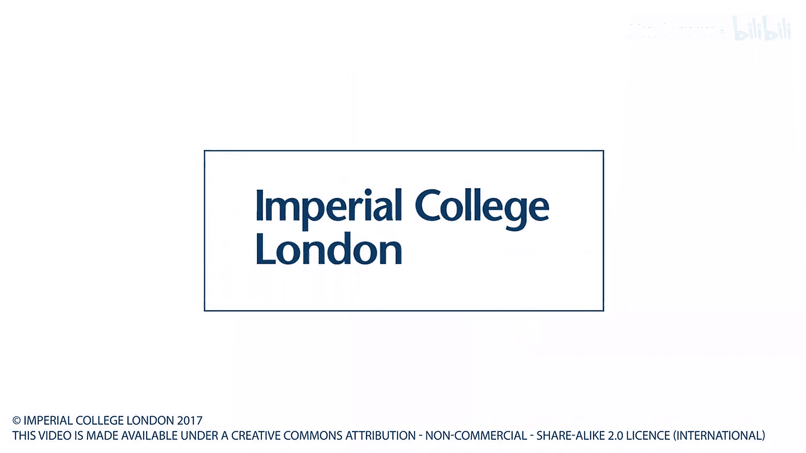

# 017：03_01_01

在本节课中，我们将要学习高维数据的一个核心特性，并引出降维技术的基本思想。高维数据通常难以分析和可视化。然而，高维数据常常具有一个特性：只有少数几个维度包含了大部分信息，而其他大多数维度对于描述数据的关键属性并非必需。

当我们压缩或可视化高维数据时，会不可避免地丢失信息。因此，我们的目标是找到数据中最具信息量的维度，在压缩数据时保留它们，同时忽略不相关的维度。

在本课程中，我们将深入探讨正交投影，它在降维算法中扮演着核心角色。

---

## 高维数据的挑战与机遇 🧩

上一节我们提到了高维数据处理的总体目标。本节中，我们来看看高维数据面临的具体挑战及其内在特性。

高维数据通常难以分析或可视化。这主要是因为人类难以直观理解超过三维的空间。

然而，高维数据通常具备一个重要特性：仅有少数维度包含了绝大部分信息。数据的关键属性可以由这些少数“信息丰富”的维度来描述。

大多数其他维度对于描述数据的关键属性并非必需。这些维度可能只包含噪声、冗余信息或微小的变化。

---

## 降维的核心思想：保留信息 📉

上一节我们介绍了高维数据“内在维度低”的特性。本节中我们来看看如何利用这一特性进行数据压缩。

当我们压缩或可视化高维数据时，总会丢失一部分信息。这是一个不可避免的权衡。

因此，关键在于找到数据中最具信息量的维度。我们的目标是识别出那些承载了数据主要结构和模式的维度。

在压缩数据时，我们保留这些最具信息量的维度。它们是数据本质特征的代表。

同时，我们忽略那些不相关的维度。这些维度通常对理解数据的核心模式贡献甚微，舍弃它们可以简化问题而不损失关键信息。

---

## 正交投影：降维的数学基础 📐

前面我们讨论了降维的总体策略。本节将介绍实现这一策略的一个核心数学工具——正交投影。

在降维算法中，正交投影扮演着核心角色。它提供了一种将数据从高维空间映射到低维子空间的严谨数学方法。

通过正交投影，我们可以将数据点投射到一个由选定维度（或称“主成分”）张成的低维平面上，并确保投影后的点与原点的距离（即投影误差）最小化。这通常通过以下步骤实现：
1.  数据中心化：确保数据的均值为零。
2.  计算协方差矩阵：`Σ = (1/(n-1)) * X^T * X`，其中 `X` 是中心化后的数据矩阵。
3.  特征值分解：对协方差矩阵 `Σ` 进行分解，得到特征值和特征向量。
4.  选择主成分：选取前 `k` 个最大特征值对应的特征向量，构成投影矩阵 `W`。
5.  数据投影：将原始数据投影到新的低维空间 `Y = X * W`。

这种方法（即主成分分析，PCA）能确保在降维后保留数据中最大程度的方差（即信息）。

---

## 总结

本节课中我们一起学习了高维数据处理的基本概念。我们认识到高维数据虽然难以直接处理，但其内在维度往往较低。降维的目标是在压缩数据时，有选择地保留信息量最大的维度，舍弃不相关的维度。正交投影是实现这一目标的强大数学工具，为后续学习主成分分析等具体降维算法奠定了重要的理论基础。