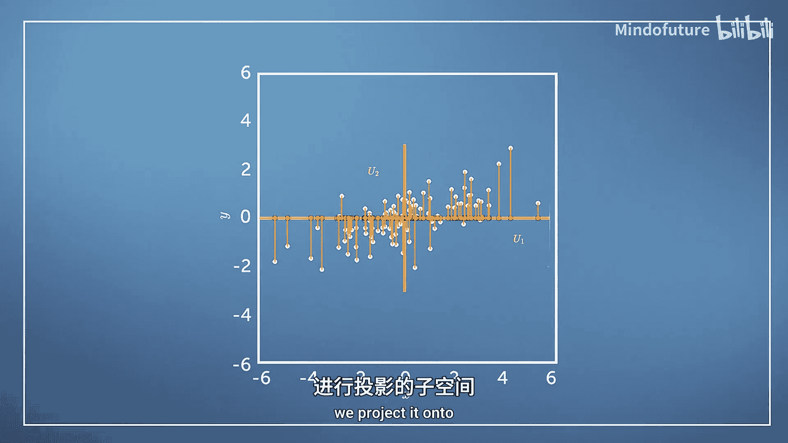

# 026：目标的重新表述

## 概述
在本节中，我们将重新表述主成分分析（PCA）的损失函数。我们将看到，最小化重构误差等价于最大化投影后保留的数据方差，并且损失函数可以简洁地用数据协方差矩阵来表示。这为我们下一步寻找最优基向量奠定了基础。

## 投影坐标回顾
在上一节中，我们确定了数据点在其主成分子空间上的最优投影坐标。

在继续求解最优基向量之前，我们先重新表述一下损失函数。

以下是目前已有的结果：数据点的投影描述、损失函数、损失函数对投影数据点的偏导数，以及上一节中找到的最优坐标。

## 位移向量的分析
在求解最优基向量之前，重新表述损失函数将使问题变得更简单。

为此，让我们仔细分析原始数据点与其投影数据点之间的差向量。

投影数据点 **x̃ₙ** 由公式A给出：
```
x̃ₙ = Σⱼ₌₁ᴹ βⱼₙ * bⱼ
```
如果我们使用上一节得到的最优参数 βⱼₙ 的结果，可以得到：
```
x̃ₙ = Σⱼ₌₁ᴹ (xₙᵀ * bⱼ) * bⱼ
```
我们可以按以下方式重写这个表达式。点积是对称的，因此我们可以交换顺序，并将标量移到前面。最终得到：
```
x̃ₙ = Σⱼ₌₁ᴹ bⱼ * bⱼᵀ * xₙ
```
我们可以将 **xₙ** 提到求和符号外面：
```
x̃ₙ = (Σⱼ₌₁ᴹ bⱼ * bⱼᵀ) * xₙ
```
观察这个式子，括号内的部分是一个**投影矩阵**。这意味着 **x̃ₙ** 是 **xₙ** 在由基向量 **bⱼ** (j=1,...,M) 张成的子空间上的正交投影。


类似地，我们可以将原始数据点 **xₙ** 完整地写为在主成分子空间及其正交补空间上的投影之和：
```
xₙ = (Σⱼ₌₁ᴹ bⱼ * bⱼᵀ) * xₙ + (Σⱼ₌ₘ₊₁ᴰ bⱼ * bⱼᵀ) * xₙ
```
第一部分是投影到主成分子空间的部分，第二部分是投影到其正交补空间的部分。而 **x̃ₙ** 正是缺少了第二部分，因此它是 **xₙ** 的一个近似。

现在，如果我们观察 **xₙ** 和 **x̃ₙ** 之间的差向量，剩下的部分正好是正交补空间上的投影：
```
xₙ - x̃ₙ = Σⱼ₌ₘ₊₁ᴰ bⱼ * bⱼᵀ * xₙ
```
这个位移向量完全位于我们忽略的子空间，即主成分子空间的正交补空间中。

## 直观示例
让我们看一个二维空间的例子。假设我们有一个二维数据集，由下图中的点表示。



现在，我们感兴趣的是将它们投影到 **u₁** 子空间上。当我们这样做并观察原始数据与投影数据之间的差向量时，我们得到这些垂直线。这意味着它们在 **u₁** 方向（x方向）上没有分量或变化。它们只存在于 **u₂** 子空间中的分量，而 **u₂** 正是我们投影目标子空间 **u₁** 的正交补空间。

## 损失函数的重新表述
我们分析了数据点与其在主成分子空间上投影之间的位移向量。现在，我们将利用这个结果来重新表述损失函数。

根据公式B，我们的损失函数是平均平方重构误差：
```
L = (1/N) * Σₙ₌₁ᴺ ||xₙ - x̃ₙ||²
```
现在，我们使用公式E（位移向量的表达式）来重写它：
```
L = (1/N) * Σₙ₌₁ᴺ || Σⱼ₌ₘ₊₁ᴰ (bⱼᵀ * xₙ) * bⱼ ||²
```
由于 **bⱼ** 构成一组标准正交基，这个表达式可以大大简化。利用标准正交基的性质，向量的范数平方等于其各分量系数的平方和：
```
L = (1/N) * Σₙ₌₁ᴺ Σⱼ₌ₘ₊₁ᴰ (bⱼᵀ * xₙ)²
```
接下来，我们将其明确展开：
```
L = (1/N) * Σₙ₌₁ᴺ Σⱼ₌ₘ₊₁ᴰ (bⱼᵀ * xₙ) * (xₙᵀ * bⱼ)
```
现在，我们重新排列求和顺序，将关于 **j** 的求和移到外面：
```
L = Σⱼ₌ₘ₊₁ᴰ bⱼᵀ * [ (1/N) * Σₙ₌₁ᴺ xₙ * xₙᵀ ] * bⱼ
```
仔细观察，我们可以识别出括号内的表达式正是**数据协方差矩阵 S**（因为我们假设数据已经中心化，均值为0）。因此，我们可以用数据协方差矩阵来重写损失函数：
```
L = Σⱼ₌ₘ₊₁ᴰ bⱼᵀ * S * bⱼ
```
我们还可以通过重新排列项和使用迹运算符，得到另一种略有不同的解释：
```
L = trace( Σⱼ₌ₘ₊₁ᴰ bⱼ * bⱼᵀ * S )
```
这里的矩阵 `Σⱼ₌ₘ₊₁ᴰ bⱼ * bⱼᵀ` 是一个**投影矩阵**。它将我们的数据协方差矩阵投影到主成分子空间的正交补空间上。

因此，损失函数的这种重新表述意味着：**最小化重构误差等价于最小化被投影到我们忽略的子空间（正交补空间）上的数据的方差**。换句话说，我们的目标是使投影后保留的方差尽可能大。

## 总结
在本节中，我们一起学习了如何将PCA的平均平方重构误差损失函数，重新表述为关于数据协方差矩阵的形式。我们发现，最小化损失等价于最小化数据在主成分子空间正交补空间上的方差，这反过来意味着我们要最大化投影后主成分子空间内保留的方差。这个重新表述为我们下一节寻找主成分子空间的最优基向量提供了一条清晰的路径。


