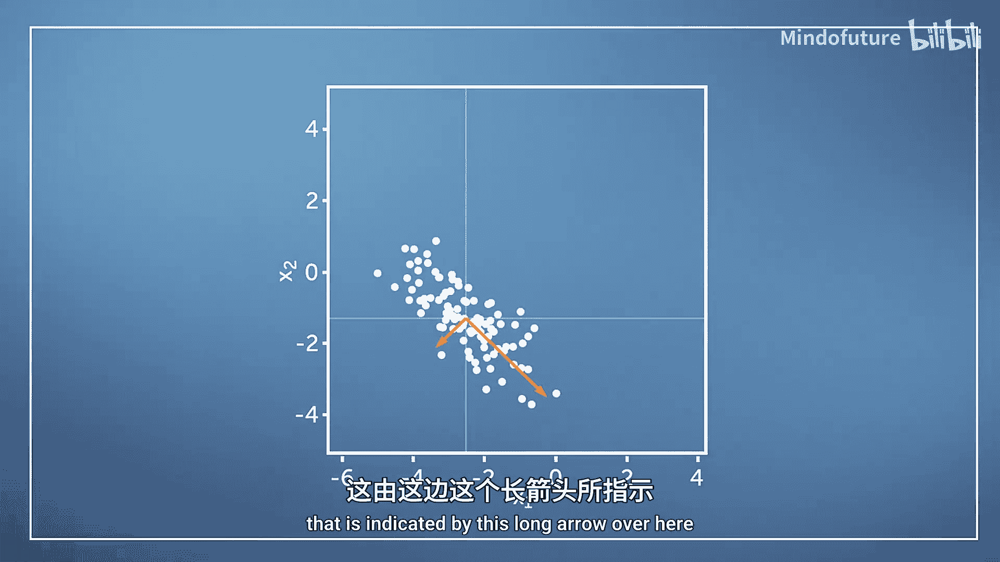

# 027：找到构成主子空间的基础向量

在本节课中，我们将学习如何为主成分分析（PCA）中的主子空间找到一个正交规范基。我们将利用最小化平均平方重构误差等价于最小化数据在忽略子空间上投影的方差这一结论，并通过求解特征值问题来确定基向量。

## 概述

上一节我们介绍了最小化平均平方重构误差等价于最小化数据在PCA将要忽略的子空间上的投影方差。本节中，我们将利用这一见解，并运用之前的结果，来确定m维主子空间的一个正交规范基。

## 损失函数与优化问题

我们可以将损失函数写为：
`J = Σ_{j=m+1}^{D} b_j^T S b_j`
其中 `S` 是数据的协方差矩阵。最小化这个目标函数需要我们找到张成我们将忽略的子空间的正交规范基。当我们得到这个基后，取其正交补作为主子空间的基。

一个子空间 `U` 的正交补由原始向量空间中所有与 `U` 中每个向量都正交的向量组成。

## 从二维示例开始

让我们从一个示例开始确定基向量 `b`。我们从二维情况开始，我们希望找到一个一维子空间，使得数据投影到该子空间上的方差最小。

我们寻找 `R^2` 中的两个基向量 `b1` 和 `b2`。`b1` 将张成主子空间，而 `b2` 是其正交补，也就是我们将忽略的子空间。我们还有约束条件：`b1` 和 `b2` 是正交规范的，这意味着 `b_i^T b_j = δ_{ij}`（当 `i=j` 时为1，否则为0）。

在我们的例子中，损失函数是：
`J = b_2^T S b_2`
约束条件是：
`b_2^T b_2 = 1`

为了求解这个优化问题，我们写出拉格朗日函数：
`L(b_2, λ) = b_2^T S b_2 + λ(1 - b_2^T b_2)`
其中 `λ` 是拉格朗日乘子。

接下来，我们计算 `L` 对 `b_2` 和 `λ` 的梯度，并令它们为零。

*   对 `λ` 的偏导：`∂L/∂λ = 1 - b_2^T b_2 = 0`。这等价于恢复了我们的约束条件 `b_2^T b_2 = 1`。
*   对 `b_2` 的偏导：`∂L/∂b_2 = 2 b_2^T S - 2λ b_2^T = 0`。这等于零当且仅当 `S b_2 = λ b_2`。

我们最终得到了一个特征值问题。`b_2` 是数据协方差矩阵 `S` 的一个特征向量，而拉格朗日乘子 `λ` 扮演了对应特征值的角色。

现在回到损失函数，我们可以利用这个表达式重写 `J`：
`J = b_2^T S b_2 = b_2^T (λ b_2) = λ (b_2^T b_2) = λ`
由于我们有正交规范基，`b_2^T b_2 = 1`。

因此，**当 `λ` 是数据协方差矩阵的最小特征值时，平均平方重构误差被最小化**。这意味着我们需要选择 `b_2` 作为对应的特征向量，它将张成我们将忽略的子空间。

而张成主子空间的 `b_1`，则是属于数据协方差矩阵最大特征值的特征向量。由于协方差矩阵的对称性，其特征向量彼此正交。

在一个二维数据示例中，最佳投影（即保留最多信息的投影）是将数据投影到由属于最大特征值的特征向量所张成的子空间上，如图中长箭头所示。

## 推广到一般情况

现在，让我们看一般情况。如果我们想找到一个D维数据集的m维主子空间，并求解基向量 `b_j`（其中 `j = m+1, ..., D`），我们优化这些向量。

我们会得到与之前简单示例中相同类型的特征值问题：
`S b_j = λ_j b_j`，对于 `j = m+1, ..., D`。

损失函数由对应的特征值之和给出：
`J = Σ_{j=m+1}^{D} λ_j`

同样，在一般情况下，**如果我们选择张成被忽略子空间的基向量为数据协方差矩阵中属于最小特征值的特征向量，那么平均重构误差就被最小化**。

这等价地意味着，**主子空间是由属于数据协方差矩阵前m个最大特征值的特征向量所张成的**。

这与协方差矩阵的性质完美契合：
*   由于对称性，协方差矩阵的特征向量彼此正交。
*   属于最大特征值的特征向量指向数据方差最大的方向，该方向上的方差由对应的特征值给出。
*   属于第二大特征值的特征向量指向数据第二大方差的方向，依此类推。

## 总结

本节课中，我们一起学习了如何确定PCA主子空间的正交规范基。我们通过求解一个受约束的优化问题，发现**主子空间的基正是数据协方差矩阵中与最大特征值相关联的特征向量**。而损失函数（重构误差）的值等于被忽略的特征值之和。这为PCA算法提供了坚实的数学基础。

在下一节视频中，我们将把所有部分整合起来，详细讲解PCA算法的完整步骤。